# Infographic Visual Formatting Guide — GitHub Markdown

> **Scope:** Mandatory presentation standard for all learning notes, road map modules, and lesson files in this workspace.  
> **Target Environment:** GitHub-Flavored Markdown (GFM) web preview and mobile app.  
> **Golden Invariant:** **NEVER drop, summarize, or alter existing educational text.** All visual engineering is strictly an additive styling layer over 100% of the content.

---

## 🎨 The Semantic Color Palette

Every color in this design system carries a consistent semantic meaning across all lessons:

| Tone | Hex Code | Visual Identity | Semantic Purpose & Usage |
| :--- | :---: | :---: | :--- |
| **Royal Navy** | `#0D47A1` / `#1565C0` | 🔵 | Master H1 Titles, Stage 0, Core Architecture, Python Engine, Interpreter. |
| **Cyan / Sky** | `#0288D1` / `#01579B` | 🔷 | "Builds on" anchors, client-side requests, introductory concepts. |
| **Teal / Emerald** | `#00695C` / `#00897B` | 🟢 | Stage 1 Simple Ideas, "Unlocks" anchors, safe/idiomatic paths, outputs. |
| **Forest Green** | `#1B5E20` / `#2E7D32` | 📗 | Quick Reference, package management (`pip`, `venv`), verified solutions, best practices. |
| **Amber / Rust** | `#BF360C` / `#D84315` | 🟠 | Stage 2 Mechanism, How It Works, step numbers, hardware/CPU execution. |
| **Deep Purple** | `#4A148C` / `#512DA8` | 🟣 | Key Terms / Vocabulary, "The Aha!" insight, AI Engineering connections. |
| **Crimson / Rose** | `#B71C1C` / `#D32F2F` | 🔴 | Traps, gotchas, STOP checkpoint questions, anti-patterns, error tables. |
| **Magenta / Plum**| `#880E4F` / `#AD1457` | 🛑 | Common Errors & Fixes, debugging headers, failure modes. |

---

## 🏷️ 1. Lesson Header & Navigation Standard

Every lesson must begin with a standardized 4-badge metadata row followed by the breadcrumb navigation bar:

```markdown
# $\Huge\color{#0D47A1}{\textsf{01 — How Python Runs and Setup}}$

[](https://www.python.org/)
[](README.md)
[](../../AI%20Engineer%20Architect%20Road%20Map.md)
[](#)

> $\color{#546E7A}\mathbf{Navigation:}$ **Phase 0** · **Module 0.1** · **Lesson 1 of 16** · [Phase 0.1 — Python Index](README.md) · [Next: 02 Variables, Types & Operators →](02%20Variables%20Types%20and%20Operators.md)

---
```

---

## 🏷️ 2. Section Headings (Infographic Badges & Prominent Chapter Anchors)

Every major section begins with an executive Shields.io stage badge followed by its prominent `\Large` KaTeX H2 header:

```markdown


## 🗺️ $\Large\color{#0D47A1}\blacksquare\space\color{#1565C0}{\textsf{Stage 0 — Concept Map}}$


## 🔑 $\Large\color{#4A148C}\blacksquare\space\color{#6A1B9A}{\textsf{New Terms (Plain English)}}$


## 🎈 $\Large\color{#00695C}\blacksquare\space\color{#00897B}{\textsf{Stage 1 — The Simple Idea}}$


## ⚙️ $\Large\color{#BF360C}\blacksquare\space\color{#D84315}{\textsf{Stage 2 — How It Actually Works}}$


## 🚀 $\Large\color{#0D47A1}\blacksquare\space\color{#1565C0}{\textsf{Stage 3 — In Practice / Why It Matters}}$


## ⚖️ $\Large\color{#00695C}\blacksquare\space\color{#00838F}{\textsf{Variations and When to Use}}$


## 🐛 $\Large\color{#880E4F}\blacksquare\space\color{#AD1457}{\textsf{Common Errors and Fixes}}$


## 📌 $\Large\color{#1B5E20}\blacksquare\space\color{#2E7D32}{\textsf{Quick Reference}}$


## 🛑 $\Large\color{#B71C1C}\blacksquare\space\color{#D32F2F}{\textsf{STOP — Self-Check}}$
```

---

## 🔠 3. Colored Headings & Subheadings (KaTeX Typography & Sizing)

Use KaTeX math formulas within Markdown headers. Always wrap title text in `\textsf{...}` to use a clean sans-serif font rather than italicized math variables. Use `\Large` for H2 chapter anchors and `\large` for H3 subsections:

```markdown
# $\Huge\color{#0D47A1}{\textsf{Master Title Here}}$

## 🗺️ $\Large\color{#0D47A1}\blacksquare\space\color{#1565C0}{\textsf{Stage 0 — Concept Map}}$

### $\large\color{#D84315}\blacktriangleright\space\color{#BF360C}{\textsf{1.1 Subsection Title Here}}$

#### $\color{#4527A0}\blacklozenge\space\color{#283593}{\textsf{(a) Detailed Step / Variation Here}}$
```

> [!CAUTION]
> ### 🛑 GitHub KaTeX Sanitizer Rules (CRITICAL GOTCHAS)
> 1. **NEVER use `&` or `\&` inside math blocks (`$...$` or `$$...$$`):**  
>    GitHub's markdown pre-processor converts `&` into `&amp;` *before* KaTeX runs. KaTeX chokes on the `&` in `&amp;` and displays a fatal red error box: `'&' can not be used here`. **Always use the plain English word `and` instead of `&` inside all KaTeX blocks.**
> 2. **NEVER use math inside HTML tags (like `<summary>...</summary>`):**  
>    GitHub treats raw HTML elements literally and does NOT parse math inside `<summary>`, `<details>`, `<div>`, or `<span>`. Putting `\color{...}` inside `<summary>` prints the raw unrendered LaTeX string. Keep `<summary>` in clean bold Markdown (e.g., `<summary><b>🔍 Click to Reveal...</b></summary>`), and place KaTeX inside the dropdown body after a blank line.
> 3. **NEVER wrap `\texttt` inside `\mathbf` or `\textbf`:**  
>    Computer Modern Typewriter has no bold font metrics in KaTeX (`Font metrics not found for font: Typewriter-Bold`). To style code keywords or parameters, use `\color{#HEX}\texttt{...}` alone.
> 4. **NEVER use literal `_` or `\textunderscore` inside KaTeX `\textsf` or `\texttt`:**  
>    GitHub's CommonMark parser strips single backslashes (`\_` &rarr; `_`), causing KaTeX to throw `'_' allowed only in math mode`, while `\textunderscore` triggers `\textunderscore is only supported in math mode`.  
>    - **In Headings:** Keep code identifiers with underscores OUTSIDE KaTeX using native Markdown backticks (e.g., `#### $\color{#D84315}\blacktriangleright\space\color{#BF360C}{\textsf{Slashing RAM Overhead with}}$ `__slots__``).  
>    - **In Tables:** Code invocations and signatures should use native Markdown code backticks (e.g., `` `connect_db(...)` `` or `` `def save_checkpoint() -> None:` ``) for clean syntax styling, zero parsing failures, and easy copy-pasting.  
>    - **In KaTeX Syntax Breakdown Diagrams:** When an identifier in `\texttt{...}` requires an underscore (e.g., `process_embedding` or `max_words`), use `\rule{0.45em}{0.08ex}` (e.g. `\texttt{max\rule{0.45em}{0.08ex}words}`). It renders an exact monospace baseline underscore without using any underscore character, ensuring 100% crash-proof rendering on GitHub.
> 5. **KEEP Emojis OUTSIDE math blocks:**  
>    Unicode emojis do not exist in KaTeX font metrics and cause symbol metric warnings or rendering glitches. Place emojis in standard markdown outside `$...$` (e.g. `## 🎈 $\Large...$`).
> 6. **Always wrap words in `\textsf{...}`:**  
>    To prevent math mode from rendering text as italicized algebra variables, wrap readable labels in `\textsf{...}`.
> 7. **Use `\space` for spaces:**  
>    Math mode collapses whitespace by default; insert `\space` between words outside `\text{...}`.
> 8. **NEVER use raw asterisks (`*` or `**`) in headings or code callouts inside KaTeX:**  
>    CommonMark interprets `*` and `**` as Markdown emphasis (italic/bold) delimiters across headings and blocks, mutating them into underscores (`_`) before KaTeX executes, causing fatal `'_' allowed only in math mode` errors. Keep `*`, `**`, `*args`, and `**kwargs` OUTSIDE KaTeX using native Markdown backticks (e.g. `#### $\color{#D84315}\blacktriangleright\space\color{#BF360C}{\textsf{Unpacking at Call Time}}$ (`*` for iterables)`). Inside syntax breakdown KaTeX formulas, always use `\ast` or `\ast\ast` instead of ASCII `*`.

---

## 🔹 4. Colored Bullets & List Accents

Replace plain gray Markdown list markers (`-` or `*`) with KaTeX colored geometric shapes:

```markdown
* $\color{#0288D1}\blacktriangleright$ **$\color{#01579B}{\textsf{Builds on:}}$** Prerequisite concept here.
* $\color{#00897B}\blacktriangleright$ **$\color{#004D40}{\textsf{Unlocks:}}$** Subsequent concept here.
* $\color{#2E7D32}\bullet$ **$\color{#1B5E20}{\textsf{Feature:}}$** Safe, recommended behavior here.
* $\color{#D32F2F}\blacktriangleright$ **$\color{#B71C1C}{\textsf{Pitfall:}}$** Bug or anti-pattern warning here.
```

---

## 🔤 5. Colored Bold Keywords & Table Cells

Apply consistent semantic inline coloring for vocabulary terms, table headers, and critical concept definitions:

### Inline Vocabulary Styling
- In definitions: `$\color{#0D47A1}\mathbf{Interpreter}$`
- In running text: `**$\color{#0D47A1}{\textsf{interpreted language}}$**`
- In critical traps: `**$\color{#D32F2F}{\textsf{Critical Step:}}$**`

### Colored Table Headers
Style markdown tables with colored KaTeX header cells:
```markdown
| $\color{#4A148C}\textsf{\textbf{Term}}$ | $\color{#00695C}\textsf{\textbf{One-Line Meaning}}$ |
| :--- | :--- |
| $\color{#0D47A1}\mathbf{Interpreter}$ | The program (`python.exe`) that translates code into actions. |
| $\color{#4A148C}\mathbf{Bytecode}$ | Compact machine-friendly instructions compiled before execution. |
```

---

## 📦 6. GitHub Flavored Markdown (GFM) 5-Color Alert Cards

Convert generic blockquotes and notes into official GitHub callout cards. GitHub automatically renders these with full-width tinted backgrounds, icons, and colored left borders:

### Blue Card — Context & Internal Mechanics
```markdown
> [!NOTE]
> ### $\color{#0D47A1}{\textsf{Under the Hood: Execution Mechanism}}$
> Explains internal runtime details, operating system behavior, or PATH mechanics.
```

### Green Card — Pro-Tips & Idiomatic Best Practices
```markdown
> [!TIP]
> ### $\color{#1B5E20}{\textsf{Pythonic Pro-Tip}}$
> Explains best practices, shortcuts, and efficient architectural patterns.
```

### Purple Card — Foundational Insights & Core Problems
```markdown
> [!IMPORTANT]
> ### $\color{#512DA8}{\textsf{The Core Problem / The "Aha!" Insight}}$
> Explains the exact pain point being solved or the single mental model unlock.
```

### Yellow / Amber Card — Gotchas & Traps
```markdown
> [!WARNING]
> ### $\color{#D84315}{\textsf{⚠️ THE POWERSHELL EXECUTION POLICY TRAP}}$
> Explains common pitfalls, silent bugs, and operating system permission issues.
```

### Red Card — Critical Warnings & Destructive Anti-Patterns
```markdown
> [!CAUTION]
> ### $\color{#B71C1C}{\textsf{Never Commit .venv to Git}}$
> Highlights memory leaks, dependency collisions, and breaking production errors.
```

---

## 📊 7. Colored Mermaid SVG Diagrams

Never leave architectural flows, execution pipelines, or dispatch mechanics as flat gray monospace text. Convert them into colored Mermaid SVGs with custom `style` directives:

```mermaid
flowchart LR
    A["📄 <b>your_script.py</b><br/><code>Source Code (Plain Text)</code>"] --> B["⚙️ <b>Python Interpreter</b><br/><code>Checks Syntax & Parses Tokens</code>"]
    B --> C["📦 <b>Bytecode (.pyc)</b><br/><code>Internal Compact Instructions</code>"]
    C --> D["🚀 <b>PVM (Virtual Machine)</b><br/><code>Executes against CPU & RAM</code>"]
    D --> E["🖥️ <b>System Output</b><br/><code>Printed Results / Actions</code>"]

    style A fill:#E1F5FE,stroke:#0288D1,stroke-width:2px,color:#01579B
    style B fill:#FFF3E0,stroke:#F57C00,stroke-width:2px,color:#E65100
    style C fill:#EDE7F6,stroke:#512DA8,stroke-width:2px,color:#311B92
    style D fill:#E8F5E9,stroke:#388E3C,stroke-width:2px,color:#1B5E20
    style E fill:#FCE4EC,stroke:#C2185B,stroke-width:2px,color:#880E4F
```



---

## 🚥 8. `diff` Code Blocks for Approach Contrasts

When demonstrating "The Fragile / Anti-Pattern Way" versus "The Robust / Pythonic Solution", use ````diff ```` code blocks. GitHub highlights `-` lines in **light red** and `+` lines in **light green**:

```diff
- ❌ FRAGILE: Global pip install overwrites versions across projects
- pip install pydantic==2.8.2  # Crashes Project Alpha which requires v1.10!

+ ✅ SAFE: Isolated virtual environment sandbox
+ python -m venv .venv && source .venv/bin/activate
+ pip install pydantic==2.8.2  # Isolated safely inside project folder
```

---

## ⌨️ 9. Interactive Elements & Keycaps

* **Keyboard Shortcuts:** Wrap hotkeys in `<kbd>` tags:
  `<kbd>Ctrl</kbd> + <kbd>Shift</kbd> + <kbd>P</kbd>`
* **Directory Trees:** Use emoji file indicators (`📁 .venv/`, `⚙️ python.exe`, `📜 Activate.ps1`, `📄 main.py`).
* **Collapsible Self-Check Cards:**
  ```markdown
  <details>
  <summary><b>🔍 Click to Reveal the Answer and Architectural Fix</b></summary>
  
  <br/>
  
  ### $\color{#D32F2F}\blacktriangleright\space\color{#B71C1C}{\textsf{The Mistakes:}}$
  ...
  
  ### $\color{#2E7D32}\blacktriangleright\space\color{#1B5E20}{\textsf{The Proper Sequence:}}$
  ...
  
  </details>
  ```

---

## 🎯 10. Core 80/20 vs. Variations Highlighting Standard

In comprehensive technical lessons, exhaustive lists of methods, variations, and edge cases can overwhelm a learner. To ensure immediate clarity on what matters for **real-world production and AI engineering**, lessons must visually differentiate **Daily Core Essentials (the 80/20 rule)** from **Occasional / Reference-Only Variations**.

### 3-Tier Production Frequency Taxonomy

| Tier | Visual Badge / Chip | Hex Color | Semantic Meaning | Usage Guidance |
| :--- | :--- | :---: | :--- | :--- |
| **Tier 1: Core 80/20** | `🟢 Core (Daily AI Use)` or `$\color{#00C853}\mathbf{[CORE\ 80/20]}$` | `#00C853` | Used in 90% of real-world production and AI engineering workflows. | Master first; commit to muscle memory. |
| **Tier 2: Occasional** | `🟡 Occasional` or `$\color{#FFB300}\mathbf{[OCCASIONAL]}$` | `#FFB300` | Useful in specialized scenarios (custom parsing, advanced serialization). | Learn when encountering relevant edge cases. |
| **Tier 3: Reference Only** | `⚪ Reference Only` or `$\color{#757575}\mathbf{[REFERENCE]}$` | `#757575` | Seldom used directly; mostly seen in legacy libraries or deep runtime internals. | Skim for awareness; look up as needed. |

### Visual Implementation Patterns

#### Pattern A: The Production 80/20 Callout Card
Place this card at the transition between Stage 1 (Intuition) and Stage 2 (Exhaustive Mechanics) or within Stage 3:
```markdown
> [!IMPORTANT]
> ### $\color{#00C853}{\textsf{🔥 The 80/20 Core Rule: What Matters in Production}}$
> * $\color{#00C853}\blacktriangleright$ **Daily Essentials (90% of AI Work):** `split()`, `join()`, `strip()`, `replace()`, f-strings.
> * $\color{#FFB300}\blacktriangleright$ **Occasional (Specialized Cases):** `startswith()`, `endswith()`, `encode()`.
> * $\color{#757575}\blacktriangleright$ **Reference Only (Exhaustive Lookups):** `center()`, `zfill()`, `isalnum()`, `partition()`.
```

#### Pattern B: Production Priority Column in Reference and Comparison Tables
In any table that compares methods, operators, or error types:
```markdown
| $\color{#4A148C}\textsf{\textbf{Method / Feature}}$ | $\color{#00C853}\textsf{\textbf{Production Priority}}$ | $\color{#0D47A1}\textsf{\textbf{Real-World Use Case}}$ |
| :--- | :---: | :--- |
| `strip()` | `🟢 Core (Daily)` | Cleaning leading/trailing whitespace in LLM prompts and user input |
| `split()` / `join()` | `🟢 Core (Daily)` | Tokenization, chunking text, and assembling prompts |
| `isalnum()` | `🟡 Occasional` | Fast validation of variable names or identifiers |
| `zfill()` | `⚪ Reference` | Zero-padding numerical IDs (rare in modern data pipelines) |
```

#### Pattern C: Categorized Comments in Code Blocks
In code snippets demonstrating a tour of multiple methods:
```python
# 🟢 CORE (Daily AI Use — master these first):
clean_prompt = raw_prompt.strip()
tokens = clean_prompt.split()

# 🟡 OCCASIONAL (Specialized scenarios):
is_valid = token.startswith("--")

# ⚪ REFERENCE ONLY (Exhaustive variations):
padded = doc_id.zfill(8)
```

#### Pattern D: Inline Rule of Thumb Highlights in Paragraphs
Highlight the single decisive guideline in explanatory paragraphs:
```markdown
> **$\color{#00C853}\blacksquare\ \textsf{Production Rule of Thumb:}$** In real-world AI applications, always prefer `pathlib.Path` over `os.path` because it handles cross-platform slashes automatically.
```

---

## 📋 11. AI Assistant Execution Checklist

When authoring or re-formatting any lesson in this repository:
1. [ ] **Verify zero text loss:** Do not delete, rephrase, or drop existing paragraphs, code comments, or explanations.
2. [ ] **Header badges placed:** 4-badge row (Python, Curriculum, Priority, Status) present at the top.
3. [ ] **Shields.io banners:** Every major section opens with its designated SVG banner.
4. [ ] **Headings colored:** H1, H2, H3, H4 use KaTeX `\color` with proper geometric anchors and `\&` escaping.
5. [ ] **Bullets enhanced:** List items use `\color{#HEX}\blacktriangleright` or `\color{#HEX}\bullet`.
6. [ ] **Alert cards converted:** Generic notes and gotchas converted to official GFM alerts (`[!NOTE]`, `[!TIP]`, `[!IMPORTANT]`, `[!WARNING]`, `[!CAUTION]`).
7. [ ] **ASCII converted to Mermaid:** Text diagrams upgraded to colored Mermaid flowcharts.
8. [ ] **Diff highlighting used:** Anti-pattern vs recommended contrasts formatted in ````diff ```` blocks.
9. [ ] **Core 80/20 highlighted:** Production 80/20 callout cards, priority table columns, and code comment tiers distinguish core daily needs from exhaustive variations.
10. [ ] **STOP dropdown formatted:** Socratic answers enclosed in interactive `<details>` with colored headings.
