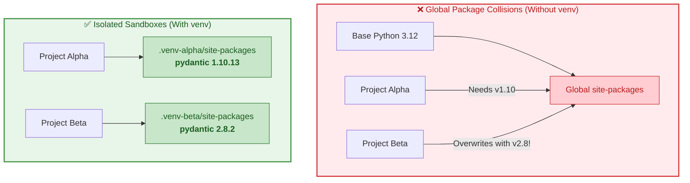

# $\Huge\color{#0D47A1}{\textsf{01 — How Python Runs and Setup}}$

[](https://www.python.org/)
[](README.md)
[](../../AI%20Engineer%20Architect%20Road%20Map.md)
[](#)

> $\color{#546E7A}\mathbf{Navigation:}$ **Phase 0** · **Module 0.1** · **Lesson 1 of 16** · [Phase 0.1 — Python Index](README.md) · [Next: 02 Variables, Types & Operators →](02%20Variables%20Types%20and%20Operators.md)

---

## 🗺️ $\color{#0D47A1}\blacksquare\space\color{#1565C0}{\textsf{Stage 0 — Concept Map}}$

> [!IMPORTANT]
> ### $\color{#512DA8}{\textsf{The Problem}}$
> **Without knowing how Python executes and isolates code**, you end up with mysterious errors: commands not recognized in your terminal, packages conflicting and breaking across different projects, and scripts running against the wrong interpreter.

### $\color{#00838F}\blacktriangleright\space\color{#00695C}{\textsf{Where It Fits}}$

* $\color{#0288D1}\blacktriangleright$ **$\color{#01579B}{\textsf{Builds on:}}$** **Nothing** — this is the absolute starting point.
* $\color{#00897B}\blacktriangleright$ **$\color{#004D40}{\textsf{Unlocks:}}$** **Every subsequent module** in this road map, from basic syntax to PyTorch, LangChain, and production API servers.

> [!NOTE]
> ### $\color{#0D47A1}{\textsf{Why Care as an AI Engineer / Architect?}}$
> AI development relies heavily on rapidly evolving open-source libraries (`torch`, `transformers`, `openai`, `pydantic`, `langchain`). These libraries often require specific, conflicting versions of underlying C-extensions and sub-dependencies. If you install everything globally onto your operating system, your development environment will quickly collapse into **"dependency hell."** Mastering the interpreter, PATH, and **$\color{#2E7D32}{\textsf{virtual environments (venv)}}$** is mandatory survival knowledge.

---

## 🔑 $\color{#4A148C}\blacksquare\space\color{#6A1B9A}{\textsf{New Terms (Plain English)}}$

| $\color{#4A148C}\textsf{\textbf{Term}}$ | $\color{#00695C}\textsf{\textbf{One-Line Meaning}}$ |
| :--- | :--- |
| $\color{#0D47A1}\mathbf{Interpreter}$ | The program (`python.exe`) that reads your plain text code and translates it into actions on your computer. |
| $\color{#0D47A1}\mathbf{Source\space code}$ | The human-readable text you write in a `.py` file. |
| $\color{#4A148C}\mathbf{Bytecode}$ | The compact, internal machine-friendly instructions Python compiles your code into right before execution. |
| $\color{#00695C}\mathbf{REPL}$ | Read-Eval-Print Loop — an interactive scratchpad that runs one line of code at a time in the terminal. |
| $\color{#E65100}\mathbf{PATH}$ | An operating system environment variable listing the folders where the terminal searches for runnable programs. |
| $\color{#0D47A1}\mathbf{Package\space /\space Library}$ | A reusable collection of code written by others that you download to add capabilities to your project. |
| $\color{#2E7D32}\mathbf{pip}$ | The standard package installer program bundled with Python. |
| $\color{#2E7D32}\mathbf{Virtual\space Environment\space (venv)}$ | An isolated folder containing a dedicated copy of Python and its own independent set of installed libraries. |
| $\color{#E65100}\mathbf{site-packages}$ | The specific folder inside Python (or inside a `venv`) where downloaded third-party libraries live. |

---

## 🎈 $\color{#00695C}\blacksquare\space\color{#00897B}{\textsf{Stage 1 — The Simple Idea}}$

### $\color{#00838F}\blacktriangleright\space\color{#00695C}{\textsf{Analogy 1: The Live Interpreter}}$

A computer processor only understands raw machine switches (binary machine code) — not English, not Python. **$\color{#0D47A1}{\textsf{Python is a live human translator standing between you and the computer.}}$** You speak readable Python; the translator reads it sentence by sentence and tells the machine what to do as it goes.

Because translation happens on the fly, Python is called an **$\color{#0D47A1}{\textsf{interpreted language}}$**. You do not need to run a separate manual compile command to produce an executable file before testing your code; you hand your script to the interpreter and it executes immediately.

> [!IMPORTANT]
> ### $\color{#512DA8}{\textsf{The "Aha!" Insight}}$
> **"Python" refers to two things:**
> 1. The **$\color{#0D47A1}{\textsf{language}}$** (the syntax and grammar rules you write).
> 2. The **$\color{#2E7D32}{\textsf{interpreter}}$** (the actual binary program named `python.exe` that executes those rules).

---

### $\color{#00838F}\blacktriangleright\space\color{#00695C}{\textsf{Analogy 2: Virtual Environments (venv) as Dedicated Toolboxes}}$

Imagine you are building two different physical models in your garage:
* $\color{#0288D1}\blacktriangleright$ **$\color{#01579B}{\textsf{Project A:}}$** A delicate vintage watch requiring tiny micro-screwdrivers.
* $\color{#E65100}\blacktriangleright$ **$\color{#BF360C}{\textsf{Project B:}}$** A heavy-duty lawnmower requiring giant steel wrenches.

If you dump all your tools into one giant central bin, tools collide, parts get lost, and using the wrong wrench on the watch strips the screws.

A **$\color{#2E7D32}{\textsf{virtual environment}}$** is a dedicated, self-contained toolbox for each project:
* $\color{#2E7D32}\bullet$ Project A gets its own small box with only its micro-screwdrivers.
* $\color{#2E7D32}\bullet$ Project B gets its own box with its wrenches.
* $\color{#2E7D32}\bullet$ Neither knows the other exists. If you destroy Project B's toolbox, Project A is completely untouched.

---

## ⚙️ $\color{#BF360C}\blacksquare\space\color{#D84315}{\textsf{Stage 2 — How It Actually Works}}$

> [!IMPORTANT]
> ### $\color{#00C853}{\textsf{🔥 The 80/20 Core Rule: What Matters in Production}}$
> * $\color{#00C853}\blacktriangleright$ **Daily Core (90% of Real AI Work):** Always isolate projects with a virtual environment (`python -m venv .venv`), activate it (`.venv/Scripts/Activate.ps1`), install dependencies (`pip install <package>`), and run via your environment's interpreter (`.venv/Scripts/python.exe main.py`).
> * $\color{#FFB300}\blacktriangleright$ **Occasional (Setup and CI/CD Pipelines):** Managing multiple Python versions via `pyenv-win`, freezing dependencies with `pip freeze > requirements.txt`, selecting interpreter in VS Code (<kbd>Ctrl</kbd> + <kbd>Shift</kbd> + <kbd>P</kbd>).
> * $\color{#757575}\blacktriangleright$ **Reference Only (Under the Hood):** Bytecode `.pyc` cache mechanics, manual PATH registry editing, compiling C-extensions from source.

### $\color{#D84315}\blacktriangleright\space\color{#BF360C}{\textsf{1.1 What Happens When You Run a Program}}$

```mermaid
flowchart LR
    A["📄 <b>your_script.py</b><br/><code>Source Code (Plain Text)</code>"] --> B["⚙️ <b>Python Interpreter</b><br/><code>Checks Syntax & Parses Tokens</code>"]
    B --> C["📦 <b>Bytecode (.pyc)</b><br/><code>Internal Compact Instructions</code>"]
    C --> D["🚀 <b>PVM (Virtual Machine)</b><br/><code>Executes against CPU & RAM</code>"]
    D --> E["🖥️ <b>System Output</b><br/><code>Printed Results / Actions</code>"]

    style A fill:#E1F5FE,stroke:#0288D1,stroke-width:2px,color:#01579B
    style B fill:#FFF3E0,stroke:#F57C00,stroke-width:2px,color:#E65100
    style C fill:#EDE7F6,stroke:#512DA8,stroke-width:2px,color:#311B92
    style D fill:#E8F5E9,stroke:#388E3C,stroke-width:2px,color:#1B5E20
    style E fill:#FCE4EC,stroke:#C2185B,stroke-width:2px,color:#880E4F
```



1. You write plain-text **$\color{#0D47A1}{\textsf{source code}}$** in a `.py` file.
2. The **$\color{#0D47A1}{\textsf{interpreter}}$** reads your file, validates syntax, and quietly compiles it into **$\color{#4A148C}{\textsf{bytecode}}$** (stored in memory or cached in a `__pycache__` folder).
3. The **$\color{#2E7D32}{\textsf{Python Virtual Machine (PVM)}}$** executes the bytecode against your machine's CPU and operating system.
4. You see the printed output or results.

---

### $\color{#D84315}\blacktriangleright\space\color{#BF360C}{\textsf{1.2 Installing Python on Windows}}$

1. Download the latest stable Python 3 release from the official website: **[python.org/downloads](https://www.python.org/downloads/)**.
2. Run the installer.
3. ⚠️ **$\color{#D32F2F}{\textsf{Critical Step:}}$** On the very first screen of the installer, check the box:  
   `☑ Add python.exe to PATH`
4. Click **Install Now**.
5. Verify the installation by opening a new PowerShell window:

```powershell
# Check interpreter version
python --version
# Expected output: Python 3.12.x (or newer)

# On Windows, you can also use the Python launcher:
py --version
```

> [!NOTE]
> ### $\color{#0D47A1}{\textsf{What Does PATH Do?}}$
> When you type `python` in a terminal, Windows searches every directory listed in your `PATH` environment variable until it finds `python.exe`. If Python is not on `PATH`, Windows returns: `'python' is not recognized as an internal or external command`.

---

### $\color{#D84315}\blacktriangleright\space\color{#BF360C}{\textsf{1.3 Running Python: REPL vs. Script}}$

#### $\color{#4527A0}\blacklozenge\space\color{#283593}{\textsf{(a) The REPL (Interactive Scratchpad)}}$
Type `python` with no arguments to enter the REPL:

```powershell
python
```
```python
# The '>>>' indicates Python is waiting for your input
>>> 2 + 3
5
>>> text = "AI Engineer"
>>> text.lower()
'ai engineer'
>>> exit()   # or press Ctrl+Z then Enter to return to PowerShell
```

#### $\color{#4527A0}\blacklozenge\space\color{#283593}{\textsf{(b) Script Files (Production Workflow)}}$
Save your code in a file named `main.py`:

```python
# main.py
# print() sends text to the terminal standard output
print("System initialized.")

model_name = "gpt-4o"
tokens = 1500

# An f-string lets you interpolate variables directly into text
print(f"Model: {model_name} | Tokens used: {tokens}")
```

Run it from your terminal:

```powershell
python main.py
# Output:
# System initialized.
# Model: gpt-4o | Tokens used: 1500
```

---

### $\color{#D84315}\blacktriangleright\space\color{#BF360C}{\textsf{1.4 Virtual Environments (venv): Isolation and Setup}}$

#### $\color{#C2185B}\blacktriangleright\space\color{#880E4F}{\textsf{The Problem: Global Package Pollution}}$

When you install a library globally using `pip install package_name`, Python deposits the files into your machine's global `Lib/site-packages` directory.

Consider this common AI development conflict:
* $\color{#D32F2F}\blacktriangleright$ **$\color{#B71C1C}{\textsf{Project Alpha (Legacy Bot):}}$** Requires `pydantic==1.10.13` (used by older LangChain).
* $\color{#0288D1}\blacktriangleright$ **$\color{#01579B}{\textsf{Project Beta (Modern Agent):}}$** Requires `pydantic==2.8.2` (Pydantic V2 has breaking syntax changes).

If you install globally, Project Beta's install will overwrite Project Alpha's files. Project Alpha will immediately crash with `ImportError` or `ValidationError`.

```diff
- ❌ GLOBAL INSTALL (Fragile):
- Global Python 3.12 ──► site-packages ──► pydantic 2.8.2 (OVERWRITES v1.10!)
-                              ▲
-               Both projects share this folder

+ ✅ VIRTUAL ENVIRONMENTS (Isolated):
+ Project-Alpha/ ──► .venv/ ──► site-packages ──► pydantic 1.10.13  (Safe!)
+ Project-Beta/  ──► .venv/ ──► site-packages ──► pydantic 2.8.2    (Safe!)
```



---

#### $\color{#00838F}\blacktriangleright\space\color{#00695C}{\textsf{Step 1: Create the Virtual Environment}}$
Navigate to your project root folder in PowerShell and tell Python to run its built-in `venv` module:

```powershell
# Syntax: python -m venv <folder_name>
# Standard convention is to name the folder '.venv' or 'venv'
python -m venv .venv
```

> [!NOTE]
> ### $\color{#0D47A1}{\textsf{What Does -m Mean?}}$
> The `-m` flag tells the Python interpreter: *"Search your standard library for the module named `venv`, and run it as a script."*

What Python creates inside your project directory:
```text
my-project/
├── 📁 .venv/                     # The virtual environment directory
│   ├── 📁 Include/               # C headers for compiling native extensions
│   ├── 📁 Lib/
│   │   └── 📁 site-packages/     # Isolated folder where third-party packages will go
│   ├── 📁 Scripts/               # Executables & activation scripts on Windows
│   │   ├── ⚙️ python.exe         # Dedicated redirector binary
│   │   ├── ⚙️ pip.exe            # Dedicated package installer
│   │   ├── 📜 Activate.ps1       # Activation script for PowerShell
│   │   └── 📜 activate.bat       # Activation script for CMD
│   └── ⚙️ pyvenv.cfg             # Configuration file pointing to base Python install
├── 📄 main.py
└── 📄 .gitignore
```

#### $\color{#4A148C}\blacktriangleright\space\color{#311B92}{\textsf{Under the Hood: What venv Actually Does}}$
A virtual environment does **not** make a heavy, full copy of the entire Python runtime. Instead:
1. It creates lightweight stub executables (`python.exe`, `pip.exe`) inside `.venv/Scripts/`.
2. It writes a file called `pyvenv.cfg` storing the path to your base system Python:
   ```ini
   home = C:\Users\Username\AppData\Local\Programs\Python\Python312
   include-system-site-packages = false
   version = 3.12.2
   ```
3. When activated, it temporarily prepends `.venv\Scripts` to the front of your system `PATH`. When you type `python` or `pip`, Windows picks up the `.venv` executables first!

---

#### $\color{#00838F}\blacktriangleright\space\color{#00695C}{\textsf{Step 2: Activate the Virtual Environment}}$

##### $\color{#0288D1}\blacklozenge\space\textsf{On Windows PowerShell:}$
```powershell
.\.venv\Scripts\Activate.ps1
```

Once activated, your terminal prompt changes to show the prefix `(.venv)`:
```powershell
(.venv) PS C:\Code\my-project>
```

##### $\color{#0288D1}\blacklozenge\space\textsf{On Windows Command Prompt (CMD):}$
```cmd
.\.venv\Scripts\activate.bat
```

##### $\color{#0288D1}\blacklozenge\space\textsf{On macOS / Linux (or Git Bash on Windows):}$
```bash
source .venv/bin/activate
```

---

> [!WARNING]
> ### $\color{#D32F2F}{\textsf{⚠️ THE POWERSHELL EXECUTION POLICY TRAP}}$
> On fresh Windows machines, running `.\.venv\Scripts\Activate.ps1` often fails with this error:
> ```text
> File ... .venv\Scripts\Activate.ps1 cannot be loaded because running scripts 
> is disabled on this system. (PSSecurityException)
> ```
> **The Fix:** Windows blocks downloaded scripts by default. Allow local scripts for your user account by running this once in PowerShell:
> ```powershell
> Set-ExecutionPolicy -ExecutionPolicy RemoteSigned -Scope CurrentUser
> ```
> Then run `.\.venv\Scripts\Activate.ps1` again. It will now activate cleanly.

---

#### $\color{#00838F}\blacktriangleright\space\color{#00695C}{\textsf{Step 3: Installing Packages Inside the Environment}}$
With `(.venv)` displayed in your prompt, any package you install is placed strictly inside `.venv/Lib/site-packages`:

```powershell
# Upgrade pip to latest version
python -m pip install --upgrade pip

# Install a third-party package (e.g. requests for HTTP APIs)
pip install requests

# Verify where it is installed:
pip show requests
# Location will show: C:\Code\my-project\.venv\Lib\site-packages
```

---

#### $\color{#00838F}\blacktriangleright\space\color{#00695C}{\textsf{Step 4: Saving and Restoring Dependencies (requirements.txt)}}$

```powershell
# Freeze current dependencies into a standard manifest file
pip freeze > requirements.txt

# Inspect the file contents
Get-Content requirements.txt
# requests==2.32.3
# urllib3==2.2.2
# ...

# When sharing code or cloning on a new machine, install all dependencies in one command:
pip install -r requirements.txt
```

---

#### $\color{#00838F}\blacktriangleright\space\color{#00695C}{\textsf{Step 5: Deactivating the Environment}}$
When you are finished working on the project, leave the environment:

```powershell
deactivate
# The '(.venv)' prefix disappears from your prompt.
```

---

### $\color{#D84315}\blacktriangleright\space\color{#BF360C}{\textsf{1.5 Version Control: Never Commit .venv}}$

> [!CAUTION]
> ### $\color{#B71C1C}{\textsf{Never Commit .venv to Git}}$
> The `.venv` folder contains machine-specific absolute paths and binaries. **Never commit `.venv` to Git.**

Create a `.gitignore` file in your project root:
```gitignore
# Python Virtual Environments
.venv/
venv/
ENV/

# Python Cache & Bytecode
__pycache__/
*.pyc
```

Anyone cloning your project will simply run:
```powershell
python -m venv .venv
.\.venv\Scripts\Activate.ps1
pip install -r requirements.txt
```

---

### $\color{#D84315}\blacktriangleright\space\color{#BF360C}{\textsf{1.6 Configuring VS Code for venv}}$

To ensure VS Code provides autocomplete, linting, and runs your code using the virtual environment:

1. Open your project folder in VS Code (`File` → `Open Folder...`).
2. Press <kbd>Ctrl</kbd> + <kbd>Shift</kbd> + <kbd>P</kbd> to open the Command Palette.
3. Type: `Python: Select Interpreter`
4. Pick the interpreter located inside your virtual environment:  
   `Python 3.12.x ('.venv': venv) .\.venv\Scripts\python.exe`
5. VS Code will remember this selection in `.vscode/settings.json` and will automatically activate `.venv` every time you open an integrated terminal (<kbd>Ctrl</kbd> + <kbd>~</kbd>).

---

### $\color{#D84315}\blacktriangleright\space\color{#BF360C}{\textsf{1.7 Comments and Indentation Rules}}$

```python
# 1. COMMENTS:
# Any text following '#' is ignored by Python.
# Use comments to explain the "why" and trade-offs, not obvious syntax.

# 2. INDENTATION:
# Python does NOT use curly braces {} to define code blocks.
# Python uses 4 SPACES of indentation to define code structure.

def check_status(is_active: bool):
    # 4 spaces indentation marks this line as inside the function body
    if is_active:
        # 8 spaces indentation marks this line as inside the if-block
        print("System is operational.")
    else:
        print("System is offline.")

check_status(True)
```

---

## 🚀 $\color{#0D47A1}\blacksquare\space\color{#1565C0}{\textsf{Stage 3 — In Practice / Why It Matters}}$

In production AI development, virtual environment hygiene is the difference between reliable systems and untraceable bugs:

* $\color{#0288D1}\blacktriangleright$ **$\color{#01579B}{\textsf{1. CUDA and PyTorch Matching:}}$** PyTorch builds must match your specific CUDA GPU driver versions. Keeping projects in isolated venvs prevents driver/binary mismatches.
* $\color{#00897B}\blacktriangleright$ **$\color{#004D40}{\textsf{2. Reproducible Docker Containers:}}$** Docker images for deploying FastAPI inference endpoints copy `requirements.txt` into the container and run `pip install` in a clean environment, mirroring your local venv.
* $\color{#7B1FA2}\blacktriangleright$ **$\color{#4A148C}{\textsf{3. Multi-Model Pipelines:}}$** A data preparation script might use older scientific packages (`scipy`), while your LLM agent uses bleeding-edge orchestration libraries (`langchain`, `llamaindex`). Isolating them prevents version lock.

---

## ⚖️ $\color{#00695C}\blacksquare\space\color{#00838F}{\textsf{Variations and When to Use}}$

| $\color{#0D47A1}\textsf{\textbf{Tool}}$ | $\color{#00C853}\textsf{\textbf{Production Priority}}$ | $\color{#00695C}\textsf{\textbf{What It Is}}$ | $\color{#2E7D32}\textsf{\textbf{✅ When to Use It}}$ | $\color{#D32F2F}\textsf{\textbf{🚫 When to Avoid It}}$ |
| :--- | :---: | :--- | :--- | :--- |
| **`venv`** | `🟢 Core (Daily Default)` | Python built-in standard library tool | **$\color{#2E7D32}{\textsf{Default for 95 percent of projects.}}$** Zero installation required, standard in all tutorials and production pipelines. | When you need to manage multiple different Python engine versions (e.g., Python 3.10 vs 3.12). |
| **`uv`** | `🟡 Occasional (Modern Speed)` | Modern ultra-fast package manager written in Rust | Large projects with complex dependencies where `pip install` is slow. Installs packages in milliseconds. | When keeping your environment minimal with zero external tool dependencies. |
| **`conda`** | `⚪ Reference (Legacy / C-Heavy)` | Multi-language environment and package manager | Heavy data science projects requiring complex non-Python C/Fortran/CUDA system libraries outside Python. | Standard web APIs, microservices, and general Python development (it is heavy and slow). |

---

## 🐛 $\color{#880E4F}\blacksquare\space\color{#AD1457}{\textsf{Common Errors and Fixes}}$

| $\color{#C2185B}\textsf{\textbf{What You See}}$ | $\color{#E65100}\textsf{\textbf{Cause}}$ | $\color{#2E7D32}\textsf{\textbf{Fix}}$ |
| :--- | :--- | :--- |
| `'python' is not recognized...` | Python was installed without checking "Add to PATH" | Re-run installer, click "Modify", check "Add to PATH"; or use `py`. |
| `File ... Activate.ps1 cannot be loaded... PSSecurityException` | PowerShell blocks unsigned script execution by default | Run `Set-ExecutionPolicy -ExecutionPolicy RemoteSigned -Scope CurrentUser` in PowerShell. |
| `ModuleNotFoundError: No module named 'requests'` | Package was installed in another environment, or venv is not activated | Look for `(.venv)` in prompt. Run `.\.venv\Scripts\Activate.ps1`, then check `pip list`. |
| Script runs against wrong Python in VS Code | VS Code selected the global interpreter instead of `.venv` | Press <kbd>Ctrl</kbd> + <kbd>Shift</kbd> + <kbd>P</kbd> → `Python: Select Interpreter` → Select `./.venv/Scripts/python.exe`. |
| `python: can't open file 'main.py': No such file or directory` | Your terminal current working directory is not the project folder | Run `pwd` or `dir` to verify directory; `cd` to the directory containing `main.py`. |

---

## 📌 $\color{#1B5E20}\blacksquare\space\color{#2E7D32}{\textsf{Quick Reference}}$

```powershell
# 1. Create a virtual environment
python -m venv .venv

# 2. Activate it (Windows PowerShell)
.\.venv\Scripts\Activate.ps1

# 3. Verify activation (prompt shows (.venv))
python -c "import sys; print(sys.prefix)"  # Outputs your .venv path

# 4. Install dependencies
pip install <package_name>
pip freeze > requirements.txt

# 5. Reinstall from requirements manifest
pip install -r requirements.txt

# 6. Deactivate environment
deactivate
```

---

## 🛑 $\color{#B71C1C}\blacksquare\space\color{#D32F2F}{\textsf{STOP — Self-Check}}$

You open a new PowerShell terminal, navigate to your AI project, and immediately run:
```powershell
pip install openai
```
However, when your teammate clones your repository on their machine and tries to run the project, it fails with:
```text
ModuleNotFoundError: No module named 'openai'
```
**What two mistakes happened on your machine, and what is the proper sequence to prevent this?**

<details>
<summary><b>🔍 Click to Reveal the Answer and Architectural Fix</b></summary>

<br/>

### $\color{#D32F2F}\blacktriangleright\space\color{#B71C1C}{\textsf{The Mistakes:}}$
1. **$\color{#D32F2F}{\textsf{No Virtual Environment Activation:}}$** You ran `pip install openai` globally against your machine's base Python because the prompt did not show `(.venv)`.
2. **$\color{#D32F2F}{\textsf{Missing Dependency Manifest:}}$** You did not record the dependency into a version-controlled `requirements.txt` file.

### $\color{#2E7D32}\blacktriangleright\space\color{#1B5E20}{\textsf{The Proper Sequence:}}$
```powershell
# 1. Create and activate the virtual environment
python -m venv .venv
.\.venv\Scripts\Activate.ps1

# 2. Install inside the isolated environment
pip install openai

# 3. Record the dependency into source control
pip freeze > requirements.txt

# 4. Commit requirements.txt (and ensure .venv is in .gitignore!)
```

---

🎉 **Setup Complete!** Continue to the next lesson: [02 Variables, Types & Operators →](02%20Variables%20Types%20and%20Operators.md)

</details>
