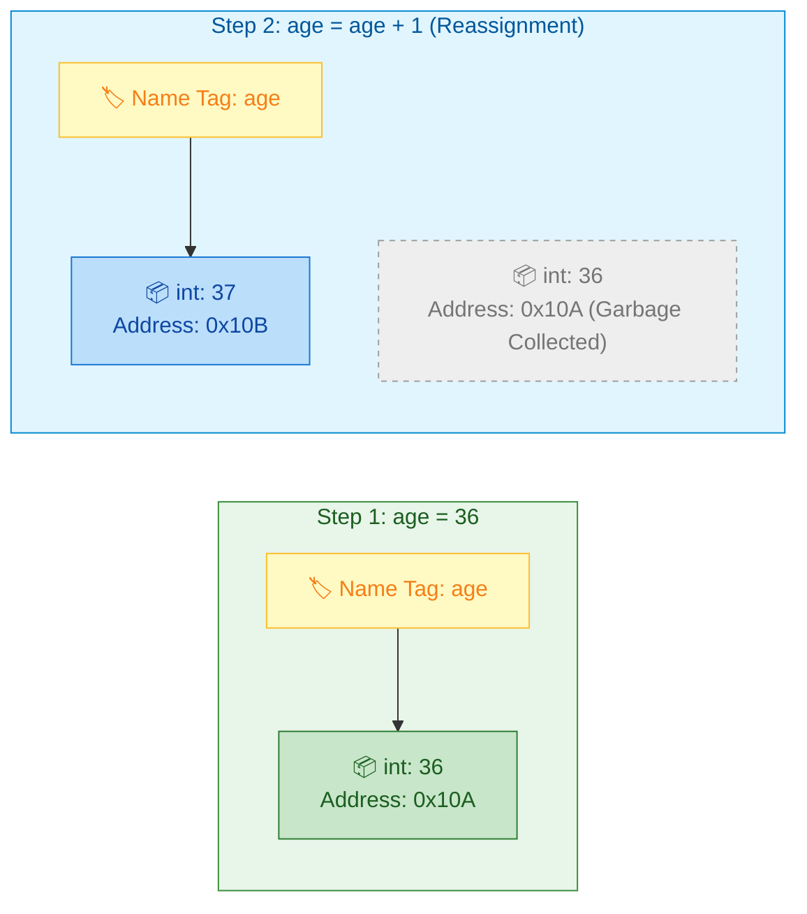
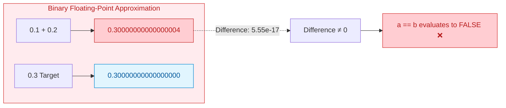
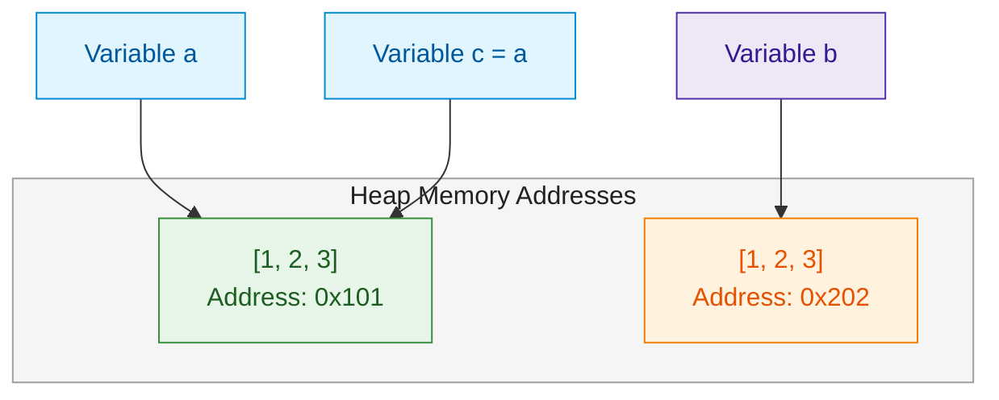

# $\Huge\color{#0D47A1}{\textsf{02 — Variables, Types and Operators}}$

[](https://www.python.org/)
[](README.md)
[](../../AI%20Engineer%20Architect%20Road%20Map.md)
[](#)

> $\color{#546E7A}\mathbf{Navigation:}$ **Phase 0** · **Module 0.1** · **Lesson 2 of 16** · [← Prev: 01 How Python Runs and Setup](01%20How%20Python%20Runs%20and%20Setup.md) · [Phase 0.1 — Python Index](README.md) · [Next: 03 Strings In Depth →](03%20Strings%20In%20Depth.md)

---


## 🗺️ $\Large\color{#0D47A1}\blacksquare\space\color{#1565C0}{\textsf{Stage 0 — Concept Map}}$

> [!IMPORTANT]
> ### $\color{#512DA8}{\textsf{The Core Premise}}$
> Programs move **data** around: numbers, text, true/false flags. This lesson covers how Python **stores** data (variables), the **kinds** of data (types), and how you **combine** data (operators). You'll also see how Python tracks objects in computer memory with **`id()`**, and why checking equality (**`==`**) is fundamentally different from checking identity (**`is`**). Every line of code you ever write uses these. It comes right after setup because you can't do anything without it.

### $\large\color{#00838F}\blacktriangleright\space\color{#00695C}{\textsf{Where It Fits}}$

* $\color{#0288D1}\blacktriangleright$ **$\color{#01579B}{\textsf{Builds on:}}$** [01 How Python Runs and Setup](01%20How%20Python%20Runs%20and%20Setup.md) — interpreter execution and virtual environment isolation.
* $\color{#00897B}\blacktriangleright$ **$\color{#004D40}{\textsf{Unlocks:}}$** Strings, data structures (Lists, Dicts, Tuples), control flow, and every mathematical operation in PyTorch and NumPy.

---


## 🔑 $\Large\color{#4A148C}\blacksquare\space\color{#6A1B9A}{\textsf{New Terms (Plain English)}}$

| $\color{#4A148C}\textsf{\textbf{Term}}$ | $\color{#00695C}\textsf{\textbf{One-Line Meaning}}$ |
| :--- | :--- |
| $\color{#0D47A1}\mathbf{Variable}$ | A named label that points to a value in memory. |
| $\color{#0D47A1}\mathbf{Dynamic\space typing}$ | Python infers a value's type at runtime; you don't declare it explicitly. |
| $\color{#4A148C}\mathbf{Type}$ | The classification of a value: `int`, `float`, `str`, `bool`, `None`. |
| $\color{#00695C}\mathbf{Casting}$ | Converting a value from one type to another (e.g. `int("5")`). |
| $\color{#E65100}\mathbf{Memory\space address\space (id())}$ | The unique integer showing where an object physically lives in computer memory. |
| $\color{#2E7D32}\mathbf{Identity\space (is)\space vs\space Equality\space (==)}$ | `==` asks *"do they have the same value?"*; `is` asks *"are they the exact same object in memory?"*. |
| $\color{#E65100}\mathbf{Truthiness}$ | Whether an arbitrary value evaluates to `True` or `False` in a conditional statement. |

---


## 🎈 $\Large\color{#00695C}\blacksquare\space\color{#00897B}{\textsf{Stage 1 — The Simple Idea (Analogy: Labelled Boxes)}}$

A **variable** is a labelled box you put a value in. You write the label, drop a value inside, and later refer to the value by its label. In Python you don't declare the box's size or type up front — you just assign, and Python figures out the type from the value.

```python
age = 36          # make a box labelled "age", put the number 36 in it
age = age + 1     # read the box (36), add 1, put 37 back in the same box
print(age)        # 37
```

> [!IMPORTANT]
> ### $\color{#512DA8}{\textsf{The "Aha!" Insight: Variables as Sticky Name Tags}}$
> Python is **dynamically typed** — a variable has no fixed type; it takes on the type of whatever you assign. The *value* has a type, the *label* doesn't. Even more: **every value in Python is an object living at a specific address in memory**. Variables are just sticky name tags pointing to those objects.



---


## ⚙️ $\Large\color{#BF360C}\blacksquare\space\color{#D84315}{\textsf{Stage 2 — How It Actually Works}}$

> [!IMPORTANT]
> ### 🔥 $\color{#00C853}{\textsf{The 80/20 Core Rule: What Matters in Production}}$
> * $\color{#00C853}\blacktriangleright$ **Daily Core (90% of Real AI Work):** `int`, `float`, `str`, `bool`, `NoneType`, `is None` identity checks, `==` value equality, augmented assignment (`+=`), and explicit casting (`int()`, `float()`, `str()`).
> * $\color{#FFB300}\blacktriangleright$ **Occasional (Specialized Calculations):** Floor division `//` and modulo `%` (batching, pagination, token window math), exponentiation `**`.
> * $\color{#757575}\blacktriangleright$ **Reference Only (Exhaustive Variations):** Bitwise operators (`&`, `|`, `^`, `<<`), complex numbers (`3+4j`), inspecting internal memory IDs (`id()`).

---

### $\large\color{#D84315}\blacktriangleright\space\color{#BF360C}{\textsf{2.1 Assignment and Naming}}$

```python
first_name = "Ada"      # use lowercase_with_underscores (the Python convention, "snake_case")
total = 0
is_active = True
PI = 3.14159            # ALL_CAPS by convention means "constant — don't change me"
```

* $\color{#00C853}\blacktriangleright$ **$\color{#1B5E20}{\textsf{Valid Names:}}$** Names must start with a letter (`a-z`, `A-Z`) or an underscore (`_`), followed by any letters, digits, or underscores. They are **case-sensitive** (`age` ≠ `Age`).
* $\color{#D32F2F}\blacktriangleright$ **$\color{#B71C1C}{\textsf{Reserved Keywords:}}$** Cannot use Python keywords (`for`, `if`, `class`, `def`, `return`, `import`, etc.).
* $\color{#0288D1}\blacktriangleright$ **$\color{#01579B}{\textsf{Constants by Convention:}}$** Python does not have a native `const` keyword. By PEP 8 convention, variables in `ALL_CAPS` (e.g. `MAX_TOKENS = 4096`, `DEFAULT_TEMPERATURE = 0.7`) signal to other developers that the value should not be modified.

---

### $\large\color{#D84315}\blacktriangleright\space\color{#BF360C}{\textsf{2.1.1 Shorthand Assignments (Multiple, Swapping and Chained)}}$

Python provides clean shorthands for assigning and updating variables without verbose boilerplate:

```python
# 1. Multiple assignment (tuple packing/unpacking shorthand):
a, b = 10, 20
print(a, b)                    # 10 20

# 2. Variable swapping in one line (no temporary variable needed!):
a, b = b, a
print(a, b)                    # 20 10

# 3. Chained assignment (assign the same value to multiple variables):
x = y = z = 0
print(x, y, z)                 # 0 0 0

# 4. Augmented assignment (operate and assign in place):
count = 5
count += 1                     # equivalent to: count = count + 1 (becomes 6)
count *= 2                     # equivalent to: count = count * 2 (becomes 12)
count -= 3                     # equivalent to: count = count - 3 (becomes 9)
```

```diff
- ❌ FRAGILE: Chained assignment with mutable objects points both labels to ONE object!
- a = b = []
- a.append("token_1")
- print(b)  # ['token_1'] — Modifying 'a' silently corrupted 'b'!

+ SAFE: Always instantiate independent mutable collections separately:
+ a = []
+ b = []
+ a.append("token_1")
+ print(b)  # [] — 'b' remains completely unaffected!
```

> [!WARNING]
> ### $\color{#D84315}{\textsf{Gotcha with Chained Assignment}}$
> `a = b = []` points **both** variables to the **same** mutable list in memory! If you do `a.append(1)`, `b` will also become `[1]`! For independent mutable collections, always assign separately: `a = []; b = []`.

---

### $\large\color{#D84315}\blacktriangleright\space\color{#BF360C}{\textsf{2.2 The Core Built-in Types}}$

In Python, you interact primarily with 5 fundamental primitive types. Each serves a distinct purpose in general programming and production AI:

| $\color{#4A148C}\textsf{\textbf{Type}}$ | $\color{#00C853}\textsf{\textbf{Production Priority}}$ | $\color{#0D47A1}\textsf{\textbf{Example Literal}}$ | $\color{#E65100}\textsf{\textbf{Real-World AI Application}}$ | $\color{#2E7D32}\textsf{\textbf{Key Characteristic}}$ |
| :--- | :---: | :--- | :--- | :--- |
| **`int`** | `🟢 Core (Daily)` | `42`, `-10`, `0` | Token counts, batch sizes, tensor dimensions | Arbitrary precision (unlimited integer size) |
| **`float`** | `🟢 Core (Daily)` | `19.99`, `1e-5`, `0.7` | Model loss, learning rate, embedding similarities | 64-bit IEEE 754 double precision |
| **`str`** | `🟢 Core (Daily)` | `"Ada"`, `"gpt-4o"` | Prompts, LLM completion outputs, raw text | Immutable sequence of Unicode characters |
| **`bool`** | `🟢 Core (Daily)` | `True`, `False` | Guard rails, early-exit flags, streaming toggles | Subclass of `int` (`True == 1`, `False == 0`) |
| **`NoneType`** | `🟢 Core (Daily)` | `None` | Default parameters (`temperature=None`), missing keys | Singleton sentinel representing absence of value |

```python
count = 42              # int    — whole numbers, unlimited size in Python
price = 19.99           # float  — numbers with a decimal point
name = "Ada"            # str    — text (string), in quotes
is_ready = True         # bool   — True or False (note the capitals)
nothing = None          # NoneType — a special "no value here" placeholder
```

Check a type with `type()`, and test a type with `isinstance()`:

```python
print(type(price))               # <class 'float'>
print(isinstance(count, int))    # True
```

> **$\color{#00C853}\blacksquare\ \textsf{Production Rule of Thumb:}$** Always prefer **`isinstance(x, int)`** over `type(x) == int`. `isinstance()` correctly accounts for object inheritance (for example, `bool` is technically an internal subclass of `int`, so `isinstance(True, int)` is `True`).

`None` is worth a special note: it's Python's way of saying "empty / not set yet" — used for optional values and missing results. It is **not** the same as `0`, `False`, or `""`.

---

### $\large\color{#D84315}\blacktriangleright\space\color{#BF360C}{\textsf{2.3 Converting Between Types (Casting)}}$

User input, environment variables, and API network payloads almost universally arrive as **strings**. You must cast them into typed numbers or booleans before performing operations:

```mermaid
flowchart LR
    RAW["📄 External Data (str)<br/>'42', '19.99', 'True'"]
    INT_NODE["🔢 int()<br/>42 (Integer)"]
    FLOAT_NODE["📐 float()<br/>19.99 (Decimal)"]
    BOOL_NODE["⚖️ bool()<br/>True (Boolean)"]
    STR_OUT["📝 Prompt / Log (str)<br/>str(...)"]

    RAW -->|int('42')| INT_NODE
    RAW -->|float('19.99')| FLOAT_NODE
    RAW -->|bool('...')| BOOL_NODE
    INT_NODE -->|str(42)| STR_OUT
    FLOAT_NODE -->|str(19.99)| STR_OUT

    style RAW fill:#E1F5FE,stroke:#0288D1,color:#01579B
    style INT_NODE fill:#FFF3E0,stroke:#F57C00,color:#E65100
    style FLOAT_NODE fill:#EDE7F6,stroke:#512DA8,color:#311B92
    style BOOL_NODE fill:#E8F5E9,stroke:#388E3C,color:#1B5E20
    style STR_OUT fill:#FCE4EC,stroke:#C2185B,color:#880E4F
```

```python
quantity = int("5")        # str "5" -> int 5
total = float("19.99")     # str -> float
label = str(42)            # int 42 -> str "42"
flag = bool(0)             # 0 -> False ; any non-zero/with-content -> True

# This is why reading a number from input needs a cast:
# input() ALWAYS returns a string, even if the user types digits.
# age = int(input("Age? "))
```

> [!WARNING]
> ### $\color{#D84315}{\textsf{Casting Trap: int() on Decimal Strings}}$
> `int("42")` succeeds, but `int("42.8")` crashes with **`ValueError: invalid literal for int() with base 10`**!  
> **The Fix:** If the incoming string can have decimals, cast through float first: `int(float("42.8")) -> 42`.

---

### $\large\color{#D84315}\blacktriangleright\space\color{#BF360C}{\textsf{2.4 Operators — Combining Values}}$

Python provides three primary groups of operators for manipulating primitive values:

| $\color{#4A148C}\textsf{\textbf{Category}}$ | $\color{#0D47A1}\textsf{\textbf{Operator}}$ | $\color{#00C853}\textsf{\textbf{Production Priority}}$ | $\color{#E65100}\textsf{\textbf{Operation}}$ | $\color{#2E7D32}\textsf{\textbf{Real-World AI Application}}$ |
| :--- | :---: | :---: | :--- | :--- |
| **Arithmetic** | `+`, `-`, `*` | `🟢 Core (Daily)` | Add, subtract, multiply | Token length totals, scaling weights |
| **Arithmetic** | `/` | `🟢 Core (Daily)` | True division (always float) | Average scores, normalizing metrics |
| **Arithmetic** | `//` | `🟢 Core (Daily)` | Floor division (drops remainder) | Splitting data into batches (`total // batch_size`) |
| **Arithmetic** | `%` | `🟢 Core (Daily)` | Modulo (remainder) | Logging progress every $N$ steps (`step % 100 == 0`) |
| **Arithmetic** | `**` | `🟡 Occasional` | Exponentiation (power) | Calculating variance, exponential backoff ($2^k$) |
| **Comparison** | `==`, `!=` | `🟢 Core (Daily)` | Value equality / inequality | Matching model names, response status |
| **Comparison** | `<`, `>`, `<=`, `>=` | `🟢 Core (Daily)` | Numeric magnitude checks | Threshold checking (`similarity >= 0.85`) |
| **Logical** | `and`, `or`, `not` | `🟢 Core (Daily)` | Boolean combinations | Guard logic (`if api_key and is_ready:`) |

#### $\color{#4527A0}\blacklozenge\space\color{#283593}{\textsf{1. Arithmetic in Action:}}$

```python
print(7 + 2)    # 9
print(7 - 2)    # 5
print(7 * 2)    # 14
print(7 / 2)    # 3.5   <- "/" ALWAYS gives a float (true division)
print(7 // 2)   # 3     <- "//" floor division: divide and drop the remainder
print(7 % 2)    # 1     <- "%" modulo: the remainder (great for "is it even?": n % 2 == 0)
print(7 ** 2)   # 49    <- "**" power (7 squared)
```

> **$\color{#00C853}\blacksquare\ \textsf{AI Production Rule:}$** In Python 3, `/` **always** returns a `float`, even when dividing evenly (`4 / 2 -> 2.0`). Because array indices and token counts must be integers, always use **`//`** when calculating indices or batch sizes.

#### $\color{#4527A0}\blacklozenge\space\color{#283593}{\textsf{2. Comparison in Action (always produce a bool):}}$

```python
print(3 == 3)   # True   <- "==" means "equal?"  (TWO equals signs)
print(3 != 4)   # True   <- "!=" means "not equal?"
print(3 < 4, 4 >= 4)     # True True
```

#### $\color{#4527A0}\blacklozenge\space\color{#283593}{\textsf{3. Logical Operators (combine booleans):}}$

```python
print(True and False)   # False  — both must be True
print(True or False)    # True   — at least one True
print(not True)         # False  — flips it
```

> [!TIP]
> ### $\color{#1B5E20}{\textsf{Short-Circuit Evaluation}}$
> Python's `and` and `or` operators **short-circuit**:
> * In `A and B`, if `A` is `False`, Python immediately returns `A` without ever evaluating `B`.
> * In `A or B`, if `A` is `True`, Python immediately returns `A` without evaluating `B`.  
> You can safely write `if client is not None and client.is_ready():` — the second call will never crash because Python stops if `client` is `None`!

#### $\color{#4527A0}\blacklozenge\space\color{#283593}{\textsf{4. Shorthand Augmented Assignment:}}$

```python
total = 10
total += 5      # same as total = total + 5  -> 15
total *= 2      # -> 30
```

---

### $\large\color{#D84315}\blacktriangleright\space\color{#BF360C}{\textsf{2.4.1 Floating-Point Comparison and The Tolerance Pattern (abs(a - b) < tolerance)}}$

One of the most surprising pitfalls for software engineers in any language is **floating-point inaccuracy**.

#### $\color{#C2185B}\blacktriangleright\space\color{#880E4F}{\textsf{The Core Problem: Why 0.1 + 0.2 == 0.3 is False}}$
Computers represent floating-point numbers using binary bits (powers of 2: $1/2, 1/4, 1/8, ...$). In base-10 mathematics, the fraction $1/3$ cannot be written as a finite decimal ($0.33333...$). Similarly, in binary hardware, numbers like $0.1$ ($1/10$) and $0.2$ ($1/5$) are repeating fractions that **cannot be stored with 100% exact precision**:

```python
a = 0.1 + 0.2
b = 0.3

print(a)                        # 0.30000000000000004
print(b)                        # 0.3

# ❌ THE FATAL EQUALITY BUG:
print(a == b)                   # False!
if a == b:
    print("Matches!")           # This NEVER executes!
```



---

#### $\color{#00838F}\blacktriangleright\space\color{#00695C}{\textsf{The Solution: The Difference and Tolerance Pattern (abs(a - b) < tolerance)}}$
Instead of testing whether two floating-point numbers are bit-for-bit identical, test whether **the absolute distance between them is smaller than an acceptable margin of error (called tolerance or epsilon $\epsilon$)**:

$$\text{difference} = |a - b| < \text{tolerance}$$

```diff
- # ❌ FATAL EQUALITY BUG: Bit-for-bit comparison fails
- if a == b:
-     execute_trade()

+ # SAFE TOLERANCE PATTERN: Check if distance is negligible
+ tolerance = 1e-9
+ if abs(a - b) < tolerance:
+     execute_trade()
```

```python
a = 0.1 + 0.2
b = 0.3

# 1. Calculate the absolute difference:
difference = abs(a - b)         # abs() removes negative signs
print(f"Absolute difference: {difference}")
# Output: 5.551115123125783e-17 (approx 0.0000000000000000555)

# 2. Define an acceptable tolerance threshold (epsilon):
tolerance = 1e-9                # 0.000000001 (10^-9)

# 3. Check if difference is within tolerance:
if abs(a - b) < tolerance:
    print("Values are practically equal!")  # Runs successfully!
```

> [!NOTE]
> ### $\color{#0D47A1}{\textsf{Why abs() is Crucial}}$
> If $a = 0.29$ and $b = 0.30$, then $a - b = -0.01$. Without `abs()`, a negative number is always smaller than a positive tolerance (`-0.01 < 0.0001`), which would falsely report that any smaller number is "equal"! `abs()` guarantees you measure the **distance** between the numbers, regardless of which one is larger.

---

#### $\color{#00838F}\blacktriangleright\space\color{#00695C}{\textsf{The Modern Pythonic Solution: math.isclose()}}$
Python's standard library `math` module provides a dedicated, optimized function that handles both **relative tolerance** and **absolute tolerance**:

```python
import math

a = 0.1 + 0.2
b = 0.3

# Standard usage:
print(math.isclose(a, b))       # True! (default rel_tol=1e-09)

# Fine-tuning tolerances:
# - rel_tol: relative tolerance (scales with large numbers, e.g. 1,000,000.001)
# - abs_tol: absolute tolerance (essential when comparing numbers close to 0.0)
print(math.isclose(a, b, rel_tol=1e-9, abs_tol=1e-12))  # True!
```

> [!TIP]
> ### $\color{#1B5E20}{\textsf{Why This Matters in AI Engineering}}$
> * **Loss Functions and Convergence:** In machine learning training loops, you never check `if loss == 0.0:`. You check `if loss < 1e-5:` or `if abs(loss_prev - loss_curr) < 1e-6:`.
> * **Cosine Similarity and Probabilities:** Model confidence scores and vector similarities are floats between `0.0` and `1.0`. Rounding errors can produce values like `0.9999999999999998` instead of `1.0`.
> * **NumPy / PyTorch:** In vector/tensor operations, NumPy provides `np.isclose(vec_a, vec_b)` and `np.allclose(vec_a, vec_b)` which apply this exact tolerance formula across entire embedding arrays!

---

### $\large\color{#D84315}\blacktriangleright\space\color{#BF360C}{\textsf{2.5 Object Identity: id(), Memory Addresses, and is vs ==}}$

Every object created in Python sits at a specific memory location. Python gives each object a unique integer ID called its **memory address**. You can see this address using the built-in `id()` function:

```python
x = 42
print(id(x))    # e.g. 140718293028000 — the unique memory location of this object
```

This brings up one of the most important concepts in Python: **equality** vs **identity**.

* $\color{#0288D1}\blacktriangleright$ **`==` (Value Equality):** checks whether two items hold the **same value** (*"Do they look identical?"*).
* $\color{#2E7D32}\blacktriangleright$ **`is` (Identity):** checks whether two variables point to the **exact same object in memory** (*"Are they the same physical object?"*).
* $\color{#D32F2F}\blacktriangleright$ **`is not` (Non-identity):** checks that two variables do *not* point to the exact same object in memory.



**Analogy (two identical notebooks):**  
Imagine you and a classmate buy the exact same brand and model of notebook, and write the exact same notes on page 1.
* With `==` (equality), they match: `notebook1 == notebook2` is `True` because the contents are identical.
* With `is` (identity), they do not: `notebook1 is notebook2` is `False` because they are two separate physical notebooks sitting on different desks (`id(notebook1) != id(notebook2)`).

```python
# Two separate lists with the exact same items:
a = [1, 2, 3]
b = [1, 2, 3]

print(a == b)         # True   <- values are identical
print(a is b)         # False  <- two different list objects in memory!
print(id(a) == id(b)) # False  <- different memory addresses

# Pointing a new variable name to an existing object:
c = a
print(c == a)         # True   <- same values
print(c is a)         # True   <- c and a point to the EXACT same object in memory
print(id(c) == id(a)) # True   <- identical memory addresses
```

> [!IMPORTANT]
> ### $\color{#1B5E20}{\textsf{The Golden Rule for None}}$
> In Python, there is only one `None` object in the entire program. Therefore, checking for `None` should **always** be done with `is` or `is not`, never with `==`:
> ```python
> api_key = None
> 
> if api_key is None:        # The correct, idiomatic way (fast, checks memory identity)
>     print("API key not provided")
> 
> if api_key is not None:    # The correct way to verify a value is present
>     print("Ready to make calls")
> 
> # Avoid: if api_key == None  # ❌ Works, but unidiomatic and can be misled by custom classes
> ```

> [!WARNING]
> ### $\color{#D84315}{\textsf{Gotcha: Small Integer Caching}}$
> For performance, Python pre-allocates and reuses the same memory addresses for small integers (`-5` to `256`) and short strings. That means `x = 10; y = 10; x is y` may evaluate to `True`. **Never rely on `is` to compare numbers or strings** — always use `==` to compare values, and reserve `is` for identity checks (especially `is None`).

---

### $\large\color{#D84315}\blacktriangleright\space\color{#BF360C}{\textsf{2.6 Truthiness (Testing Values in Conditions)}}$

In Python, every single value evaluates to either **`True`** (truthy) or **`False`** (falsy) when passed to `bool()` or used in an `if` condition.

#### $\color{#00838F}\blacktriangleright\space\color{#00695C}{\textsf{The Complete Falsy Matrix in Python:}}$

| $\color{#C2185B}\textsf{\textbf{Category}}$ | $\color{#D84315}\textsf{\textbf{Falsy Values (bool() is False)}}$ | $\color{#2E7D32}\textsf{\textbf{Truthy Counterparts (bool() is True)}}$ |
| :--- | :--- | :--- |
| **Constants** | `None`, `False` | `True` |
| **Numeric Zeros** | `0`, `0.0`, `0j` | Any non-zero: `1`, `-5`, `0.001` |
| **Empty Sequences** | `""` (str), `b""` (bytes), `[]` (list), `()` (tuple), `range(0)` | `"hello"`, `" "`, `[0]`, `[None]`, `(1,)` |
| **Empty Mappings & Sets** | `{}` (dict), `set()`, `frozenset()` | `{"key": "val"}`, `{0}` |
| **Custom Classes** | Objects implementing `__bool__() -> False` or `__len__() -> 0` | Regular populated objects |

> **$\color{#00C853}\blacksquare\ \textsf{Core Insight:}$** **Literally everything else in Python is TRUTHY.** Notice that `"0"` (a string of length 1) and `[0]` (a list containing one item) are **TRUTHY** because they are non-empty!

```python
# 1. Empty vs populated collections:
name = ""
print(bool(name))            # False — empty string is falsy

items = []
print(bool(items))           # False — empty list is falsy

# 2. Common Truthy Traps (Beginner Pitfalls):
print(bool("0"))             # True! (non-empty string of length 1)
print(bool("False"))         # True! (non-empty string)
print(bool(" "))             # True! (whitespace string has length 1)
print(bool([0]))             # True! (list contains 1 item)
print(bool([None]))          # True! (list contains 1 item)
print(bool(-1))              # True! (only 0 is falsy, negative numbers are truthy)
```

```diff
- # ❌ UNIDIOMATIC: Clumsy explicit length checks
- if len(token_list) > 0:
-     process_tokens(token_list)
- if user_prompt != "":
-     send_query(user_prompt)

+ # PYTHONIC & ELEGANT: Rely on direct truthiness
+ if token_list:
+     process_tokens(token_list)
+ if user_prompt:
+     send_query(user_prompt)
```

*(See [06 — Control Flow](06%20Control%20Flow.md#611-truth-value-testing-falsy-vs-truthy-across-all-python-types) for the complete type-by-type matrix, under-the-hood rules, and best practices in `if` statements).*

---


## 🚀 $\Large\color{#0D47A1}\blacksquare\space\color{#1565C0}{\textsf{Stage 3 — In Practice / Why It Matters}}$

In production AI development, variable discipline and type handling prevent subtle bugs:

* $\color{#0288D1}\blacktriangleright$ **$\color{#01579B}{\textsf{API Response Normalization:}}$** LLM REST endpoints return JSON with mixed string and numerical data. You will constantly convert strings to floats/ints for token cost tracking and score filtering.
* $\color{#00897B}\blacktriangleright$ **$\color{#004D40}{\textsf{Handling Optional Model Hyperparameters:}}$** LLM client parameters almost always default to `None` (e.g. `def generate(prompt: str, temperature: float | None = None)`). You verify whether the user supplied an override using `if temperature is not None:`.
* $\color{#E65100}\blacktriangleright$ **$\color{#BF360C}{\textsf{Batch Slicing and Token Budgeting:}}$** You will use integer floor division `//` and modulo `%` on every large data ingestion pipeline to split documents into fixed-size context window chunks (`chunk_idx = total_tokens // max_window`).

### $\large\color{#00838F}\blacktriangleright\space\color{#00695C}{\textsf{Common Beginner Mistakes (The Reasoning)}}$

* $\color{#D32F2F}\blacktriangleright$ **`=` vs `==`:** `=` *assigns*, `==` *compares*. `if x = 5:` is an error; you want `if x == 5:`.
* $\color{#D32F2F}\blacktriangleright$ **Adding a string and a number:** `"3" + 5` raises `TypeError`. Convert first: `int("3") + 5`.  
  *Reason:* `+` means "concatenate" for strings and "add" for numbers; Python won't guess.
* $\color{#D32F2F}\blacktriangleright$ **Float surprises:** `0.1 + 0.2` prints `0.30000000000000004`. Floats are approximate; never compare them with `==` for equality — compare with a small tolerance instead.
* $\color{#D32F2F}\blacktriangleright$ **Forgetting `input()` returns a string:** `input()` then doing math without `int(...)` fails.
* $\color{#D32F2F}\blacktriangleright$ **Using `== None` instead of `is None`:** `if result == None:` works in simple cases, but PEP 8 requires `if result is None:`.  
  *Reason:* `is` checks the memory address directly; `==` runs the object's equality comparison method, which can be slow or overridden.
* $\color{#D32F2F}\blacktriangleright$ **Using `is` to compare values:** writing `if score is 100:` or `if name is "Ada":`.  
  *Reason:* `is` checks memory address (`id()`), not value content. Python can assign separate addresses to identical numbers or strings. Always use `==` for values.

### $\large\color{#00838F}\blacktriangleright\space\color{#00695C}{\textsf{Try It Yourself}}$
Predict, then run: `print(10 / 3)`, `print(10 // 3)`, `print(10 % 3)`, `print(2 ** 10)`.  
Then test:
```python
x = [10, 20]
y = [10, 20]
print(x == y, x is y, id(x) == id(y))
```

---


## 📌 $\Large\color{#1B5E20}\blacksquare\space\color{#2E7D32}{\textsf{Quick Reference}}$

```python
x = 5            # int   |  5.0 float  |  "5" str  |  True bool  |  None
int("5"); float("5"); str(5); bool(0)        # casting
a, b = 10, 20; a, b = b, a; x = y = 0        # multiple, swap & chained assignment
x += 1; x -= 2; x *= 3                       # augmented assignment
7 / 2  # 3.5   7 // 2  # 3   7 % 2  # 1   2 ** 3  # 8
==  !=  <  >  <=  >=        and  or  not     # compare / logic
id(x)            # unique memory address number of an object
a == b           # True if VALUES match (content equality)
a is b           # True if EXACT SAME object in memory (id(a) == id(b))
x is None        # standard check for None (also: x is not None)
math.isclose(a, b) # safe float equality check: abs(a - b) < 1e-9
```

* $\color{#2E7D32}\bullet$ **Falsy values:** `False`, `None`, `0`, `0.0`, `0j`, `""`, `b""`, `[]`, `()`, `{}`, `set()`, `range(0)`. Everything else is truthy (including `"0"`, `[0]`, `[None]`, and `-1`).
* $\color{#2E7D32}\bullet$ **Value vs Identity:** Use `==` for values; use `is` for object identity and checking `None`.
* $\color{#2E7D32}\bullet$ **Float equality:** Use `math.isclose(a, b)` or `abs(a - b) < tolerance`.

---


## 🛑 $\Large\color{#B71C1C}\blacksquare\space\color{#D32F2F}{\textsf{STOP — Self-Check}}$

What are the **values and types** of `a` and `b` here, and why are they different?

```python
a = 9 / 3
b = 9 // 3
```

<details>
<summary><b>🔍 Click to Reveal the Answer</b></summary>

<br/>

`a` is **`3.0`**, a **`float`** — the `/` operator always performs true division and returns a float. `b` is **`3`**, an **`int`** — `//` is floor division on two ints and stays an int. Same mathematical answer, different *type*, which matters when later code expects one or the other.

---

🎉 **Lesson Complete!** Continue to the next lesson: [03 Strings In Depth →](03%20Strings%20In%20Depth.md)

</details>
