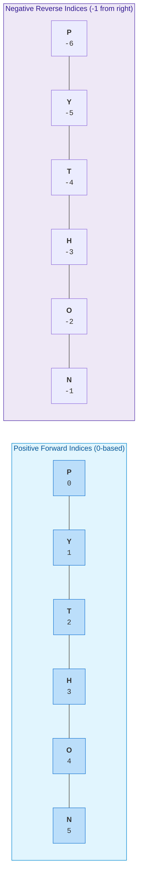

# $\Huge\color{#0D47A1}{\textsf{03 — Strings In Depth}}$

[](https://www.python.org/)
[](README.md)
[](../../AI%20Engineer%20Architect%20Road%20Map.md)
[](#)

> $\color{#546E7A}\mathbf{Navigation:}$ **Phase 0** · **Module 0.1** · **Lesson 3 of 16** · [← Prev: 02 Variables, Types and Operators](02%20Variables%20Types%20and%20Operators.md) · [Phase 0.1 — Python Index](README.md) · [Next: 04 Lists and Tuples →](04%20Lists%20and%20Tuples.md)

---

## 🗺️ $\color{#0D47A1}\blacksquare\space\color{#1565C0}{\textsf{Stage 0 — Concept Map}}$

> [!IMPORTANT]
> ### $\color{#512DA8}{\textsf{The Core Premise}}$
> Text is everywhere in AI: prompts, model replies, document chunks, JSON. **Strings** are Python's text type, and you'll manipulate them constantly — slicing, cleaning, searching, and building them from pieces. This lesson goes deep on strings because comfort here pays off in every later phase.

### $\color{#00838F}\blacktriangleright\space\color{#00695C}{\textsf{Where It Fits}}$

* $\color{#0288D1}\blacktriangleright$ **$\color{#01579B}{\textsf{Builds on:}}$** [02 Variables, Types and Operators](02%20Variables%20Types%20and%20Operators.md) — variables, built-in types, and immutability.
* $\color{#00897B}\blacktriangleright$ **$\color{#004D40}{\textsf{Unlocks:}}$** Prompt templating, RAG text chunking, tokenization concepts, and data parsing across all AI pipelines.

---

## 🔑 $\color{#4A148C}\blacksquare\space\color{#6A1B9A}{\textsf{New Terms (Plain English)}}$

| $\color{#4A148C}\textsf{\textbf{Term}}$ | $\color{#00695C}\textsf{\textbf{One-Line Meaning}}$ |
| :--- | :--- |
| $\color{#0D47A1}\mathbf{String}$ | Text, written enclosed in quotes. |
| $\color{#0D47A1}\mathbf{Index}$ | A character's zero-based integer position (`0` is first; `-1` is last). |
| $\color{#4A148C}\mathbf{Slice}$ | A sub-range `s[start:stop]` (the `stop` boundary is excluded). |
| $\color{#E65100}\mathbf{Immutable}$ | Cannot be altered in place; every method returns a brand-new string. |
| $\color{#2E7D32}\mathbf{f-string}$ | Formatted string literal `f"...{value}..."` that interpolates variables directly. |

---

## 🎈 $\color{#00695C}\blacksquare\space\color{#00897B}{\textsf{Stage 1 — The Simple Idea (Analogy: A Bead Necklace)}}$

A **string** is an ordered sequence of characters — like beads on a string, each bead a letter, digit, space, or symbol, in a fixed order. Because the order is fixed, every bead has a **position (index)**, and you can grab one bead or a run of beads.

```mermaid
flowchart LR
    subgraph OriginalNecklace ["Original String in Memory (Immutable)"]
        direction LR
        B0["🔵 'P'<br/><code>idx 0</code>"] --- B1["🔵 'Y'<br/><code>idx 1</code>"] --- B2["🔵 'T'<br/><code>idx 2</code>"] --- B3["🔵 'H'<br/><code>idx 3</code>"] --- B4["🔵 'O'<br/><code>idx 4</code>"] --- B5["🔵 'N'<br/><code>idx 5</code>"]
    end

    subgraph NewNecklace ["Result of s.replace('P', 'J') (New Object)"]
        direction LR
        NB0["🟢 'J'<br/><code>idx 0</code>"] --- NB1["🟢 'Y'<br/><code>idx 1</code>"] --- NB2["🟢 'T'<br/><code>idx 2</code>"] --- NB3["🟢 'H'<br/><code>idx 3</code>"] --- NB4["🟢 'O'<br/><code>idx 4</code>"] --- NB5["🟢 'N'<br/><code>idx 5</code>"]
    end

    OriginalNecklace -.->|Creates Fresh String| NewNecklace

    style OriginalNecklace fill:#E1F5FE,stroke:#0288D1,color:#01579B
    style NewNecklace fill:#E8F5E9,stroke:#388E3C,color:#1B5E20
```



> [!IMPORTANT]
> ### $\color{#512DA8}{\textsf{The "Aha!" Insight: Strings Are Immutable}}$
> Strings are **immutable** — once made, you cannot change a bead in place. Every "edit" actually builds a **new** string in memory. (This sounds limiting but prevents whole classes of concurrency and state-corruption bugs).

---

## ⚙️ $\color{#BF360C}\blacksquare\space\color{#D84315}{\textsf{Stage 2 — How It Actually Works}}$

> [!IMPORTANT]
> ### $\color{#00C853}{\textsf{🔥 The 80/20 Core Rule: What Matters in Production}}$
> * $\color{#00C853}\blacktriangleright$ **Daily Core (90% of Real AI Work):** Slicing `s[start:stop]`, f-strings `f"{var}"`, immutability awareness, and essential methods: `.strip()` (clean user/LLM input), `.split()` and `"".join()` (tokenization and prompt building), `.replace()` (prompt templates), `.lower()` (text normalization), `.startswith()` / `.endswith()` (file and URL routing).
> * $\color{#FFB300}\blacktriangleright$ **Occasional (Specialized Parsing):** `.find()` / `.index()`, `.count()`, `.encode("utf-8")` / `.decode("utf-8")` (network byte streams).
> * $\color{#757575}\blacktriangleright$ **Reference Only (Exhaustive Lookups):** `.isalnum()`, `.capitalize()`, `.center()`, `.zfill()`, `.partition()`.

---

### $\color{#D84315}\blacktriangleright\space\color{#BF360C}{\textsf{3.1 Making Strings: Quotes and Escaping}}$

Python offers four ways to define string literals depending on formatting needs:

| $\color{#4A148C}\textsf{\textbf{Literal Syntax}}$ | $\color{#00C853}\textsf{\textbf{Production Priority}}$ | $\color{#0D47A1}\textsf{\textbf{Example}}$ | $\color{#2E7D32}\textsf{\textbf{When to Use}}$ |
| :--- | :---: | :--- | :--- |
| **Double / Single Quotes** | `🟢 Core (Daily)` | `"hello"`, `'hello'` | Standard short strings, dictionary keys, variable values |
| **Triple Quotes** | `🟢 Core (Daily)` | `"""Prompt text..."""` | Multi-line system prompts, documentation docstrings |
| **Raw String (`r"..."`)** | `🟢 Core (Daily)` | `r"C:\Users\docs\data"` | Windows file paths, Regular Expressions (backslashes literal) |
| **Escaped Quotes** | `🟡 Occasional` | `"He said \"hi\""` | Embedding quotation marks within matching string delimiters |

```python
a = "double quotes"
b = 'single quotes'          # identical; pick one and be consistent
c = "She said \"hi\""        # \" is an escaped quote; \n = newline, \t = tab
d = """A multi-line
string spanning
several lines."""            # triple quotes keep the line breaks
e = r"C:\new\path"           # r"" = raw string: backslashes are literal (great for Windows paths)
```

---

### $\color{#D84315}\blacktriangleright\space\color{#BF360C}{\textsf{3.2 Indexing and Slicing (The Most Important Skill)}}$

Positions start at **0**. Negative positions count from the end (`-1` is the last character).



```python
s = "PYTHON"
#    012345          (and from the right: -6 -5 -4 -3 -2 -1)
print(s[0])     # 'P'   first character
print(s[-1])    # 'N'   last character

# SLICING: s[start:stop]  -> from start UP TO (but NOT including) stop
print(s[0:3])   # 'PYT'  positions 0,1,2
print(s[2:])    # 'THON' from 2 to the end
print(s[:3])    # 'PYT'  from start to 3
print(s[::2])   # 'PTO'  every 2nd char (s[start:stop:step])
print(s[::-1])  # 'NOHTYP' a reversed copy (handy trick)
```

> **$\color{#00C853}\blacksquare\ \textsf{The Universal Slicing Formula:}$** **`s[start : stop : step]`**  
> In Python, `start` is **INCLUSIVE** and `stop` is **EXCLUSIVE** (the half-open interval `[start, stop)`). This rule is universal across strings, lists, tuples, NumPy arrays, and PyTorch tensors.

```diff
- # ❌ IN-PLACE MUTATION BUG: Strings are immutable!
- s = "PYTHON"
- s[0] = "J"  # TypeError: 'str' object does not support item assignment

+ # ✅ SLICE AND CONCATENATE: Build a new string
+ s = "PYTHON"
+ s = "J" + s[1:]  # 'JYTHON' (creates a fresh string in memory)
```

---

### $\color{#D84315}\blacktriangleright\space\color{#BF360C}{\textsf{3.3 Length and Membership}}$

```python
print(len("hello"))        # 5
print("th" in "python")    # True   — substring check
print("z" not in "python") # True
```

> **$\color{#00C853}\blacksquare\ \textsf{Production Tip:}$** The `in` keyword on strings performs a rapid substring search. It is case-sensitive: `"error" in response` won't match `"Error"`. Always normalize first: `"error" in response.lower()`.

---

### $\color{#D84315}\blacktriangleright\space\color{#BF360C}{\textsf{3.4 Essential String Methods}}$

Methods return a **new** string (remember: immutable).

| $\color{#4A148C}\textsf{\textbf{Method}}$ | $\color{#00C853}\textsf{\textbf{Production Priority}}$ | $\color{#0D47A1}\textsf{\textbf{What It Does}}$ | $\color{#2E7D32}\textsf{\textbf{Real-World AI Engineering Role}}$ |
| :--- | :---: | :--- | :--- |
| **`.strip()`** | `🟢 Core (Daily)` | Removes leading/trailing whitespace | Sanitizing user prompts, cleaning raw LLM completions |
| **`.split(sep)`** | `🟢 Core (Daily)` | Breaks string into a list of chunks | Tokenization, parsing CSV/TSV, document chunking |
| **`sep.join(list)`** | `🟢 Core (Daily)` | Glues list of strings into one text | Assembling prompt context, combining retrieved docs |
| **`.replace(old, new)`** | `🟢 Core (Daily)` | Replaces occurrences of a substring | Injecting template variables (`{input}`), text masking |
| **`.lower()` / `.upper()`** | `🟢 Core (Daily)` | Converts character case | Case-insensitive intent matching and command routing |
| **`.startswith(prefix)`** | `🟢 Core (Daily)` | Checks beginning of string | Routing CLI commands (`--flag`), protocol validation (`http://`) |
| **`.endswith(suffix)`** | `🟢 Core (Daily)` | Checks end of string | Validating file extensions (`.json`, `.pdf`, `.parquet`) |
| **`.find(sub)`** | `🟡 Occasional` | Returns index of match, or `-1` | Finding specific markers when regex is overkill |
| **`.count(sub)`** | `🟡 Occasional` | Counts occurrences of substring | Counting token occurrences or newline delimiters |
| **`.encode()` / `.decode()`** | `🟡 Occasional` | Converts between `str` and `bytes` | Handling binary network payloads and API streaming chunks |
| **`.capitalize()` / `.title()`** | `⚪ Reference` | Capitalizes words | UI formatting (rarely needed in backend AI logic) |
| **`.isalnum()` / `.isalpha()`** | `⚪ Reference` | Validates alphanumeric characters | Input format validation |

```python
text = "  Hello, World  "

# 🟢 CORE (Daily AI Use — master these first):
print(text.strip())            # 'Hello, World'  — clean user prompts / strip whitespace
print("a,b,c".split(","))      # ['a', 'b', 'c']  — string -> list (chunking text)
print("-".join(["a", "b"]))    # 'a-b'            — list -> string (prompt assembly)
print("python".replace("p", "P"))   # 'Python'    — template injection / sanitization
print(text.lower())            # '  hello, world  ' — case normalization for matching
print("python".startswith("py"))    # True        — prefix check (routing CLI flags/protocols)
print("data.csv".endswith(".csv"))  # True        — suffix check (file format validation)

# 🟡 OCCASIONAL (Specialized parsing):
print(text.upper())            # '  HELLO, WORLD  '
print("python".find("th"))     # 2   — index of first match, or -1 if not found
print("Hello".count("l"))      # 2   — count occurrences of substring

# ⚪ REFERENCE ONLY (Exhaustive variations):
print("hello".capitalize())    # 'Hello'
print("a1b2".isalnum())        # True — only letters/digits?
```

`split()` and `join()` are a pair you'll use constantly: `split` breaks text apart, `join` glues a list back into text.

```diff
- ❌ FRAGILE & SLOW: Accumulating strings with '+' in loops (O(N^2) memory copying)
- prompt = ""
- for chunk in document_chunks:
-     prompt += chunk + "\n"  # Allocates a brand new string on every iteration!

+ ✅ SCALABLE & FAST: Collect in a list, then join once (O(N) linear time)
+ parts = []
+ for chunk in document_chunks:
+     parts.append(chunk)
+ prompt = "\n".join(parts)  # Single allocation in memory!
```

> [!TIP]
> ### $\color{#1B5E20}{\textsf{Performance Pro-Tip: Building Strings in Loops}}$
> Never use `+` or `+=` inside a loop to accumulate large blocks of text. Because strings are immutable, each `+` creates a whole new string and discards the old one ($O(N^2)$ memory copying).  
> **Always append parts to a list and combine with `''.join(parts)` ($O(N)$ linear time).**

---

### $\color{#D84315}\blacktriangleright\space\color{#BF360C}{\textsf{3.5 f-strings (The Modern Way to Build Text)}}$

Prefix a string with `f` and put expressions inside `{ }`:

| $\color{#4A148C}\textsf{\textbf{Format Specifier}}$ | $\color{#0D47A1}\textsf{\textbf{Example Expression}}$ | $\color{#2E7D32}\textsf{\textbf{Rendered Output}}$ | $\color{#E65100}\textsf{\textbf{Use Case in AI}}$ |
| :--- | :--- | :--- | :--- |
| `:.2f` | `f"{0.87654:.2f}"` | `'0.88'` | Formatting confidence scores and model loss |
| `:.1%` | `f"{0.876:.1%}"` | `'87.6%'` | Displaying accuracy and hit rates |
| `:,` | `f"{1500000:,}"` | `'1,500,000'` | Formatting large token budgets and dataset sizes |
| `= ` | `f"{tokens=}"` | `'tokens=1500'` | Rapid inline debugging without typing variable names |
| `:>10` / `:<10` | `f"{'doc':>10}"` | `'       doc'` | CLI tables and fixed-width log formatting |

```python
name = "Ada"
score = 0.8736

print(f"{name} scored {score}")          # Ada scored 0.8736
print(f"{name.upper()} scored {score:.2%}")  # ADA scored 87.36%  — expressions + formatting

# Format specifiers after a colon control the look:
pi = 3.14159
print(f"{pi:.2f}")     # '3.14'   — 2 decimal places
print(f"{42:5d}")      # '   42'  — width 5, right-aligned
print(f"{42:<5}|")     # '42   |' — left-aligned in width 5
print(f"{1000000:,}")  # '1,000,000' — thousands separator

# Debugging shorthand (Python 3.8+):
tokens = 1500
print(f"{tokens=}")    # 'tokens=1500' — prints both the variable name and value!
```

---

## 🚀 $\color{#0D47A1}\blacksquare\space\color{#1565C0}{\textsf{Stage 3 — In Practice / Why It Matters}}$

Text is the universal interface of modern Generative AI:

* $\color{#0288D1}\blacktriangleright$ **$\color{#01579B}{\textsf{Dynamic Prompt Templating:}}$** You'll construct zero-shot and few-shot prompts using f-strings and multi-line strings (`f"Context: {retrieved_doc}\nQuestion: {query}"`).
* $\color{#00897B}\blacktriangleright$ **$\color{#004D40}{\textsf{Output Sanitization:}}$** LLMs often wrap outputs in whitespace or markdown fences. You'll use `.strip()` and `.replace("```json", "")` to sanitize raw completions before parsing.
* $\color{#E65100}\blacktriangleright$ **$\color{#BF360C}{\textsf{RAG Document Chunking:}}$** In Retrieval-Augmented Generation, you split long documents on delimiters (`text.split("\n\n")`) and merge small chunks with `" ".join(chunk_parts)`.
* $\color{#7B1FA2}\blacktriangleright$ **$\color{#4A148C}{\textsf{Error Guardrails:}}$** Check model failure modes quickly using substring membership (`if "apology" in response.lower():`).

### $\color{#00838F}\blacktriangleright\space\color{#00695C}{\textsf{Common Beginner Mistakes (The Reasoning)}}$

* $\color{#D32F2F}\blacktriangleright$ **Trying to mutate a string:** `s[0] = "x"` raises `TypeError`. Build a new one instead: `"x" + s[1:]`.  
  *Reason:* strings are immutable.
* $\color{#D32F2F}\blacktriangleright$ **Forgetting methods return a new value:** `text.strip()` alone does nothing lasting; you must capture it: `text = text.strip()`.
* $\color{#D32F2F}\blacktriangleright$ **Off-by-one in slices:** `s[0:3]` gives 3 chars (0,1,2), not 4. The stop index is excluded.
* $\color{#D32F2F}\blacktriangleright$ **`+` to build big strings in a loop:** slow and clumsy — collect parts in a list and `"".join(parts)` at the end.

### $\color{#00838F}\blacktriangleright\space\color{#00695C}{\textsf{Try It Yourself}}$
Given `path = "report_2026.pdf"`, use slicing and/or methods to print the extension (`pdf`) and the name without extension (`report_2026`).

---

## 🐛 $\color{#880E4F}\blacksquare\space\color{#AD1457}{\textsf{Common Errors and Fixes}}$

| $\color{#C2185B}\textsf{\textbf{What You See}}$ | $\color{#E65100}\textsf{\textbf{Cause}}$ | $\color{#2E7D32}\textsf{\textbf{Fix}}$ |
| :--- | :--- | :--- |
| `TypeError: 'str' object does not support item assignment` | `s[0] = "x"` — strings are immutable | Build a new string: `"x" + s[1:]` |
| `IndexError: string index out of range` | Asked for a position past the end | Check `len(s)`; last index is `len(s) - 1` |
| `text.strip()` "did nothing" | Didn't capture the result | `text = text.strip()` |
| `.find(...)` returns `-1` | Substring not present | `-1` means "not found" — check before using it |

---

## 📌 $\color{#1B5E20}\blacksquare\space\color{#2E7D32}{\textsf{Quick Reference}}$

```python
s[0]; s[-1]; s[0:3]; s[::-1]          # index, slice, reverse
s.strip(); s.lower(); s.upper()
"a,b".split(","); "-".join(["a", "b"])  # split / join
s.replace("a", "b"); s.startswith("x"); "x" in s
f"{name} scored {score:.2%}"          # formatting
```

* $\color{#2E7D32}\bullet$ **Immutability:** Strings cannot be changed in place; always reassign or capture the return value.
* $\color{#2E7D32}\bullet$ **Slicing rule:** `s[start:stop]` includes `start` up to but *excluding* `stop`.
* $\color{#2E7D32}\bullet$ **f-strings:** Always use `f"..."` for clear, modern variable interpolation.

---

## 🛑 $\color{#B71C1C}\blacksquare\space\color{#D32F2F}{\textsf{STOP — Self-Check}}$

What does this print, and why doesn't `greeting` change?

```python
greeting = "hello"
greeting.upper()
print(greeting)
```

<details>
<summary><b>🔍 Click to Reveal the Answer</b></summary>

<br/>

It prints **`hello`** (lowercase). `greeting.upper()` *returns* a new string `"HELLO"`, but the result is thrown away because it isn't assigned anywhere — and strings are **immutable**, so the original `greeting` is untouched. To keep it you'd write `greeting = greeting.upper()`.

---

🎉 **Lesson Complete!** Continue to the next lesson: [04 Lists and Tuples →](04%20Lists%20and%20Tuples.md)

</details>
