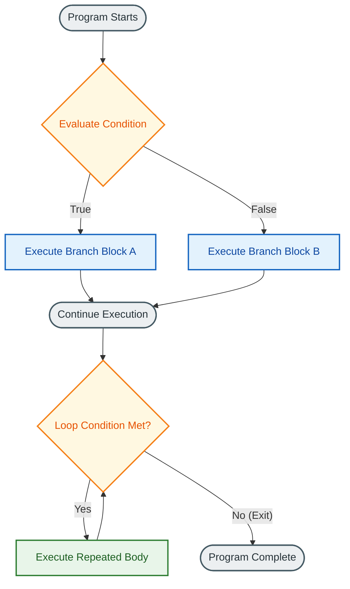
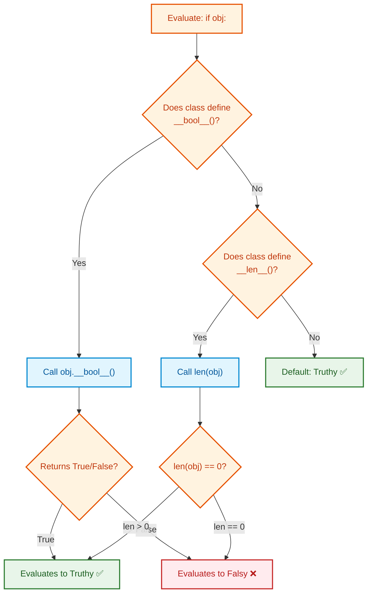
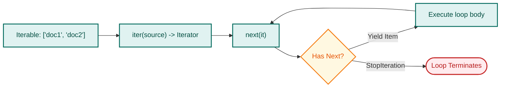
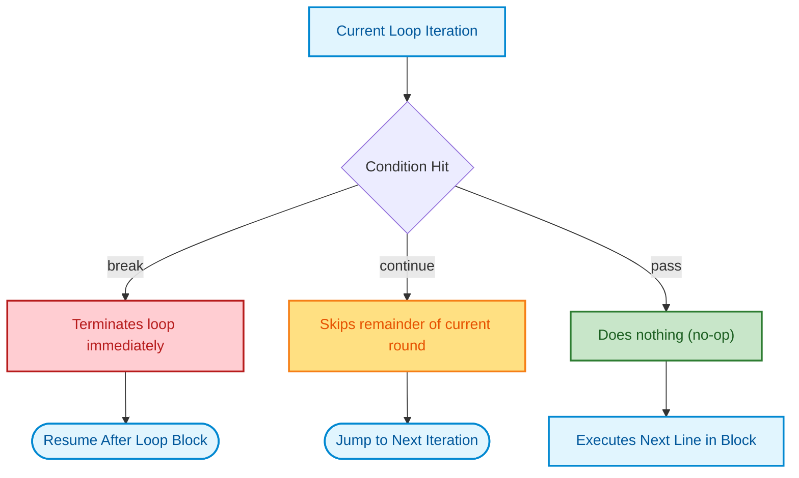
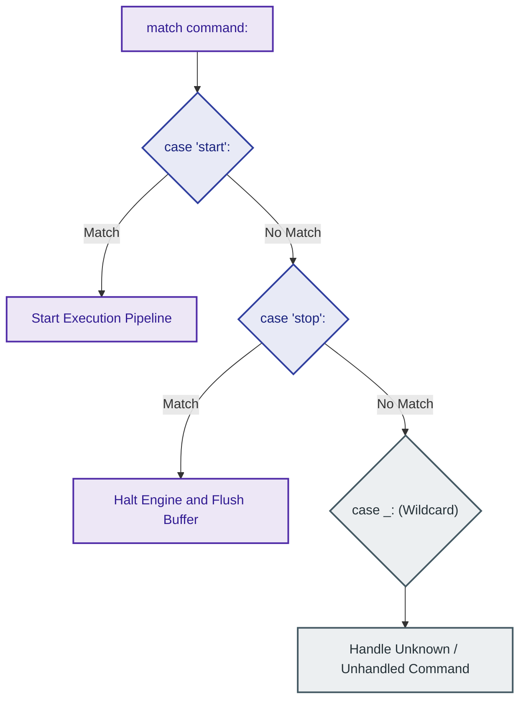

# $\Huge\color{#0D47A1}{\textsf{06 — Control Flow}}$

[](https://www.python.org/)
[](README.md)
[](../../AI%20Engineer%20Architect%20Road%20Map.md)
[](#)

> $\color{#546E7A}\mathbf{Navigation:}$ **Phase 0** · **Module 0.1** · **Lesson 6 of 16** · [← Prev: 05 Dictionaries and Sets](05%20Dictionaries%20and%20Sets.md) · [Phase 0.1 — Python Index](README.md) · [Next: 07 Functions →](07%20Functions.md)

---

## 🗺️ $\color{#0D47A1}\blacksquare\space\color{#1565C0}{\textsf{Stage 0 — Concept Map}}$

> [!IMPORTANT]
> ### $\color{#512DA8}{\textsf{The Core Premise}}$
> So far code runs top to bottom, once. **Control flow** lets a program **make decisions** (`if`) and **repeat work** (loops). This is where programs start to feel alive — and where indentation (Lesson 01) becomes load-bearing. Every algorithm, every data pipeline, every agent loop is built from these. *(Note: Exceptional control flow via `try` / `except` / `else` / `finally` has its own dedicated deep-dive in [10 — Error Handling](10%20Error%20Handling.md)).*

### $\color{#00838F}\blacktriangleright\space\color{#00695C}{\textsf{Where It Fits}}$

* $\color{#0288D1}\blacktriangleright$ **$\color{#01579B}{\textsf{Builds on:}}$** [02 Variables, Types and Operators](02%20Variables%20Types%20and%20Operators.md) and [05 Dictionaries and Sets](05%20Dictionaries%20and%20Sets.md) — boolean logic, comparisons, and iterating collections.
* $\color{#00897B}\blacktriangleright$ **$\color{#004D40}{\textsf{Unlocks:}}$** [07 Functions](07%20Functions.md), [08 Comprehensions and Generators](08%20Comprehensions%20and%20Generators.md), and iterative AI Agent loops (ReAct pattern).

## 🔑 $\color{#4A148C}\blacksquare\space\color{#6A1B9A}{\textsf{New Terms (Plain English)}}$

| $\color{#4A148C}\textsf{\textbf{Term}}$ | $\color{#00695C}\textsf{\textbf{One-Line Meaning}}$ |
| :--- | :--- |
| $\color{#0D47A1}\mathbf{Condition}$ | An expression that evaluates to `True` or `False`. |
| $\color{#0D47A1}\mathbf{Branch}$ | Choosing which code pathway runs (`if` / `elif` / `else`). |
| $\color{#00695C}\mathbf{Loop}$ | Repeating a block of code multiple times (`while`, `for`). |
| $\color{#D32F2F}\mathbf{break\space /\space continue}$ | `break` exits a loop early; `continue` skips to the next iteration. |
| $\color{#E65100}\mathbf{pass}$ | A syntax placeholder that does nothing; satisfies indentation rules. |
| $\color{#2E7D32}\mathbf{Loop\space else}$ | Block running after `for`/`while` only if the loop finishes without `break`. |
| $\color{#00838F}\mathbf{range}$ | Built-in sequence generator for iterating over number intervals. |

## 🎈 $\color{#00695C}\blacksquare\space\color{#00897B}{\textsf{Stage 1 — The Simple Idea (Analogy: Recipe with Choices and Repeats)}}$

A recipe sometimes says *"if the dough is too dry, add water"* (a decision) and *"stir until smooth"* (a repeat). Control flow gives your code those two powers:
* $\color{#0288D1}\blacktriangleright$ **Branching:** Choose which steps to run based on a condition.
* $\color{#00897B}\blacktriangleright$ **Looping:** Run a block again and again until something changes.



> [!IMPORTANT]
> ### $\color{#512DA8}{\textsf{The "Aha!" Insight}}$
> The **indented block** under an `if`/`for`/`while` is the body that those statements control. Indentation *is* the grouping structure — there are no curly braces `{}` or begin/end tokens.

## ⚙️ $\color{#BF360C}\blacksquare\space\color{#D84315}{\textsf{Stage 2 — How It Actually Works}}$

> [!IMPORTANT]
> ### $\color{#00C853}{\textsf{🔥 The 80/20 Core Rule: What Matters in Production}}$
> * $\color{#00C853}\blacktriangleright$ **Daily Core (90% of Real AI Work):** `if / elif / else` branching, `for item in iterable:` loops, `enumerate()` (when you need both index and item), `zip()` (iterating two lists in lockstep), `break` and `continue`, and idiomatic truthy/falsy checks (`if not results:` instead of `if len(results) == 0:`).
> * $\color{#FFB300}\blacktriangleright$ **Occasional (Tool Dispatch and Polling):** `match / case` (structural pattern matching for routing LLM function/tool calls), `while condition:` with a safety counter for polling API status.
> * $\color{#757575}\blacktriangleright$ **Reference Only (Exhaustive and Confusing):** `for ... else` and `while ... else` clauses (obscure syntax prone to misunderstandings).

### $\color{#D84315}\blacktriangleright\space\color{#BF360C}{\textsf{6.1 if / elif / else}}$

```python
score = 72

if score >= 90:                 # condition: an expression that's True or False
    grade = "A"
elif score >= 75:               # checked only if the above was False
    grade = "B"
elif score >= 60:
    grade = "C"
else:                           # runs if none of the above matched
    grade = "F"

print(grade)                    # 'C'
```

Conditions use comparison (`==`, `<`, `>=`, ...) and logical (`and`, `or`, `not`) operators, and
they respect truthiness (Lesson 02):

```python
name = ""
if not name:                    # empty string is falsy
    print("name is missing")

age = 25
if 18 <= age < 65:              # Python allows chained comparisons
    print("working age")

# ⚠️ Float Comparison Pitfall in 'if' conditions:
# Never write 'if val == 0.3:' because binary floating-point rounding causes false negatives.
# Instead, check if the absolute difference is within a tolerance (Lesson 02):
import math
threshold = 0.1 + 0.2
if math.isclose(threshold, 0.3):  # Or: if abs(threshold - 0.3) < 1e-9:
    print("Scores match within acceptable tolerance!")
```

### $\color{#D84315}\blacktriangleright\space\color{#BF360C}{\textsf{6.1.1 Truth Value Testing: Falsy vs. Truthy Across All Python Types}}$

In Python, **any object can be tested directly in an `if` condition** without needing explicit comparisons like `if len(x) == 0` or `if x == True`.

```python
if user_input:                  # Automatically evaluates the truthiness of user_input
    process(user_input)
```

#### $\color{#D84315}\blacktriangleright\space\color{#BF360C}{\textsf{Under the Hood: How Python Evaluates Truthiness}}$

When Python evaluates `if obj:`, it internally invokes `bool(obj)` following a strict two-step protocol:
1. **`__bool__()` Check:** If the object's class defines a `__bool__()` method, Python calls it. The return value must be `True` or `False`.
2. **`__len__()` Fallback:** If `__bool__()` is not defined, Python checks for `__len__()`. If `len(obj) == 0`, the object evaluates to **`False`** (falsy); if `len(obj) > 0`, it evaluates to **`True`** (truthy).
3. **Default:** If neither method is defined, the object is considered **`True` by default**.



---

#### $\color{#D84315}\blacktriangleright\space\color{#BF360C}{\textsf{The Master Falsy vs. Truthy Matrix (Every Built-in Python Type)}}$

Every object in Python is either **Falsy** or **Truthy**:

| Category | Python Data Type | ❌ Falsy Values (`bool(x) == False`) | ✅ Truthy Values (`bool(x) == True`) | Production AI Context |
| :--- | :--- | :--- | :--- | :--- |
| **Booleans** | `bool` | `False` | `True` | Flags (`is_streaming = True`) |
| **Null / Singleton** | `NoneType` | `None` | *(None is always falsy)* | Unconfigured parameters (`api_key = None`) |
| **Integers** | `int` | `0` | Any non-zero: `1`, `42`, `-1`, `-99` ⚠️ *(negatives are Truthy!)* | Retry attempts, token counters |
| **Floats** | `float` | `0.0`, `-0.0` | Any non-zero: `0.001`, `-1.5`, `float('inf')` | Temperature setting (`0.0` is falsy!) |
| **Complex Numbers** | `complex` | `0j`, `0.0 + 0.0j` | `1j`, `2.0 + 3.0j` | Embedding signal transformations |
| **Strings (Text)** | `str` | `""` (empty string) | Any non-empty string: `"Ada"`, `"0"`, `"False"`, `" "` ⚠️ | Prompt text, system instructions |
| **Byte Sequences** | `bytes`, `bytearray` | `b""`, `bytearray()` | Any non-empty bytes: `b"abc"`, `b"\x00"` | Raw audio / binary embedding buffers |
| **Lists** | `list` | `[]` (empty list) | Any list with $\ge 1$ item: `[1]`, `[0]`, `[None]` ⚠️ | Retrieved search chunks, tool calls |
| **Tuples** | `tuple` | `()` (empty tuple) | Any tuple with $\ge 1$ item: `(1,)`, `(0,)`, `(None,)` ⚠️ | Embedding vector dimensions `(1536,)` |
| **Dictionaries** | `dict` | `{}` (empty dict) | Any dict with $\ge 1$ key: `{"a": 1}`, `{"status": False}` ⚠️ | JSON response bodies, tool arguments |
| **Sets** | `set` | `set()` (empty set; note `{}` is a dict!) | Any set with $\ge 1$ item: `{"user"}`, `{0}` | Unique stop-words, seen document IDs |
| **Frozen Sets** | `frozenset` | `frozenset()` | `frozenset([1, 2])` | Immutable prompt categories |
| **Ranges** | `range` | `range(0)` | Any range producing $\ge 1$ number: `range(1)`, `range(5)` | Batch chunk indices |
| **Custom Classes** | `class` | Instances where `__bool__` returns `False` or `__len__` returns `0` | Any standard class instance (truthy by default) | Model agents, database connections |

---

#### $\color{#C62828}\blacktriangleright\space\color{#B71C1C}{\textsf{⚠️ The 5 Infamous \"Truthy Traps\" (Where Production Bugs Happen)}}$

##### $\color{#C62828}\blacktriangleright\space\color{#B71C1C}{\textsf{1. Strings \"0\" and \"False\" are TRUTHY!}}$
A string is only falsy if its length is 0 (`""`). Any string containing characters — even `"0"` or `"False"` — has a length $> 0$ and is **Truthy**:
```python
user_input = "0"
if user_input:
    print("Runs!")                     # 💥 RUNS because len("0") == 1!

flag_str = "False"
if flag_str:
    print("Also runs!")                 # 💥 RUNS because len("False") == 5!

# ✅ Fix: Cast or parse explicitly:
if user_input != "0":
    ...
```

##### $\color{#C62828}\blacktriangleright\space\color{#B71C1C}{\textsf{2. Whitespace Strings \" \" are TRUTHY!}}$
```python
raw_query = "   "                       # User pressed the spacebar
if raw_query:
    print("Valid query!")               # 💥 Runs because length is 3!

# ✅ Fix: Always call .strip() when checking user text input:
if raw_query.strip():
    print("Only runs if non-whitespace characters exist")
```

##### $\color{#C62828}\blacktriangleright\space\color{#B71C1C}{\textsf{3. Collections Containing 0, False, or None are TRUTHY!}}$
A collection's truthiness depends **strictly on whether it is empty**, NOT on what items it contains:
```python
empty_list = []
print(bool(empty_list))                 # False (len == 0)

# A list containing None or 0 is NOT empty (len == 1):
results = [None]
print(bool(results))                    # True! (len == 1)

flags = [False]
print(bool(flags))                      # True! (len == 1)

# A dict whose only value is None or False is NOT empty:
config = {"verbose": False}
print(bool(config))                     # True! (len == 1 key)
```

##### $\color{#C62828}\blacktriangleright\space\color{#B71C1C}{\textsf{4. Negative Numbers are TRUTHY!}}$
Only zero (`0`, `0.0`) is falsy. Negative numbers evaluate to `True`:
```python
exit_code = -1
if exit_code:
    print("True!")                      # Runs! bool(-1) is True
```

##### $\color{#C62828}\blacktriangleright\space\color{#B71C1C}{\textsf{5. The Dangerous AI Parameter Fallback Bug (if x: vs if x is not None:)}}$
This is one of the most common production bugs in Python SDKs and agent code:
```python
# ❌ BUGGY: Fails when user intentionally specifies temperature=0.0 (deterministic mode):
def generate(prompt: str, temperature: float = None):
    # 💥 BUG: bool(0.0) is False! The user's 0.0 is ignored and overridden with 0.7!
    temp = temperature if temperature else 0.7
    return f"Sampling with temp={temp}"

print(generate("Hi", temperature=0.0))  # Output: 'Sampling with temp=0.7' (WRONG!)

# ✅ CORRECT: Distinguish explicitly between unprovided (None) and falsy values (0.0):
def generate_safe(prompt: str, temperature: float = None):
    temp = temperature if temperature is not None else 0.7
    return f"Sampling with temp={temp}"

print(generate_safe("Hi", temperature=0.0))  # Output: 'Sampling with temp=0.0' (CORRECT!)
```

---

#### $\color{#D84315}\blacktriangleright\space\color{#BF360C}{\textsf{Idiomatic Truthiness: PEP 8 Best Practices}}$

```diff
# Comparing unpythonic checking against idiomatic truthiness
- ❌ Clumsy / Verbose checks:
- if len(chat_history) == 0:
-     print("No messages yet")
- if is_active == True:
-     stream_tokens()
- if query != "":
-     process(query)

+ ✅ Clean, idiomatic Python:
+ if not chat_history:
+     print("No messages yet")
+ if is_active:
+     stream_tokens()
+ if query:
+     process(query)
```

* **Checking for empty sequences / collections:**
  ```python
  # [CORE - DAILY] Idiomatic check:
  if not chat_history:
      print("No messages yet")

  # [AVOID] Clumsy length check:
  if len(chat_history) == 0:
      print("No messages yet")
  ```
* **Checking explicitly for `None`:**
  ```python
  # ✅ Always use 'is' / 'is not' when checking if an optional argument was provided:
  if response is None:
      retry()
  ```

---

**Shorthand `if-else` (conditional expression / ternary):**

When choosing between two values in a single line, Python provides a one-line conditional expression (`value_if_true if condition else value_if_false`). Unlike an `if` statement block, this expression evaluates directly to a value:

```python
score = 85

# Traditional multi-line if-else:
if score >= 60:
    status = "Pass"
else:
    status = "Fail"

# Shorthand one-line equivalent:
status = "Pass" if score >= 60 else "Fail"
print(status)                          # 'Pass'

# Real-world AI application: selecting a model based on a boolean flag:
use_advanced_model = True
model_name = "gpt-4o" if use_advanced_model else "gpt-4o-mini"
print(model_name)                      # 'gpt-4o'

# Used directly inside an f-string:
temp = 0.8
print(f"Sampling mode: {'Creative' if temp > 0.5 else 'Deterministic'}")
# Output: 'Sampling mode: Creative'
```

### $\color{#D84315}\blacktriangleright\space\color{#BF360C}{\textsf{6.2 while Loops — Repeat Until a Condition Fails}}$

```python
count = 3
while count > 0:                # keep looping while this stays True
    print(count)
    count -= 1                  # MUST move toward the exit, or you loop forever
print("liftoff")
```

`break` exits a loop early; `continue` skips to the next iteration:

```python
n = 0
while True:                     # an intentional "loop forever" — exit with break
    n += 1
    if n == 3:
        continue                # skip printing 3
    if n > 5:
        break                   # leave the loop
    print(n)                    # 1 2 4 5
```

### $\color{#D84315}\blacktriangleright\space\color{#BF360C}{\textsf{6.3 for Loops — Walk Through a Collection}}$

A `for` loop in Python is a "for-each" loop. It iterates directly over the items of any sequence or iterable (lists, strings, tuples, dictionaries, or ranges).



#### $\color{#D84315}\blacktriangleright\space\color{#BF360C}{\textsf{1. Iterating over collections and strings}}$

```python
# Lists & tuples:
for fruit in ["apple", "banana"]:
    print(fruit)                       # 'apple' then 'banana'

# Strings (character by character):
for char in "AI":
    print(char)                        # 'A' then 'I'

# Dictionaries (iterates keys by default, or .items() for pairs):
for key, value in {"model": "gpt-4o", "temp": 0.7}.items():
    print(f"{key} = {value}")
```

#### $\color{#D84315}\blacktriangleright\space\color{#BF360C}{\textsf{2. The range() function and shorthand repeat loops}}$

`range()` generates numbers on demand without allocating an entire list in memory:

```python
# range(stop): 0 up to stop (stop is excluded):
for i in range(3):
    print(i)                           # 0, 1, 2

# range(start, stop):
for i in range(1, 4):
    print(i)                           # 1, 2, 3

# range(start, stop, step):
for i in range(0, 10, 2):
    print(i)                           # 0, 2, 4, 6, 8

# Reverse / countdown range (negative step):
for i in range(3, 0, -1):
    print(i)                           # 3, 2, 1

# Shorthand repeat using throwaway variable '_':
# Use '_' when you just want to repeat an action N times without needing the index:
for _ in range(3):
    print("Retrying API request...")   # prints 3 times
```

#### $\color{#D84315}\blacktriangleright\space\color{#BF360C}{\textsf{3. Loop variations: enumerate(), zip(), reversed()}}$

| Loop Helper | Production Priority | Return Value | Memory Overhead | Real-World AI Application |
| :--- | :--- | :--- | :--- | :--- |
| **`enumerate(seq, start=0)`** | $\color{#00C853}\blacksquare\ \textbf{Core (Daily)}$ | `(index, item)` tuple | $O(1)$ lazy streaming | Numbering retrieved citations, chat message ordering |
| **`zip(*iterables)`** | $\color{#00C853}\blacksquare\ \textbf{Core (Daily)}$ | Tuples of paired items | $O(1)$ lazy streaming | Pairing prompt templates with user variables, input/target alignment |
| **`range(start, stop, step)`** | $\color{#00C853}\blacksquare\ \textbf{Core (Daily)}$ | Integer range generator | $O(1)$ memory generator | API retry loops (`for _ in range(3):`), batch slice index stepping |
| **`reversed(seq)`** | $\color{#FFB300}\blacksquare\ \textbf{Occasional}$ | Reverse iterator | $O(1)$ zero-copy | Inspecting token stream in reverse, recent message stack traversal |
| **`sorted(seq)`** | $\color{#FFB300}\blacksquare\ \textbf{Occasional}$ | New sorted list | $O(N)$ new allocation | Ordering RAG retrieval results by similarity score descending |

```diff
# Accessing both index and element
- ❌ Clumsy indexing anti-pattern:
- for i in range(len(tools)):
-     tool = tools[i]
-     print(f"{i + 1}. {tool}")

+ ✅ Idiomatic enumerate:
+ for idx, tool in enumerate(tools, start=1):
+     print(f"{idx}. {tool}")
```

- **`enumerate(seq)`**: yields `(index, item)` pairs so you don't need manual index counters.
- **`zip(seq1, seq2)`**: walks through two or more collections in lockstep.
- **`reversed(seq)`**: streams items backwards without copying the collection in memory.

```python
tools = ["search", "calculator", "browser"]

# 1. enumerate — index + value:
for idx, tool in enumerate(tools, start=1):
    print(f"{idx}. {tool}")            # 1. search / 2. calculator / 3. browser

# 2. zip — iterate two lists together:
queries = ["weather", "math"]
prompts = ["What's the forecast?", "Compute 12 * 8"]
for q, p in zip(queries, prompts):
    print(f"{q} -> {p}")

# 3. reversed — zero-copy backwards iteration:
for tool in reversed(tools):
    print(tool)                        # browser, calculator, search
```

#### $\color{#D84315}\blacktriangleright\space\color{#BF360C}{\textsf{4. Shorthand: Guarding against None or empty before a loop}}$

If a function or API returns `None` instead of a list, a normal loop crashes with `TypeError: 'NoneType' object is not iterable`. Python has clean patterns to handle this:

```python
# The risk:
# response_docs = None
# for doc in response_docs: ...       # 💥 TypeError: 'NoneType' object is not iterable

# 1. Inline shorthand: '(items or [])':
# If response_docs is None (or empty), it evaluates to [] and runs 0 times safely:
response_docs = None
for doc in response_docs or []:
    print(doc)                         # Safe! 0 iterations, NO crash

# 2. Shorthand boolean check before the loop:
chunks = []
if not chunks:
    print("No chunks to process")      # Clean early exit / guard clause
else:
    for c in chunks: ...

# 3. Explicit None guard:
if response_docs is not None:
    for doc in response_docs: ...
```

#### $\color{#D84315}\blacktriangleright\space\color{#BF360C}{\textsf{5. Loop else clause (for ... else and while ... else)}}$

Python loops can have an optional `else` block. The `else` runs **only if the loop completes all iterations without hitting `break`**. If `break` terminates the loop early, the `else` block is skipped.

```python
# 1. for ... else (The Search Pattern):
documents = ["doc_01", "doc_02", "doc_03"]
target = "doc_99"

for doc in documents:
    if doc == target:
        print("Found document!")
        break
else:
    print("Document not found.")       # runs because break was never hit

# 2. while ... else (The Retry / Timeout Pattern):
attempts = 0
max_retries = 3
service_ready = False

while attempts < max_retries:
    attempts += 1
    if service_ready:
        print("Connected successfully!")
        break
else:
    print("Failed to connect after 3 attempts.")  # runs because break was never hit
```

### $\color{#D84315}\blacktriangleright\space\color{#BF360C}{\textsf{6.4 Loop Control: continue vs break vs pass}}$



Engineers frequently ask about the exact mechanical differences between these three keywords:
- **`continue`**: Skips the remainder of the *current iteration* and jumps straight to the next iteration.
- **`break`**: Terminates the *entire loop* immediately and jumps out to the code after the loop.
- **`pass`**: A "do-nothing" statement. Execution proceeds immediately to the *very next line in the current block*.

#### $\color{#D84315}\blacktriangleright\space\color{#BF360C}{\textsf{1. The 3-way direct comparison on identical data}}$

```python
numbers = [1, 2, 3]

# (a) pass: does NOTHING — print(n) still runs for all numbers:
for n in numbers:
    if n == 2:
        pass                           # does nothing!
    print(n, end=" ")
# Output: 1 2 3

print()

# (b) continue: SKIPS remaining lines of this round, proceeds to 3:
for n in numbers:
    if n == 2:
        continue                       # skips print(2)
    print(n, end=" ")
# Output: 1 3

print()

# (c) break: EXITS the loop immediately on 2:
for n in numbers:
    if n == 2:
        break                          # loop terminates completely
    print(n, end=" ")
# Output: 1
```

#### $\color{#D84315}\blacktriangleright\space\color{#BF360C}{\textsf{2. Where pass is practically used}}$

Because Python uses indentation instead of curly braces (`{}`), you cannot leave a code block empty without raising an `IndentationError`. Use `pass` as a syntactical placeholder:

```python
# 1. Empty if-branch (explicitly ignore a condition):
status_code = 200
if status_code == 200:
    pass                               # Handled / OK — do nothing
else:
    print("Error encountered!")

# 2. Stubbing functions or agent tools to implement later:
def extract_entities(text: str):
    pass                               # TODO: implement with spaCy or an LLM

# 3. Custom class or exception stubs:
class ToolExecutionError(Exception):
    pass                               # Empty class definition
```

### $\color{#D84315}\blacktriangleright\space\color{#BF360C}{\textsf{6.5 match — Clean Multi-Way Branching (Modern Python)}}$



```python
command = "start"

match command:                  # compares the value against each "case"
    case "start":
        print("starting...")
    case "stop":
        print("stopping...")
    case _:                     # "_" is the catch-all (like else)
        print("unknown command")
```

#### $\color{#D84315}\blacktriangleright\space\color{#BF360C}{\textsf{Pattern Matching with Enums (match + Enum)}}$
In production AI engineering, `match / case` is most commonly paired with **`Enum`** types to build type-safe state machines and tool dispatchers without fragile magic strings:

```python
from enum import Enum, auto

class AgentState(Enum):
    IDLE = auto()
    PLANNING = auto()
    EXECUTING = auto()
    FAILED = auto()

current_state = AgentState.PLANNING

# 1. Matching against Enum members:
match current_state:
    case AgentState.IDLE:
        print("Waiting for prompt...")
    case AgentState.PLANNING:
        print("Generating DAG plan...")
    case AgentState.EXECUTING:
        print("Executing tools...")
    case AgentState.FAILED:
        print("Triggering retry handler...")

# 2. Comparing Enums in 'if' conditions:
# Always use 'is' / 'is not' for Enum comparison (fastest, checks memory identity of singleton):
if current_state is AgentState.PLANNING:
    print("Agent is actively planning.")
```

*(See [12 — Object-Oriented Programming](12%20Object-Oriented%20Programming.md#127-enumerations-enum-typesafe-named-constants) for the complete guide to `Enum`, `IntEnum`, `StrEnum`, and `.value`).*

Use `match` when you'd otherwise write a long `if/elif` chain comparing one value to many options.

## 🚀 $\color{#0D47A1}\blacksquare\space\color{#1565C0}{\textsf{Stage 3 — In Practice / Why It Matters}}$

Branching decides which model or tool to call; loops process every document chunk, retry failed
API calls, or drive an agent's "think → act → observe" cycle. Comfort with `for`, `range`,
`break`, and `continue` is non-negotiable for everything ahead.

**Common beginner mistakes (the reasoning):**
1. **Infinite `while`** — forgetting to change the condition variable. Always ensure progress
   toward the exit (`count -= 1`). *Reason:* the loop only stops when the condition becomes False.
2. **Indentation errors** — mixing tabs/spaces or uneven indents under `if`/`for`. Use 4 spaces
   consistently. *Reason:* indentation defines the block; unevenness changes meaning or errors.
3. **Modifying a list while looping over it** — deleting items mid-iteration skips elements. Loop
   over a copy (`for x in items[:]:`) or build a new list instead.
4. **Off-by-one with `range`** — `range(5)` is `0..4`, not `1..5`; the stop is excluded.

### $\color{#0D47A1}\blacktriangleright\space\color{#1565C0}{\textsf{Try It Yourself}}$
Use a `for` loop and `range` to print only the even numbers from 1 to 20, then rewrite it using
`continue` to skip odds.

## ⚖️ $\color{#00695C}\blacksquare\space\color{#00838F}{\textsf{Variations and When to Use (Control Flow Decision Guide)}}$

### $\color{#00695C}\blacktriangleright\space\color{#00838F}{\textsf{Branching Decisions}}$

| Technique | Syntax | ✅ When to Use | 🚫 Avoid When | AI / Pipeline Use Case |
| :--- | :--- | :--- | :--- | :--- |
| **`if / elif / else`** | `if c1: ... elif c2: ... else: ...` | Multi-line logic, distinct side effects, or complex boolean checks | Assigning a single variable between 2 simple choices | Guarding invalid inputs, routing logic |
| **Shorthand `if-else` (Ternary)** | `val = x if cond else y` | Single inline value selection, f-string formatting, defaults | Complex multi-line bodies or nested conditions | Choosing model tier (`"gpt-4o"` vs `"mini"`) |
| **`match / case`** | `match val: case "a": ...` | Clean branching against known literal commands or structural shapes | Simple binary True/False checks | Agent tool/action dispatcher |

### $\color{#00695C}\blacktriangleright\space\color{#00838F}{\textsf{Looping Decisions}}$

| Technique | Syntax | ✅ When to Use | 🚫 Avoid When | AI / Pipeline Use Case |
| :--- | :--- | :--- | :--- | :--- |
| **Direct `for` iteration** | `for item in seq:` | Inspecting or processing all items in a collection or string | You need the item's numeric index | Processing document chunks |
| **`range(start, stop, step)`** | `for i in range(n):` | Repeating a specific number of times or stepping through indices | Looping over an existing collection (use direct `for`) | Retrying API requests (`for _ in range(3):`) |
| **`enumerate(seq)`** | `for idx, item in enumerate(s):` | You need both the numeric index and the item value together | You only need the item values | Numbered citations or chat message history |
| **`zip(seq1, seq2)`** | `for a, b in zip(l1, l2):` | Walking through 2 or more related sequences in parallel | Collections have unequal lengths and trailing data matters | Pairing prompt templates with user queries |
| **`while` loop** | `while condition:` | Looping until an external condition changes or state converges | You know the exact number of iterations upfront | ReAct agent think-act-observe cycle |
| **`continue`** | `continue` | Skipping invalid/blank items and jumping to the next iteration | You want to exit the loop entirely (use `break`) | Filtering out blank prompt chunks |
| **`break`** | `break` | Terminating loop immediately on match or error threshold | You only want to skip the current item (use `continue`) | Aborting execution on guardrail violation |
| **`pass`** | `pass` | Syntactical placeholder for empty blocks (TODOs, no-op branches) | You want to skip loop iterations (use `continue`) | Stubbing custom tool functions or empty classes |
| **Loop `else`** | `for/while ... break else:` | Running a fallback when search or retry loop completes without break | Loops without a `break` statement (`else` will always run) | Document lookup or API retry exhaustion |
| **Safe guard `(items or [])`** | `for x in items or []:` | Fast inline guard against `None` or empty iterables | You need to log an explicit warning when input is `None` | Streaming token chunks from optional API fields |

## 🐛 $\color{#880E4F}\blacksquare\space\color{#AD1457}{\textsf{Common Errors and Fixes}}$

| What you see | Cause | Fix |
| --- | --- | --- |
| Default `0` or `0.0` parameter overridden by fallback | Used `val = x if x else default`, but `0` / `0.0` is falsy | Check explicitly for `None`: `val = x if x is not None else default` |
| `if input_str:` evaluates to True on spaces or "0" | Non-empty strings (even `" "` or `"0"`) have `len > 0` and are Truthy | Strip whitespace (`if input_str.strip():`) or cast to int/bool |
| `IndentationError: expected an indented block` | Left an `if`/`for`/`def` body completely empty | Add `pass` as a placeholder |
| Unexpected execution after condition | Used `pass` thinking it skips to the next iteration | Use `continue` instead of `pass` |
| `TabError: inconsistent use of tabs and spaces` | Mixed tabs and spaces | Use spaces only (VS Code does this for `.py`) |
| `TypeError: 'NoneType' object is not iterable` | Looped over `None` | Use `for x in (items or []):` or guard with `if items:` |
| Program hangs forever | A `while` condition never becomes False | Make the loop variable move toward the exit |
| `range(5)` gives `0..4`, not `1..5` | The `stop` value is excluded | Use `range(1, 6)` for 1–5 |

## 📌 $\color{#1B5E20}\blacksquare\space\color{#2E7D32}{\textsf{Quick Reference}}$

```python
if c: ...        elif c2: ...        else: ...
val = x if cond else y          # shorthand if-else (ternary expression)
pass                            # do nothing (syntax placeholder for empty blocks)
continue                        # skip remainder of this round, start next round
break                           # exit loop immediately
while cond: ...                # repeat while condition is True
while cond: ... else: ...       # else runs ONLY if while exited without break
for x in items or []: ...       # safe loop (runs 0 times if items is None)
for char in "text": ...         # iterate string characters
for _ in range(3): ...          # repeat 3 times (throwaway index)
for i in range(2, 10, 2): ...  # 2, 4, 6, 8 (start, stop, step)
for i, x in enumerate(items): ... # index + value
for a, b in zip(l1, l2): ...    # iterate two lists in parallel
for x in reversed(items): ...   # iterate backwards without copying
for x in items: ... else: ...   # else runs ONLY if loop completes without break
match value:
    case "a": ...
    case _: ...                # catch-all (like else)
```

## 🛑 $\color{#B71C1C}\blacksquare\space\color{#D32F2F}{\textsf{STOP — Self-Check}}$

What does this print, and why does it stop where it does?

```python
total = 0
for n in range(1, 100):
    total += n
    if total > 10:
        break
print(n, total)
```

<details>
<summary><b>🔍 Click to Reveal the Answer</b></summary>

<br/>

It prints **`5 15`**. The loop adds 1+2+3+4+5 = 15; after adding 5, `total` (15) exceeds 10, so
`break` fires immediately, leaving `n` at **5**. `range(1, 100)` starts at 1, and `break` stops the
loop the first time the condition is met — so it never reaches 6.

---

🎉 **Lesson Complete!** Continue to the next lesson: [07 Functions →](07%20Functions.md)

</details>
