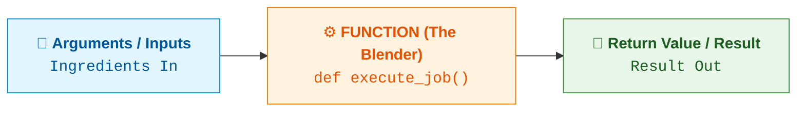
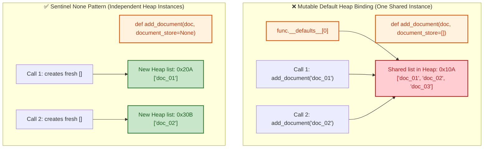
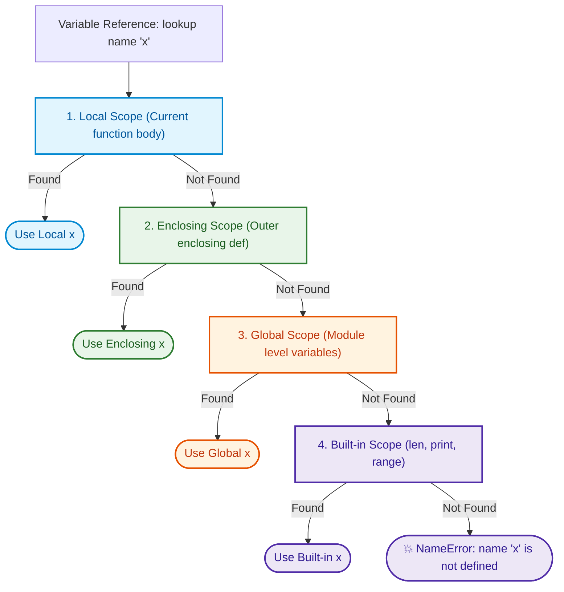

# $\Huge\color{#0D47A1}{\textsf{07 — Functions}}$

[](https://www.python.org/)
[](README.md)
[](../../AI%20Engineer%20Architect%20Road%20Map.md)
[](#)

> $\color{#546E7A}\mathbf{Navigation:}$ **Phase 0** · **Module 0.1** · **Lesson 7 of 16** · [← Prev: 06 Control Flow](06%20Control%20Flow.md) · [Phase 0.1 — Python Index](README.md) · [Next: 08 Comprehensions and Generators →](08%20Comprehensions%20and%20Generators.md)

---

## 🗺️ $\color{#0D47A1}\blacksquare\space\color{#1565C0}{\textsf{Stage 0 — Concept Map}}$

> [!IMPORTANT]
> ### $\color{#512DA8}{\textsf{The Core Premise}}$
> A **function** is a named, reusable block of code. Functions are how you stop repeating yourself, give names to ideas, and build programs out of small testable parts. In modern Python and AI engineering, functions are more than just reusability — they are the foundational contract for **LLM tool calling**, where AI models inspect function signatures, docstrings, and type hints to interact with the real world. Everything from here on — decorators, methods, async functions, agent tools — is built on functions.

### $\color{#00838F}\blacktriangleright\space\color{#00695C}{\textsf{Where It Fits}}$

* $\color{#0288D1}\blacktriangleright$ **$\color{#01579B}{\textsf{Builds on:}}$** [06 Control Flow](06%20Control%20Flow.md) — execution blocks, variable scoping, and conditional returns.
* $\color{#00897B}\blacktriangleright$ **$\color{#004D40}{\textsf{Unlocks:}}$** [08 Comprehensions and Generators](08%20Comprehensions%20and%20Generators.md), [09 Decorators and Closures](09%20Decorators%20and%20Closures.md), and AI Tool Calling (structured schemas for LLMs).

## 🔑 $\color{#4A148C}\blacksquare\space\color{#6A1B9A}{\textsf{New Terms (Plain English)}}$

- **Function** — a named, reusable block of code defined with `def`.
- **Parameter** — the variable name listed in the function definition (the input slot).
- **Argument** — the concrete value sent to the function when calling it.
- **Positional argument** — an argument matched to a parameter strictly by its left-to-right order.
- **Keyword argument (named argument)** — an argument matched by explicitly specifying `name=value`.
- **Default parameter** — a parameter with a predefined fallback value, making it optional for the caller.
- **Keyword-only parameter (`*`)** — a parameter that callers MUST pass by name, never positionally.
- **Positional-only parameter (`/`)** — a parameter that callers MUST pass positionally, never by name.
- **`*args` (Arbitrary positional arguments)** — collects any excess positional arguments into an immutable `tuple`.
- **`**kwargs` (Arbitrary keyword arguments)** — collects any excess keyword arguments (`name=val`) into a `dict`.
- **Argument unpacking (`*` / `**`)** — exploding an iterable into positional arguments (`*list`) or a dict into keyword arguments (`**dict`) at call time.
- **Return value** — the output handed back to the caller by `return` (`None` if omitted).
- **Parameter type annotation (`param: type`)** — an optional label declaring the expected data type of an input parameter.
- **Return type annotation (`-> type`)** — an optional label declaring the data type the function hands back.
- **Multiple return values** — returning comma-separated values (`return a, b`), which Python automatically bundles into a `tuple`.
- **Scope (LEGB Rule)** — the visibility hierarchy of variables in memory: Local $\rightarrow$ Enclosing $\rightarrow$ Global $\rightarrow$ Built-in.
- **`global` keyword** — explicitly binds a variable inside a function to the module-level global namespace for rebinding or creation.
- **`nonlocal` keyword** — binds a variable in a nested function to the nearest enclosing (outer) function's scope, neither local nor global.
- **Mutable default trap** — the bug where a mutable default object (`[]` or `{}`) is shared across all function calls.

## 🎈 $\color{#00695C}\blacksquare\space\color{#00897B}{\textsf{Stage 1 — The Simple Idea (Analogy: A Kitchen Appliance)}}$

A function is like a blender: you put **ingredients in** (arguments), it does a defined **job** (the body), and it hands you a **result out** (the return value). Once built, you reuse it endlessly without caring about the internal wiring — you just feed it inputs and take the output.

> [!IMPORTANT]
> ### $\color{#512DA8}{\textsf{The "Aha!" Insight}}$
> Define the recipe **once** with `def`, then **call** it as many times as you like with different inputs. A function packages behaviour behind a name.



## ⚙️ $\color{#BF360C}\blacksquare\space\color{#D84315}{\textsf{Stage 2 — How It Actually Works}}$

> [!IMPORTANT]
> ### $\color{#00C853}{\textsf{🔥 The 80/20 Core Rule: What Matters in Production}}$
> * $\color{#00C853}\blacktriangleright$ **Daily Core (90% of Real AI Work):** Function definitions `def func(...)`, immutable default arguments (always `default=None`, never mutable lists `default=[]`), `*args` and `**kwargs` (essential for decorators, middleware, and forwarding options to LLM client libraries), explicit `return`, and type annotations.
> * $\color{#FFB300}\blacktriangleright$ **Occasional (Clean API Signatures):** Keyword-only parameters (`def func(*, prompt, model)` for safer configuration), lambdas for custom sorting `key=lambda d: d.score`.
> * $\color{#757575}\blacktriangleright$ **Reference Only (Exhaustive and Fragile):** Positional-only parameters (`/`), `global` and `nonlocal` keywords (avoid global mutable state in production), deep recursion (Python lacks tail-call optimization).

### $\color{#D84315}\blacktriangleright\space\color{#BF360C}{\textsf{7.1 Defining, Calling and Return Values (Data Types, Multiple Returns, Implicit None)}}$

$$
\overbrace{\color{#E53935}\texttt{def}}^{\color{#B71C1C}\textsf{🔒\ 1.\ Keyword\ (Starts\ definition)}}\space\space
\underbrace{\color{#0D47A1}\texttt{greet}}_{\color{#1565C0}\textsf{🏷️\ 2.\ Function\ Name}}\space\space
\overbrace{\color{#00897B}\texttt{(name:\ str)}}^{\color{#004D40}\textsf{💻\ 3.\ Parameter\ (Input\ slot\ placeholder)}}\space\space
\underbrace{\color{#7B1FA2}\texttt{->\ str:}}_{\color{#4A148C}\textsf{🎯\ 4.\ Return\ Type\ Contract}}
$$

$$
\textsf{\textbf{Definition Time:}}\quad \color{#E53935}\texttt{def}\space\color{#0D47A1}\texttt{greet}\texttt{(}\color{#00897B}\texttt{name}\texttt{):}\quad \longleftarrow\space \color{#00897B}\textbf{\textsf{Parameter}}\space\textsf{(The variable placeholder slot)}
$$
$$
\textsf{\textbf{Call Time:}}\quad\quad\quad\space \color{#0D47A1}\texttt{greet}\texttt{(}\color{#D84315}\texttt{"Ada"}\texttt{)}\quad\quad \longleftarrow\space \color{#D84315}\textbf{\textsf{Argument}}\space\textsf{(The concrete value passed into slot)}
$$

```python
def greet(name: str) -> str:
    return f"Hello, {name}!"        # "return" hands value back to caller

message = greet("Ada")              # Call with concrete argument "Ada"
print(message)                      # 'Hello, Ada!'
print(greet("Bo"))                  # Reuse immediately with another argument -> 'Hello, Bo!'
```

#### $\color{#D84315}\blacktriangleright\space\color{#BF360C}{\textsf{1. Returning Any Data Type (Primitives vs Collections)}}$

Because Python is dynamically typed, a function can return any Python data type: numbers, strings, booleans, lists, dictionaries, or custom objects:

```python
# (a) Returning a primitive (int):
def add_scores(a: int, b: int) -> int:
    return a + b

# (b) Returning a structured dictionary (typical LLM API output):
def format_llm_response(text: str, tokens_used: int) -> dict:
    return {
        "content": text,
        "usage": {"total_tokens": tokens_used},
        "finish_reason": "stop",
    }

response = format_llm_response("Hello!", 12)
print(response["usage"]["total_tokens"])  # 12

# (c) Returning a list (chunking text):
def split_chunks(text: str) -> list[str]:
    return text.split(". ")

print(split_chunks("Sentence one. Sentence two."))  # ['Sentence one', 'Sentence two.']
```

#### $\color{#D84315}\blacktriangleright\space\color{#BF360C}{\textsf{2. Returning Multiple Values (Automatic Tuple Packing and Unpacking)}}$

$$
\textsf{\textbf{Return Packing:}}\space \color{#E53935}\texttt{return}\space \color{#00897B}\texttt{tokens\_per\_sec,\ cost\_estimate}\space \longrightarrow\space \color{#7B1FA2}\texttt{(200.0,\ 0.01)}\space\textsf{(Packed into immutable Tuple)}
$$
$$
\textsf{\textbf{Caller Unpacking:}}\space \color{#00897B}\texttt{speed,\ cost}\space \color{#37474F}\texttt{=}\space \color{#0D47A1}\texttt{calculate\_metrics(500,\ 2.5)}\space \longrightarrow\space \color{#00897B}\texttt{speed=200.0},\space \color{#00897B}\texttt{cost=0.01}
$$

```python
def calculate_metrics(tokens: int, duration_sec: float):
    tokens_per_sec = tokens / duration_sec
    cost_estimate = tokens * 0.00002
    return tokens_per_sec, cost_estimate    # packs into a tuple: (tps, cost)

# 1. Capture as a single tuple object:
metrics = calculate_metrics(500, 2.5)
print(metrics)                              # (200.0, 0.01)
print(type(metrics))                        # <class 'tuple'>

# 2. Unpack directly into separate variables on the caller side (idiomatic Python):
speed, cost = calculate_metrics(500, 2.5)
print(f"Speed: {speed} tps | Cost: ${cost}") # Speed: 200.0 tps | Cost: $0.01
```

#### $\color{#D84315}\blacktriangleright\space\color{#BF360C}{\textsf{3. Early Return (Guard Clauses)}}$

The `return` statement terminates execution immediately and exits the function. Use **guard clauses** at the top of a function to handle invalid or missing inputs early, avoiding deeply nested `if/else` ladders:

```python
def retrieve_documents(query: str | None) -> list[str]:
    # Guard clause: exit early if input is invalid:
    if not query or not query.strip():
        return []                           # returns empty list immediately

    # Main logic runs only when input is valid:
    return [f"Chunk 1 matching '{query}'", f"Chunk 2 matching '{query}'"]

print(retrieve_documents(None))             # [] (exited early, no crash)
print(retrieve_documents("AI agents"))      # ['Chunk 1 matching...', 'Chunk 2 matching...']
```

#### $\color{#D84315}\blacktriangleright\space\color{#BF360C}{\textsf{4. The Implicit return None (Side Effects vs Values)}}$

If a function does not contain a `return` statement, or if `return` is written without an expression, Python **automatically returns `None`**:

```python
# A function with NO return statement:
def log_event(event_name: str) -> None:
    print(f"[LOG] {event_name}")            # prints to screen (side effect)
    # No return statement here!

result = log_event("Server started")        # prints: '[LOG] Server started'
print(result)                               # None!

# An explicit empty return (used to exit early from a void function):
def send_alert(message: str) -> None:
    if not message:
        return                              # exits immediately; implicitly returns None
    print(f"ALERT: {message}")
```

### $\color{#D84315}\blacktriangleright\space\color{#BF360C}{\textsf{7.2 Positional vs Keyword (Named) Arguments}}$

| $\color{#546E7A}\textsf{\textbf{Call Style}}$ | $\color{#0D47A1}\textsf{\textbf{Invocation Code Syntax}}$ | $\color{#00695C}\textsf{\textbf{Positional Rule and Mechanism}}$ | $\color{#1B5E20}\textsf{\textbf{Verdict}}$ |
| :--- | :--- | :--- | :---: |
| **1. Pure Positional** | $\color{#0D47A1}\texttt{connect\_db}\color{#263238}\texttt{(}\color{#00897B}\texttt{"localhost"}\color{#263238}\texttt{,}\space\color{#00897B}\texttt{5432}\color{#263238}\texttt{,}\space\color{#00897B}\texttt{"vec"}\color{#263238}\texttt{)}$ | Left-to-right alignment: Order strictly matters | ✅ Valid |
| **2. Pure Keyword** | $\color{#0D47A1}\texttt{connect\_db}\color{#263238}\texttt{(}\color{#D84315}\texttt{db\_name=}\color{#00897B}\texttt{"vec"}\color{#263238}\texttt{,}\space\color{#D84315}\texttt{host=}\color{#00897B}\texttt{"loc"}\color{#263238}\texttt{,}\space\color{#D84315}\texttt{port=}\color{#00897B}\texttt{5432}\color{#263238}\texttt{)}$ | Name-matched: Any order produces identical call | ✅ Valid |
| **3. Mixed Call** | $\color{#0D47A1}\texttt{connect\_db}\color{#263238}\texttt{(}\color{#00897B}\texttt{"localhost"}\color{#263238}\texttt{,}\space\color{#D84315}\texttt{db\_name=}\color{#00897B}\texttt{"vec"}\color{#263238}\texttt{,}\space\color{#D84315}\texttt{port=}\color{#00897B}\texttt{5432}\color{#263238}\texttt{)}$ | Positional args FIRST, keywords AFTER | ✅ Valid |
| **❌ Illegal Order** | $\color{#0D47A1}\texttt{connect\_db}\color{#263238}\texttt{(}\color{#D84315}\texttt{host=}\color{#00897B}\texttt{"loc"}\color{#263238}\texttt{,}\space\color{#C62828}\texttt{5432}\color{#263238}\texttt{,}\space\color{#C62828}\texttt{"vec"}\color{#263238}\texttt{)}$ | `SyntaxError`: Positional arg cannot follow keyword | ❌ SyntaxError |
| **❌ Duplicate Slot** | $\color{#0D47A1}\texttt{connect\_db}\color{#263238}\texttt{(}\color{#00897B}\texttt{"loc"}\color{#263238}\texttt{,}\space\color{#00897B}\texttt{5432}\color{#263238}\texttt{,}\space\color{#00897B}\texttt{"vec"}\color{#263238}\texttt{,}\space\color{#C62828}\texttt{host=}\color{#00897B}\texttt{"srv"}\color{#263238}\texttt{)}$ | `TypeError`: Multiple values assigned to `host` | ❌ TypeError |

```python
def connect_db(host: str, port: int, db_name: str):
    return f"Connected to {db_name} at {host}:{port}"
```

### $\color{#D84315}\blacktriangleright\space\color{#BF360C}{\textsf{7.3 Default Parameters and The "Defaults at the End" Rule}}$

$$
\overbrace{\color{#E53935}\texttt{def}}^{\textsf{Keyword}}\space\space
\color{#0D47A1}\texttt{power}\texttt{(}\space
\overbrace{\color{#00897B}\texttt{base:\ int}}^{\color{#004D40}\textsf{1.\ Required\ Positional\ (No\ Default)}}\space\texttt{,}\space\space
\overbrace{\color{#D84315}\texttt{exponent:\ int}\space\color{#BF360C}\texttt{=\ 2}}^{\color{#BF360C}\textsf{2.\ Optional\ Parameter\ (Fallback\ =\ 2)}}\space
\texttt{)}\space\space
\overbrace{\color{#7B1FA2}\texttt{->\ int:}}^{\textsf{Return\ Type}}
$$

```python
def power(base: int, exponent: int = 2) -> int:
    return base ** exponent

print(power(5))                     # 25  — exponent defaulted to 2
print(power(5, 3))                  # 125 — exponent overridden positionally to 3
print(power(5, exponent=4))         # 625 — exponent overridden by keyword to 4
```

#### $\color{#00695C}\blacktriangleright\space\color{#004D40}{\textsf{The Defaults at the End Rule}}$
**Parameters with default values MUST follow all parameters without default values.**

```python
# ✅ VALID: non-default parameter ('prompt') comes first; defaults come after:
def query_model(prompt: str, model: str = "gpt-4o", temp: float = 0.7):
    pass

# ❌ INVALID: SyntaxError: non-default argument follows default argument
# def query_model(model: str = "gpt-4o", prompt: str):
#     pass
```

> **Why does Python enforce this under the hood?**
> Python evaluates arguments positionally from left to right. If default parameters could be placed before required parameters, a call like `query_model("Hello")` would be completely ambiguous: does `"Hello"` belong to the optional `model` or the required `prompt`? Putting required parameters first ensures unambiguous left-to-right matching.

### $\color{#D84315}\blacktriangleright\space\color{#BF360C}{\textsf{7.4 Multiple Defaults and Skipping Defaults with Named Arguments}}$

Real-world functions often have **multiple default parameters** to provide sensible configuration out of the box while allowing fine-grained customization.

The core superpower of **keyword arguments** is that they allow you to **skip intermediate default parameters** and override only the specific one you care about!

```python
def generate_completion(
    prompt: str,
    model: str = "gpt-4o",
    temperature: float = 0.7,
    max_tokens: int = 2048,
    stream: bool = False,
):
    return (
        f"Prompt: {prompt} | Model: {model} | Temp: {temperature} | "
        f"Tokens: {max_tokens} | Stream: {stream}"
    )

# 1. Using ALL defaults (only supply the required 'prompt'):
print(generate_completion("Translate to French"))
# Output: '... Model: gpt-4o | Temp: 0.7 | Tokens: 2048 | Stream: False'

# 2. Overriding defaults positionally (only works left-to-right):
print(generate_completion("Translate to French", "gpt-4o-mini", 0.2))
# Output: '... Model: gpt-4o-mini | Temp: 0.2 | Tokens: 2048 | Stream: False'

# 3. SKIPPING DEFAULTS: Suppose you want default model, temp, and tokens,
# but you want stream=True!
# ❌ The awkward positional way (forces you to re-specify every intermediate default):
print(generate_completion("Translate to French", "gpt-4o", 0.7, 2048, True))

# ✅ The idiomatic Python way (skip intermediate defaults by naming 'stream'):
print(generate_completion("Translate to French", stream=True))
# Output: '... Model: gpt-4o | Temp: 0.7 | Tokens: 2048 | Stream: True'

# 4. Override any combination in ANY order:
print(generate_completion("Explain RAG", stream=True, temperature=0.0))
# Output: '... Model: gpt-4o | Temp: 0.0 | Tokens: 2048 | Stream: True'
```

### $\color{#D84315}\blacktriangleright\space\color{#BF360C}{\textsf{7.5 The Mutable Default Trap and The Sentinel None Pattern}}$

This is one of the most famous traps in Python. **Never use a mutable object (like a list `[]`, dictionary `{}`, or set) as a default parameter value.**

#### $\color{#C62828}\blacktriangleright\space\color{#B71C1C}{\textsf{The Problem: Default values are evaluated ONCE at definition time}}$



```diff
# Comparing mutable default anti-pattern against Sentinel None
- ❌ Dangerous mutable default argument (shared across all calls):
- def add_document(doc: str, document_store: list = []) -> list:
-     document_store.append(doc)
-     return document_store

+ ✅ Production Sentinel None pattern (fresh list per call):
+ def add_document(doc: str, document_store: list | None = None) -> list:
+     if document_store is None:
+         document_store = []
+     document_store.append(doc)
+     return document_store
```

```python
# ⚠️ BUGGY CODE:
def add_document(doc: str, document_store: list = []) -> list:
    document_store.append(doc)
    return document_store

print(add_document("doc_01"))       # ['doc_01']
print(add_document("doc_02"))       # ['doc_01', 'doc_02']  <-- 💥 Reused the previous list!
print(add_document("doc_03"))       # ['doc_01', 'doc_02', 'doc_03']
```

> **Why does this happen? (Under the Hood)**
> In Python, a `def` statement is an executable statement that runs when the file is first imported or loaded. Python creates the default list `[]` **once** and binds it to the function object's `__defaults__` attribute.
> Every subsequent call that omits the argument shares the **exact same memory address** (`id(document_store)`). Any mutation persists forever!

#### $\color{#2E7D32}\blacktriangleright\space\color{#1B5E20}{\textsf{The Fix: The Sentinel None Pattern}}$

Use `None` as the default value, and instantiate a fresh list inside the function body:

```python
def add_document(doc: str, document_store: list | None = None) -> list:
    if document_store is None:
        document_store = []         # A fresh, independent list created on EVERY call!
    document_store.append(doc)
    return document_store

print(add_document("doc_01"))       # ['doc_01']
print(add_document("doc_02"))       # ['doc_02']  <-- ✅ Clean and isolated!
```

### $\color{#D84315}\blacktriangleright\space\color{#BF360C}{\textsf{7.6 Keyword-Only (*) and Positional-Only (/) Parameters}}$

Modern Python allows you to strictly control whether callers must use positional or keyword arguments.

#### $\color{#D84315}\blacktriangleright\space\color{#BF360C}{\textsf{1. Keyword-Only Parameters (*)}}$
Any parameter listed **after a bare `*`** CANNOT be passed positionally. The caller is forced to pass it by name:

```python
def search_vector_db(query: str, *, top_k: int = 5, score_threshold: float = 0.8):
    return f"Searching '{query}' (top_k={top_k}, threshold={score_threshold})"

# ✅ Call with keyword arguments:
print(search_vector_db("transformer architecture", top_k=10, score_threshold=0.85))

# ❌ TypeError: search_vector_db() takes 1 positional argument but 3 were given:
# search_vector_db("transformer architecture", 10, 0.85)
```

> **Why AI SDKs use `*` everywhere:**
> In AI and machine learning libraries (such as OpenAI, Anthropic, and LangChain), functions often take 10+ hyperparameters and boolean flags (e.g. `stream=True`, `temperature=0.7`, `top_p=0.9`). If callers passed numbers positionally, swapping `0.7` and `0.9` would cause silent, catastrophic model behavior. Bare `*` prevents positional confusion and makes client code completely self-documenting.

#### $\color{#D84315}\blacktriangleright\space\color{#BF360C}{\textsf{2. Positional-Only Parameters (/)}}$
Any parameter listed **before a `/`** CANNOT be passed by keyword. It must be passed positionally:

```python
def calculate_tokens(text: str, /) -> int:
    return len(text.split())

print(calculate_tokens("Hello world"))  # ✅ 2

# ❌ TypeError: calculate_tokens() got some positional-only arguments passed as keyword arguments: 'text'
# calculate_tokens(text="Hello world")
```

#### $\color{#D84315}\blacktriangleright\space\color{#BF360C}{\textsf{3. Combining /, Standard Parameters, and * in One Single Function (The 3-Zone Architecture)}}$

Python allows you to use **both `/` and `*` in the same function definition**. This establishes **three distinct calling zones**:

$$
\color{#E53935}\texttt{def}\space\color{#0D47A1}\texttt{process\_embedding}\texttt{(}
\overbrace{\color{#B71C1C}\texttt{text:\ str}}^{\color{#B71C1C}\textsf{Zone\ 1:\ Positional-Only}}\space\texttt{,}\space
\color{#D84315}\texttt{/}\space\texttt{,}\space
\underbrace{\color{#1565C0}\texttt{model:\ str\ =\ "text-embedding-3"}}_{\color{#0D47A1}\textsf{Zone\ 2:\ Standard\ (Either\ Way)}}\space\texttt{,}\space
\color{#D84315}\texttt{*}\space\texttt{,}\space
\overbrace{\color{#00897B}\texttt{normalize:\ bool\ =\ True}}^{\color{#004D40}\textsf{Zone\ 3:\ Keyword-Only}}\space
\texttt{):}
$$

| Parameter Kind | Syntax | Calling Rule | Production Priority | Real-World AI Application |
| :--- | :--- | :--- | :--- | :--- |
| **Standard (Positional / Keyword)** | `def f(x, model="gpt-4o")` | Can be passed by position or by keyword | $\color{#00C853}\blacksquare\ \textbf{Core (Daily)}$ | General inputs, prompt text, model names |
| **Default / Optional** | `def f(temperature=0.7)` | Uses default value if omitted by caller | $\color{#00C853}\blacksquare\ \textbf{Core (Daily)}$ | Hyperparameters (`temperature=0.7`, `top_p=1.0`) |
| **Excess Positional (`*args`)** | `def f(*args)` | Packs extra positional args into a tuple | $\color{#00C853}\blacksquare\ \textbf{Core (Daily)}$ | Universal middleware wrappers, batch string chunks |
| **Keyword-Only (`*`)** | `def f(*, stream=True)` | Forces caller to explicitly name the argument | $\color{#00C853}\blacksquare\ \textbf{Core (Daily)}$ | AI SDK safety (`stream=True`, `max_retries=3`) |
| **Excess Keyword (`**kwargs`)** | `def f(**kwargs)` | Packs extra keyword args into a dict | $\color{#00C853}\blacksquare\ \textbf{Core (Daily)}$ | Forwarding arbitrary kwargs to OpenAI / Anthropic APIs |
| **Positional-Only (`/`)** | `def f(text, /)` | Must be passed positionally, never by keyword | $\color{#757575}\blacksquare\ \textbf{Reference Only}$ | Fast C-extensions, math wrappers (`math.sin(x)`) |

| Zone | Position | Allowed Calling Style | If Violated |
| :--- | :--- | :--- | :--- |
| **Zone 1: Positional-Only** | Before `/` | Strictly positional (`"text"`) | `TypeError: got some positional-only arguments passed as keyword arguments` |
| **Zone 2: Standard** | Between `/` and `*` | Positional OR Keyword (`"val"` or `arg="val"`) | Both work seamlessly |
| **Zone 3: Keyword-Only** | After `*` | Strictly keyword (`param="val"`) | `TypeError: takes X positional arguments but Y were given` |

```python
# Real-world AI pipeline function combining all 3 zones:
def process_embedding(
    text: str,                          # Zone 1 (before /): POSITIONAL-ONLY
    /,
    model: str = "text-embedding-3",    # Zone 2 (between / and *): STANDARD (positional or keyword)
    dimensions: int = 1536,
    *,
    normalize: bool = True,             # Zone 3 (after *): KEYWORD-ONLY
    batch_size: int = 32,
) -> str:
    return (
        f"Embedding '{text}' with {model} ({dimensions}d) | "
        f"normalize={normalize}, batch={batch_size}"
    )

# 1. ✅ VALID: text is positional, model is keyword, normalize is keyword:
print(process_embedding(
    "Deep learning notes",
    model="text-embedding-3-large",
    normalize=False
))

# 2. ✅ VALID: text is positional, model/dims are positional, batch_size is keyword:
print(process_embedding(
    "Deep learning notes",
    "text-embedding-3-small", 512,
    batch_size=64
))

# 3. ❌ INVALID: Violating Zone 1 (trying to pass 'text' by keyword):
# process_embedding(text="Deep learning notes")
# 💥 TypeError: process_embedding() got some positional-only arguments passed as keyword arguments: 'text'

# 4. ❌ INVALID: Violating Zone 3 (trying to pass 'normalize' positionally):
# process_embedding("Deep learning notes", "text-embedding-3", 1536, True)
# 💥 TypeError: process_embedding() takes from 1 to 3 positional arguments but 4 were given
```

> **Why design APIs with all 3 zones?**
> - **Zone 1 (Positional-only)**: The payload data (like raw text, numbers, or tensors) has an obvious role. Restricting it to positional-only allows library authors to rename internal parameters (`text` $\rightarrow$ `input_content`) in future versions without breaking downstream code.
> - **Zone 2 (Standard)**: Core parameters like `model` or `dimensions` can be passed positionally for brevity or by name for clarity.
> - **Zone 3 (Keyword-only)**: Configuration flags (`normalize=True`, `batch_size=32`) are forced to be named explicitly to prevent accidental order bugs.

### $\color{#D84315}\blacktriangleright\space\color{#BF360C}{\textsf{7.7 Flexible Arguments: *args, **kwargs, and Parameter Co-existence Rules}}$

When writing flexible APIs, decorators, middleware, or AI agent tool wrappers, you often do not know in advance how many arguments a caller might pass. Python provides two packing operators:

- **`*args`**: collects any number of excess **positional** arguments into an immutable **`tuple`**.
- **`**kwargs`**: collects any number of excess **keyword** arguments into a **`dict`**.

#### $\color{#D84315}\blacktriangleright\space\color{#BF360C}{\textsf{1. How *args Works (Packing Excess Positional Arguments into a Tuple)}}$

When you prefix a parameter name with a single asterisk `*`, Python gathers all leftover positional arguments into a `tuple`:

```python
def calculate_cost(*token_counts: int) -> int:
    # Inside the function, 'token_counts' is a standard tuple:
    print(f"args type: {type(token_counts)} | content: {token_counts}")
    return sum(token_counts)

# (a) Pass multiple positional arguments:
total = calculate_cost(150, 300, 450)          # args type: <class 'tuple'> | content: (150, 300, 450)
print(f"Total tokens: {total}")                # 900

# (b) Pass ZERO extra arguments:
# args evaluates to an EMPTY TUPLE '()', NEVER None!
empty_total = calculate_cost()                 # args type: <class 'tuple'> | content: ()
print(f"Empty total: {empty_total}")           # 0
```

> **Why a Tuple?**
> A tuple is an immutable sequence. Python packs positional arguments into a tuple rather than a list to guarantee that the arguments passed by the caller cannot be accidentally mutated inside the function before processing.

#### $\color{#D84315}\blacktriangleright\space\color{#BF360C}{\textsf{2. How **kwargs Works (Packing Excess Keyword Arguments into a Dictionary)}}$

When you prefix a parameter name with a double asterisk `**`, Python gathers all leftover `key=value` keyword arguments into a standard `dict`:

```python
def build_agent_config(agent_name: str, **settings):
    # Inside the function, 'settings' is a standard dictionary:
    print(f"kwargs type: {type(settings)} | content: {settings}")
    print(f"Configuring agent: {agent_name}")
    for key, val in settings.items():
        print(f"  {key} = {val}")

# (a) Pass arbitrary keyword arguments:
build_agent_config("Researcher", model="gpt-4o", max_retries=3, stream=True)
# kwargs type: <class 'dict'> | content: {'model': 'gpt-4o', 'max_retries': 3, 'stream': True}
# Configuring agent: Researcher
#   model = gpt-4o
#   max_retries = 3
#   stream = True

# (b) Pass ZERO extra keyword arguments:
# kwargs evaluates to an EMPTY DICTIONARY '{}', NEVER None!
build_agent_config("SimpleBot")
# kwargs type: <class 'dict'> | content: {}
```

#### $\color{#D84315}\blacktriangleright\space\color{#BF360C}{\textsf{3. Parameter Co-existence and The Strict Ordering Hierarchy}}$

In Python, you can combine standard parameters, default parameters, `*args`, keyword-only parameters, and `**kwargs` in the **same function**, but they **MUST follow this exact strict order**:

$$
\color{#E53935}\texttt{def}\space\color{#0D47A1}\texttt{execute\_pipeline}\texttt{(}
\overbrace{\color{#00897B}\texttt{stage:\ str}}^{\color{#004D40}\textsf{1.\ Positional\ Req}}\texttt{,}\space
\underbrace{\color{#1565C0}\texttt{timeout:\ int\ =\ 60}}_{\color{#0D47A1}\textsf{2.\ Positional\ Default}}\texttt{,}\space
\overbrace{\color{#D84315}\texttt{*extra\_steps:\ str}}^{\color{#BF360C}\textsf{3.\ *args\ (Tuple\ Pack)}}\texttt{,}\space
\underbrace{\color{#7B1FA2}\texttt{verbose:\ bool\ =\ False}}_{\color{#4A148C}\textsf{4.\ Keyword-Only}}\texttt{,}\space
\overbrace{\color{#C2185B}\texttt{**env\_metadata:\ str}}^{\color{#880E4F}\textsf{5.\ **kwargs\ (Dict\ Pack\ -\ MUST\ BE\ LAST)}}\space
\texttt{):}
$$

| Order | Parameter Kind | Purpose | Example |
| :---: | :--- | :--- | :--- |
| **1** | **Positional Required** | Mandatory positional arguments | `name, query` |
| **2** | **Positional Defaults** | Optional arguments with fallbacks | `timeout=30` |
| **3** | **`*args`** | Excess positional arguments (packed into tuple) | `*extra_queries` |
| **4** | **Keyword-Only** | Parameters placed after `*args` (must be named) | `verbose=False` |
| **5** | **`**kwargs`** | Excess keyword arguments (packed into dict) | `**env_metadata` |

```python
# The Universal Parameter Hierarchy in action:
def execute_pipeline(
    stage_name: str,                    # 1. Positional required
    timeout: int = 60,                  # 2. Positional with default
    *extra_steps: str,                  # 3. Excess positional args (*args -> tuple)
    verbose: bool = False,              # 4. Keyword-only parameter (placed after *args!)
    **env_metadata: str                 # 5. Excess keyword args (**kwargs -> dict) MUST BE LAST!
):
    print(f"Stage: {stage_name} (timeout={timeout}s)")
    print(f"Extra steps (tuple): {extra_steps}")
    print(f"Verbose (keyword-only): {verbose}")
    print(f"Metadata (dict): {env_metadata}")

# Calling with all tiers populated:
execute_pipeline(
    "DataIngestion", 120,               # fills stage_name and timeout
    "clean_html", "tokenize",           # collected into extra_steps = ('clean_html', 'tokenize')
    verbose=True,                       # explicitly fills keyword-only 'verbose'
    region="us-east", run_by="cron"     # collected into env_metadata = {'region': '...', 'run_by': '...'}
)
```

#### $\color{#00695C}\blacktriangleright\space\color{#004D40}{\textsf{The Golden Rules of Parameter Order and Co-existence}}$

- **Rule 1: `**kwargs` MUST be the absolute LAST parameter.**
  Nothing can come after `**kwargs`. Placing any parameter after `**kwargs` is an immediate `SyntaxError`:
  ```python
  # ❌ SyntaxError: arguments cannot follow var-keyword argument
  # def bad_function(**kwargs, a=1): pass
  ```
- **Rule 2: Any parameter placed after `*args` is automatically Keyword-Only.**
  Because `*args` absorbs all remaining positional arguments, Python cannot match any subsequent parameter by position. Any parameter placed between `*args` and `**kwargs` **must** be passed by keyword!
  ```python
  # In 'execute_pipeline' above, 'verbose' follows '*extra_steps':
  # execute_pipeline("Ingest", 60, "step1", True)         # 💥 True gets absorbed into extra_steps!
  # execute_pipeline("Ingest", 60, "step1", verbose=True) # ✅ Correct!
  ```
- **Rule 3: Only ONE `*args` and ONE `**kwargs` are allowed.**
  You cannot define multiple `*args` or multiple `**kwargs` in the same function signature.

#### $\color{#D84315}\blacktriangleright\space\color{#BF360C}{\textsf{4. Using BOTH *args and **kwargs (The Universal Wrapper Pattern)}}$

Combining `*args` and `**kwargs` allows a function to accept **any possible argument signature**. This is the standard pattern for **decorators**, **logging middleware**, and **AI agent tool routers**:

```python
import time

def timer_middleware(target_fn, *args, **kwargs):
    """Universal wrapper: measures execution time of ANY function with ANY arguments."""
    start_time = time.time()
    
    # FORWARD all arguments untouched to the original target function:
    result = target_fn(*args, **kwargs)
    
    elapsed = time.time() - start_time
    print(f"[METRICS] {target_fn.__name__} took {elapsed:.4f}s")
    return result

# Target 1: takes 2 positional numbers
def compute_loss(pred, actual): return abs(pred - actual)

# Target 2: takes keyword parameters
def fetch_embeddings(text, model="text-embedding-3-small"): return [0.12, 0.45, 0.78]

# Both pass through the exact same wrapper seamlessly:
timer_middleware(compute_loss, 0.85, 0.90)
timer_middleware(fetch_embeddings, "AI safety", model="text-embedding-3-small")
```

#### $\color{#D84315}\blacktriangleright\space\color{#BF360C}{\textsf{5. Unpacking at Call Time (* for iterables, ** for dictionaries)}}$

While `*` and `**` in a `def` **pack** values into a tuple or dict, using them in a function **call** does the exact opposite: it **unpacks (explodes)** a collection into individual arguments:

$$
\textsf{\textbf{Positional Unpack (*):}}\quad \color{#0D47A1}\texttt{func}\texttt{(}\color{#D84315}\texttt{*}\color{#00897B}\texttt{[101,\ "text",\ 20]}\texttt{)}\quad \longrightarrow\quad \color{#0D47A1}\texttt{func}\texttt{(}\color{#00897B}\texttt{101,\ "text",\ 20}\texttt{)}
$$
$$
\textsf{\textbf{Keyword Unpack (**):}}\quad \color{#0D47A1}\texttt{func}\texttt{(}\color{#C2185B}\texttt{**}\color{#7B1FA2}\texttt{\{"model":\ "gpt-4o"\}}\texttt{)}\quad \longrightarrow\quad \color{#0D47A1}\texttt{func}\texttt{(}\color{#7B1FA2}\texttt{model="gpt-4o"}\texttt{)}
$$

```python
# 1. Unpacking a list/tuple into positional arguments (*):
def configure_embedding_chunk(chunk_id: int, text: str, overlap: int):
    return f"Chunk #{chunk_id}: '{text}' (overlap={overlap})"

chunk_data = [101, "Transformers are neural network architectures...", 20]
# Unpacks list elements into chunk_id, text, overlap:
print(configure_embedding_chunk(*chunk_data))

# 2. Unpacking a dictionary into keyword arguments (**):
request_payload = {
    "temperature": 0.2,
    "model": "gpt-4o",
    "prompt": "Explain RAG in 1 sentence",
}
def call_api(prompt: str, model: str, temperature: float):
    return f"[{model} @ {temperature}]: {prompt}"

# Unpacks dictionary key-value pairs into named parameters:
print(call_api(**request_payload))

# ⚠️ Call-Site Order Rule:
# Positional unpacking (*args) MUST come before keyword unpacking (**kwargs):
# call_api(**request_payload, *chunk_data)  # ❌ SyntaxError!
```

### $\color{#D84315}\blacktriangleright\space\color{#BF360C}{\textsf{7.8 Parameter and Return Type Annotations (Foundations of AI Tool Calling)}}$

In Python, type hints provide clear contracts for what a function expects to receive and what it promises to return.

#### $\color{#D84315}\blacktriangleright\space\color{#BF360C}{\textsf{1. Parameter Type Hint Syntax}}$

$$
\overbrace{\color{#00897B}\texttt{topic:\ str}}^{\color{#004D40}\textsf{Required\ Parameter\ Type}}\texttt{,}\space\space
\overbrace{\color{#1565C0}\texttt{max\_words:\ int}}^{\color{#0D47A1}\textsf{Type\ Hint\ Annotation}}\space\space
\overbrace{\color{#D84315}\texttt{=\ 150}}^{\color{#BF360C}\textsf{Default\ Fallback\ Value}}\space\space
\overbrace{\color{#7B1FA2}\texttt{->\ str:}}^{\color{#4A148C}\textsf{Return\ Type\ Contract}}
$$

> ⚠️ **Syntax Rule:** The type annotation **must** come *before* the `=` sign (`temperature: float = 0.7`), never after!

```python
# Type-annotated parameters with and without defaults:
def generate_prompt(
    topic: str,                         # required parameter of type str
    max_words: int = 150,               # optional int with default 150
    include_summary: bool = True,       # optional bool with default True
) -> str:                               # returns a str
    return f"Write about {topic} in {max_words} words."
```

#### $\color{#D84315}\blacktriangleright\space\color{#BF360C}{\textsf{2. Return Type Annotation Syntax (-> ReturnType)}}$

| $\color{#546E7A}\textsf{\textbf{Pattern}}$ | $\color{#0D47A1}\textsf{\textbf{Return Annotation Syntax}}$ | $\color{#00695C}\textsf{\textbf{Real-World AI Application}}$ | $\color{#1B5E20}\textsf{\textbf{Example Output}}$ |
| :--- | :--- | :--- | :--- |
| **1. Side Effect Only** | $\color{#E53935}\texttt{def}\space\color{#0D47A1}\texttt{save\_checkpoint}\texttt{()}\space\color{#7B1FA2}\texttt{->\ None:}$ | Logging, disk checkpointing, weights saving | `None` |
| **2. Homogeneous List** | $\color{#E53935}\texttt{def}\space\color{#0D47A1}\texttt{get\_model\_tiers}\texttt{()}\space\color{#7B1FA2}\texttt{->\ list[str]:}$ | Available LLM tier models, chunked sentences | `["gpt-4o", "o3-mini"]` |
| **3. Structured Mapping** | $\color{#E53935}\texttt{def}\space\color{#0D47A1}\texttt{get\_metadata}\texttt{()}\space\color{#7B1FA2}\texttt{->\ dict[str,\ str]:}$ | System environment info, headers, configs | `{"region": "eastus"}` |
| **4. Multi-Value Tuple** | $\color{#E53935}\texttt{def}\space\color{#0D47A1}\texttt{calc\_tokens}\texttt{()}\space\color{#7B1FA2}\texttt{->\ tuple[int,\ float]:}$ | Bundled return metrics (token count + dollar cost) | `(500, 0.01)` |
| **5. Nullable / Optional** | $\color{#E53935}\texttt{def}\space\color{#0D47A1}\texttt{find\_tool}\texttt{()}\space\color{#7B1FA2}\texttt{->\ str\ \|\ None:}$ | Lookup operations that may return a missing record | `"Search"` or `None` |

```python
def save_checkpoint(step: int) -> None:
    print(f"Saved step {step}")

def get_model_tiers() -> list[str]:
    return ["gpt-4o", "gpt-4o-mini", "o3-mini"]

def get_system_metadata() -> dict[str, str]:
    return {"environment": "production", "region": "eastus"}

def get_token_usage(prompt: str) -> tuple[int, float]:
    tokens = len(prompt.split())
    return tokens, tokens * 0.00002     # returns tuple[int, float]

def find_tool(tool_name: str) -> str | None:
    return {"search": "Web Search Tool"}.get(tool_name)
```

#### $\color{#D84315}\blacktriangleright\space\color{#BF360C}{\textsf{3. The Runtime Non-Enforcement Rule}}$

Python is dynamically typed: **type annotations are not enforced at runtime by Python itself**.

```python
def add_numbers(a: int, b: int) -> int:
    return a + b

# Python does NOT crash at runtime if you pass strings:
result = add_numbers("hello", "world")  # Works! Evaluates to 'helloworld'
print(result)                           # 'helloworld'
```

> **Why use type hints if Python doesn't enforce them?**
> 1. **IDE Autocomplete & Linting**: VS Code and static analysis tools (`mypy`) flag bugs before code ever runs.
> 2. **AI Tool Calling (Phase 3)**: When defining tools for LLMs (OpenAI, LangChain), frameworks inspect `__annotations__` on your functions to automatically build the JSON Schema that guides the model on how to call the tool!
> 3. **Pydantic Validation (Lesson 13)**: Production frameworks like FastAPI and Pydantic use these exact annotations to validate and cast data at runtime.

#### $\color{#D84315}\blacktriangleright\space\color{#BF360C}{\textsf{4. Docstrings (Documenting Args and Returns)}}$

```python
def calculate_chunk_overlap(
    text_length: int,
    chunk_size: int = 500,
    overlap_pct: float = 0.1,
) -> int:
    """Calculate the overlap token count for document chunking.

    Args:
        text_length: Total token length of the source document.
        chunk_size: Target token capacity per chunk.
        overlap_pct: Percentage of chunk_size to retain between adjacent chunks.

    Returns:
        The integer count of overlapping tokens.
    """
    return int(chunk_size * overlap_pct)
```

> **🤖 The AI Agent Superpower:**
> When creating tools for LangChain, AutoGen, or OpenAI Assistants, the AI does **not** see your Python code. It inspects your function's **docstring** (to understand *what* the tool does) and **type hints** (to generate the JSON schema for required parameters). Writing clean docstrings and types is literally prompt engineering for agent tool selection!

### $\color{#D84315}\blacktriangleright\space\color{#BF360C}{\textsf{7.9 Variable Scoping: Local vs. Global, global, and nonlocal}}$

**Scope** defines where a variable can be seen and accessed in computer memory. Python resolves variable names using the strict **LEGB Rule** (Local $\rightarrow$ Enclosing $\rightarrow$ Global $\rightarrow$ Built-in).



---

#### $\color{#D84315}\blacktriangleright\space\color{#BF360C}{\textsf{1. Local vs. Global Variables}}$

* **Local Variable**: Defined inside a function. Created when the function is called; completely destroyed when the function returns.
* **Global Variable**: Defined at the top level of a module (file) outside all functions. Accessible by any function in that file.

```python
global_app_name = "AgentEngine"        # GLOBAL: lives at module level

def process_batch(items: list[str]):
    local_count = len(items)           # LOCAL: exists only during this specific call
    print(f"Running {global_app_name}") # ✅ CAN READ globals freely without special keywords
    return local_count

print(process_batch(["chunk_1", "chunk_2"]))  # 2

# ❌ Trying to access a local variable from outside fails:
# print(local_count)                   # 💥 NameError: name 'local_count' is not defined
```

---

#### $\color{#D84315}\blacktriangleright\space\color{#BF360C}{\textsf{2. Modifying vs. Declaring Globals with global}}$

In Python, you can **read** any global variable inside a function without declaring anything. However, the moment you attempt to **reassign** (`=`) or modify (`+=`) a global variable inside a function, Python treats that variable as a **new local variable** unless you explicitly declare it with `global`:

##### $\color{#512DA8}\blacktriangleright\space\color{#311B92}{\textsf{(a) Modifying an Existing Global Variable}}$
```python
total_tokens_used = 0                  # Global tracker

def track_tokens(tokens: int):
    global total_tokens_used           # Informs Python: "Bind this name to the module-level global"
    total_tokens_used += tokens

track_tokens(150)
track_tokens(250)
print(total_tokens_used)               # 400
```

##### $\color{#512DA8}\blacktriangleright\space\color{#311B92}{\textsf{(b) Declaring a BRAND NEW Global from Inside a Local Function}}$
You can also create a brand-new global variable from inside a function using `global`, even if it never existed at the module level:

```python
def initialize_system():
    global DB_CONNECTION_URL           # Creates a new global variable in the module dictionary!
    DB_CONNECTION_URL = "postgresql://localhost:5432/ai_db"

initialize_system()
print(DB_CONNECTION_URL)               # 'postgresql://localhost:5432/ai_db' (Accessible globally!)
```

> ⚠️ **Why Declaring Globals Inside Functions is a Strong Anti-Pattern:**
> 1. **Hidden Side Effects:** Callers of `initialize_system()` have no idea it silently mutated the global namespace.
> 2. **Order Dependency:** If another function tries to use `DB_CONNECTION_URL` before `initialize_system()` is invoked, the program crashes with a `NameError`.
> 3. **Breaks Testability & Concurrency:** Code that relies on mutating global state cannot be easily unit-tested or run safely in multi-threaded/async environments.
>
> **Best Practice:** Keep functions pure. Pass dependencies as arguments and return values with `return`. Reserve `global` strictly for module-level constants or explicit singleton registries.

---

#### $\color{#C62828}\blacktriangleright\space\color{#B71C1C}{\textsf{3. 💥 The Infamous UnboundLocalError Trap}}$

One of the most common beginner traps in Python occurs when attempting to read and rebind a variable without declaring `global`:

```python
counter = 0

def increment():
    # 💥 CRASH: UnboundLocalError: cannot access local variable 'counter' where it is not associated with a value
    counter += 1

# increment()
```

##### $\color{#C62828}\blacktriangleright\space\color{#B71C1C}{\textsf{Why Does This Happen?}}$
Python parses the **entire function body at compile time**. Because `counter += 1` contains an assignment (`counter = counter + 1`), Python marks `counter` as a **local variable for the entire function**.
When line 1 tries to read `counter + 1`, the local `counter` has not been assigned a value yet!
* **Fix:** Add `global counter` at the top of the function if you truly intended to mutate the module global.

---

#### $\color{#D84315}\blacktriangleright\space\color{#BF360C}{\textsf{4. Nested Functions and The nonlocal Keyword (Enclosing Scope)}}$

When you nest a function inside another function (the foundation of closures and decorators), Python introduces the **Enclosing Scope** (the outer function's body).

* **Reading Enclosing Variables:** An inner function can read variables from the outer function automatically (a **closure**).
* **Modifying Enclosing Variables:** If the inner function wants to **rebind** or modify an enclosing variable, it MUST use **`nonlocal`**:

```python
def make_rate_limiter(max_calls: int):
    # Enclosing variable: belongs to make_rate_limiter, but outside record_call
    call_count = 0

    def record_call():
        nonlocal call_count            # Links to 'call_count' in the nearest enclosing non-global scope!
        call_count += 1
        if call_count > max_calls:
            raise RuntimeError(f"Rate limit exceeded! Max {max_calls} allowed.")
        return f"Request {call_count}/{max_calls} approved"

    return record_call

# Create a stateful limiter instance:
limiter = make_rate_limiter(max_calls=2)
print(limiter())                       # 'Request 1/2 approved'
print(limiter())                       # 'Request 2/2 approved'
# print(limiter())                     # 💥 RuntimeError: Rate limit exceeded!
```

##### $\color{#C62828}\blacktriangleright\space\color{#B71C1C}{\textsf{What Happens If You Omit nonlocal?}}$
If you remove `nonlocal call_count` and write `call_count += 1`, Python assumes `call_count` is a brand-new **local variable** of `record_call()`, crashing immediately with:
`UnboundLocalError: cannot access local variable 'call_count' where it is not associated with a value`.

---

#### $\color{#D84315}\blacktriangleright\space\color{#BF360C}{\textsf{5. Comparison: local vs. nonlocal vs. global}}$

| Keyword / Scope | Target Scope Modified | Where Variable Lives | When to Use |
| :--- | :--- | :--- | :--- |
| **No keyword** (`x = 1`) | **Local** | Inside current function only | Standard internal function computation (default) |
| **`nonlocal x`** | **Enclosing** | Nearest outer parent function | Stateful closures, custom decorators, event counters |
| **`global x`** | **Global** | Module level (top-level file scope) | Rebinding module configuration or shared global state |

### $\color{#D84315}\blacktriangleright\space\color{#BF360C}{\textsf{7.10 lambda — Tiny Anonymous Functions}}$

A `lambda` is a small, one-line anonymous function defined without a name:

```diff
# Comparing inline lambda with named functions
- ❌ Anti-pattern: Assigning lambda to a variable (PEP 8 violation):
- compute_similarity = lambda v1, v2: sum(a * b for a, b in zip(v1, v2))

+ ✅ Idiomatic Python: Use def for named functions:
+ def compute_similarity(v1: list[float], v2: list[float]) -> float:
+     return sum(a * b for a, b in zip(v1, v2))

+ ✅ Best use of lambda: Throwaway key in sort/filter:
+ documents.sort(key=lambda d: d["score"], reverse=True)
```

$$
\overbrace{\color{#E53935}\texttt{lambda}}^{\color{#B71C1C}\textsf{🔒\ 1.\ Anonymous\ Keyword}}\space\space
\underbrace{\color{#00897B}\texttt{doc}}_{\color{#004D40}\textsf{💻\ 2.\ Input\ Parameter}}\space
\color{#37474F}\texttt{:}\space\space
\overbrace{\color{#7B1FA2}\texttt{doc["score"]}}^{\color{#4A148C}\textsf{🎯\ 3.\ Single\ Expression\ (Implicitly\ Returned)}}
$$

> 💡 *'Like a quick chai recipe: no teapot, no formal sit-down — just instant essence in a single line!'*

| $\color{#546E7A}\textsf{\textbf{Sorting Operation}}$ | $\color{#0D47A1}\textsf{\textbf{Python Code Syntax}}$ | $\color{#00695C}\textsf{\textbf{How Lambda Operates as Key Extractor}}$ |
| :--- | :--- | :--- |
| **Descend by Relevance** | $\color{#0D47A1}\texttt{sorted(docs,\ key=}\color{#E53935}\texttt{lambda}\space\color{#00897B}\texttt{d:\ }\color{#7B1FA2}\texttt{d["score"]}\color{#0D47A1}\texttt{,\ rev=True)}$ | Extracts `d["score"]` per item $\to$ compares values $\to$ yields `['doc_c', 'doc_a', 'doc_b']` |

```python
# Syntax: lambda parameter: expression
square = lambda x: x * x
print(square(5))                    # 25

# Production use: quick key extractor for sorting and filtering:
documents = [
    {"id": "doc_a", "score": 0.92},
    {"id": "doc_b", "score": 0.78},
    {"id": "doc_c", "score": 0.95},
]
sorted_docs = sorted(documents, key=lambda doc: doc["score"], reverse=True)
print([d["id"] for d in sorted_docs])  # ['doc_c', 'doc_a', 'doc_b']
```

## 🚀 $\color{#0D47A1}\blacksquare\space\color{#1565C0}{\textsf{Stage 3 — In Practice / Why It Matters}}$

In modern AI engineering:
1. **API Client Wrappers**: Every LLM API client (OpenAI, Anthropic, HuggingFace) exposes dozens of configuration options. Designing wrappers with required prompts, keyword-only hyperparameter defaults (`*, temperature=0.7`), and `**kwargs` pass-through allows your pipeline to stay stable even when third-party libraries add new parameters.
2. **LLM Tool Calling (Agents)**: In Phase 3 (Agentic AI), an agent invokes Python functions dynamically. The framework automatically parses:
   - Function name $\rightarrow$ Tool identifier.
   - Docstring $\rightarrow$ Description given to the LLM to choose the tool.
   - Parameter type hints & defaults $\rightarrow$ JSON Schema validation.

**Common beginner mistakes (the reasoning):**
1. **The mutable default argument trap** — `def f(items=[]):` reuses the *same* list across calls. *Reason:* Python creates default values **once** when the function is parsed, not every time it is called. Always use `None` and initialize inside.
2. **Placing default parameters before required parameters** — `def f(a=1, b):` crashes immediately with `SyntaxError`. *Reason:* Python matches positional arguments left-to-right; an optional parameter at the front creates ambiguity.
3. **Putting positional arguments after keyword arguments** — `f(x=1, 2)` crashes with `SyntaxError`. *Reason:* Once you switch to keyword mapping, positional order can no longer be guaranteed.
4. **Forgetting `return`** — a function that only calls `print()` hands back `None` to the caller. *Reason:* `print` produces output on the console screen; `return` hands data back to your program logic.

### $\color{#0D47A1}\blacktriangleright\space\color{#1565C0}{\textsf{Try It Yourself}}$
Write a function `build_prompt(template: str, *, system_role: str = "Assistant", **variables)` that formats `template` with `variables`, ensuring `system_role` cannot be passed positionally. Test skipping `system_role` while passing custom variables.

## ⚖️ $\color{#00695C}\blacksquare\space\color{#00838F}{\textsf{Variations and When to Use (Function Argument Decision Guide)}}$

| Technique | Syntax | ✅ When to Use | 🚫 Avoid When | Production AI Example |
| :--- | :--- | :--- | :--- | :--- |
| **Positional Parameters** | `def f(a, b):` | Core, mandatory inputs that have an obvious, intuitive order | Function has >3 parameters or ambiguous order | `embed(text, model)` |
| **Default Parameters** | `def f(a, b=val):` | Optional settings where 90% of callers want a sensible standard value | The default value is mutable (list/dict/set) | `generate(prompt, max_tokens=1000)` |
| **Keyword Arguments** | `f(b=2, a=1)` | Passing values with explicit names for readability; skipping defaults | Simple 1-parameter functions (too verbose) | `query(stream=True, prompt="hi")` |
| **Keyword-Only (`*`)** | `def f(a, *, b=1):` | Disambiguating boolean flags and hyperparameters; preventing order bugs | Natural mathematical functions like `add(x, y)` | `chat(query, *, temp=0.7, seed=42)` |
| **Positional-Only (`/`)** | `def f(a, /, b):` | Parameter name has no semantic meaning or shouldn't be bound to API | Callers would benefit from named readability | `len(obj, /)`, `math.sin(x, /)` |
| **`*args` (Var Positional)** | `def f(*items):` | Accepting arbitrary sequences of similar items | Fixed inputs where each position has a different role | `merge_documents(*doc_lists)` |
| **`**kwargs` (Var Keyword)** | `def f(**config):` | Passing through unknown options to underlying libraries / APIs | The function requires specific, strictly validated inputs | Forwarding kwargs to OpenAI API client |
| **`lambda`** | `lambda x: x + 1` | Short, disposable 1-line transformation passed to `sorted()`, `map()` | Multi-step logic, error handling, or reusable functions | `sorted(chunks, key=lambda c: c.score)` |

## 🐛 $\color{#880E4F}\blacksquare\space\color{#AD1457}{\textsf{Common Errors and Fixes}}$

| What you see | Cause | Fix |
| --- | --- | --- |
| `SyntaxError: non-default argument follows default argument` | Placed a required parameter after an optional default parameter in `def` | Move all default parameters to the **end** of the parameter list |
| `SyntaxError: positional argument follows keyword argument` | Passed a positional argument after passing a `name=val` keyword argument | Ensure all positional arguments come **first** in the call |
| `SyntaxError: arguments cannot follow var-keyword argument` | Defined a parameter after `**kwargs` in a function signature | `**kwargs` must **always** be the absolute last parameter |
| `SyntaxError: iterable argument unpacking follows keyword argument unpacking` | Passed `*args` after `**kwargs` at the call site | Ensure positional unpacking (`*list`) comes before keyword unpacking (`**dict`) |
| `TypeError: f() got multiple values for argument 'x'` | Passed argument for `'x'` positionally AND by keyword in the same call | Pass `'x'` only once (either positionally or by keyword) |
| `TypeError: f() takes 1 positional argument but 3 were given` | Passed arguments positionally to parameters defined after a bare `*` or `*args` | Call the parameters by name (`param_name=value`) |
| `UnboundLocalError: cannot access local variable 'X'` | Attempted `X += 1` or referenced `X` before assignment inside a function | Add `global X` (for module globals) or `nonlocal X` (for nested closures) |
| `TypeError: f() missing 1 required positional argument` | Called a function without providing a non-default parameter | Supply the required argument, or define a default value |
| Default list/dict accumulates data across calls | Used a mutable object (`[]` or `{}`) as a default parameter | Use sentinel `None` (`param=None`) and initialize `param = []` inside |
| Function returns `None` unexpectedly | Forgot the `return` keyword (only used `print`) | Add `return result` to hand the value back to the caller |

## 📌 $\color{#1B5E20}\blacksquare\space\color{#2E7D32}{\textsf{Quick Reference}}$

```python
# 1. The Universal Parameter Hierarchy (strict definition order):
# req -> opt_default -> *args -> kw_only -> **kwargs (MUST BE LAST)
def pipeline(req: str, opt: int = 10, *args: str, flag: bool = False, **kwargs: str) -> None:
    pass

# 2. The 3-Zone Architecture (positional-only, standard, keyword-only):
# pos_only (before /) | standard (between / and *) | kw_only (after *)
def process(data: str, /, model: str = "gpt-4o", *, normalize: bool = True) -> str:
    pass

# 3. Standard definition with parameter & return type hints and defaults:
def query_model(prompt: str, model: str = "gpt-4o", temperature: float = 0.7) -> str:
    return f"{model}: {prompt}"

# 4. Returning multiple values (auto-packs into tuple, unpacked by caller):
def get_usage(prompt: str) -> tuple[int, float]:
    return len(prompt.split()), 0.002
tokens, cost = get_usage("Hello world")                    # caller unpacking

# 5. Optional / Nullable return type (union pipe '|'):
def find_key(k: str) -> str | None:
    return {"a": "val"}.get(k)                             # returns str or None

# 6. Calling: Positional vs Keyword (Keyword args can be in ANY order):
query_model("Hello")                                       # uses defaults for model & temperature
query_model("Hello", "gpt-4o-mini", 0.2)                   # positional (order strictly matters)
query_model("Hello", temperature=0.0)                      # SKIPS 'model', overrides only 'temperature'!
query_model(temperature=0.2, prompt="Hi", model="o3-mini") # keyword args in ANY order

# 7. Keyword-Only enforcement with bare '*':
def safe_eval(data, *, strict: bool = True, timeout: int = 30) -> None:
    pass
safe_eval(data, strict=False)                              # ✅ Must pass 'strict' by name!

# 8. Mutable Default Sentinel Pattern:
def append_entry(entry: str, store: list | None = None) -> list:
    if store is None:
        store = []                                         # fresh list per call
    store.append(entry)
    return store

# 9. Universal Wrapper & Unpacking (*args, **kwargs):
def wrapper(target_fn, *args, **kwargs):
    return target_fn(*args, **kwargs)                      # forward all arguments untouched
items = [1, 2]; opts = {"timeout": 10}
wrapper(my_func, *items, **opts)                           # unpack list to *args, dict to **kwargs

# 10. Lambda:
get_score = lambda x: x["score"]                           # 1-expression inline function
```

## 🛑 $\color{#B71C1C}\blacksquare\space\color{#D32F2F}{\textsf{STOP — Self-Check}}$

Consider the following function definition:

```python
def configure_agent(name, role="assistant", verbose=False, timeout=60):
    return f"{name} ({role}) - verbose={verbose}, timeout={timeout}s"
```

1. Can we call `configure_agent("Coder", timeout=120)`? What will `role` and `verbose` be?
2. What error occurs if we define `def configure_agent(name, timeout=60, role):`?
3. What error occurs if we call `configure_agent(name="Coder", "researcher")`?

<details>
<summary><b>🔍 Click to Reveal the Answer</b></summary>

<br/>

1. **Yes, absolutely!** Python uses the positional argument `"Coder"` for `name`. It skips the default values for `role` (which defaults to `"assistant"`) and `verbose` (which defaults to `False`), and updates only `timeout` to `120`.
2. **`SyntaxError: non-default argument follows default argument`**. In Python function definitions, all non-default (required) parameters must come before any default parameters.
3. **`SyntaxError: positional argument follows keyword argument`**. When calling a function, once a keyword argument (`name="Coder"`) is used, all arguments that follow it must also be keyword arguments.

---

🎉 **Lesson Complete!** Continue to the next lesson: [08 Comprehensions and Generators →](08%20Comprehensions%20and%20Generators.md)

</details>

