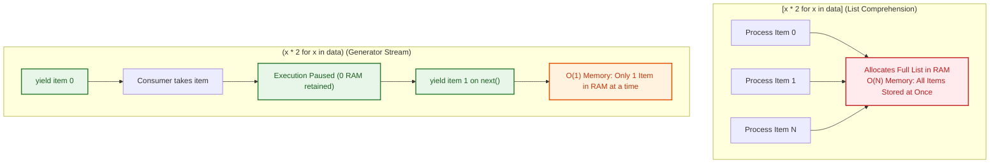
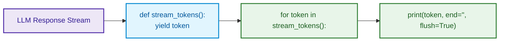

# $\Huge\color{#0D47A1}{\textsf{08 — Comprehensions and Generators}}$

[](https://www.python.org/)
[](README.md)
[](../../AI%20Engineer%20Architect%20Road%20Map.md)
[](#)

> $\color{#546E7A}\mathbf{Navigation:}$ **Phase 0** · **Module 0.1** · **Lesson 8 of 16** · [← Prev: 07 Functions](07%20Functions.md) · [Phase 0.1 — Python Index](README.md) · [Next: 09 Decorators and Closures →](09%20Decorators%20and%20Closures.md)

---


## 🗺️ $\color{#0D47A1}\blacksquare\space\color{#1565C0}{\textsf{Stage 0 — Concept Map}}$

You constantly need to **transform** one collection into another ("uppercase every word", "keep
only the long sentences"). **Comprehensions** are Python's concise, idiomatic way to do this in one
line. **Generators** do the same lazily — one item at a time — which is how you handle huge or
streaming data (like tokens arriving from an LLM) without running out of memory.


## 🔑 $\color{#4A148C}\blacksquare\space\color{#6A1B9A}{\textsf{New Terms (Plain English)}}$

- **Comprehension** — a concise, optimized syntactic construct to transform and filter iterables into lists, dicts, or sets in a single line.
- **Execution order** — the internal evaluation sequence of a comprehension: `for` clause $\rightarrow$ `if` filter $\rightarrow$ left-most dynamic expression.
- **Filtering vs. Transformation** — trailing `if` removes items (changes length); leading `x if c else y` transforms values (preserves length).
- **Generator** — produces items lazily, one at a time (saves memory).
- **`yield`** — hands out one value and pauses the function until the next request.
- **Iterator** — anything you can step through with a `for` loop / `next()`.
- **Lazy** — computed only when needed, not all upfront.


## 🎈 $\color{#00695C}\blacksquare\space\color{#00897B}{\textsf{Stage 1 — The Simple Idea (analogy: an assembly line)}}$

Imagine an assembly line: raw parts go in one end, each gets the same operation, finished parts
come out the other. A **comprehension** is that line written compactly: *"give me `f(x)` for every
`x` in this collection (optionally only if some condition holds)."*

A **generator** is the same line, but it makes each finished part **only when you ask for the next
one** — nothing is built ahead of time, so it uses almost no memory.



**The "Aha!":** comprehension = build the whole new list now; generator = produce items
on-demand, one at a time.


## ⚙️ $\color{#BF360C}\blacksquare\space\color{#D84315}{\textsf{Stage 2 — How It Actually Works}}$

> [!IMPORTANT]
> ### $\color{#00C853}{\textsf{🔥 The 80/20 Core Rule: What Matters in Production}}$
> * $\color{#00C853}\blacktriangleright$ **Daily Core (90% of Real AI Work):** List comprehensions `[clean(x) for x in raw if is_valid(x)]` (concise, high-speed C-level data filtering), Dict comprehensions `{doc.id: doc for doc in docs}` (instant lookup index), and Generator expressions / `yield` functions for streaming LLM tokens and processing massive datasets with **$O(1)$ constant memory**.
> * $\color{#FFB300}\blacktriangleright$ **Occasional (Set Filtering):** Set comprehensions `{chunk.source for chunk in chunks}`.
> * $\color{#757575}\blacktriangleright$ **Reference Only (Exhaustive and Hard to Read):** Nested multi-for comprehensions (prefer standard nested loops for maintainability), generator coroutine methods (`.send()`, `.throw()`, `.close()`).

### $\color{#D84315}\blacktriangleright\space\color{#BF360C}{\textsf{8.1 List Comprehensions: Syntax, Execution Order and Advanced Patterns}}$

A **list comprehension** provides a concise, expressive, and optimized way to transform and filter one iterable into a new `list`. In CPython, list comprehensions are implemented in optimized C-bytecode (`LIST_APPEND`), making them noticeably faster than manual `for` loops with `.append()`.

---

#### $\color{#D84315}\blacktriangleright\space\color{#BF360C}{\textsf{1. Anatomy and Mechanical Execution Order}}$

The general anatomy of a list comprehension is:
`[ <transform_expression> for <item> in <iterable> if <filter_condition> ]`

```python
raw_scores = [45, 82, 91, 58, 76]

# Comprehension:
passing_grades = [s + 5 for s in raw_scores if s >= 60]
print(passing_grades)           # [87, 96, 81]
```

##### $\color{#512DA8}\blacktriangleright\space\color{#311B92}{\textsf{What is the Exact Execution Order Behind the Scenes?}}$
Although written in a single line, Python evaluates the components in a strict, counter-intuitive sequence:

```
Step 1: for s in raw_scores     (1. Loop over the iterable)
               │
               ▼
Step 2:   if s >= 60            (2. Evaluate filter condition)
          ├── False ──> Discard item immediately (transform_expression NEVER runs!)
          └── True
               │
               ▼
Step 3:      s + 5              (3. Apply dynamic transform expression & append to list)
```

1. **Step 1 (`for` clause)**: Python pulls the next item from `raw_scores`.
2. **Step 2 (`if` filter clause — optional)**: Python checks whether `s >= 60`. If `False`, the item is discarded immediately; Step 3 is skipped entirely.
3. **Step 3 (`expression` transformation clause)**: Only if the filter evaluated to `True`, Python evaluates `s + 5` and appends it to the newly created list.

---

#### $\color{#D84315}\blacktriangleright\space\color{#BF360C}{\textsf{2. Dynamic Function Application on the Loop Variable}}$

**Can you call functions inside a list comprehension? YES, ANY FUNCTION!**
The left-hand expression slot can dynamically invoke built-in functions, object methods, custom helper functions, mathematical formulas, or external libraries:

```python
import json
import math

# (a) Calling object methods dynamically:
raw_prompts = ["  summarize document ", "  explain RAG  ", "   "]
clean_prompts = [p.strip().upper() for p in raw_prompts if p.strip()]
print(clean_prompts)            # ['SUMMARIZE DOCUMENT', 'EXPLAIN RAG']

# (b) Calling Python built-in functions:
dimensions = ["1536", "768", "512"]
dims_int = [int(d) for d in dimensions]
print(dims_int)                 # [1536, 768, 512]

# (c) Calling custom user-defined functions:
def calculate_token_cost(token_count: int, rate_per_k: float = 0.002) -> float:
    return (token_count / 1000) * rate_per_k

task_tokens = [1200, 4500, 890, 15000]
task_costs = [calculate_token_cost(t) for t in task_tokens]
print(task_costs)               # [0.0024, 0.009, 0.00178, 0.03]

# (d) Parsing external data (e.g. JSON strings from a cache):
raw_json_lines = ['{"model": "gpt-4o"}', '{"model": "claude-3-5"}']
parsed_models = [json.loads(line)["model"] for line in raw_json_lines]
print(parsed_models)            # ['gpt-4o', 'claude-3-5']
```

---

#### $\color{#D84315}\blacktriangleright\space\color{#BF360C}{\textsf{3. The Two Faces of if: Filtering vs. Ternary Transformation}}$

One of the most frequent syntax errors in Python is confusing where `if` goes.

```diff
# The Two Faces of 'if' in Comprehensions
- ❌ Common Syntax Error: Putting filter 'if' before 'for' without else:
- [x * 2 if x > 0 for x in items]  # SyntaxError: expected 'else' after 'if' expression

+ ✅ Case A: Filtering (if placed at the END without else):
+ [x * 2 for x in items if x > 0]

+ ✅ Case B: Conditional Transformation (if-else ternary placed at FRONT):
+ [x * 2 if x > 0 else 0 for x in items]
```

##### $\color{#00897B}\blacktriangleright\space\color{#004D40}{\textsf{Case A: Filtering Items (if placed at the END)}}$
* **Goal**: Reduce the number of elements in the list (drop items that don't match).
* **Rule**: NEVER use `else` here! Adding `else` at the end raises `SyntaxError`.
```python
numbers = [-2, 5, -1, 8, 0]

# Keep only positive numbers:
positives = [n for n in numbers if n > 0]
print(positives)                # [5, 8] — Length changed from 5 to 2!
```

##### $\color{#00897B}\blacktriangleright\space\color{#004D40}{\textsf{Case B: Transforming Values Conditionally (if-else placed at the FRONT)}}$
* **Goal**: Transform values conditionally using a ternary expression (`val if cond else fallback`).
* **Rule**: MUST include `else`! Every element in the input is preserved (length remains identical).
```python
# Replace negative numbers with 0 (ReLU activation pattern):
relu_activated = [n if n > 0 else 0 for n in numbers]
print(relu_activated)           # [0, 5, 0, 8, 0] — Length remains 5!
```

##### $\color{#00897B}\blacktriangleright\space\color{#004D40}{\textsf{Case C: Combining BOTH (Transform + Filter in one comprehension)}}$
You can use a ternary expression at the front AND a filter at the end simultaneously:
```python
raw_entries = ["user", None, "admin", "guest", ""]

# Filter out empty/None entries, AND format the surviving entries:
sanitized = [role.upper() if role != "guest" else "ANONYMOUS"
             for role in raw_entries
             if role]
print(sanitized)                # ['USER', 'ADMIN', 'ANONYMOUS']
```

---

#### $\color{#D84315}\blacktriangleright\space\color{#BF360C}{\textsf{4. Nested Loops: Flattening Multi-Dimensional Data}}$
Comprehensions support multiple `for` clauses. The clauses execute in the exact order they are written (outer loop first, inner loop second):

```python
# A list of document chunks grouped by section (2D matrix):
section_chunks = [
    ["Intro chunk 1", "Intro chunk 2"],
    ["Body chunk 1"],
    ["Conclusion chunk 1", "Conclusion chunk 2"]
]

# Flatten 2D matrix into a 1D list:
flattened = [chunk for section in section_chunks for chunk in section]
print(flattened)
# ['Intro chunk 1', 'Intro chunk 2', 'Body chunk 1', 'Conclusion chunk 1', 'Conclusion chunk 2']
```

> 💡 **Mental Model for Nested Comprehensions:**
> Read the `for` statements left-to-right as if they were regular indented nested loops:
> ```python
> flattened = []
> for section in section_chunks:       # First for clause
>     for chunk in section:           # Second for clause
>         flattened.append(chunk)     # Left-most expression
> ```

---

#### $\color{#D84315}\blacktriangleright\space\color{#BF360C}{\textsf{5. Real-World AI Application Scenarios}}$

Here is how list comprehensions are applied in production AI pipelines:

##### $\color{#512DA8}\blacktriangleright\space\color{#311B92}{\textsf{Scenario 1: LLM Tool-Calling Argument Extraction}}$
When an LLM returns multiple tool calls, extract just the function names and parsed arguments:
```python
tool_call_payload = [
    {"id": "call_1", "function": {"name": "web_search", "arguments": '{"q": "AI"}'}},
    {"id": "call_2", "function": {"name": "calculator", "arguments": '{"expr": "2+2"}'}},
    {"id": "call_3", "function": {"name": "internal_noop", "arguments": '{}'}},
]

# Extract only valid user-facing tool names:
active_tools = [
    call["function"]["name"]
    for call in tool_call_payload
    if call["function"]["name"] != "internal_noop"
]
print(active_tools)             # ['web_search', 'calculator']
```

##### $\color{#512DA8}\blacktriangleright\space\color{#311B92}{\textsf{Scenario 2: Token Length Filtering and Chunk Validation}}$
Prevent context window overflows by filtering chunks that exceed token limits:
```python
document_chunks = [
    "Short sentence.",
    "A very comprehensive and excessively long passage that exceeds token budget...",
    "Valid medium chunk."
]

MAX_CHARS = 30
# Keep valid chunks, rejecting oversized ones:
valid_chunks = [c.strip() for c in document_chunks if len(c) <= MAX_CHARS]
print(valid_chunks)             # ['Short sentence.', 'Valid medium chunk.']
```

##### $\color{#512DA8}\blacktriangleright\space\color{#311B92}{\textsf{Scenario 3: Mathematical Normalization (Softmax / Probability Scaling)}}$
```python
import math

raw_logits = [2.0, 1.0, 0.1]
exp_scores = [math.exp(x) for x in raw_logits]
total_sum = sum(exp_scores)

# Softmax probability distribution:
probabilities = [score / total_sum for score in exp_scores]
print([round(p, 4) for p in probabilities])  # [0.659, 0.2424, 0.0986]
```

### $\color{#D84315}\blacktriangleright\space\color{#BF360C}{\textsf{8.2 Dict and set comprehensions}}$

| Comprehension Form | Syntax | Output Data Type | Memory Complexity | Production Priority | Real-World AI Application |
| :--- | :--- | :--- | :--- | :--- | :--- |
| **List Comprehension** | `[x for x in seq]` | `list` | $O(N)$ RAM | $\color{#00C853}\blacksquare\ \textbf{Core (Daily)}$ | Parsing LLM tool arguments, transforming prompt tokens |
| **Dict Comprehension** | `{k: v for k, v in seq}` | `dict` | $O(N)$ RAM | $\color{#00C853}\blacksquare\ \textbf{Core (Daily)}$ | Inverting ID-to-name lookup tables, mapping chunk IDs to embeddings |
| **Set Comprehension** | `{x for x in seq}` | `set` | $O(N)$ RAM | $\color{#00C853}\blacksquare\ \textbf{Core (Daily)}$ | Deduplicating stop-words, extracting unique retrieved citation URLs |
| **Generator Expression** | `(x for x in seq)` | `generator` | $O(1)$ RAM | $\color{#00C853}\blacksquare\ \textbf{Core (Daily)}$ | Streaming 10M dataset rows from disk, continuous token pipelining |

```python
# Dict comprehension: { key_expr: value_expr for ... }
prices = {"apple": 3, "pear": 5}
doubled = {name: price * 2 for name, price in prices.items()}   # {'apple': 6, 'pear': 10}

# Set comprehension: { expr for ... } -> unique results
lengths = {len(w) for w in ["hi", "hey", "yo"]}   # {2, 3}
```

### $\color{#D84315}\blacktriangleright\space\color{#BF360C}{\textsf{8.3 Generators — lazy sequences}}$

A **generator expression** looks like a list comprehension but with **parentheses**, and it
produces values one at a time instead of building a list:

```python
numbers = [1, 2, 3, 4]

gen = (n * n for n in numbers)   # NOTHING is computed yet — this is lazy
print(next(gen))                 # 1   — compute the first value on demand
print(next(gen))                 # 4   — then the next
for value in gen:                # continue consuming the rest
    print(value)                 # 9, 16
```

Write your own generator with a function that uses **`yield`** instead of `return`. `yield` hands
out a value and *pauses*, resuming where it left off on the next request:



```python
def count_up_to(limit):
    n = 1
    while n <= limit:
        yield n          # pause here, give out n, resume next time
        n += 1

for x in count_up_to(3):
    print(x)             # 1, 2, 3
```

### $\color{#D84315}\blacktriangleright\space\color{#BF360C}{\textsf{8.4 Why lazy matters: memory}}$

```python
# A list of a billion squares would try to build ALL of them in memory (gigabytes) -> crash risk.
# squares = [n * n for n in range(1_000_000_000)]   # don't!

# A generator holds only ONE value at a time, so this is fine:
squares = (n * n for n in range(1_000_000_000))
total = sum(squares)     # streams through them; constant memory
```

**iterator** — anything you can step through with `next()` / a `for` loop. Generators are
iterators you create easily; `for` loops quietly call `next()` until the items run out.


## 🚀 $\color{#0D47A1}\blacksquare\space\color{#1565C0}{\textsf{Stage 3 — In Practice / Why It Matters}}$

Comprehensions are the everyday way to clean and reshape data: `[chunk.strip() for chunk in chunks
if chunk]`. Generators are how you process a 10 GB file line by line, or stream an LLM's response
**token by token** without waiting for (or storing) the whole thing — exactly the streaming you'll
build in Phase 1.

**Common beginner mistakes (the reasoning):**
1. **Cramming too much logic into a comprehension** — if it needs nested conditions or several
   steps, a plain `for` loop is clearer. Readability beats cleverness.
2. **Consuming a generator twice** — once exhausted, it's empty. `list(gen)` a second time yields
   `[]`. Rebuild it or convert to a list if you need to reuse the data. *Reason:* generators don't
   store past values.
3. **Using `[]` when you meant `()`** for huge data — the list version builds everything in memory.
4. **Forgetting the `if` goes at the end** — `[x for x in items if cond]`, not before the `for`
   (that's the different "conditional expression" form).

### $\color{#0D47A1}\blacktriangleright\space\color{#1565C0}{\textsf{Try It Yourself}}$
From `words = ["  Ada ", "", "Bo  ", "   "]`, use one comprehension to produce a clean list of
non-empty, stripped names: `["Ada", "Bo"]`.


## ⚖️ $\color{#00695C}\blacksquare\space\color{#00838F}{\textsf{Variations and When to Use}}$

| Construct | Syntax | ✅ When to Use | 🚫 Avoid When | Production AI Example |
| :--- | :--- | :--- | :--- | :--- |
| **List Comprehension** | `[f(x) for x in data if c]` | Clean 1-line filtering and dynamic transformation of existing data | Multiple nested loops (>2) or heavy side-effects (file I/O) | Sanitizing prompt chunks, extracting API fields |
| **Generator Expression** | `(f(x) for x in data)` | Massive collections, infinite streams, or 1-pass pipelines | You need indexing (`gen[0]`), length (`len(gen)`), or multiple passes | Streaming tokens, processing 10GB log files |
| **Traditional `for` Loop** | `for x in data: ...` | Complex multi-step mutations, early `break`/`continue`, error handling | Simple 1-line mapping or filtering (unnecessarily verbose) | Agent step-by-step reasoning cycle |
| **`map()` / `filter()`** | `map(func, data)` | Passing pre-existing functions without writing a lambda | Writing inline expressions (comprehensions are cleaner) | Functional pipelines |


## 🐛 $\color{#880E4F}\blacksquare\space\color{#AD1457}{\textsf{Common Errors and Fixes}}$

| What you see | Cause | Fix |
| --- | --- | --- |
| `SyntaxError: invalid syntax` on trailing `else` | Wrote `[x for x in data if c else y]` | Trailing `if` is filter-only; place `if-else` ternary at the front: `[x if c else y for x in data]` |
| Generator is empty the 2nd time | Generators exhaust after one pass | Rebuild it, or use a list if you'll reuse it |
| `MemoryError` on a huge `[...]` | Built a giant list in memory | Use a generator `(...)` instead |
| `TypeError: 'NoneType' object is not iterable` | Attempted comprehension on `None` | Use inline guard: `[x for x in (data or [])]` |
| Pipeline hangs / slow latency | Called synchronous network/LLM API inside a comprehension | Comprehensions are sequential; use `asyncio.gather` for concurrent API calls |
| Comprehension is unreadable | Crammed too much logic into one line | Refactor into a helper function or write a standard `for` loop |


## 📌 $\color{#1B5E20}\blacksquare\space\color{#2E7D32}{\textsf{Quick Reference}}$

```python
[x * x for x in nums]                 # list comprehension
[x for x in nums if x % 2 == 0]       # with a filter
{k: v for k, v in pairs}              # dict comprehension
(x * x for x in nums)                 # generator (lazy, parentheses)
def gen():
    yield 1
    yield 2                           # generator function
```


## 🛑 $\color{#B71C1C}\blacksquare\space\color{#D32F2F}{\textsf{STOP — Self-Check}}$

What's the key difference between `squares = [n*n for n in range(5)]` and
`squares = (n*n for n in range(5))`, and when would you prefer the second?

<details>
<summary><b>🔍 Click to Reveal the Answer</b></summary>

<br/>

`[ ... ]` builds a **list** — all 5 values computed and stored immediately. `( ... )` builds a
**generator** — values are produced **lazily**, one at a time, only as you consume them. Prefer the
generator when the sequence is **large or streaming** (to save memory) or when you'll consume items
one-by-one and don't need them all stored at once — e.g. streaming tokens or reading a huge file.

---

🎉 **Lesson Complete!** Continue to the next lesson: [09 Decorators and Closures →](09%20Decorators%20and%20Closures.md)

</details>
