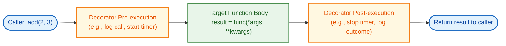
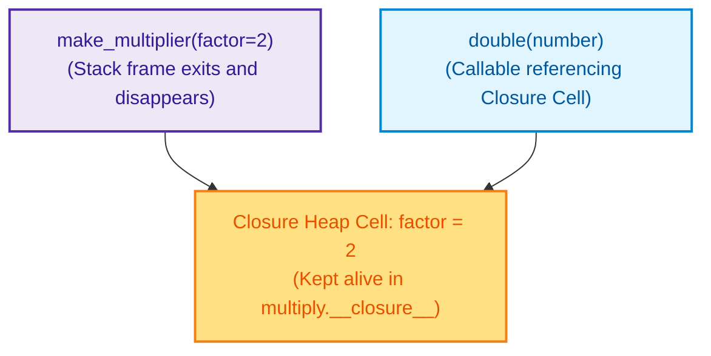

# $\Huge\color{#0D47A1}{\textsf{09 — Decorators and Closures}}$

[](https://www.python.org/)
[](README.md)
[](../../AI%20Engineer%20Architect%20Road%20Map.md)
[](#)

> $\color{#546E7A}\mathbf{Navigation:}$ **Phase 0** · **Module 0.1** · **Lesson 9 of 16** · [← Prev: 08 Comprehensions and Generators](08%20Comprehensions%20and%20Generators.md) · [Phase 0.1 — Python Index](README.md) · [Next: 10 Error Handling →](10%20Error%20Handling.md)

---


## 🗺️ $\color{#0D47A1}\blacksquare\space\color{#1565C0}{\textsf{Stage 0 — Concept Map}}$

This lesson explains the mysterious `@something` lines you'll see above functions in every AI
framework (FastAPI routes, `@tool`, `tenacity` retries). To understand decorators you first need
two ideas: functions are **values** you can pass around, and a function can **remember** variables
from where it was created (a **closure**). This is the most "advanced" core-Python topic — take it
slowly.


## 🔑 $\color{#4A148C}\blacksquare\space\color{#6A1B9A}{\textsf{New Terms (Plain English)}}$

- **First-class function** — a function you can store, pass, or return like any value.
- **Closure** — an inner function that remembers variables from its outer function.
- **`nonlocal`** — keyword used inside an inner function to rebind a variable belonging to an outer enclosing function.
- **Decorator** — a function that wraps another to add behaviour, applied with `@name`.
- **Wrapper** — the inner function a decorator returns.
- **`functools.wraps`** — keeps the original function's name and docstring on the wrapper.


## 🎈 $\color{#00695C}\blacksquare\space\color{#00897B}{\textsf{Stage 1 — The Simple Idea (analogy: gift-wrapping)}}$

A **decorator** wraps a function in extra behaviour without changing the function's own code — like
gift-wrapping a box. The present inside is unchanged; the wrapping adds something around it
(logging, timing, retrying, access checks). You apply the wrap with one line: `@decorator`.

**The "Aha!":** in Python, functions are ordinary objects — you can store them in variables, pass
them as arguments, and return them from other functions. A decorator is just *a function that takes
a function and returns a new, wrapped function.*




## ⚙️ $\color{#BF360C}\blacksquare\space\color{#D84315}{\textsf{Stage 2 — How It Actually Works}}$

> [!IMPORTANT]
> ### $\color{#00C853}{\textsf{🔥 The 80/20 Core Rule: What Matters in Production}}$
> * $\color{#00C853}\blacktriangleright$ **Daily Core (90% of Real AI Work):** Function decorators as reusable execution middleware, preserving metadata using `@functools.wraps(func)`, forwarding signatures with `*args, **kwargs`, and production patterns: `@timing`, `@retry` on API timeouts, and `@require_auth`.
> * $\color{#FFB300}\blacktriangleright$ **Occasional (Configurable Middleware):** Decorators accepting custom parameters (`@retry(max_retries=3)`), memoization with `@functools.lru_cache(maxsize=128)`.
> * $\color{#757575}\blacktriangleright$ **Reference Only (Exhaustive Variations):** Class-based decorators (implementing `__call__`), deep decorator stacks (4+ wrappers), wrapping generator/streaming functions.

### $\color{#D84315}\blacktriangleright\space\color{#BF360C}{\textsf{9.1 Functions are first-class values}}$

```python
def shout(text):
    return text.upper()

yell = shout              # store the function itself (no parentheses!) in another name
print(yell("hi"))         # 'HI'

def apply(func, value):   # a function can take ANOTHER function as an argument
    return func(value)
print(apply(shout, "hello"))   # 'HELLO'
```

### $\color{#D84315}\blacktriangleright\space\color{#BF360C}{\textsf{9.2 Closures — a function that remembers}}$

A function defined **inside** another can capture the outer function's variables, and keeps them
even after the outer function has returned. That captured bundle is a **closure**.

```python
def make_multiplier(factor):       # outer function
    def multiply(number):          # inner function...
        return number * factor     # ...remembers "factor"
    return multiply                # hand back the inner function

double = make_multiplier(2)        # factor=2 is "baked in"
triple = make_multiplier(3)        # factor=3 is "baked in"
print(double(10))                  # 20
print(triple(10))                  # 30
```

`double` "remembers" `factor=2` even though `make_multiplier` has already finished. That memory is
the closure — and it's the machinery decorators are built on.



#### $\color{#D84315}\blacktriangleright\space\color{#BF360C}{\textsf{Modifying Enclosing State with nonlocal}}$
If an inner function needs to **update or increment** an enclosing variable, use the **`nonlocal`** keyword:

```python
def make_call_counter():
    total_calls = 0                     # Enclosing state

    def record_call():
        nonlocal total_calls            # Informs Python to mutate the enclosing 'total_calls'
        total_calls += 1
        return total_calls

    return record_call

counter = make_call_counter()
print(counter())                        # 1
print(counter())                        # 2
print(counter())                        # 3
```

> ⚠️ Without `nonlocal total_calls`, Python treats `total_calls += 1` as a local assignment, crashing with `UnboundLocalError`.

### $\color{#D84315}\blacktriangleright\space\color{#BF360C}{\textsf{9.3 A decorator, built up}}$

```python
import functools

def logged(func):                          # takes the function to wrap
    @functools.wraps(func)                 # keeps the original name/docstring on the wrapper
    def wrapper(*args, **kwargs):          # accepts ANY arguments (Lesson 07)
        print(f"calling {func.__name__}")
        result = func(*args, **kwargs)     # call the real function
        print(f"{func.__name__} returned {result}")
        return result                      # pass its result back out
    return wrapper                         # return the wrapped version

@logged                                    # <-- apply the decorator
def add(a, b):
    return a + b

add(2, 3)
# calling add
# add returned 5
```

The `@logged` line is exactly equivalent to writing `add = logged(add)`. The decorator runs once,
replacing `add` with `wrapper`. Now every call to `add` is logged — without touching `add`'s body.

`*args, **kwargs` in the wrapper let the decorator work on *any* function regardless of its
parameters, and `@functools.wraps(func)` preserves the original's identity (without it, `add.__name__`
would wrongly say `"wrapper"`).

```diff
# Comparing naive decorator vs production pattern
- ❌ Naive Decorator (Destroys metadata, breaks FastAPI and LLM Tool Calling):
- def logged(func):
-     def wrapper(*args, **kwargs):
-         return func(*args, **kwargs)
-     return wrapper
# add.__name__ becomes 'wrapper', add.__doc__ is completely lost!

+ ✅ Production Decorator (Preserves metadata with @functools.wraps):
+ import functools
+ def logged(func):
+     @functools.wraps(func)
+     def wrapper(*args, **kwargs):
+         return func(*args, **kwargs)
+     return wrapper
# add.__name__ is preserved as 'add', docstring retained for tool calling schema!
```

| Decorator Pattern | Syntax | Execution Phase | Production Priority | Real-World AI Application |
| :--- | :--- | :--- | :--- | :--- |
| **Standard Wrapper** | `@decorator` | Intercepts function execution | $\color{#00C853}\blacksquare\ \textbf{Core (Daily)}$ | Latency timing (`@timing`), call auditing (`@log_call`) |
| **Signature Forwarder** | `*args, **kwargs` | Dynamic argument dispatch | $\color{#00C853}\blacksquare\ \textbf{Core (Daily)}$ | Universal middleware across arbitrary function signatures |
| **Metadata Preservation** | `@functools.wraps(func)` | Definition time reflection | $\color{#00C853}\blacksquare\ \textbf{Core (Daily)}$ | Preserving docstrings for LLM tool discovery and FastAPI endpoints |
| **Parametrized Decorator** | `@retry(max_retries=3)` | Factory returning decorator | $\color{#00C853}\blacksquare\ \textbf{Core (Daily)}$ | Exponential backoff retry loops on LLM API rate limits (`429`) |
| **Caching / Memoization** | `@functools.lru_cache` | In-memory lookup table | $\color{#FFB300}\blacksquare\ \textbf{Occasional}$ | Caching expensive embedding computations or static prompt templates |


## 🚀 $\color{#0D47A1}\blacksquare\space\color{#1565C0}{\textsf{Stage 3 — In Practice / Why It Matters}}$

You won't write many decorators, but you'll **use** them constantly:
- `@app.get("/items")` (FastAPI) registers a function as a web endpoint — Phase 1.
- `@retry(...)` (tenacity) auto-retries a flaky API call — Phase 1/4.
- `@tool` marks a function as something an agent can call — Phase 3.
- `@property`, `@staticmethod` shape classes — Lesson 12.

Recognising "a decorator wraps my function with extra behaviour" demystifies a huge amount of
real-world code.

**Common beginner mistakes (the reasoning):**
1. **Adding `()` when storing a function** — `yell = shout()` *calls* it; `yell = shout` stores it.
   *Reason:* parentheses mean "invoke now."
2. **Omitting `*args, **kwargs`** in the wrapper, so the decorator only works on functions with a
   specific signature. Accept anything.
3. **Forgetting `@functools.wraps`** — debugging gets confusing because every wrapped function
   reports the name `wrapper`.
4. **Expecting the decorator to run on every call** — the *decorator* runs once (at definition);
   the *wrapper* runs on every call. Put per-call logic inside `wrapper`.

### $\color{#0D47A1}\blacktriangleright\space\color{#1565C0}{\textsf{Try It Yourself}}$
Write a `timed` decorator that prints how long the wrapped function took (use
`import time; start = time.perf_counter()` before the call and the difference after).


## 🐛 $\color{#880E4F}\blacksquare\space\color{#AD1457}{\textsf{Common Errors and Fixes}}$

| What you see | Cause | Fix |
| --- | --- | --- |
| The function runs when you meant to store it | Added `()` — `x = func()` calls it | Store without parentheses: `x = func` |
| Decorated function breaks on some arguments | Wrapper didn't accept `*args, **kwargs` | Define `def wrapper(*args, **kwargs)` |
| `func.__name__` shows `'wrapper'` | Missing `@functools.wraps` | Add `@functools.wraps(func)` to the wrapper |
| Your logic runs once, not per call | Code placed outside `wrapper` | Put per-call logic **inside** `wrapper` |


## 📌 $\color{#1B5E20}\blacksquare\space\color{#2E7D32}{\textsf{Quick Reference}}$

```python
import functools
def logged(func):
    @functools.wraps(func)
    def wrapper(*args, **kwargs):
        # before
        result = func(*args, **kwargs)
        # after
        return result
    return wrapper

@logged                       # same as: add = logged(add)
def add(a, b): return a + b
```


## 🛑 $\color{#B71C1C}\blacksquare\space\color{#D32F2F}{\textsf{STOP — Self-Check}}$

What is a **closure**, and how does it make the `@logged` decorator above possible?

<details>
<summary><b>🔍 Click to Reveal the Answer</b></summary>

<br/>

A **closure** is an inner function that **remembers variables from the enclosing function** even
after that outer function has returned. In `@logged`, the inner `wrapper` closes over `func` (the
original function it was given), so each time `wrapper` runs it still has access to the specific
function it's meant to wrap. Without closures, `wrapper` would have no way to "remember" which
function to call.

---

🎉 **Lesson Complete!** Continue to the next lesson: [10 Error Handling →](10%20Error%20Handling.md)

</details>
