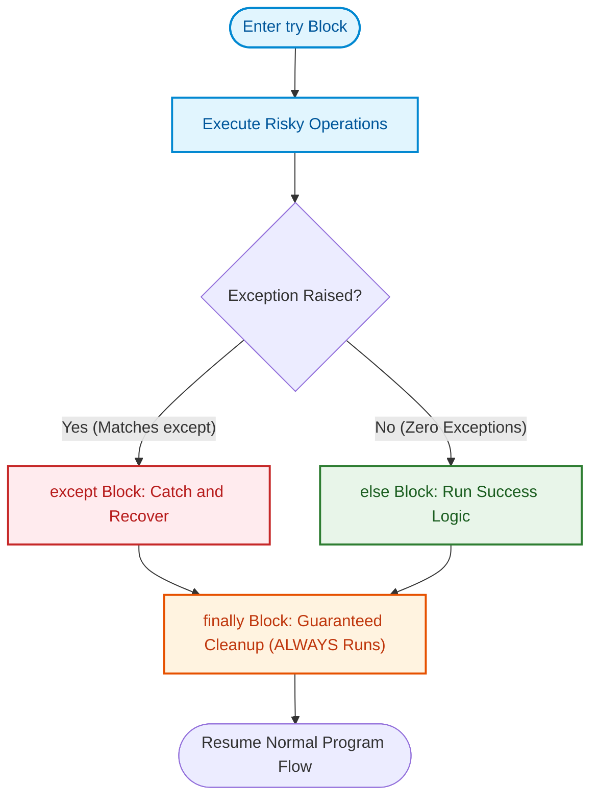
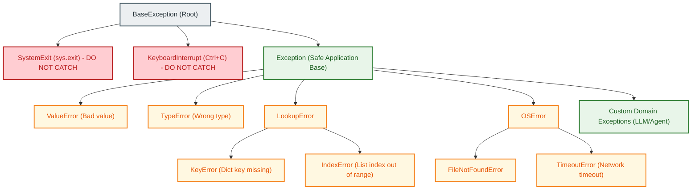
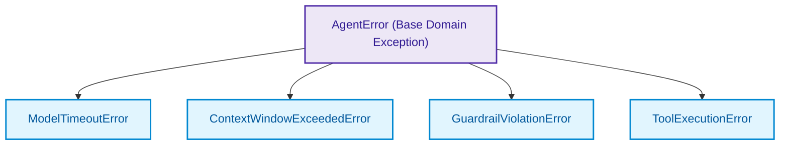

# $\Huge\color{#0D47A1}{\textsf{10 — Error Handling}}$

[](https://www.python.org/)
[](README.md)
[](../../AI%20Engineer%20Architect%20Road%20Map.md)
[](#)

> $\color{#546E7A}\mathbf{Navigation:}$ **Phase 0** · **Module 0.1** · **Lesson 10 of 16** · [← Prev: 09 Decorators and Closures](09%20Decorators%20and%20Closures.md) · [Phase 0.1 — Python Index](README.md) · [Next: 11 Modules, Packages and Files →](11%20Modules%20Packages%20and%20Files.md)

---

## 🗺️ $\color{#0D47A1}\blacksquare\space\color{#1565C0}{\textsf{Stage 0 — Concept Map}}$

Real programs hit problems: an external API rate-limits your request, a network socket drops, a database times out, or an LLM returns malformed JSON instead of valid tool arguments. **Error handling** is how you anticipate failures and respond gracefully instead of letting the entire application crash. In AI engineering, where models, vector stores, and external APIs are inherently non-deterministic, robust error handling is the difference between a brittle prototype and a resilient production agent.

## 🔑 $\color{#4A148C}\blacksquare\space\color{#6A1B9A}{\textsf{New Terms (Plain English)}}$

- **Exception** — an object Python creates to signal that an error or unexpected condition occurred.
- **Traceback** — the chronological report showing the stack of function calls that led up to the error.
- **`try` / `except`** — run risky code in `try`, and catch/handle specific failures in `except`.
- **`else` (in try blocks)** — code that runs **only if no exception** was raised in the `try` block.
- **`finally`** — code that is **guaranteed to run always**, regardless of whether an exception occurred, was caught, or was uncaught (used for resource cleanup).
- **`raise`** — deliberately trigger an exception in your code.
- **Exception chaining (`raise ... from err`)** — raising a high-level domain error while preserving the original low-level root cause in the traceback.
- **Custom exception** — a user-defined error class (subclassing `Exception`) that carries domain-specific metadata.
- **EAFP** — "Easier to Ask Forgiveness than Permission": the Pythonic philosophy of trying an action and catching errors rather than running defensive checks beforehand.
- **LBYL** — "Look Before You Leap": checking preconditions with `if` statements before attempting an operation.

## 🎈 $\color{#00695C}\blacksquare\space\color{#00897B}{\textsf{Stage 1 — The Simple Idea (analogy: a circuit breaker and safety net)}}$

When a trapeze artist might fall, you string a **safety net** under the risky part of the act — not under the whole circus. In Python:
1. You wrap only the risky operation in a **`try`** block.
2. If something fails, execution jumps straight to the matching **`except`** block (the safety net).
3. If everything succeeded without a hitch, the **`else`** block celebrates with follow-up steps.
4. Finally, the **`finally`** block runs no matter what — cleaning up the stage before the next act.

**The "Aha!":** An exception does not have to be a crash. It is simply an **alternate return path** that bubbles up the call stack until an `except` block catches it. If nothing catches it, the program halts with a traceback.



## ⚙️ $\color{#BF360C}\blacksquare\space\color{#D84315}{\textsf{Stage 2 — How It Actually Works}}$

> [!IMPORTANT]
> ### $\color{#00C853}{\textsf{🔥 The 80/20 Core Rule: What Matters in Production}}$
> * $\color{#00C853}\blacktriangleright$ **Daily Core (90% of Real AI Work):** Specific exception handling with `try / except SpecificException as e:` (never swallow errors with bare `except:`), guaranteed resource cleanup in `finally:`, raising exceptions `raise ValueError(...)`, and handling real AI runtime errors: HTTP timeouts, rate limits (`429 Too Many Requests`), and JSON parsing errors (`json.JSONDecodeError`).
> * $\color{#FFB300}\blacktriangleright$ **Occasional (Domain Errors):** Custom domain exception classes (`class LLMProviderError(Exception): pass`), explicit exception chaining (`raise LLMTimeoutError from e`).
> * $\color{#757575}\blacktriangleright$ **Reference Only (Exhaustive and Anti-Patterns):** The optional `else:` clause in `try / except / else / finally`, `assert` statements for business logic (disabled in Python production `-O` mode).

### $\color{#D84315}\blacktriangleright\space\color{#BF360C}{\textsf{10.1 The Anatomy of an Exception and Built-in Hierarchy}}$

When an unhandled error occurs, Python prints a **traceback** and stops:

```python
# Unhandled error:
# print(10 / 0)
# ZeroDivisionError: division by zero   <-- Error Type: description
```

#### $\color{#D84315}\blacktriangleright\space\color{#BF360C}{\textsf{Python's Exception Hierarchy}}$
Exceptions in Python are regular classes that inherit from `BaseException`:



> ⚠️ **Critical Rule: Never catch `BaseException` (and never use a bare `except:`)!**
> Catching `BaseException` or writing `except:` intercepts `KeyboardInterrupt` (preventing you from stopping a runaway program with `Ctrl+C`) and `SystemExit`. Always catch `Exception` or, even better, specific subclasses!

### $\color{#D84315}\blacktriangleright\space\color{#BF360C}{\textsf{10.2 The Complete 4-Part Structure: try / except / else / finally}}$

Python provides a complete 4-part control flow for handling risky operations:

```python
def load_prompt_template(file_path: str) -> str:
    file = None
    try:
        print("1. [try] Attempting to open file...")
        file = open(file_path, "r")
        content = file.read()
    except FileNotFoundError as err:
        # Catches ONLY FileNotFoundError:
        print(f"2. [except] File missing: {err}. Falling back to default.")
        content = "You are a helpful AI assistant."
    except (PermissionError, IsADirectoryError) as err:
        # Catches multiple specific errors in a tuple:
        print(f"2. [except] File access error: {err}.")
        content = "You are a helpful AI assistant."
    else:
        # Runs ONLY if try completed with ZERO exceptions:
        print("3. [else] Template loaded successfully from disk!")
    finally:
        # Runs ALWAYS (success, caught error, or even unhandled error):
        print("4. [finally] Running guaranteed cleanup...")
        if file and not file.closed:
            file.close()
            print("   File handle cleanly closed.")
            
    return content

# Case A: File exists -> runs try -> else -> finally
# Case B: File missing -> runs try -> except -> finally
```

```diff
# Comparing exception handling specificity
- ❌ Dangerous Anti-Pattern: Bare except (catches Ctrl+C and masks crashes):
- try:
-     response = call_llm(prompt)
- except:
-     print("Failed")

+ ✅ Production Pattern: Catch specific domain exceptions:
+ try:
+     response = call_llm(prompt)
+ except (TimeoutError, ConnectionError) as err:
+     logger.warning(f"Network glitch, retrying: {err}")
+ except ValueError as err:
+     logger.error(f"Malformed prompt payload: {err}")
```

#### $\color{#D84315}\blacktriangleright\space\color{#BF360C}{\textsf{Why use else instead of putting code inside try?}}$
```python
# 🚫 BAD: puts too much inside 'try':
try:
    data = fetch_api_data()
    parsed = json.loads(data)
    process(parsed)
except NetworkError:
    handle_network()
# Gotcha: If process() raises a NetworkError internally, it will be 
# accidentally caught here, masking a logic bug!

# ✅ GOOD: use 'else' for code that should run ONLY on success:
try:
    data = fetch_api_data()
except NetworkError:
    handle_network()
else:
    # Runs only if fetch succeeded; errors here are NOT caught by NetworkError:
    parsed = json.loads(data)
    process(parsed)
```

#### $\color{#00695C}\blacktriangleright\space\color{#004D40}{\textsf{Why finally is non-negotiable for cleanup}}$
Even if your `try` or `except` block contains a `return` statement, Python **still executes the `finally` block** before returning control to the caller!

```python
def check_status() -> str:
    try:
        return "SUCCESS"
    finally:
        print("This ALWAYS prints before returning!")

print(check_status())
# Output:
# This ALWAYS prints before returning!
# SUCCESS
```

### $\color{#D84315}\blacktriangleright\space\color{#BF360C}{\textsf{10.3 Raising Exceptions and Re-raising}}$

Use the **`raise`** keyword to signal an error deliberately when input validation or state invariants fail:

```python
def set_temperature(temp: float) -> float:
    if not (0.0 <= temp <= 2.0):
        # Deliberately raise a built-in exception with a helpful message:
        raise ValueError(f"Temperature must be between 0.0 and 2.0, got {temp}")
    return temp

# 1. Raising:
# set_temperature(2.5)  # 💥 ValueError: Temperature must be between 0.0 and 2.0, got 2.5

# 2. Re-raising (intercept, log, and propagate):
def call_model_with_logging(prompt: str):
    try:
        return set_temperature(3.0)
    except ValueError as err:
        print(f"[AUDIT LOG] Validation failed: {err}")
        raise  # A bare 'raise' re-raises the active exception up to the caller!
```

### $\color{#D84315}\blacktriangleright\space\color{#BF360C}{\textsf{10.4 Exception Chaining (raise ... from original\_error)}}$

In modern Python, when low-level library errors happen, you often want to wrap them in a meaningful domain exception. Using **`raise ... from err`** preserves the entire causal chain in the traceback:

```python
import json

class PromptConfigError(Exception):
    """Raised when application prompt configuration fails."""
    pass

def load_agent_config(raw_json: str) -> dict:
    try:
        return json.loads(raw_json)
    except json.JSONDecodeError as err:
        # Chain the low-level JSONDecodeError into our high-level PromptConfigError:
        raise PromptConfigError("Invalid agent configuration syntax") from err

# If raw_json is "{bad_json":
# Python prints BOTH tracebacks clearly:
# json.decoder.JSONDecodeError: Expecting property name enclosed in double quotes...
# The above exception was the direct cause of the following exception:
# PromptConfigError: Invalid agent configuration syntax
```

> **Why Exception Chaining Matters for AI Pipelines:**
> If an OpenAI or Anthropic API call fails with a raw `httpx.ConnectTimeout`, re-raising it as `raise LLMServiceUnavailableError("Model API timed out") from err` gives your monitoring system clean high-level alerts while keeping the exact socket-level network traceback attached for debugging.

### $\color{#D84315}\blacktriangleright\space\color{#BF360C}{\textsf{10.5 Custom Exceptions (Domain Hierarchies and Metadata)}}$

A **custom exception** is simply a class that inherits from `Exception` (or a subclass of `Exception`).

#### $\color{#D84315}\blacktriangleright\space\color{#BF360C}{\textsf{1. Basic Custom Exception}}$
```python
class ToolExecutionError(Exception):
    """Raised when an agent tool fails to execute."""
    pass

def run_calculator(expression: str) -> float:
    if "/ 0" in expression:
        raise ToolExecutionError("Division by zero in tool expression")
    return eval(expression)
```

#### $\color{#D84315}\blacktriangleright\space\color{#BF360C}{\textsf{2. Custom Exceptions with Rich Metadata}}$
You can store attributes (like HTTP status codes, model names, or retry delays) directly on your exception object:

```python
class LLMRateLimitError(Exception):
    """Raised when an LLM provider rate-limits a request."""
    def __init__(self, message: str, retry_after: int, provider: str):
        super().__init__(message)       # Initialize parent Exception with error message
        self.retry_after = retry_after  # Custom metadata attribute
        self.provider = provider

try:
    raise LLMRateLimitError("Quota exceeded on tier-1", retry_after=30, provider="OpenAI")
except LLMRateLimitError as err:
    print(f"Error: {err}")
    print(f"Action: Pause requests to {err.provider} for {err.retry_after}s")
    # Output:
    # Error: Quota exceeded on tier-1
    # Action: Pause requests to OpenAI for 30s
```

#### $\color{#D84315}\blacktriangleright\space\color{#BF360C}{\textsf{3. Designing a Production Exception Hierarchy for AI Systems}}$



In large AI systems, create a base domain error so callers can catch **all** errors from your module, or selectively handle specific sub-errors:

```python
# Base domain error:
class AgentError(Exception):
    """Base exception for all agent failures."""
    pass

# Specific child exceptions:
class ModelTimeoutError(AgentError):
    """Raised when LLM call exceeds timeout."""
    pass

class ContextWindowExceededError(AgentError):
    """Raised when prompt tokens exceed model context limit."""
    pass

class GuardrailViolationError(AgentError):
    """Raised when prompt or output triggers safety filters."""
    pass

# Caller flexibility:
try:
    # ... run agent workflow ...
    pass
except ContextWindowExceededError:
    # Handle specifically: summarize chat history and retry
    pass
except AgentError as err:
    # Catch ALL other agent-related errors generically
    pass
```

### $\color{#D84315}\blacktriangleright\space\color{#BF360C}{\textsf{10.6 The Pythonic Mindset: EAFP vs LBYL}}$

| Style | Full Name | Core Philosophy | Production Priority | Code Example | Production AI Application |
| :--- | :--- | :--- | :--- | :--- | :--- |
| **EAFP** | Easier to Ask Forgiveness than Permission | Assume success; catch exception on rare failure | $\color{#00C853}\blacksquare\ \textbf{Core (Daily)}$ | `try: val = d[k]`<br/>`except KeyError: val = default` | Reading cache dictionaries, opening prompt files without race conditions |
| **LBYL** | Look Before You Leap | Check preconditions with `if` before executing | $\color{#FFB300}\blacksquare\ \textbf{Occasional}$ | `if k in d: val = d[k]`<br/>`else: val = default` | Checking user inputs where failure is expected 50%+ of the time |

In Python, **EAFP is idiomatic and often faster** when failures are rare. It also avoids race conditions (e.g. checking `os.path.exists()` before opening a file is vulnerable to another process deleting the file between the check and the open; EAFP handles it safely in `try/except`).

## 🚀 $\color{#0D47A1}\blacksquare\space\color{#1565C0}{\textsf{Stage 3 — In Practice / Why It Matters}}$

In modern AI engineering:
1. **Resilient Agent Loops**: LLMs are external network services that produce unstructured text. When an LLM generates invalid JSON for a function call, a production agent catches `json.JSONDecodeError`, feeds the error message back into the conversation context, and asks the model to self-correct.
2. **Rate Limit & Backoff Handling**: When an API returns HTTP 429 (`RateLimitError`), the pipeline reads the `retry_after` attribute, triggers exponential backoff (e.g., with `tenacity`), or fails over to a secondary fallback model (`gpt-4o` $\rightarrow$ `gpt-4o-mini`).
3. **Structured Tool Contracts**: In agent frameworks (LangGraph, CrewAI), tools raise `ToolExecutionError` so the agent knows the tool failed and can formulate an alternate plan rather than crashing the entire session.

**Common beginner mistakes (the reasoning):**
1. **Bare `except:`** — writing `except:` without an exception class catches `KeyboardInterrupt` and `SystemExit`, making it impossible to stop a runaway script with `Ctrl+C`. *Reason:* Always specify `except Exception:` or concrete classes.
2. **Silent error swallowing (`except: pass`)** — hiding exceptions with `pass` leaves zero logs, making bugs completely undetectable. *Reason:* Always log or handle errors explicitly.
3. **Overly broad `try` blocks** — wrapping 50 lines in a single `try` block makes it impossible to know which operation raised `ValueError`. *Reason:* Wrap only the specific line capable of failing.
4. **Confusing `else` with `finally`** — putting cleanup code in `else` means cleanup will **not** run if an error occurred. *Reason:* `else` is for success-only code; `finally` is for guaranteed cleanup.

### $\color{#0D47A1}\blacktriangleright\space\color{#1565C0}{\textsf{Try It Yourself}}$
Write a custom exception `TokenLimitExceededError` that stores `current_tokens` and `max_tokens`. Write a function `validate_prompt(text: str, max_tokens: int = 100)` that splits `text` into words; if word count exceeds `max_tokens`, raise your custom exception. Catch it and print a helpful alert.

## ⚖️ $\color{#00695C}\blacksquare\space\color{#00838F}{\textsf{Variations and When to Use}}$

| Technique | Syntax | ✅ When to Use | 🚫 Avoid When | Production AI Example |
| :--- | :--- | :--- | :--- | :--- |
| **Specific `except`** | `except SpecificError:` | Standard error handling where failure mode is known | Handling errors you don't know how to recover from | Catching `KeyError` on API response payload |
| **Multiple `except`** | `except (Err1, Err2):` | Treating different error classes with identical fallback logic | Different errors require distinct recovery strategies | Catching `(ConnectionError, TimeoutError)` |
| **`try ... else`** | `else:` | Code that should run only when `try` succeeded without catching unexpected errors | Trivial 1-line functions where no follow-up is needed | Parsing LLM response after successful HTTP call |
| **`try ... finally`** | `finally:` | Guaranteed resource cleanup (files, sockets, GPU caches, lock releases) | Normal business logic that shouldn't run on error | Closing vector DB client session |
| **Bare `raise`** | `raise` (inside `except`) | Logging or auditing an error before letting it propagate upward | You have completely resolved and recovered from the error | Emitting error metric to Datadog / OpenTelemetry |
| **Chained `raise ... from`**| `raise DomainErr from err`| Translating low-level library errors into clear application exceptions | Internal code where original exception is already self-explanatory | Wrapping `requests.HTTPError` in `LLMProviderError` |
| **Custom Exception** | `class MyErr(Exception):` | Defining domain-specific errors with rich metadata (`status_code`, `model`)| A built-in exception (`ValueError`, `KeyError`) fits perfectly | `ContextWindowExceededError(limit=8192)` |

## 🐛 $\color{#880E4F}\blacksquare\space\color{#AD1457}{\textsf{Common Errors and Fixes}}$

| What you see | Cause | Fix |
| --- | --- | --- |
| Script won't stop with `Ctrl+C` | Used bare `except:` or caught `BaseException` | Change to `except Exception:` or specific error class |
| Silent bugs / program behaves weirdly | Used `except Exception: pass` (swallowed error) | Log the exception with `logging.exception(err)` |
| Cleanup didn't execute on crash | Placed cleanup code in `try` or `else` | Move cleanup code to `finally` |
| `TypeError: catching classes that do not inherit from BaseException` | Tried to catch an object that isn't an exception class | Ensure custom exception inherits from `Exception` |
| `NameError` inside `finally` block | Variable initialized inside `try` failed before assignment | Initialize the variable to `None` before the `try` block |
| Original error cause lost in logs | Re-raised a new error without `from` | Use `raise CustomError("msg") from err` |

## 📌 $\color{#1B5E20}\blacksquare\space\color{#2E7D32}{\textsf{Quick Reference}}$

```python
# 1. Complete 4-part structure:
try:
    result = risky_operation()
except (ValueError, KeyError) as err:
    handle_error(err)                  # catches specified errors
else:
    process_result(result)             # runs ONLY if try succeeded
finally:
    cleanup_resources()                # ALWAYS runs (guaranteed cleanup)

# 2. Raising built-in exceptions:
if token_count <= 0:
    raise ValueError("Token count must be positive")

# 3. Custom Exception with metadata:
class ModelRateLimitError(Exception):
    def __init__(self, message: str, retry_after: int):
        super().__init__(message)
        self.retry_after = retry_after

# 4. Exception Chaining (preserve original root cause):
try:
    response = call_llm_api()
except NetworkTimeout as err:
    raise ModelRateLimitError("Provider unreachable", retry_after=60) from err

# 5. Re-raising active exception:
try:
    execute_step()
except Exception as err:
    log_alert(err)
    raise                              # re-raises original error upward
```

## 🛑 $\color{#B71C1C}\blacksquare\space\color{#D32F2F}{\textsf{STOP — Self-Check}}$

Consider this code:

```python
def parse_payload(raw_text: str) -> dict:
    try:
        data = json.loads(raw_text)
        return data
    except json.JSONDecodeError:
        return {}
    finally:
        print("Audit logged")
```

1. If `raw_text = '{"status": "ok"}'`, what gets printed, and what does the function return?
2. If `raw_text = 'malformed_json'`, what gets printed, and what does the function return?
3. Where does the `print("Audit logged")` execute relative to the `return` statement?

<details>
<summary><b>🔍 Click to Reveal the Answer</b></summary>

<br/>

1. It prints `"Audit logged"` and returns `{"status": "ok"}`.
2. It prints `"Audit logged"` and returns `{}`.
3. In both cases, the **`finally` block executes immediately before the function returns**. Even though `return` appears in both the `try` and `except` blocks, Python guarantees that `finally` runs before control is handed back to the caller.

---

🎉 **Lesson Complete!** Continue to the next lesson: [11 Modules, Packages and Files →](11%20Modules%20Packages%20and%20Files.md)

</details>

