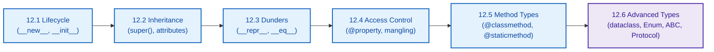
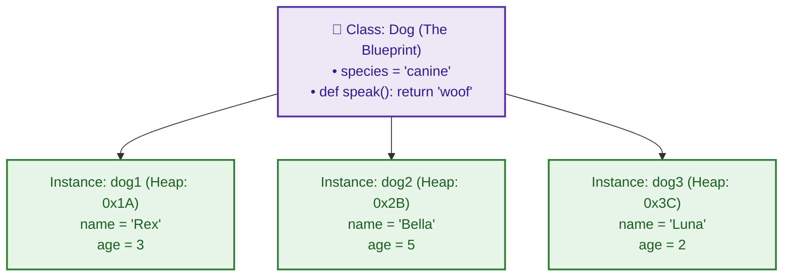

# $\Huge\color{#0D47A1}{\textsf{12 — Object-Oriented Programming (OOP)}}$

[](https://www.python.org/)
[](README.md)
[](../../AI%20Engineer%20Architect%20Road%20Map.md)
[](#)

> $\color{#546E7A}\mathbf{Navigation:}$ **Phase 0** · **Module 0.1** · **Lesson 12 of 16** · [← Prev: 11 Modules, Packages and Files](11%20Modules%20Packages%20and%20Files.md) · [Phase 0.1 — Python Index](README.md) · [Next: 12.1 Classes and Object Lifecycle →](12.1%20Classes%20and%20Object%20Lifecycle.md)

---


## 🗺️ $\Large\color{#0D47A1}\blacksquare\space\color{#1565C0}{\textsf{Stage 0 — Concept Map}}$

So far you've used data (lists, dicts) and behaviour (functions) separately. **OOP** bundles them together: a **class** packages related data *and* the functions that work on it into one reusable type. You'll mostly *use* classes that libraries provide (a `SentenceTransformer`, an `OpenAI` client, a Pydantic `BaseModel`), so understanding how they work makes every library click.

---

## 📚 $\Large\color{#0D47A1}\blacksquare\space\color{#1565C0}{\textsf{What's in This Lesson — Sub-Module Architecture}}$



This lesson is split into **6 focused sub-modules**. Work through them in order — each one builds on the last.

| # | Sub-module | Covers | Learning Goal |
| :-- | :--- | :--- | :--- |
| 1 | [12.1 Classes & Object Lifecycle](12.1%20Classes%20and%20Object%20Lifecycle.md) | `class`, `__init__`, `__new__`, Singleton, Factory | Understand the two-phase creation sequence and when to override `__new__` |
| 2 | [12.2 Attributes & Inheritance](12.2%20Attributes%20and%20Inheritance.md) | Class vs instance attrs, `super()`, override strategies | Spot the mutable class attribute trap; extend parent logic cleanly |
| 3 | [12.3 Dunder Methods](12.3%20Dunder%20Methods.md) | `__str__`, `__repr__`, `__eq__`, `__add__`, `self.__dict__` | Teach Python's operators to speak your class's language |
| 4 | [12.4 Access Control & Properties](12.4%20Access%20Control%20and%20Properties.md) | Public / Protected / Private, name mangling, `@property` | Control what callers can see and add validation to attribute access |
| 5 | [12.5 Method Types](12.5%20Method%20Types.md) | Instance method, `@classmethod`, `@staticmethod` | Pick the right method type; write alternative constructors the Python way |
| 6 | [12.6 Advanced Types](12.6%20Advanced%20Types.md) | `@dataclass`, `Enum`, `ABC`, `Protocol` | Use Python's power tools for safe, expressive, contract-driven design |

---

## 🔑 $\Large\color{#4A148C}\blacksquare\space\color{#6A1B9A}{\textsf{Full Vocabulary}}$

<details>
<summary>Click to expand — all 19 terms defined</summary>

### $\large\color{#512DA8}\blacktriangleright\space\color{#311B92}{\textsf{Core Objects and Lifecycle}}$
- **Class** — a blueprint for making objects.
- **Object / instance** — a specific thing built from a class.
- **`__new__`** — the allocator method; runs *before* `__init__` to allocate raw heap memory. Receives `cls` and returns the new instance.
- **`__init__`** — the initializer method; Python calls it automatically immediately after `__new__` to set up initial state. Receives `self` and returns `None`.
- **`self`** — the current instance, inside a method (a strict convention, not a reserved keyword).
- **Singleton** — a design pattern ensuring only one instance of a class exists in memory.

### $\large\color{#512DA8}\blacktriangleright\space\color{#311B92}{\textsf{Encapsulation and Polymorphism}}$
- **Class attribute** — data shared by all instances of a class (acts like a shared static variable; trap if mutable!).
- **`_variable` (Protected by convention)** — single leading underscore signals internal use (accessible, but hands-off by convention).
- **`__variable` (Private / name mangling)** — double leading underscores trigger Python name mangling (`_Class__var`) to prevent subclass collisions.
- **`@property` (Getter / Setter / Deleter)** — decorator that turns methods into attribute access with validation and cleanup.
- **`@classmethod`** — a method receiving the class (`cls`) instead of `self`; Python's standard way to build alternative constructors.
- **`@staticmethod`** — a plain function namespaced inside a class; receives neither `self` nor `cls`.
- **Inheritance** — a class building on another; **dunder** — special `__methods__` Python calls for you.
- **`self.__dict__`** — internal dictionary mapping attribute names to their values for an instance.
- **`__eq__`** — dunder method defining equality (`==`); defaults to identity (`is`) unless overridden.

### $\large\color{#512DA8}\blacktriangleright\space\color{#311B92}{\textsf{Contracts and Advanced Types}}$
- **`ABC` & `@abstractmethod`** — Abstract Base Class; defines an interface contract that cannot be instantiated until subclasses implement all required methods and properties.
- **`Enum` (Enumeration)** — a symbolic set of named constant values; prevents invalid string bugs and provides type-safe options.
- **`Protocol` (`typing.Protocol`)** — structural subtyping (static duck typing); defines an interface contract satisfied by any class with matching methods/attributes without inheritance.
- **`@runtime_checkable`** — decorator enabling `isinstance()` checks against a `Protocol` at runtime (checks attribute existence).

</details>

---


## 🎈 $\Large\color{#00695C}\blacksquare\space\color{#00897B}{\textsf{Stage 1 — The Simple Idea }}$

A **class** is a cookie cutter — a blueprint that defines a shape. An **object** (or **instance**) is an actual cookie stamped from it. One cutter, many cookies, each with its own decorations. The class says *what every dog has* (a name, a `bark()` ability); each dog object fills in its own details.



> **The "Aha!":** a class defines a new **type** that carries both **state** (its data, called attributes) and **behaviour** (its functions, called methods) together.

---

> [!IMPORTANT]
> ### 🔥 $\color{#00C853}{\textsf{The 80/20 Core Rule: What Matters in Production}}$
> * $\color{#00C853}\blacktriangleright$ **Daily Core (90% of Real AI Work):** Encapsulating state in classes (`class DocumentChunker:`), `__init__`, `self`, `@property` for clean computed attributes, `@classmethod` for factory constructors (`LLMClient.from_env()`), Pydantic models for structured schema validation, and essential dunders (`__repr__`, `__call__`).
> * $\color{#FFB300}\blacktriangleright$ **Occasional (Framework Integration):** Subclassing base classes (`class CustomEmbedding(BaseEmbedding):`), `__enter__` and `__exit__` for custom context managers, `@abstractmethod`.
> * $\color{#757575}\blacktriangleright$ **Reference Only (Exhaustive and Metaprogramming):** Metaclasses (`type`), `__slots__`, multiple inheritance diamond resolution (MRO C3 linearization), arithmetic operator overloading (`__add__`, `__matmul__`).

---

## 📌 $\Large\color{#1B5E20}\blacksquare\space\color{#2E7D32}{\textsf{Master Quick Reference}}$

```python
class Dog(Animal):
    species = "canine"             # class attribute (shared immutable constant)
    def __init__(self, name):
        super().__init__(name)     # parent setup
        self.name = name           # instance attribute
        self.tricks = []           # per-instance collection (not shared!)

    def speak(self): return "woof"
    def __repr__(self): return f"Dog({self.name})"

    # Alternative constructor:
    @classmethod
    def from_string(cls, s):
        return cls(s.strip())

class Account:
    def __init__(self, balance):
        self._balance = balance    # private by convention

    @property
    def balance(self):             # GETTER: acc.balance
        return self._balance

    @balance.setter
    def balance(self, val):        # SETTER: acc.balance = val
        if val < 0: raise ValueError("Negative!")
        self._balance = val        # assign to private backing variable!

    @balance.deleter
    def balance(self):             # DELETER: del acc.balance
        del self._balance

# Singleton using __new__:
class SingletonConnection:
    _instance = None
    def __new__(cls, *args, **kwargs):
        if cls._instance is None:
            cls._instance = super().__new__(cls)  # delegates to object.__new__(cls)
        return cls._instance


from dataclasses import dataclass
@dataclass
class Point:
    x: int
    y: int

from enum import Enum, IntEnum, StrEnum, auto
class Role(StrEnum):
    ADMIN = "admin"
    USER = "user"

role is Role.ADMIN                  # identity comparison (fastest & safest)
role.name                           # 'ADMIN' (identifier string)
role.value                          # 'admin' (underlying value)
Role("admin")                       # lookup by value -> Role.ADMIN
Role["ADMIN"]                       # lookup by name  -> Role.ADMIN

from abc import ABC, abstractmethod
class BaseService(ABC):
    @property
    @abstractmethod
    def api_key(self): pass        # @abstractmethod MUST be innermost
    @abstractmethod
    def run(self): ...             # '...' (Ellipsis) or 'pass'

from typing import Protocol, runtime_checkable
@runtime_checkable
class Embedder(Protocol):
    def embed(self, text: str) -> list[float]: ...  # Ellipsis (...) = pure signature contract
```

---


## 🛑 $\Large\color{#B71C1C}\blacksquare\space\color{#D32F2F}{\textsf{STOP — Self-Check}}$

In `rex = Dog("Rex", 3)`, what does `__init__` do, and what is `self` inside it?

<details>
<summary><b>🔍 Click to Reveal the Answer</b></summary>

<br/>

`__init__` is the **initializer** — it runs automatically when the instance is created, setting up the object's initial data (here, storing `name="Rex"` and `age=3`). Inside it, **`self` is the specific new object being created** (the one that will be called `rex`); assigning `self.name = name` attaches that data to *this* instance, separate from any other `Dog`.

Ready to go deeper? Start with [12.1 Classes & Object Lifecycle →](12.1%20Classes%20and%20Object%20Lifecycle.md)

</details>
