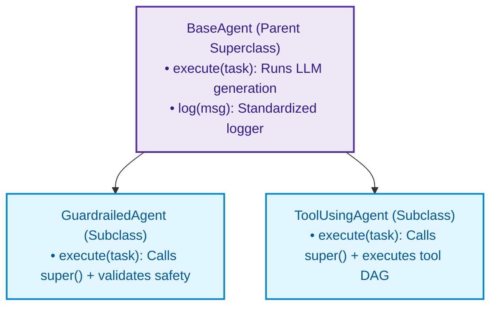
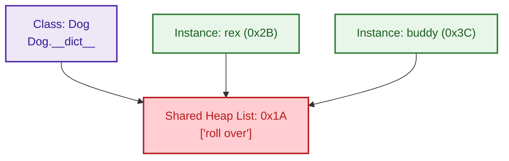
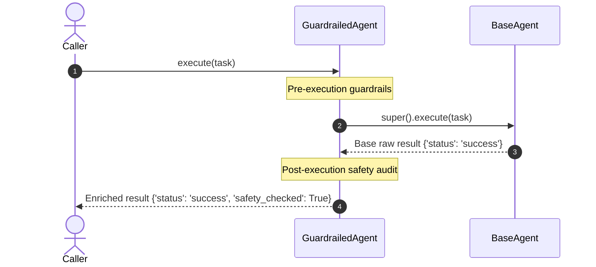

# $\Huge\color{#0D47A1}{\textsf{12.2 — Attributes and Inheritance}}$

[](https://www.python.org/)
[](README.md)
[](../../AI%20Engineer%20Architect%20Road%20Map.md)
[](#)

> $\color{#546E7A}\mathbf{Navigation:}$ **Phase 0** · **Module 0.1** · **Sub-module 2 of 6** · [← Prev: 12.1 Classes and Lifecycle](12.1%20Classes%20and%20Object%20Lifecycle.md) · [OOP Index](12%20Object-Oriented%20Programming.md) · [Next: 12.3 Dunder Methods →](12.3%20Dunder%20Methods.md)

---

## 🗺️ $\color{#0D47A1}\blacksquare\space\color{#1565C0}{\textsf{Stage 0 — Concept Map}}$

**The problem (attributes):** Without the class vs instance attribute distinction, you'll accidentally share a mutable list across every object of a class — one of Python's most common silent bugs.

**The problem (inheritance):** Without inheritance and `super()`, every subclass would have to re-implement everything from scratch. Inheritance lets you *reuse and extend* — the child gets the parent's setup for free.

**Where it fits:**
- Builds on: 12.1 (class basics, `__init__`, `self`)
- Unlocks: Dunder methods (12.3), Access control (12.4), ABCs (12.6)

---

## 🔑 $\color{#4A148C}\blacksquare\space\color{#6A1B9A}{\textsf{New Terms (Plain English)}}$

| Term | One-line meaning |
| :--- | :--- |
| **Class attribute** | Data defined on the class itself, shared by *all* instances |
| **Instance attribute** | Data defined on `self` inside `__init__`, unique to *one* instance |
| **Inheritance** | A class that gets all the methods and attributes of a parent class automatically |
| **Subclass / Child** | The class that inherits (`class Dog(Animal):`) |
| **Superclass / Parent** | The class being inherited from (`Animal`) |
| **`super()`** | A proxy that hands you the parent's version of a method |
| **Override** | Defining a method in the child with the *same name* as the parent's |
| **Polymorphism** | Calling the same method on different objects — each responds in its own way |

---

## 🎈 $\color{#00695C}\blacksquare\space\color{#00897B}{\textsf{Stage 1 — The Simple Idea }}$

**Attributes:** Think of a class attribute as a whiteboard in a shared office — everyone in the room sees the same whiteboard. An instance attribute is a sticky note on *your* desk — only yours.

**Inheritance:** Think of it as a job title hierarchy. A `GuardrailedAgent` *is a* `BaseAgent` — it inherits all the base job skills, plus adds its own safety checks on top.



> **The "Aha!"**: Every class-level mutable object (`[]`, `{}`) is *the same object in memory* for every instance. The fix is always to create it inside `__init__` on `self`.

---

## ⚙️ $\color{#BF360C}\blacksquare\space\color{#D84315}{\textsf{Stage 2 — How It Actually Works}}$

> [!IMPORTANT]
> ### $\color{#00C853}{\textsf{🔥 The 80/20 Core Rule: What Matters in Production}}$
> * $\color{#00C853}\blacktriangleright$ **Daily Core (90% of Real AI Work):** Single inheritance (`class OpenAIAgent(BaseAgent):`), calling `super().__init__(...)` to safely initialize parent configuration, and overriding methods cleanly.
> * $\color{#FFB300}\blacktriangleright$ **Occasional (Modular Mixins):** Multi-class mixins for orthogonal capabilities (`class LoggingMixin:`).
> * $\color{#757575}\blacktriangleright$ **Reference Only (Exhaustive & Complex):** Multi-level diamond inheritance trees, inspecting and debugging C3 MRO (`ClassName.__mro__`).

### $\color{#D84315}\blacktriangleright\space\color{#BF360C}{\textsf{12.3 Instance vs. Class Attributes (and the shared-state trap)}}$

#### $\color{#D84315}\blacktriangleright\space\color{#BF360C}{\textsf{\"Who Owns It?\" — The Attribute Ownership Table}}$

| Attribute Type | Where Defined | Who Shares It | Mutable Trap? | Access Pattern |
| :--- | :--- | :--- | :--- | :--- |
| **Class attribute** | Outside `__init__`, on the class body | **All instances** (same object) | ⚠️ **YES** — if `list` or `dict`, all instances share the same container | `Dog.species` or `rex.species` |
| **Instance attribute** | Inside `__init__` on `self` | **Only this instance** | ✅ No — each instance gets its own fresh object | `rex.name` — `fido.name` is separate |

**In code — proving the table:**

```python
class Dog:
    species = "Canis familiaris"    # 🔵 CLASS attribute — shared by ALL instances

    def __init__(self, name):
        self.name = name            # 🟢 INSTANCE attribute — unique to THIS instance

rex  = Dog("Rex")
fido = Dog("Fido")

# 🔵 Class attribute: accessed on class OR instance — same value everywhere
print(Dog.species)   # 'Canis familiaris'   ← via class
print(rex.species)   # 'Canis familiaris'   ← via instance (falls back to class)
print(fido.species)  # 'Canis familiaris'   ← same object

# 🟢 Instance attribute: unique per instance
print(rex.name)      # 'Rex'    ← rex's own data
print(fido.name)     # 'Fido'   ← fido's own data, completely independent
```

---

#### $\color{#C62828}\blacktriangleright\space\color{#B71C1C}{\textsf{⚠️ The Mutable Class Attribute Trap (and the Fix)}}$



```diff
# Comparing class-level vs instance-level collections
- ❌ Anti-pattern: Placing mutable collection at class body (shared across all instances):
- class ChatSession:
-     history = []  # 💥 Every user session mutates the EXACT same shared list in RAM!

+ ✅ Production pattern: Fresh collection instantiated on self inside __init__:
+ class ChatSession:
+     def __init__(self):
+         self.history = []  # Unique independent list allocated per instance
```

The trap fires when you put a **mutable container** (`list`, `dict`, `set`) as a class attribute. Every instance shares the *exact same container object in memory* — modifying through one instance silently pollutes all others.

```python
# 🚫 THE BUG: Mutable class attribute acts as shared state across all objects
class Dog:
    tricks = []                      # CLASS attribute (mutable list) — SHARED by every dog!

    def __init__(self, name):
        self.name = name

    def add_trick(self, trick):
        self.tricks.append(trick)    # Appends to the ONE shared list in memory!

rex   = Dog("Rex")
buddy = Dog("Buddy")

rex.add_trick("roll over")

# Look at buddy's tricks without ever teaching him a trick:
print(buddy.tricks)                  # ['roll over']  <- 💥 POLLUTED! Buddy shares rex's list!
print(rex.tricks is buddy.tricks)    # True — both point to the EXACT same list in memory!
```

```python
# ✅ THE FIX: Create a fresh list per instance inside __init__
class Dog:
    def __init__(self, name):
        self.name = name
        self.tricks = []             # INSTANCE attribute: a brand-new list for THIS dog

    def add_trick(self, trick):
        self.tricks.append(trick)    # Appends only to this specific dog's list

rex   = Dog("Rex")
buddy = Dog("Buddy")

rex.add_trick("roll over")

print(rex.tricks)                    # ['roll over']
print(buddy.tricks)                  # []  <- Clean! Buddy's list is completely independent
print(rex.tricks is buddy.tricks)    # False — two separate list objects in memory
```

> **Rule of thumb:** Use class attributes only for **immutable constants** (`species = "Canis familiaris"`) or class-level counters. Never put a `[]` or `{}` at the class level unless you deliberately want a shared global cache.

---

### $\color{#D84315}\blacktriangleright\space\color{#BF360C}{\textsf{12.4 Inheritance and super()}}$

Inheritance lets a child class *reuse* everything the parent defines — then add or change specific parts.

```python
class Animal:
    def __init__(self, name):
        self.name = name
    def speak(self):
        return "..."

class Cat(Animal):                   # Cat INHERITS from Animal (gets its attributes/methods)
    def speak(self):                 # OVERRIDE: replace the parent's version
        return f"{self.name} says meow"

class Dog(Animal):
    def __init__(self, name, breed):
        super().__init__(name)       # call the PARENT's __init__ to set up "name"
        self.breed = breed
    def speak(self):
        return f"{self.name} says woof"

# Polymorphism: same call, different behaviour depending on the actual type.
for animal in [Cat("Min"), Dog("Rex", "Lab")]:
    print(animal.speak())            # Min says meow / Rex says woof
```

**Polymorphism** = one method call, different behaviour per type. The caller never needs an `if isinstance(...)` check.

---



#### $\color{#D84315}\blacktriangleright\space\color{#BF360C}{\textsf{Method Override Strategies — Comparison Table}}$

| Strategy | Call `super()`? | What happens to parent logic | When to use |
| :--- | :--- | :--- | :--- |
| **Pure Override (Replace)** | 🚫 No | Parent's logic is **completely discarded** | Child needs entirely different logic (`Cat.speak()` returns `"meow"`, ignores `Animal.speak()`) |
| **Augmented Override (Extend)** | ✅ Yes (`super().method()`) | Parent logic **runs inside child** — child adds pre/post steps | Keep parent behaviour but add safety checks, logging, or enrichment |

**In code — proving both strategies:**

```python
# 🔵 Strategy 1: Pure Override — Cat.speak() REPLACES Animal.speak() entirely
class Animal:
    def speak(self):
        return "[Animal base sound]"

class Cat(Animal):
    def speak(self):
        return "meow"               # ← parent's speak() is never called

cat = Cat()
print(cat.speak())                  # 'meow'   (parent's logic gone)


# 🟢 Strategy 2: Augmented Override — GuardrailedAgent EXTENDS BaseAgent.execute()
class BaseAgent:
    def execute(self, task):
        print(f"[Core Engine]: Executing {task}...")
        return {"status": "success"}

class GuardrailedAgent(BaseAgent):
    def execute(self, task):
        # 1. Pre-execution safety check (child's own step):
        if "malicious" in task:
            raise ValueError("Task blocked by safety guardrail!")

        # 2. Call parent's execute() via super() (parent's logic RUNS):
        result = super().execute(task)

        # 3. Post-execution enrichment (child's own step):
        result["safety_checked"] = True
        return result

agent = GuardrailedAgent()
print(agent.execute("Analyze data"))
# Output:
# [Core Engine]: Executing Analyze data...    ← parent ran
# {'status': 'success', 'safety_checked': True}  ← child enriched the result
```

---

#### $\color{#D84315}\blacktriangleright\space\color{#BF360C}{\textsf{Why super().\_\_init\_\_() is Mandatory in Subclasses}}$

Defining `__init__` in a subclass **completely replaces** the parent's `__init__`. The parent's setup does **NOT** run automatically — you must call it explicitly.

```python
# 🚫 THE BUG: Skipping super().__init__()
class Dog(Animal):
    def __init__(self, name, breed):
        # Forgot super().__init__(name)!
        self.breed = breed

d = Dog("Rex", "Lab")
print(d.name)  # 💥 AttributeError: 'Dog' object has no attribute 'name'!
# Why? Animal.__init__ never ran, so self.name was never created.
```

```python
# ✅ THE FIX: Always call super().__init__() first
class Dog(Animal):
    def __init__(self, name, breed):
        super().__init__(name)   # ← parent sets self.name = name
        self.breed = breed       # ← child adds its own attribute

d = Dog("Rex", "Lab")
print(d.name)   # 'Rex'   ← works!
print(d.breed)  # 'Lab'   ← works!
```

**3-step `super()` execution flow:**

```
Dog("Rex", "Lab")
      │
      ▼
  Dog.__init__(self, "Rex", "Lab")
      │
      ├─ 1. super().__init__("Rex")  ─→  Animal.__init__(self, "Rex")
      │                                       sets: self.name = "Rex"
      │
      ├─ 2. self.breed = "Lab"       ─→  Dog adds its own attribute
      │
      └─ 3. Returns None  ─→  d is fully initialized
```

---

#### $\color{#D84315}\blacktriangleright\space\color{#BF360C}{\textsf{super() in Regular Methods — Not Just \_\_init\_\_}}$

You can use `super()` in *any* method to extend (not replace) the parent's behaviour:

```python
class BaseAgent:
    def execute(self, task):
        print(f"[Core Engine]: Executing {task}...")
        return {"status": "success"}

class GuardrailedAgent(BaseAgent):
    def execute(self, task):
        # 1. Pre-execution safety check:
        if "malicious" in task:
            raise ValueError("Task blocked by safety guardrail!")

        # 2. Call parent's execute() via super():
        result = super().execute(task)

        # 3. Post-execution enrichment:
        result["safety_checked"] = True
        return result

agent = GuardrailedAgent()
print(agent.execute("Analyze data"))
# Output:
# [Core Engine]: Executing Analyze data...
# {'status': 'success', 'safety_checked': True}
```

---

#### $\color{#D84315}\blacktriangleright\space\color{#BF360C}{\textsf{Modern Python 3 vs. Legacy Python 2 (awareness)}}$

| Python version | How to call super |
| :--- | :--- |
| **Python 3 (always use this)** | `super().method(...)` — zero arguments, Python auto-resolves class and instance |
| **Python 2 (legacy, awareness only)** | `super(CurrentClass, self).method(...)` — never use this in new code |

> 💡 **Is there an `override` keyword in Python?**  
> No keyword is needed at runtime — defining a method with the same name *automatically* overrides the parent. Python 3.12+ added `@typing.override` as a *static type-checker* hint to catch typos like `def speek(self):` instead of `def speak(self):`.

---

## 🚀 $\color{#0D47A1}\blacksquare\space\color{#1565C0}{\textsf{Stage 3 — In Practice / Why It Matters}}$

- **Class attributes** are how library authors expose configuration defaults that subclasses can override: `default_encoding = "utf-8"` on a base class, easily replaced in a subclass.
- **Inheritance** is the foundation of every AI framework. LangGraph's `StateGraph`, Pydantic's `BaseModel`, PyTorch's `nn.Module` — all meant to be subclassed. Knowing `super().__init__()` is how you plug into their setup correctly.
- **The mutable attribute trap** shows up constantly in beginners' AI code — a shared list of `messages` or `tools` that gets polluted across agent runs. Always initialize collections inside `__init__`.

---

## 🐛 $\color{#880E4F}\blacksquare\space\color{#AD1457}{\textsf{Common Errors and Fixes}}$

| What you see | Cause | Fix |
| :--- | :--- | :--- |
| `AttributeError: 'Dog' object has no attribute 'name'` | Subclass `__init__` skipped `super().__init__()` | Add `super().__init__(...)` as the first line of the child `__init__` |
| All instances share one list / dict | Mutable class attribute acts as shared state | Put the collection inside `__init__` via `self.tricks = []` |
| `TypeError: speak() takes 1 positional argument but 2 were given` | Forgot `self` in the method definition | Always include `self` as the first parameter |
| Child method never calls parent logic | Used pure override when extension was needed | Call `super().method(...)` inside the child method |

---

## 📌 $\color{#1B5E20}\blacksquare\space\color{#2E7D32}{\textsf{Quick Reference}}$

```python
# Class vs Instance attribute at a glance:
class Dog:
    species = "Canis familiaris"   # CLASS attr — shared, immutable constant ✅
    # bad_list = []                 # CLASS attr — mutable ❌ shared trap!

    def __init__(self, name):
        self.name = name           # INSTANCE attr — unique per object ✅
        self.tricks = []           # INSTANCE attr — fresh list per dog ✅

# Inheritance with super():
class Animal:
    def __init__(self, name): self.name = name
    def speak(self): return "..."

class Dog(Animal):
    def __init__(self, name, breed):
        super().__init__(name)     # ← MANDATORY: run parent setup first
        self.breed = breed
    def speak(self):
        return f"{self.name} says woof"

# Polymorphism:
for a in [Cat("Min"), Dog("Rex", "Lab")]:
    print(a.speak())               # each responds differently — no isinstance() needed
```

---

## 🛑 $\color{#B71C1C}\blacksquare\space\color{#D32F2F}{\textsf{STOP — Self-Check}}$

You write:
```python
class Agent:
    memory = []                    # class attribute

a1 = Agent()
a2 = Agent()
a1.memory.append("task 1")
print(a2.memory)
```
**What does `a2.memory` print, and why?**

<details>
<summary><b>🔍 Click to Reveal the Answer</b></summary>

<br/>

`a2.memory` prints `['task 1']` — even though you only appended to `a1.memory`.  

`memory = []` is a **class attribute** — there is only *one* list object shared by all instances. `a1.memory.append(...)` mutates that same list. `a2.memory` is just another name pointing to the exact same list object in memory.

**Fix:** Move `self.memory = []` inside `__init__` so each instance gets its own fresh list.
 
Ready for the next sub-module? Continue to [12.3 Dunder Methods →](12.3%20Dunder%20Methods.md)

</details>
