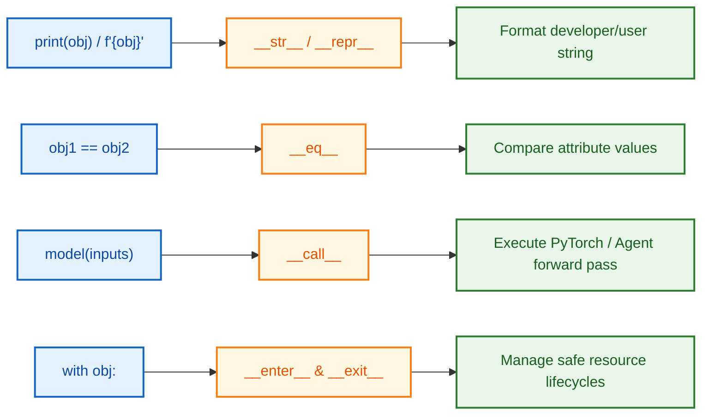

# $\Huge\color{#0D47A1}{\textsf{12.3 — Dunder Methods}}$

[](https://www.python.org/)
[](README.md)
[](../../AI%20Engineer%20Architect%20Road%20Map.md)
[](#)

> $\color{#546E7A}\mathbf{Navigation:}$ **Phase 0** · **Module 0.1** · **Sub-module 3 of 6** · [← Prev: 12.2 Attributes and Inheritance](12.2%20Attributes%20and%20Inheritance.md) · [OOP Index](12%20Object-Oriented%20Programming.md) · [Next: 12.4 Access Control and Properties →](12.4%20Access%20Control%20and%20Properties.md)

---


## 🗺️ $\Large\color{#0D47A1}\blacksquare\space\color{#1565C0}{\textsf{Stage 0 — Concept Map}}$

**The problem:** Without dunder methods, your objects print as `<ModelConfig object at 0x7f8...>`, `==` compares by memory address (not field values), and `+` doesn't work. Dunders are how you make objects behave like built-in Python types.

**Where it fits:**
- Builds on: 12.1 (class basics), 12.2 (attributes)
- Unlocks: Dataclasses (12.6 — they auto-generate these dunders for you)

**Why care as an AI Engineer?** Pydantic models, LangChain documents, embedding vectors — all rely on `__repr__` for debugging, `__eq__` for deduplication, and `__add__`/`__len__` for tensor-style operations.

---


## 🔑 $\Large\color{#4A148C}\blacksquare\space\color{#6A1B9A}{\textsf{New Terms (Plain English)}}$

| Term | One-line meaning |
| :--- | :--- |
| **Dunder method** | Special method with `__double_underscores__` — Python calls it automatically for language operations |
| **`__str__`** | Returns a human-friendly string; called by `print(obj)` and f-strings |
| **`__repr__`** | Returns an unambiguous developer string; called in REPL, debugger, and inside containers |
| **`__eq__`** | Defines `==` comparison; without it, Python compares *identity* (memory address) |
| **`self.__dict__`** | The hidden dictionary Python stores all instance attributes in |
| **`NotImplemented`** | A sentinel value returned from `__eq__` to tell Python: "ask the other side" |
| **`__add__`** | Defines `+` between objects; Python calls it when you write `a + b` |

---


## 🎈 $\Large\color{#00695C}\blacksquare\space\color{#00897B}{\textsf{Stage 1 — The Simple Idea }}$

Dunders are **hooks** — Python calls them automatically when you use a language operation on your object. You write a `+` in your code, Python finds your `__add__` method and calls it. You call `print(obj)`, Python calls your `__str__`.

> **The "Aha!"**: Dunder methods are how you teach Python's built-in operators to speak your class's language.



---


## ⚙️ $\Large\color{#BF360C}\blacksquare\space\color{#D84315}{\textsf{Stage 2 — How It Actually Works}}$

> [!IMPORTANT]
> ### 🔥 $\color{#00C853}{\textsf{The 80/20 Core Rule: What Matters in Production}}$
> * $\color{#00C853}\blacktriangleright$ **Daily Core (90% of Real AI Work):** `__init__` (constructor), `__repr__` (unambiguous developer inspection in logs/debugger), `__str__` (user display), `__enter__` and `__exit__` (context managers), and `__call__` (making instances callable like functions — used throughout PyTorch `nn.Module` and LangChain `Runnable`).
> * $\color{#FFB300}\blacktriangleright$ **Occasional (Container Emulation):** `__len__`, `__getitem__`, `__iter__`, `__eq__` (equality checks).
> * $\color{#757575}\blacktriangleright$ **Reference Only (Exhaustive Dunders):** `__hash__`, `__lt__`, `__gt__`, `__add__`, `__mul__`, `__matmul__`, `__getattr__` vs `__getattribute__`.

### $\large\color{#D84315}\blacktriangleright\space\color{#BF360C}{\textsf{1. Object String Representation: \_\_str\_\_ vs. \_\_repr\_\_}}$

```diff
# Developer inspection in logs, debuggers, and containers
- ❌ Missing __repr__ (Containers print unreadable raw memory addresses):
- class PromptTemplate:
-     def __init__(self, name): self.name = name
# print([p1, p2]) -> [<PromptTemplate object at 0x10a>, <PromptTemplate object at 0x20b>] (Useless in logs!)

+ Production Pattern: Always implement __repr__ first:
+ class PromptTemplate:
+     def __init__(self, name): self.name = name
+     def __repr__(self):
+         return f"PromptTemplate(name={self.name!r})"
# print([p1, p2]) -> [PromptTemplate(name='rag_v1'), PromptTemplate(name='rag_v2')]
```

#### $\color{#D84315}\blacktriangleright\space\color{#BF360C}{\textsf{Comparison Table — Two Dunders, Two Audiences}}$

| Method | Audience | Purpose | When Python calls it automatically |
| :--- | :--- | :--- | :--- |
| **`__str__`** | End-user / Human | Friendly, readable, informal | `print(obj)` · `str(obj)` · `f"{obj}"` · `format(obj)` |
| **`__repr__`** | Developer / Debugger | Unambiguous, technical (ideally valid Python to recreate obj) | REPL / Jupyter · `repr(obj)` · `f"{obj!r}"` · **inside containers** `print([obj])` |

**In code — same object, three call sites, proving which dunder fires:**

```python
class ModelConfig:
    def __init__(self, name, temperature):
        self.name = name
        self.temperature = temperature

    def __repr__(self):                                           # ← for developers
        return f"ModelConfig(name={self.name!r}, temperature={self.temperature})"

    def __str__(self):                                            # ← for humans
        return f"Model '{self.name}' (Temp: {self.temperature})"


cfg1 = ModelConfig("gpt-4o", 0.7)
cfg2 = ModelConfig("claude-3-5-sonnet", 0.2)

# 🔵 __str__ callers
print(cfg1)                      # __str__ -> "Model 'gpt-4o' (Temp: 0.7)"
text = f"Using {cfg1}"           # __str__ -> "Using Model 'gpt-4o' (Temp: 0.7)"
s    = str(cfg1)                 # __str__ -> same

# 🟢 __repr__ callers
repr_output = repr(cfg1)         # __repr__ -> "ModelConfig(name='gpt-4o', temperature=0.7)"
# cfg1  ← in REPL shows __repr__

# THE CONTAINER GOTCHA — print([list]) ALWAYS uses __repr__ on the items:
configs = [cfg1, cfg2]
print(configs)
# Output: [ModelConfig(name='gpt-4o', temperature=0.7), ModelConfig(name='claude-3-5-sonnet', temperature=0.2)]
# ^ Even though print() was called on the list, Python calls __repr__ for each item inside!
```

#### $\color{#D84315}\blacktriangleright\space\color{#BF360C}{\textsf{The Fallback Mechanism}}$

```mermaid
flowchart TD
    classDef call fill:#E1F5FE,stroke:#0288D1,stroke-width:2px,color:#01579B;
    classDef check fill:#FFF3E0,stroke:#E65100,stroke-width:2px,color:#BF360C;
    classDef ok fill:#E8F5E9,stroke:#2E7D32,stroke-width:2px,color:#1B5E20;
    classDef bad fill:#FFEBEE,stroke:#C62828,stroke-width:2px,color:#B71C1C;

    Req["Caller requests string representation<br/>(print, logs, debugger, REPL)"]:::call --> CheckStr{"Does class define<br/>__str__()?"}:::check
    CheckStr -- "Yes" --> CallStr["Invoke __str__()<br/>Returns human-readable text"]:::ok
    CheckStr -- "No" --> CheckRepr{"Does class define<br/>__repr__()?"}:::check
    CheckRepr -- "Yes" --> CallRepr["Fall back to __repr__()<br/>Returns unambiguous developer string"]:::ok
    CheckRepr -- "No" --> DefAddr["Fall back to object default:<br/>&lt;ModelConfig object at 0x7f...&gt;"]:::bad
```

> [!IMPORTANT]
> **The Golden Rule: Always implement `__repr__` first!**
> - Define **only `__str__`** → objects inside lists/dicts fall back to the ugly memory address.
> - Define **only `__repr__`** → Python automatically uses it as the fallback for `print(obj)` and `str(obj)` too.
> - **Standard practice:** Write `__repr__` first. Add `__str__` only when you need a separate polished format for end-users.

---

### $\large\color{#D84315}\blacktriangleright\space\color{#BF360C}{\textsf{2. Equality: \_\_eq\_\_, self.\_\_dict\_\_, and Nested Equality}}$

Without `__eq__`, Python compares by **identity** (memory address), not field values:

```python
class Item:
    def __init__(self, name): self.name = name

print(Item("Laptop") == Item("Laptop"))  # False! (Two different objects in memory)
# Two separate Item objects at two different addresses — identity fails even if fields match
```

#### $\color{#D84315}\blacktriangleright\space\color{#BF360C}{\textsf{Under the Hood: self.\_\_dict\_\_}}$

> [!NOTE]
> Every standard Python object stores its instance attributes in a hidden dictionary called **`self.__dict__`**. When you write `self.name = "Alice"`, Python literally does `self.__dict__["name"] = "Alice"`.

```python
class User:
    def __init__(self, name, role):
        self.name = name
        self.role = role

u = User("Alice", "Admin")
print(u.__dict__)  # {'name': 'Alice', 'role': 'Admin'}
#                     ^^ This is what == comparisons can use
```

#### $\color{#D84315}\blacktriangleright\space\color{#BF360C}{\textsf{Implementing \_\_eq\_\_ — Field-by-Field vs. \_\_dict\_\_}}$

```python
class User:
    def __init__(self, name, role):
        self.name = name
        self.role = role

    def __eq__(self, other):
        # 1. Type guard: return NotImplemented (not False!) so Python can ask the other side
        if not isinstance(other, User):
            return NotImplemented

        # Approach A: Explicit tuple — fast, selective, clear intent
        return (self.name, self.role) == (other.name, other.role)

        # Approach B: Full dict — compares all attributes automatically
        # return self.__dict__ == other.__dict__

u1 = User("Alice", "Admin")
u2 = User("Alice", "Admin")
u3 = User("Bob",   "User")

print(u1 == u2)   # True  ← same fields
print(u1 == u3)   # False ← different fields
print(u1 == "x")  # False ← NotImplemented triggers fallback, Python defaults to False
```

> **Why `return NotImplemented` instead of `False`?**  
> `NotImplemented` tells Python: *"I can't compare — ask the other operand's `__eq__`."* If both return `NotImplemented`, Python defaults to `False`. This is how `1 == MyObj` can still work if `MyObj.__eq__` knows how to compare with integers.

#### $\color{#C62828}\blacktriangleright\space\color{#B71C1C}{\textsf{The 3-Level Nested Equality Rule}}$

When an object contains nested custom objects, Python recursively calls `==` on each attribute. Each level must implement `__eq__`:

```
Level 1: Customer.__eq__ compares self.__dict__ == other.__dict__
         ↓  delegates to...
Level 2: Address.__eq__ — MUST exist! If missing, falls back to identity (addr1 is addr2) → False
         ↓  delegates to...
Level 3: str.__eq__ (built-in, already works: "Seattle" == "Seattle")
```

```python
class Address:
    def __init__(self, city, zip_code):
        self.city = city
        self.zip_code = zip_code

    # Must implement __eq__ on the nested child class too!
    def __eq__(self, other):
        if not isinstance(other, Address):
            return NotImplemented
        return self.__dict__ == other.__dict__


class Customer:
    def __init__(self, name, address):
        self.name = name
        self.address = address   # Nested custom object!

    def __eq__(self, other):
        if not isinstance(other, Customer):
            return NotImplemented
        # Comparing self.__dict__ automatically delegates equality down to self.address == other.address:
        return self.__dict__ == other.__dict__


addr1 = Address("Seattle", "98101")
addr2 = Address("Seattle", "98101")

c1 = Customer("Alice", addr1)
c2 = Customer("Alice", addr2)

print(c1 == c2)  # True! (Recursively compares name, then compares nested Address)
```

> **THE NESTED EQUALITY TRAP:**  
> If `Address` did NOT implement `__eq__`, comparing `c1 == c2` would compare `addr1 == addr2` by identity (`addr1 is addr2` → `False`) even though both addresses have identical text!  
> **Rule:** Every nested custom class must implement `__eq__`, OR use `@dataclass` (which generates recursive `__eq__` automatically).

---

### $\large\color{#D84315}\blacktriangleright\space\color{#BF360C}{\textsf{3. Operator Dunder Methods (\_\_add\_\_, etc.)}}$

| Dunder Category | Dunder Method | Invoked By Syntax | Production Priority | Real-World AI Application |
| :--- | :--- | :--- | :--- | :--- |
| **Representation** | `__repr__(self)` | `repr(obj)`, `print([obj])` | $\color{#00C853}\blacksquare\ \textbf{Core (Daily)}$ | Container logging, debugger inspections |
| **Representation** | `__str__(self)` | `print(obj)`, `str(obj)` | $\color{#00C853}\blacksquare\ \textbf{Core (Daily)}$ | User-facing display, CLI chat outputs |
| **Callable** | `__call__(self, *args)` | `obj(*args)` | $\color{#00C853}\blacksquare\ \textbf{Core (Daily)}$ | PyTorch layers (`model(x)`), LangChain Runnables |
| **Context Manager** | `__enter__`, `__exit__` | `with obj:` | $\color{#00C853}\blacksquare\ \textbf{Core (Daily)}$ | Safe API session lifecycle, GPU memory locks |
| **Equality** | `__eq__(self, other)` | `obj1 == obj2` | $\color{#FFB300}\blacksquare\ \textbf{Occasional}$ | Comparing prompt templates, vector embeddings |
| **Container** | `__len__(self)` | `len(obj)` | $\color{#FFB300}\blacksquare\ \textbf{Occasional}$ | Token counts, dataset chunk lengths |
| **Arithmetic** | `__add__(self, other)` | `obj1 + obj2` | $\color{#757575}\blacksquare\ \textbf{Reference Only}$ | Combining prompt templates or custom vectors |

Dunders let your objects work with Python's arithmetic operators naturally:

```python
class Money:
    def __init__(self, amount):
        self.amount = amount

    def __repr__(self):
        return f"Money({self.amount})"

    def __str__(self):
        return f"${self.amount:.2f}"

    def __eq__(self, other):
        if not isinstance(other, Money):
            return NotImplemented
        return self.amount == other.amount

    def __add__(self, other):            # defines what "+" means
        if not isinstance(other, Money):
            raise TypeError("Can only add Money to Money")
        return Money(self.amount + other.amount)


m1 = Money(10)
m2 = Money(10)
m3 = Money(25)

print(m1 == m2)           # True  (thanks to __eq__)
print(str(m1 + m3))       # '$35.00' (thanks to __add__ creating Money(35), formatted by __str__)
```

**Common operator dunders at a glance:**

| You write | Python calls | What it should return |
| :--- | :--- | :--- |
| `a + b` | `a.__add__(b)` | New instance with combined value |
| `a - b` | `a.__sub__(b)` | New instance with subtracted value |
| `a == b` | `a.__eq__(b)` | `True` / `False` / `NotImplemented` |
| `len(a)` | `a.__len__()` | Integer |
| `str(a)` | `a.__str__()` | String (human-friendly) |
| `repr(a)` | `a.__repr__()` | String (developer-unambiguous) |

---


## 🚀 $\Large\color{#0D47A1}\blacksquare\space\color{#1565C0}{\textsf{Stage 3 — In Practice / Why It Matters}}$

- `__repr__` is the first thing you implement when building any custom class — it makes debugging sessions dramatically faster.
- `__eq__` is essential for deduplication pipelines (e.g. removing duplicate `Document` objects from a RAG corpus).
- `@dataclass` (sub-module 12.6) auto-generates `__init__`, `__repr__`, and `__eq__` — but you need to understand what they do so you know when the auto-generated version isn't enough (e.g. nested equality across custom types).

---


## 🐛 $\Large\color{#880E4F}\blacksquare\space\color{#AD1457}{\textsf{Common Errors and Fixes}}$

| What you see | Cause | Fix |
| :--- | :--- | :--- |
| `<ModelConfig object at 0x7f8...>` in logs | Missing `__repr__` | Implement `__repr__` to return a developer-readable string |
| `print([obj1, obj2])` shows memory addresses | `__repr__` missing; containers always use `__repr__` | Implement `__repr__`, not just `__str__` |
| Two identical objects return `False` with `==` | Class omitted `__eq__`, defaulting to identity check | Implement `def __eq__(self, other)` or use `@dataclass` |
| Nested custom objects return `False` with `==` | A nested child class omitted `__eq__` | Ensure every nested custom class implements `__eq__` |
| `TypeError: unsupported operand type(s) for +` | `__add__` not defined | Implement `def __add__(self, other)` |

---


## 📌 $\Large\color{#1B5E20}\blacksquare\space\color{#2E7D32}{\textsf{Quick Reference}}$

```python
class ModelConfig:
    def __init__(self, name, temp):
        self.name = name
        self.temp = temp

    # ALWAYS implement __repr__ first (also used as __str__ fallback):
    def __repr__(self):
        return f"ModelConfig(name={self.name!r}, temp={self.temp})"

    # OPTIONAL: separate human-friendly display
    def __str__(self):
        return f"Model '{self.name}' @ temp={self.temp}"

    # Equality by field values (not identity):
    def __eq__(self, other):
        if not isinstance(other, ModelConfig):
            return NotImplemented
        return self.__dict__ == other.__dict__

cfg = ModelConfig("gpt-4o", 0.7)
print(cfg)             # __str__  -> "Model 'gpt-4o' @ temp=0.7"
repr(cfg)              # __repr__ -> "ModelConfig(name='gpt-4o', temp=0.7)"
print([cfg])           # __repr__ -> [ModelConfig(name='gpt-4o', temp=0.7)]

# self.__dict__ under the hood:
print(cfg.__dict__)    # {'name': 'gpt-4o', 'temp': 0.7}
```

---


## 🛑 $\Large\color{#B71C1C}\blacksquare\space\color{#D32F2F}{\textsf{STOP — Self-Check}}$

You have a class `ModelConfig` with `__str__` defined but **no `__repr__`**. You write:

```python
configs = [ModelConfig("gpt-4o", 0.7)]
print(configs)
```

**What prints, and why?**

<details>
<summary><b>🔍 Click to Reveal the Answer</b></summary>

<br/>

It prints `[<ModelConfig object at 0x7f...>]` — the ugly memory address.  

`print([configs])` asks the **list** for its string representation. The list calls `__repr__` on each of its items (not `__str__`). Since `ModelConfig` has no `__repr__`, Python falls back to the default `object.__repr__` which shows the memory address.  

**Fix:** Define `__repr__` on `ModelConfig` — it will be used both by containers and as the fallback for `print(obj)` when `__str__` is missing.
 
Ready for the next sub-module? Continue to [12.4 Access Control & Properties →](12.4%20Access%20Control%20and%20Properties.md)

</details>
