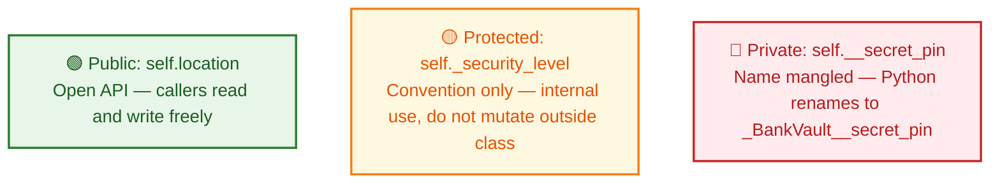
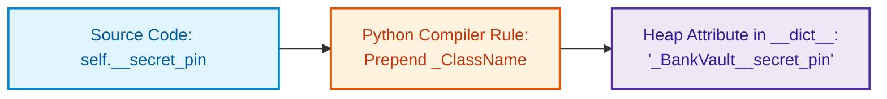
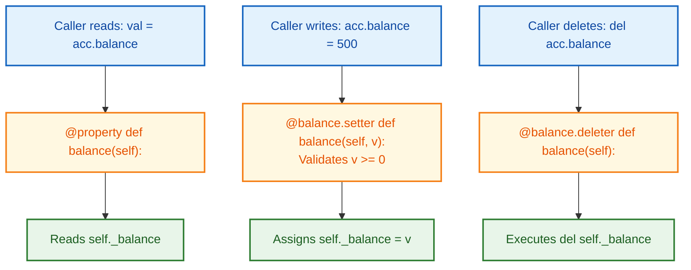

# $\Huge\color{#0D47A1}{\textsf{12.4 — Access Control and Properties}}$

[](https://www.python.org/)
[](README.md)
[](../../AI%20Engineer%20Architect%20Road%20Map.md)
[](#)

> $\color{#546E7A}\mathbf{Navigation:}$ **Phase 0** · **Module 0.1** · **Sub-module 4 of 6** · [← Prev: 12.3 Dunder Methods](12.3%20Dunder%20Methods.md) · [OOP Index](12%20Object-Oriented%20Programming.md) · [Next: 12.5 Method Types →](12.5%20Method%20Types.md)

---

## 🗺️ $\color{#0D47A1}\blacksquare\space\color{#1565C0}{\textsf{Stage 0 — Concept Map}}$

**The problem:** In languages like Java, `private` and `public` keywords enforce access at compile time. Python has no such keywords — instead it uses naming conventions and a clever trick called **name mangling** to signal intent. And rather than verbose `getBalance()` / `setBalance()` methods, Python's `@property` lets you keep clean attribute syntax while running validation under the hood.

**Where it fits:**
- Builds on: 12.1 (`self`, `__init__`), 12.2 (inheritance)
- Unlocks: Method types (12.5), ABCs (12.6 — `@property` + `@abstractmethod`)

---

## 🔑 $\color{#4A148C}\blacksquare\space\color{#6A1B9A}{\textsf{New Terms (Plain English)}}$

| Term | One-line meaning |
| :--- | :--- |
| **Public** | Any attribute/method with no underscore prefix — part of the open API |
| **Protected (`_`)** | Single underscore prefix — "internal use only" by convention; Python doesn't enforce it |
| **Private (`__`)** | Double underscore prefix — Python renames it to `_ClassName__attr` (name mangling) to prevent subclass collisions |
| **Name mangling** | Python's automatic rename: `self.__pin` in `BankVault` becomes `_BankVault__pin` at runtime |
| **`@property`** | Decorator that turns a method into readable attribute syntax with optional validation |
| **Getter** | The `@property` method — runs when you *read* `obj.attr` |
| **Setter** | The `@attr.setter` method — runs when you *assign* `obj.attr = value` |
| **Deleter** | The `@attr.deleter` method — runs when you *delete* `del obj.attr` |
| **Backing variable** | The private `self._attr` that holds the actual data behind a `@property` |

---

## 🎈 $\color{#00695C}\blacksquare\space\color{#00897B}{\textsf{Stage 1 — The Simple Idea }}$

**Access control:** Think of a hospital. The main entrance is **public** — anyone walks in. The staff corridor is **protected** — technically you can enter, but there's a sign saying "Staff Only." The operating theatre is **private** — the door is locked and the lock is hidden.

**`@property`:** Think of a coin slot machine. You put in a coin (`acc.balance = 250`) — the machine validates it, rejects counterfeits, and only then updates the count. From your perspective it *looks* like setting a variable, but behind the slot there's validation logic.



---

## ⚙️ $\color{#BF360C}\blacksquare\space\color{#D84315}{\textsf{Stage 2 — How It Actually Works}}$

> [!IMPORTANT]
> ### $\color{#00C853}{\textsf{🔥 The 80/20 Core Rule: What Matters in Production}}$
> * $\color{#00C853}\blacktriangleright$ **Daily Core (90% of Real AI Work):** Public attributes by default, non-public convention with a single leading underscore `_internal_cache`, and `@property` getters for computed attributes without breaking caller syntax (`@property def is_ready(self):`).
> * $\color{#FFB300}\blacktriangleright$ **Occasional (Validation Setters):** `@attr.setter` for runtime validation guards on assignment.
> * $\color{#757575}\blacktriangleright$ **Reference Only (Exhaustive):** Name mangling with double underscores `__mangled_var` (rarely necessary outside deep library internals).

### $\color{#D84315}\blacktriangleright\space\color{#BF360C}{\textsf{12.6 Access Control — Public, Protected, and Private}}$

Python has **no `public`, `protected`, or `private` keywords**. Access control is purely by naming convention and name mangling — it applies identically to attributes and methods.

#### $\color{#D84315}\blacktriangleright\space\color{#BF360C}{\textsf{Access Levels at a Glance}}$

| Level | Syntax | Outside class? | Subclass? | Python enforces? |
| :--- | :--- | :--- | :--- | :--- |
| 🟢 **Public** | `self.data` / `def action(self):` | ✅ Yes — open API | ✅ Yes | No convention to break |
| 🟡 **Protected** | `self._data` / `def _helper(self):` | ⚠️ Yes but violates convention | ✅ Yes — intended for subclasses | No, "consenting adults" rule |
| 🔴 **Private** | `self.__data` / `def __secret(self):` | 🚫 Direct access raises `AttributeError` | 🚫 Direct access fails in child too | Yes — name mangling enforces it |

**In code — all three levels on one object, one line per level:**

```python
class BankVault:
    def __init__(self, pin):
        self.location = "New York"            # 🟢 PUBLIC variable
        self._security_level = 3              # 🟡 PROTECTED variable (single _)
        self.__secret_pin = pin               # 🔴 PRIVATE variable (double __)

    def unlock(self, entered_pin):            # 🟢 PUBLIC method
        if self.__verify_pin(entered_pin):    # Calls private method internally!
            return "Vault unlocked! Welcome."
        return "Access denied: Invalid PIN."

    def _audit_log(self, message):            # 🟡 PROTECTED method (convention only)
        print(f"[AUDIT LOG - Level {self._security_level}]: {message}")

    def __verify_pin(self, entered_pin):      # 🔴 PRIVATE method (name mangled)
        self._audit_log("Verifying PIN...")
        return entered_pin == self.__secret_pin


vault = BankVault("9876")

# 🟢 Public: works cleanly
print(vault.location)                    # 'New York'   ✅
print(vault.unlock("9876"))              # 'Vault unlocked! Welcome.'  ✅

# 🟡 Protected: works but convention says "don't do this outside the class"
vault._audit_log("Manual check")        # ⚠️ Works but bad practice

# 🔴 Private: direct access BLOCKED by name mangling
try:
    print(vault.__secret_pin)            # 💥 AttributeError: 'BankVault' object has no attribute '__secret_pin'
except AttributeError as e:
    print(f"Blocked: {e}")

try:
    vault.__verify_pin("9876")           # 💥 AttributeError: 'BankVault' object has no attribute '__verify_pin'
except AttributeError as e:
    print(f"Blocked: {e}")
```

#### $\color{#D84315}\blacktriangleright\space\color{#BF360C}{\textsf{Name Mangling — What Python Really Stores}}$



| What you write in code | What Python stores at runtime | Why |
| :--- | :--- | :--- |
| `self.__secret_pin` (inside `BankVault`) | `_BankVault__secret_pin` | Prevents subclass `__secret_pin` from clashing with parent's |
| `self.__verify_pin` (inside `BankVault`) | `_BankVault__verify_pin` | Same — subclasses can't accidentally override internal methods |

**One-liner proof:**
```python
# Python automatically renames `def __method()` to `_ClassName__method`:
print([m for m in dir(vault) if "verify_pin" in m])
# Output: ['_BankVault__verify_pin']   ← the real name Python stored

# --- (5) How to EXPLICITLY call a Private Method (Bypassing Name Mangling) ---
# Format: obj._ClassName__methodName()
is_valid = vault._BankVault__verify_pin("9876")
print(f"Bypassed call result: {is_valid}")  # True!
```

> 💡 **Why does name mangling exist?**  
> If a parent class's `unlock()` relies on its own `__verify_pin()`, and a subclass writes a new `def __verify_pin()` with different logic, Python ensures the parent's `_Parent__verify_pin` stays intact. The subclass cannot accidentally hijack the base class's internal method!

---

#### $\color{#D84315}\blacktriangleright\space\color{#BF360C}{\textsf{Subclass Visibility: \_ vs. \_\_ — Comparison Table}}$

| Member in Parent | Syntax | Accessible directly in Child? | Explanation |
| :--- | :--- | :--- | :--- |
| **Public** | `self.x` / `def f(self):` | ✅ Yes | Inherited directly, completely open |
| **Protected** | `self._x` / `def _f(self):` | ✅ Yes | Intended for class *and* subclasses — `self._x` works in child |
| **Private** | `self.__x` / `def __f(self):` | 🚫 Direct FAILS · 🔓 Explicit works | Mangled to `_Parent__x`; child must use `self._Parent__x` explicitly |

**In code — Child trying all three access levels:**

```python
class Parent:
    def __init__(self):
        self.public_data = "Public: open to anyone"
        self._protected_data = "Protected: meant for Parent & Child subclasses"
        self.__private_data = "Private: isolated to Parent class only"

    def _protected_method(self):
        return "Parent's protected algorithm"

    def __private_method(self):
        return "Parent's private internal engine"


class Child(Parent):
    def run_subclass_checks(self):
        # 1. Public: works seamlessly
        print(self.public_data)            # ✅ 'Public: open to anyone'

        # 2. Protected: works seamlessly inside subclass!
        print(self._protected_data)        # ✅ 'Protected: meant for Parent & Child subclasses'
        print(self._protected_method())    # ✅ "Parent's protected algorithm"

        # 3. Private: DIRECT access in subclass FAILS!
        try:
            print(self.__private_data)     # 💥 Raises AttributeError!
        except AttributeError as e:
            print(f"Direct private variable access failed: {e}")
            # Error: 'Child' object has no attribute '_Child__private_data'

        try:
            self.__private_method()        # 💥 Raises AttributeError!
        except AttributeError as e:
            print(f"Direct private method access failed: {e}")
            # Error: 'Child' object has no attribute '_Child__private_method'

        # 4. How the child CAN explicitly access parent private members:
        # Format: self._ParentClassName__memberName
        print(self._Parent__private_data)      # 🔓 'Private: isolated to Parent class only'
        print(self._Parent__private_method())  # 🔓 "Parent's private internal engine"


child_instance = Child()
child_instance.run_subclass_checks()
```

> 🎯 **Architect's Mental Model:**
> - Want subclasses to inherit, reuse, or override an internal detail → **single underscore `_member`** (Protected).
> - Want to lock an internal detail so child classes can NEVER accidentally override it → **double underscore `__member`** (Private / mangled).

---

### $\color{#D84315}\blacktriangleright\space\color{#BF360C}{\textsf{12.7 @property — Getters, Setters, and Deleters}}$



```diff
# Comparing Java-style getters/setters with Pythonic @property
- ❌ Clumsy Java-style boilerplate methods:
- class LLMConfig:
-     def get_temperature(self): return self._temperature
-     def set_temperature(self, val):
-         if not (0.0 <= val <= 2.0): raise ValueError("Out of range")
-         self._temperature = val
# Usage: cfg.get_temperature() / cfg.set_temperature(0.7) (Unpythonic!)

+ ✅ Idiomatic Python: @property managed attribute:
+ class LLMConfig:
+     @property
+     def temperature(self): return self._temperature
+     @temperature.setter
+     def temperature(self, val):
+         if not (0.0 <= val <= 2.0): raise ValueError("Out of range")
+         self._temperature = val
# Usage: cfg.temperature / cfg.temperature = 0.7 (Clean attribute syntax + full validation!)
```

Instead of verbose Java-style `get_balance()` / `set_balance()`, Python's `@property` gives callers natural attribute syntax while running validation behind the scenes.

#### $\color{#D84315}\blacktriangleright\space\color{#BF360C}{\textsf{3 Decorators at a Glance}}$

| Decorator | Caller writes | When Python calls it | What you return |
| :--- | :--- | :--- | :--- |
| `@property` | `acc.balance` ← *read* | On attribute **read** | The value (from `self._balance`) |
| `@balance.setter` | `acc.balance = 250` ← *write* | On attribute **assignment** | Nothing (return `None`) |
| `@balance.deleter` | `del acc.balance` ← *delete* | On `del` | Nothing (do cleanup, `del self._balance`) |

**In code — all three decorators proved in action:**

```python
class BankAccount:
    def __init__(self, owner, initial_balance=0):
        self.owner = owner
        # Internal backing variable prefixed with _ (private convention):
        if initial_balance < 0:
            raise ValueError("Initial balance cannot be negative")
        self._balance = initial_balance

    # 1. GETTER: accessed as `account.balance` (looks like an attribute, runs as a method)
    @property
    def balance(self):
        """Public getter: returns the private backing value."""
        return self._balance

    # 2. SETTER: accessed as `account.balance = 250`
    @balance.setter
    def balance(self, new_balance):
        """Public setter: validates before mutating the private backing value."""
        if not isinstance(new_balance, (int, float)):
            raise TypeError("Balance must be a number")
        if new_balance < 0:
            raise ValueError("Balance cannot be negative! Overdraft not permitted.")
        self._balance = new_balance    # ✅ Sets the private backing variable

    # 3. DELETER: accessed as `del account.balance`
    @balance.deleter
    def balance(self):
        """Public deleter: executes cleanup when the attribute is deleted."""
        print(f"Closing account and clearing balance for {self.owner}...")
        del self._balance


# --- Using the Managed Attribute ---
acc = BankAccount("Alice", 100)

# (1) GETTER in action:
print(acc.balance)           # 100   ← clean dot-notation, no parentheses! calls __get__

# (2) SETTER in action:
acc.balance = 250            # Triggers @balance.setter            calls __set__
print(acc.balance)           # 250

# Validation guards in action:
try:
    acc.balance = -50        # Triggers ValueError in the setter!
except ValueError as e:
    print(f"Blocked: {e}")   # 'Blocked: Balance cannot be negative! Overdraft not permitted.'

# (3) DELETER in action:
del acc.balance              # Triggers @balance.deleter: prints closing message  calls __delete__
```

> [!CAUTION]
> **The Setter Infinite Recursion Loop — the most common `@property` bug:**  
> Inside `@balance.setter`, you **MUST** assign to the **private backing variable** `self._balance = new_balance`.  
> If you accidentally write `self.balance = new_balance` (no underscore), you call the setter *inside itself* — infinite recursion crashes with:  
> `RecursionError: maximum recursion depth exceeded`

---

#### $\color{#D84315}\blacktriangleright\space\color{#BF360C}{\textsf{Read-Only Computed Properties}}$

Define `@property` (getter) **without** a `.setter` → attribute becomes read-only:

```python
class Circle:
    def __init__(self, radius):
        self.radius = radius

    @property                      # Read-only getter: no setter defined!
    def area(self):
        return 3.14159 * self.radius ** 2

c = Circle(2)
print(c.area)                      # 12.566... (computed on the fly, no stored value)

# c.area = 50                      # 💥 AttributeError: property 'area' of 'Circle' object has no setter!
```

---

## 🚀 $\color{#0D47A1}\blacksquare\space\color{#1565C0}{\textsf{Stage 3 — In Practice / Why It Matters}}$

- **Access control** is how you signal intent to other developers. Use `_` liberally for any internal helper. Use `__` only when you're building a framework where subclass method collision is a real risk.
- **`@property`** appears everywhere in AI libraries: `model.device`, `tokenizer.vocab_size`, `pipeline.config` — all properties that compute or validate lazily.
- Pydantic validators (Lesson 13) are a more powerful version of the same pattern — validation on assignment, but with automatic type coercion and JSON serialization built in.

---

## 🐛 $\color{#880E4F}\blacksquare\space\color{#AD1457}{\textsf{Common Errors and Fixes}}$

| What you see | Cause | Fix |
| :--- | :--- | :--- |
| `AttributeError: 'X' object has no attribute '__y'` | Direct access to name-mangled attribute | Use public methods or `obj._ClassName__y` (debug only) |
| `RecursionError: maximum recursion depth exceeded` | `self.balance = val` inside `@balance.setter` | Assign to backing variable: `self._balance = val` |
| `AttributeError: property 'x' of '...' object has no setter` | Assigned to a read-only property | Define `@x.setter` if mutation should be permitted |
| Child class can't access parent's `__attr` | Name mangling: `Child.__attr` becomes `_Child__attr`, not `_Parent__attr` | Use `self._Parent__attr` explicitly or switch to `_attr` (protected) |

---

## 📌 $\color{#1B5E20}\blacksquare\space\color{#2E7D32}{\textsf{Quick Reference}}$

```python
# 🟢 Public     — open to all callers
self.name = "Alice"

# 🟡 Protected  — internal, subclass-accessible by convention
self._config = {}

# 🔴 Private    — name-mangled to _ClassName__attr
self.__pin = "9876"

# Proof of mangling:
# print([m for m in dir(obj) if 'pin' in m])  → ['_BankVault__pin']

# @property trio — all three decorators on ONE backing variable:
class Account:
    def __init__(self, bal):
        self._balance = bal          # backing variable

    @property
    def balance(self):               # GETTER: acc.balance
        return self._balance

    @balance.setter
    def balance(self, val):          # SETTER: acc.balance = val
        if val < 0: raise ValueError("Negative!")
        self._balance = val          # ← MUST use _balance, not balance!

    @balance.deleter
    def balance(self):               # DELETER: del acc.balance
        del self._balance

# Read-only computed property (no setter):
class Circle:
    def __init__(self, r): self.radius = r
    @property
    def area(self): return 3.14159 * self.radius ** 2
# c.area      → 12.566...
# c.area = 5  → AttributeError
```

---

## 🛑 $\color{#B71C1C}\blacksquare\space\color{#D32F2F}{\textsf{STOP — Self-Check}}$

Inside `@balance.setter`, a developer writes `self.balance = new_balance` instead of `self._balance = new_balance`. **What happens when someone assigns `acc.balance = 100`, and why?**

<details>
<summary><b>🔍 Click to Reveal the Answer</b></summary>

<br/>

The setter calls itself in an infinite loop:
1. `acc.balance = 100` → triggers `@balance.setter`
2. Inside setter: `self.balance = new_balance` → triggers `@balance.setter` again
3. → triggers again → → → `RecursionError: maximum recursion depth exceeded`

The fix is to always write `self._balance = new_balance` (the backing variable with the underscore). The backing variable is a plain attribute — reading or writing it does **not** trigger the property.
 
Ready for the next sub-module? Continue to [12.5 Method Types →](12.5%20Method%20Types.md)

</details>
