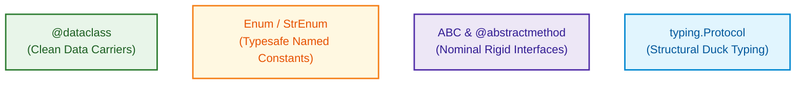
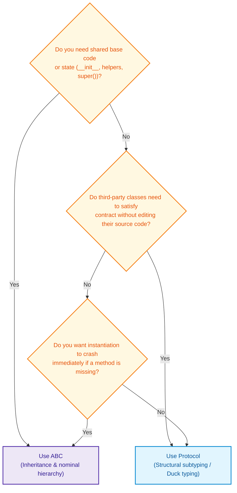

# $\Huge\color{#0D47A1}{\textsf{12.6 — Advanced Types: Dataclasses, Enums, ABCs and Protocols}}$

[](https://www.python.org/)
[](README.md)
[](../../AI%20Engineer%20Architect%20Road%20Map.md)
[](#)

> $\color{#546E7A}\mathbf{Navigation:}$ **Phase 0** · **Module 0.1** · **Sub-module 6 of 6** · [← Prev: 12.5 Method Types](12.5%20Method%20Types.md) · [OOP Index](12%20Object-Oriented%20Programming.md) · [Next Lesson: 13 Built-in Functions in Depth →](13%20Built-in%20Functions%20in%20Depth.md)

---


## 🗺️ $\Large\color{#0D47A1}\blacksquare\space\color{#1565C0}{\textsf{Stage 0 — Concept Map}}$

**This module covers four "power tools" of Python OOP:**

| Tool | Purpose | When to reach for it |
| :--- | :--- | :--- |
| **`@dataclass`** | Auto-generate `__init__`, `__repr__`, `__eq__` for data holder classes | Any class whose job is mainly holding structured data |
| **`Enum`** | Type-safe named constants — prevent typo bugs with raw strings/integers | Anywhere you have a fixed set of valid options (statuses, roles, model tiers) |
| **`ABC`** | Runtime-enforced contract — subclasses *must* implement abstract methods | Internal frameworks where you own all the implementors |
| **`Protocol`** | Static-checked structural contract — any class with matching methods qualifies | Public APIs, third-party integration, duck-typing with IDE safety |

**Where it fits:**
- Builds on: 12.1–12.5 (all OOP concepts come together here)
- Unlocks: Pydantic (Lesson 22 — supercharged dataclass), LangChain / LangGraph patterns

---


## 🔑 $\Large\color{#4A148C}\blacksquare\space\color{#6A1B9A}{\textsf{New Terms (Plain English)}}$

| Term | One-line meaning |
| :--- | :--- |
| **`@dataclass`** | Decorator that auto-generates `__init__`, `__repr__`, `__eq__` from field annotations |
| **`Enum`** | A class whose members are named constants — singletons, immutable, type-safe |
| **`IntEnum`** | An `Enum` whose values are `int` — directly comparable with raw integers |
| **`StrEnum`** | An `Enum` whose values are `str` — directly comparable with raw strings (Python 3.11+) |
| **`auto()`** | Automatically assigns sequential integer values to Enum members |
| **`ABC`** | Abstract Base Class — cannot be instantiated directly; enforces a contract via `@abstractmethod` |
| **`@abstractmethod`** | Marks a method as "must be implemented by every subclass" — instantiation blocked if missing |
| **`Protocol`** | A structural interface — any class with matching method signatures satisfies it, no inheritance needed |
| **`@runtime_checkable`** | Enables `isinstance()` checks on Protocols at runtime (checks name existence, not signatures) |
| **Structural subtyping** | "If it looks like it, it is it" — no explicit inheritance required |
| **Nominal subtyping** | "It is what it inherits from" — `ABC`'s philosophy |

---


## 🎈 $\Large\color{#00695C}\blacksquare\space\color{#00897B}{\textsf{Stage 1 — The Simple Idea }}$

- **Dataclass:** A rubber stamp that generates the boring boilerplate `__init__` / `__repr__` / `__eq__` for you.
- **Enum:** A sealed list of the only allowed values — like a dropdown menu in code. Prevents typos from sneaking into prod.
- **ABC:** A job requirement checklist. If a subclass doesn't implement every item, Python blocks the hire (instantiation).
- **Protocol:** An airport security scanner. It checks if your bag has the right shape — it doesn't care which airline issued your ticket (which class you inherit from).



---


## ⚙️ $\Large\color{#BF360C}\blacksquare\space\color{#D84315}{\textsf{Stage 2 — How It Actually Works}}$

> [!IMPORTANT]
> ### 🔥 $\color{#00C853}{\textsf{The 80/20 Core Rule: What Matters in Production}}$
> * $\color{#00C853}\blacktriangleright$ **Daily Core (90% of Real AI Work):** Pydantic `BaseModel` for validating, parsing, and serializing AI structured outputs (LLM tool calling, JSON schemas), and `@dataclass` for lightweight internal data storage.
> * $\color{#FFB300}\blacktriangleright$ **Occasional (Constrained Options):** `Enum` / `StrEnum` (for restricting choices like `ModelProvider.ANTHROPIC`), `NamedTuple`.
> * $\color{#757575}\blacktriangleright$ **Reference Only (Exhaustive & Rare):** Memory optimization with `__slots__` (rarely needed outside millions of tiny objects), custom property descriptors.

### $\large\color{#D84315}\blacktriangleright\space\color{#BF360C}{\textsf{12.9 Dataclasses — Classes for Data, with Less Boilerplate}}$

```diff
# Boilerplate reduction with @dataclass
- ❌ Verbose boilerplate (7 lines just to store 2 variables):
- class PointManual:
-     def __init__(self, x: int, y: int): self.x = x; self.y = y
-     def __repr__(self): return f"PointManual(x={self.x}, y={self.y})"
-     def __eq__(self, other): return self.__dict__ == other.__dict__

+ Production clean @dataclass (3 lines, exact same behavior):
+ from dataclasses import dataclass
+ @dataclass
+ class Point:
+     x: int
+     y: int
```

#### $\color{#D84315}\blacktriangleright\space\color{#BF360C}{\textsf{What you get for free with @dataclass}}$

| Auto-generated | What it does | Without `@dataclass` you'd write... |
| :--- | :--- | :--- |
| `__init__` | Accepts all annotated fields as parameters | `def __init__(self, x, y): self.x = x; self.y = y` |
| `__repr__` | `Point(x=1, y=2)` style string | `def __repr__(self): return f"Point(x={self.x}, y={self.y})"` |
| `__eq__` | Compares all fields by value | `def __eq__(self, other): return self.__dict__ == other.__dict__` |

**In code — plain class vs. `@dataclass`: same result, less typing:**

```python
# 🔵 WITHOUT @dataclass — manual boilerplate (7 lines just for a 2-field class)
class PointManual:
    def __init__(self, x: int, y: int):
        self.x = x
        self.y = y
    def __repr__(self):
        return f"PointManual(x={self.x}, y={self.y})"
    def __eq__(self, other):
        if not isinstance(other, PointManual): return NotImplemented
        return self.__dict__ == other.__dict__


# 🟢 WITH @dataclass — 3 lines, same behaviour
from dataclasses import dataclass

@dataclass                          # auto-writes __init__, __repr__, __eq__ for you
class Point:
    x: int
    y: int


# Proving all three auto-generated methods work:
p = Point(1, 2)
print(p)                            # 'Point(x=1, y=2)'  ← auto __repr__
print(p == Point(1, 2))             # True               ← auto __eq__
print(p == Point(3, 4))             # False              ← auto __eq__
```

> (When you also need **validation**, reach for a Pydantic model instead — that's Lesson 22.)

---

### $\large\color{#D84315}\blacktriangleright\space\color{#BF360C}{\textsf{12.10 Enumerations (Enum): Typesafe Named Constants}}$

Raw strings and integers are fragile — `"admim"` and `"admin"` are both valid strings at runtime. `Enum` prevents this class of bug entirely.

#### $\color{#D84315}\blacktriangleright\space\color{#BF360C}{\textsf{Enum Variants at a Glance}}$

| Type | Subclasses | Production Priority | `member == raw_value`? | Ordering (`<`, `>`)? | Best for |
| :--- | :--- | :--- | :--- | :--- | :--- |
| **`StrEnum`** | `str` | $\color{#00C853}\blacksquare\ \textbf{Core (Daily)}$ | Yes | ❌ No | JSON APIs, LLM model names, role strings |
| **`Enum`** | (nothing extra) | $\color{#00C853}\blacksquare\ \textbf{Core (Daily)}$ | ❌ No | ❌ No | Named constants with any value type |
| **`IntEnum`** | `int` | $\color{#FFB300}\blacksquare\ \textbf{Occasional}$ | Yes | Yes (`IntEnum` members sort) | Numeric codes, priorities, HTTP status |
| **`auto()`** | (use inside any Enum) | $\color{#FFB300}\blacksquare\ \textbf{Occasional}$ | ❌ No (auto = int) | ❌ No | Auto-numbered state machines |

**In code — the raw-value comparison trap proved per variant:**

```python
from enum import Enum, IntEnum, StrEnum, auto

# 🔵 Standard Enum: values are just labels — NOT directly comparable to raw types
class Status(Enum):
    READY = 1
    BUSY  = 2

print(Status.READY == 1)          # False! ← Enum object ≠ raw int
print(Status.READY.value == 1)    # True   ← compare .value attribute
print(Status.READY is Status.READY) # True ← Enum members are singletons

# 🟢 IntEnum: subclasses int — direct comparison works
class Priority(IntEnum):
    LOW    = 1
    MEDIUM = 2
    HIGH   = 3

print(Priority.HIGH == 3)          # True!  ← IntEnum is an int
print(Priority.HIGH > Priority.LOW) # True! ← supports ordering

# 🟣 StrEnum (Python 3.11+): subclasses str — ideal for JSON & LLM APIs
class ModelTier(StrEnum):
    FLAGSHIP  = "gpt-4o"
    FAST      = "gpt-4o-mini"
    EMBEDDING = "text-embedding-3-small"

print(ModelTier.FLAGSHIP == "gpt-4o")  # True! ← StrEnum is a str
# Can be used directly where a string is expected (HTTP headers, API payloads, etc.)

# ⚫ auto() — automatic sequential integers
class AgentState(Enum):
    IDLE      = auto()   # 1
    PLANNING  = auto()   # 2
    EXECUTING = auto()   # 3
    COMPLETED = auto()   # 4
```

---

#### $\color{#D84315}\blacktriangleright\space\color{#BF360C}{\textsf{Defining an Enum and Accessing .name and .value}}$

```python
from enum import Enum

class Role(Enum):
    ADMIN = "admin"
    USER  = "user"
    GUEST = "guest"

current_role = Role.ADMIN

print(current_role)             # Role.ADMIN (the enum member object)
print(current_role.name)        # 'ADMIN' (member identifier as a string)
print(current_role.value)       # 'admin' (underlying value)
```

---

#### $\color{#D84315}\blacktriangleright\space\color{#BF360C}{\textsf{Enum Comparison — 3 Styles}}$

```python
user_role = Role.ADMIN

# FASTEST & SAFEST: identity comparison (is) — Enum members are singletons
if user_role is Role.ADMIN:
    print("Full administrative access granted.")    # ← preferred

# OK: equality comparison (==) — also works
if user_role == Role.ADMIN:
    print("Matches!")

# ❌ TRAP: raw value comparison on standard Enum — FAILS silently
if user_role == "admin":        # False! Enum member ≠ raw string in standard Enum
    pass                        # use StrEnum if you need this

# Pattern matching (Python 3.10+):
state = AgentState.PLANNING
match state:
    case AgentState.IDLE:      print("Waiting...")
    case AgentState.PLANNING:  print("Generating plan...")
    case AgentState.EXECUTING: print("Running tools...")
    case _:                    print("Unknown state")
```

---

#### $\color{#D84315}\blacktriangleright\space\color{#BF360C}{\textsf{Lookup by Value and Lookup by Name}}$

```python
# 1. Lookup by Value: Enum(value)
# Useful when receiving raw strings from an external REST API or JSON payload:
incoming_data = "user"
role = Role(incoming_data)           # Returns Role.USER
print(role is Role.USER)             # True

# Invalid value raises ValueError:
# Role("superadmin")                 # ValueError: 'superadmin' is not a valid Role

# 2. Lookup by Name: Enum[name]
# Useful when looking up by the uppercase identifier string:
role = Role["ADMIN"]                 # Returns Role.ADMIN

# 3. Iterating over all members:
for member in Role:
    print(f"Name: {member.name:10} | Value: {member.value}")
# Output:
# Name: ADMIN      | Value: admin
# Name: USER       | Value: user
# Name: GUEST      | Value: guest
```

---

### $\large\color{#D84315}\blacktriangleright\space\color{#BF360C}{\textsf{12.11 Abstract Base Classes (ABC and @abstractmethod)}}$

ABCs define a **contract** — every subclass *must* implement the abstract methods, or Python blocks instantiation.

#### $\color{#D84315}\blacktriangleright\space\color{#BF360C}{\textsf{Defining an ABC}}$

```python
from abc import ABC, abstractmethod

class BaseLLM(ABC):
    def __init__(self, model_name: str):
        self.model_name = model_name

    # Contract 1: Using '...' (Ellipsis) — Modern Python / Type-Stub convention
    @abstractmethod
    def generate(self, prompt: str) -> str:
        ...

    # Contract 2: Using 'pass' — Traditional Python convention
    @abstractmethod
    def stream(self, prompt: str) -> str:
        pass

    # Concrete helper: subclasses inherit this as-is (not abstract)
    def format_system_prompt(self, user_text: str) -> str:
        return f"System: AI Assistant\nUser: {user_text}"
```

> [!NOTE]
> **`...` vs `pass` in abstract methods?**  
> Both are valid no-ops. `...` (Ellipsis) is the modern convention — it signals *"pure signature specification, implementation intentionally omitted."* Use `...` for Protocols and ABCs; both work identically at runtime.

---

#### $\color{#D84315}\blacktriangleright\space\color{#BF360C}{\textsf{Instantiation Enforcement — What Happens When Violated}}$

```python
# ATTEMPT 1: Instantiating the abstract class directly
try:
    llm = BaseLLM("generic")
except TypeError as e:
    print(f"Blocked: {e}")
    # Output: Blocked: Can't instantiate abstract class BaseLLM without an implementation for abstract method 'generate'


# ATTEMPT 2: Subclass forgot to implement the abstract method
class MockLLM(BaseLLM):
    pass  # Forgot def generate()!

try:
    mock = MockLLM("mock-v1")
except TypeError as e:
    print(f"Subclass blocked: {e}")
    # Output: Subclass blocked: Can't instantiate abstract class MockLLM without an implementation for abstract method 'generate'


# ATTEMPT 3: Complete implementation
class OpenAIProvider(BaseLLM):
    def generate(self, prompt: str) -> str:
        return f"OpenAI ({self.model_name}) response to: {prompt}"

    def stream(self, prompt: str) -> str:
        return f"[stream] {self.generate(prompt)}"

client = OpenAIProvider("gpt-4o")
print(client.generate("Hello"))  # Works! "OpenAI (gpt-4o) response to: Hello"
```

---

#### $\color{#D84315}\blacktriangleright\space\color{#BF360C}{\textsf{Abstract Properties: @property + @abstractmethod}}$

Force subclasses to provide a specific **computed attribute**:

```python
class BaseEmbeddingModel(ABC):
    # Contract: Every subclass must provide an embedding_dim property
    @property
    @abstractmethod
    def embedding_dim(self) -> int:
        ...  # '...' (Ellipsis) or 'pass'


class MiniLM(BaseEmbeddingModel):
    @property
    def embedding_dim(self) -> int:
        return 384


model = MiniLM()
print(model.embedding_dim)  # 384
```

> [!CAUTION]
> **Decorator Stacking Order — `@abstractmethod` MUST be the innermost (bottom) decorator:**
>
> ```python
> # CORRECT: @abstractmethod is innermost (closest to def)
> @property
> @abstractmethod
> def api_key(self): pass
>
> @classmethod
> @abstractmethod
> def from_config(cls, cfg): pass
>
> # WRONG: Reversing the order breaks descriptor machinery!
> @abstractmethod
> @property
> def api_key(self): pass
> ```
> **Why?** Python evaluates decorators bottom-to-top (inside-out). `@property` and `@classmethod` must wrap a callable that's already been flagged as abstract. Reversing breaks Python's descriptor machinery and causes subtle failures.

---

#### $\color{#D84315}\blacktriangleright\space\color{#BF360C}{\textsf{@abstractmethod Can Have Implementation Code}}$

An abstract method can provide shared baseline logic — subclasses must still override it, but can call `super()`:

```python
class BaseAgent(ABC):
    @abstractmethod
    def run(self, task):
        # Baseline shared logging
        print(f"[BASE AGENT]: Task started -> {task}")

class CodeAgent(BaseAgent):
    def run(self, task):
        super().run(task)  # Executes base class abstract implementation!
        print("[CODE AGENT]: Generating Python solution...")

agent = CodeAgent()
agent.run("Refactor DB")
# Output:
# [BASE AGENT]: Task started -> Refactor DB
# [CODE AGENT]: Generating Python solution...
```

---

### $\large\color{#D84315}\blacktriangleright\space\color{#BF360C}{\textsf{12.12 Protocols (typing.Protocol): Structural Subtyping and Static Duck Typing}}$

> **Architect's Rule (read this first):**  
> Use **`Protocol`** when defining what your functions *consume* — allows any third-party class with the right shape to qualify without modification.  
> Use **`ABC`** when building an *internal framework* — where child components share boilerplate, configuration, lifecycle hooks, and `super()` calls.

#### $\color{#D84315}\blacktriangleright\space\color{#BF360C}{\textsf{ABC vs. Protocol — The Full Comparison}}$

| Dimension | `typing.Protocol` (Structural) | `abc.ABC` + `@abstractmethod` (Nominal) |
| :--- | :--- | :--- |
| **Philosophy** | "Duck typing" — shape-based | "Lineage" — inheritance-based |
| **Inheritance required?** | ❌ No — any matching class qualifies | Yes — must write `class MyClass(BaseABC):` |
| **Coupling** | **Zero** — implementers don't even import the Protocol | **Tight** — must import and inherit the base class |
| **Third-party friendly?** | Yes — works with any library object | ❌ Rigid — needs wrapper/adapter classes |
| **Enforcement time** | Static analysis (`mypy`, IDEs) | Runtime — `TypeError` if abstract method missing |
| **Code reuse / base logic** | ❌ None — pure signatures | Rich — `__init__`, helper methods, `super()` |
| **Method body idiom** | `...` (Ellipsis) | `pass` or shared baseline code |

**In code — ABC vs. Protocol side by side with `isinstance()` proof:**

```python
from abc import ABC, abstractmethod
from typing import Protocol, runtime_checkable

# 🔵 ABC approach — requires explicit inheritance
class ABCEmbedder(ABC):
    @abstractmethod
    def embed(self, text: str) -> list[float]: ...

class OpenAIEmbedder(ABCEmbedder):        # MUST inherit ABCEmbedder
    def embed(self, text: str) -> list[float]:
        return [0.1, 0.9]

class ThirdPartyEmbedder:                 # Does NOT inherit — can't satisfy ABCEmbedder!
    def embed(self, text: str) -> list[float]:
        return [0.5, 0.5]

print(isinstance(OpenAIEmbedder(), ABCEmbedder))   # True  ← inherits
print(isinstance(ThirdPartyEmbedder(), ABCEmbedder)) # False ← no inheritance


# 🟢 Protocol approach — structural, no inheritance needed
@runtime_checkable
class ProtocolEmbedder(Protocol):
    def embed(self, text: str) -> list[float]: ...

# ThirdPartyEmbedder doesn't inherit ProtocolEmbedder, but it has the right shape:
print(isinstance(ThirdPartyEmbedder(), ProtocolEmbedder))  # True! ← has .embed method
print(isinstance(OpenAIEmbedder(), ProtocolEmbedder))       # True! ← also has .embed

class BrokenEmbedder:
    def predict(self, text: str) -> list[float]:  # wrong method name
        return [0.0]

print(isinstance(BrokenEmbedder(), ProtocolEmbedder))       # False ← no .embed
```

---

#### $\color{#D84315}\blacktriangleright\space\color{#BF360C}{\textsf{Defining a Protocol — Syntax and Ellipsis}}$

```python
from typing import Protocol

class TextEmbedder(Protocol):
    # Pure method signature contract — body is '...' (Ellipsis):
    def embed(self, text: str) -> list[float]:
        ...
```

> [!NOTE]
> **Why `...` (Ellipsis) instead of `pass` in Protocols?**  
> Both are valid no-ops. But `...` is the universal community standard for Protocol methods and `.pyi` type stub files — it signals: *"pure interface declaration, implementation intentionally omitted."*

---

#### $\color{#D84315}\blacktriangleright\space\color{#BF360C}{\textsf{Structural Subtyping in Action: Zero-Coupling Interfaces}}$

```python
# Provider A: In-memory mock
class FastMockEmbedder:
    def embed(self, text: str) -> list[float]:
        return [0.1, 0.2, 0.3]

# Provider B: Third-party library wrapper
class HuggingFaceEmbedder:
    def __init__(self, model_tag: str):
        self.model_tag = model_tag

    def embed(self, text: str) -> list[float]:
        return [0.45, -0.12, 0.88]

# Consumer function: expects anything that conforms to TextEmbedder
def index_document(content: str, embedder: TextEmbedder) -> list[float]:
    print("Indexing content with embedder...")
    vector = embedder.embed(content)
    return vector

# Both work seamlessly with type checkers and runtime execution!
mock_vec = index_document("Hello world", FastMockEmbedder())
hf_vec   = index_document("Hello world", HuggingFaceEmbedder("all-MiniLM-L6-v2"))
```

---

#### $\color{#D84315}\blacktriangleright\space\color{#BF360C}{\textsf{Protocol Attributes and Properties}}$

```python
from typing import Protocol
from dataclasses import dataclass

class VectorDocument(Protocol):
    # Required attributes (with type annotations):
    page_content: str
    metadata: dict[str, str]

    # Required property:
    @property
    def token_count(self) -> int:
        ...

# Any dataclass or class with these attributes conforms automatically:
@dataclass
class KnowledgeChunk:
    page_content: str
    metadata: dict[str, str]

    @property
    def token_count(self) -> int:
        return len(self.page_content.split())

# KnowledgeChunk perfectly satisfies VectorDocument without subclassing it!
```

---

#### $\color{#D84315}\blacktriangleright\space\color{#BF360C}{\textsf{@runtime\textunderscore checkable — With a Critical Gotcha}}$

```python
from typing import Protocol, runtime_checkable

@runtime_checkable
class Searchable(Protocol):
    def search(self, query: str) -> list[str]:
        ...

class MemoryStore:
    def search(self, query: str) -> list[str]:
        return ["result1", "result2"]

print(isinstance(MemoryStore(), Searchable))    # True (it has a .search method)
```

> **`@runtime_checkable` only checks *name existence* — not signature correctness!**
> ```python
> class BrokenStore:
>     search = "not even a method!"  # string, not a method
>
> print(isinstance(BrokenStore(), Searchable))  # Still returns True! 🚫
> ```
> For full type validation, rely on static type checkers (`mypy` / `pyright`) or Pydantic (Lesson 22).

---

#### $\color{#D84315}\blacktriangleright\space\color{#BF360C}{\textsf{Decision Tree: When to Use What?}}$



---


## 🚀 $\Large\color{#0D47A1}\blacksquare\space\color{#1565C0}{\textsf{Stage 3 — In Practice / Why It Matters}}$

- **Dataclasses:** Pydantic `BaseModel` (Lesson 22) is a dataclass on steroids — understanding `@dataclass` means you understand why Pydantic works the way it does.
- **Enums:** Every AI API uses string enums. `Role.ADMIN`, `AgentState.EXECUTING`, `ModelTier.FLAGSHIP` — safer than raw strings in every production system.
- **ABCs:** PyTorch's `nn.Module`, LangChain's `BaseRetriever`, `BaseChatModel` — all ABCs you subclass and override methods in.
- **Protocols:** The ideal tool when you write a function that should work with *any* embedder, *any* vector store, or *any* LLM client — regardless of which library it comes from.

---


## 🐛 $\Large\color{#880E4F}\blacksquare\space\color{#AD1457}{\textsf{Common Errors and Fixes}}$

| What you see | Cause | Fix |
| :--- | :--- | :--- |
| `TypeError: Can't instantiate abstract class ...` | Subclass forgot to implement an `@abstractmethod` | Implement all abstract methods/properties in the child class |
| Unexpected behavior with `@abstractmethod` + `@property` | Decorators stacked in reverse order | Place `@abstractmethod` as the innermost (bottom) decorator |
| `TypeError: Instance and class checks can only be used with @runtime_checkable protocols` | Used `isinstance()` on a standard Protocol | Decorate the Protocol with `@runtime_checkable` |
| `isinstance(obj, Protocol)` returns `True` despite wrong method signature | `@runtime_checkable` only checks name existence (`hasattr`) | Use `mypy`/`pyright` for signature validation |
| `Status.READY == 1` returns `False` | Comparing standard `Enum` member to raw integer | Use `.value` comparison, `IntEnum`, or compare by identity `is` |
| `TypeError: '<' not supported between instances of 'Role'` | Tried to sort standard `Enum` members | Use `IntEnum` for ordered numeric enums |
| `ValueError: 'X' is not a valid Enum` | Called `Enum(value)` with an unregistered value | Verify input or handle with `try/except ValueError` block |

---


## 📌 $\Large\color{#1B5E20}\blacksquare\space\color{#2E7D32}{\textsf{Quick Reference}}$

```python
from dataclasses import dataclass
@dataclass
class Point:
    x: int
    y: int
# auto-gets: __init__, __repr__, __eq__

from enum import Enum, IntEnum, StrEnum, auto
class Role(StrEnum):
    ADMIN = "admin"
    USER  = "user"

role = Role.ADMIN
role is Role.ADMIN          # ← identity comparison (fastest & safest)
role.name                   # 'ADMIN' (identifier string)
role.value                  # 'admin' (underlying value)
Role("admin")               # lookup by value -> Role.ADMIN
Role["ADMIN"]               # lookup by name  -> Role.ADMIN

from abc import ABC, abstractmethod
class BaseService(ABC):
    @property
    @abstractmethod
    def api_key(self): pass    # @abstractmethod MUST be innermost
    @abstractmethod
    def run(self): ...         # '...' (Ellipsis) or 'pass'

from typing import Protocol, runtime_checkable
@runtime_checkable
class Embedder(Protocol):
    def embed(self, text: str) -> list[float]: ...  # Ellipsis = pure signature contract
```

---


## 🛑 $\Large\color{#B71C1C}\blacksquare\space\color{#D32F2F}{\textsf{STOP — Self-Check}}$

You're writing a function `def run_pipeline(store: VectorRetriever)` that should work with LangChain's `Chroma`, Pinecone's client, and your own `InMemoryStore`. **Would you define `VectorRetriever` as a `Protocol` or an `ABC`, and why?**

<details>
<summary><b>🔍 Click to Reveal the Answer</b></summary>

<br/>

**`Protocol`** — because:

1. **Third-party libraries** (LangChain's `Chroma`, Pinecone's SDK) can't be made to inherit from your `ABC` without modifying their source code or writing adapter wrapper classes.
2. **Protocol** requires zero coupling — any object that has the required methods (e.g. `.retrieve(query: str) -> list[str]`) automatically satisfies the contract, regardless of which library it comes from.
3. Your function just *consumes* the store — it doesn't need shared boilerplate, `__init__`, or `super()` calls (which are reasons to choose `ABC`).

Use `ABC` instead when you're building an **internal framework** where YOU control all the implementations (your own `ChromaRetriever`, `PineconeRetriever`, etc.) and want a common `__init__`, logging hooks, or lifecycle methods shared via `super()`.
 
🎉 **OOP Module Complete!** Continue to the next lesson: [13 Built-in Functions in Depth →](13%20Built-in%20Functions%20in%20Depth.md)

</details>
