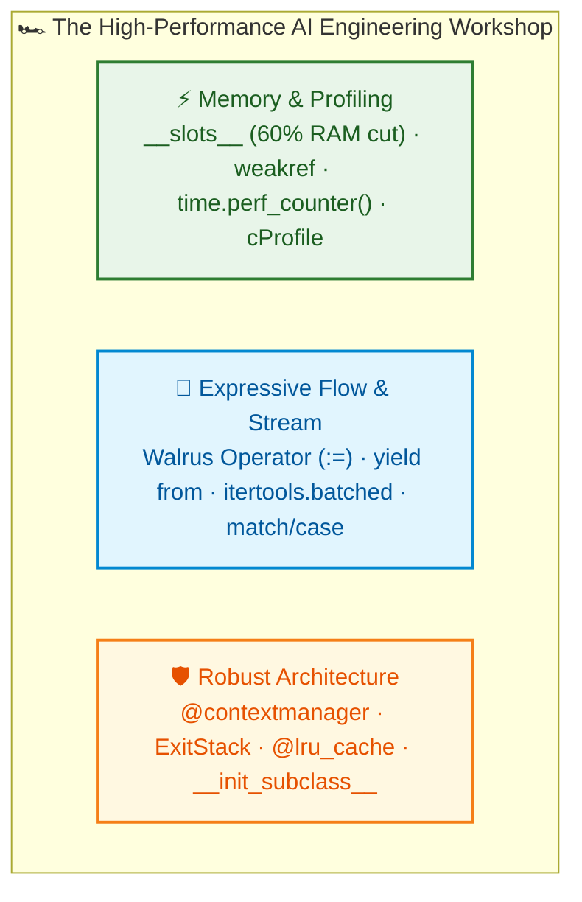
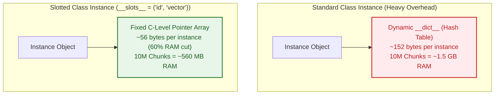

# $\Huge\color{#0D47A1}{\textsf{14 — Advanced Python}}$

[](https://www.python.org/)
[](README.md)
[](../../AI%20Engineer%20Architect%20Road%20Map.md)
[](#)

> $\color{#546E7A}\mathbf{Navigation:}$ **Phase 0** · **Module 0.1** · **Lesson 14 of 25** · [← Prev: 13 Built-in Functions in Depth](13%20Built-in%20Functions%20in%20Depth.md) · [Phase 0.1 — Python Index](README.md) · [Next: 22 Type Hints and Pydantic →](22%20Type%20Hints%20and%20Pydantic.md)

---


## 🗺️ $\Large\color{#0D47A1}\blacksquare\space\color{#1565C0}{\textsf{Stage 0 — Concept Map}}$

Basic Python gives you functions, loops, dictionaries, and classes. With those, you can write working scripts. But when you build **production AI pipelines, high-throughput retrieval systems (RAG), and autonomous agent networks**, standard patterns quickly hit hard engineering ceilings:

1. **Memory explodes:** Storing 500,000 document chunks or embedding metadata objects in standard Python classes exhausts available RAM because every object allocates a hidden dictionary (`__dict__`).
2. **Resource leaks:** Opening connections, managing GPU inference buffers, and timing token latencies with ad-hoc code leads to unclosed sockets and memory leaks when network calls fail.
3. **Repeated computations:** Re-computing expensive tokenizations or embeddings for identical prompt templates wastes money and adds latency.
4. **Brittle branching:** Parsing multi-modal payloads and tool calls from LLMs turns into deep, nested `if/elif/else` ladders that break on unexpected JSON structures.
5. **Slow streaming loops:** Processing gigabyte-scale datasets and token streams without assignment expressions and generator delegation creates bloated, repetitive code.

```
[12 OOP & 13 Built-ins]  ──>  [14 Advanced Python]  ──>  [22 Pydantic & 23 Concurrency]
  (classes & core tools)      (memory, streaming,       (data contracts & async I/O)
                               caching, optimization)
```

- **Prerequisites:** [07 Functions](07%20Functions.md), [08 Comprehensions & Generators](08%20Comprehensions%20and%20Generators.md), [09 Decorators & Closures](09%20Decorators%20and%20Closures.md), [10 Error Handling](10%20Error%20Handling.md), [12 Object-Oriented Programming](12%20Object-Oriented%20Programming.md), [13 Built-in Functions in Depth](13%20Built-in%20Functions%20in%20Depth.md).
- **Where this sits:** The master engineering toolkit bridging foundational syntax into enterprise-grade AI architecture.
- **Why care as an AI Architect:** High-throughput AI services don't fail on complex math—they fail on **Out-Of-Memory (OOM) crashes, unhandled resource lifecycles, slow streaming pipelines, un-cached API calls, and fragile message dispatchers**. Advanced Python equips you with the low-level primitives to build lean, bulletproof systems.

---


## 🔑 $\Large\color{#4A148C}\blacksquare\space\color{#6A1B9A}{\textsf{New Terms (Plain English)}}$

- **Walrus Operator (`:=`)** — Assignment expression syntax that assigns a value to a variable *inside* an expression (e.g. inside an `if` or `while` condition) and evaluates it simultaneously.
- **Generator Delegation (`yield from`)** — Passing control transparently from one generator to an inner sub-generator, streaming items without writing nested loops.
- **`del` Statement** — An eviction command that deletes a variable name from a namespace and decrements the underlying object's reference count.
- **Assertion (`assert`)** — An internal sanity check statement that verifies invariants during development and testing; raises `AssertionError` if false.
- **Memoization (`@lru_cache`)** — An optimization technique that caches the return values of expensive deterministic functions so identical inputs return instantly without re-running.
- **Monotonic Clock (`time.perf_counter`)** — A high-resolution clock designed for benchmarking execution time that never goes backwards, even if the system clock synchronizes.
- **Profiler (`cProfile`)** — A diagnostic tool that measures the exact execution time and call count of every function in your code to identify CPU bottlenecks.
- **Monkey Patching** — Dynamically modifying or replacing a module, class, or method at runtime without editing the original source file (essential for mocking in unit tests).
- **`__slots__`** — A special class attribute that prevents Python from creating a dynamic `__dict__` per instance, slashing memory consumption by 60–70%.
- **Structural Pattern Matching (`match/case`)** — A Python 3.10+ language feature that inspects the *shape* and *contents* of data structures, destructuring values and matching patterns in one step.
- **Context Manager** — An object that manages a runtime environment using `with`, guaranteeing setup and cleanup code runs even if an error crashes the program.

*(For general terms, reference the shared [AI Terms — Plain-English Glossary](../../AI%20Terms%20-%20Plain%20English%20Glossary.md).)*

---


## 🎈 $\Large\color{#00695C}\blacksquare\space\color{#00897B}{\textsf{Stage 1 — The Simple Idea (Analogy: The High-Performance Racing Workshop)}}$

Imagine you own a standard family sedan:
- It has cup holders, glove compartments, power seats, and a plush carpet. It is comfortable and forgiving.
- That is **standard Python**: every object has a roomy dynamic dictionary (`__dict__`), loops hold arrays in memory, functions re-compute identical results, and variables hang around until you don't need them.

Now, imagine entering a **Formula 1 Racing Workshop**:
- Engineers strip out the passenger seats, soundproofing, and carpet to shed every ounce of dead weight (**`__slots__`**).
- Instead of stopping the car to read fuel gauges and then opening the cap, mechanics scan and pump simultaneously in one motion (**The Walrus Operator `:=`**).
- When parts arrive, laser jigs verify their exact geometric dimensions instantly instead of reading blurry labels (**Structural Pattern Matching `match/case`**).
- Heavy diagnostic parts are swapped with lightweight dummy components during wind-tunnel simulations (**Monkey Patching**).
- Mechanics keep frequently used torque settings pinned on a quick-reference whiteboard rather than calculating them from scratch every lap (**Memoization with `@lru_cache`**).
- The pit crew runs with a calibrated high-precision stopwatch, tracking every millisecond of tire changes (**`time.perf_counter`**).

Advanced Python is not about writing obscure, clever code. It is about **taking off the passenger seats and installing racing suspension** so your AI services run with minimum RAM, zero resource leaks, and lightning-fast data routing.



---


## ⚙️ $\Large\color{#BF360C}\blacksquare\space\color{#D84315}{\textsf{Stage 2 — How It Actually Works}}$

> [!IMPORTANT]
> ### 🔥 $\color{#00C853}{\textsf{The 80/20 Core Rule: What Matters in Production}}$
> * $\color{#00C853}\blacktriangleright$ **Daily Core (90% of Real AI Work):** Custom context managers (`with` statements via `@contextlib.contextmanager` for socket/database/GPU cleanup), `collections.defaultdict` (grouping tokens/documents), `collections.Counter` (word/token frequency counts), and modern type hints.
> * $\color{#FFB300}\blacktriangleright$ **Occasional (Optimization and Utilities):** `itertools.chain` (combining large iterables without memory copy), `itertools.islice`, `@functools.lru_cache(maxsize=128)` (caching expensive embedding or tokenizer calls), and `@dataclass`.
> * $\color{#757575}\blacktriangleright$ **Reference Only (Metaprogramming and Low-Level):** Custom descriptors (`__get__`, `__set__`), class creation metaprogramming via `__init_subclass__`, and AST tree parsing.

---

### $\large\color{#D84315}\blacktriangleright\space\color{#BF360C}{\textsf{14.1 Assignment Expressions: The Walrus Operator (:=)}}$

Introduced in Python 3.8, the **walrus operator (`:=`)** assigns a value to a variable *inside an expression* while simultaneously returning that value.

#### $\color{#512DA8}\blacktriangleright\space\color{#311B92}{\textsf{1. The Analogy: The Supermarket Cashier Scanning and Bagging}}$
- **Old Way (Two Steps):** The cashier scans an item, puts it down on the counter, and then picks it up again to put it in the bag.
- **Walrus Way (One Motion):** The cashier scans the item with their right hand and drops it directly into the grocery bag in the exact same physical movement: `(item := scan())`.

#### $\color{#D84315}\blacktriangleright\space\color{#BF360C}{\textsf{2. The Problem-First Contrast: Stream Reading and Comprehensions}}$

```diff
# Reading token streams from APIs
- ❌ Clunky boilerplate (infinite while True + manual break):
- while True:
-     token = client.read_next_token()
-     if not token:
-         break
-     process(token)

+ Clean Walrus expression (read, bind, and condition in one step):
+ while (token := client.read_next_token()):
+     process(token)
```

When reading streaming tokens from an LLM API or network socket, the old way requires awkward boilerplate or infinite `while True` loops:

```python
# ❌ The Old / Clunky Way (boilerplate while True + break):
def read_llm_stream_old(client):
    while True:
        token = client.read_next_token()
        if not token:
            break
        print(f"Token: {token}")

# The Walrus Way (clean, readable, zero boilerplate):
def read_llm_stream_walrus(client):
    # Reads token, assigns to variable 'token', and checks truthiness in one line!
    while (token := client.read_next_token()):
        print(f"Token: {token}")
```

#### $\color{#512DA8}\blacktriangleright\space\color{#311B92}{\textsf{3. Real-World AI Scenario: Expensive Embedding Filtering in Comprehensions}}$
Without the walrus operator, filtering items in a list comprehension based on an expensive calculation forces you to either **run the calculation twice** or write an awkward nested loop:

```python
# Simulated expensive cosine similarity calculation:
def compute_similarity(doc: dict) -> float:
    # (Simulates vector dot product)
    return doc.get("raw_score", 0.0) * 1.05

retrieved_docs = [
    {"id": "doc_1", "raw_score": 0.85},
    {"id": "doc_2", "raw_score": 0.62},
    {"id": "doc_3", "raw_score": 0.91},
]

# ❌ BAD: Computes similarity TWICE per document (in the if AND the select):
# [compute_similarity(d) for d in retrieved_docs if compute_similarity(d) > 0.8]

# GOOD: Compute ONCE, assign to 'sim', and filter simultaneously:
relevant_scores = [
    {"id": d["id"], "score": round(sim, 3)}
    for d in retrieved_docs
    if (sim := compute_similarity(d)) > 0.8
]

print("Filtered Chunks:", relevant_scores)
# Output: [{'id': 'doc_1', 'score': 0.892}, {'id': 'doc_3', 'score': 0.956}]
```

- **Use when:** Looping over streams/buffers (`while (chunk := file.read()):`), avoiding double calculations in comprehensions, or capturing regex matches in an `if` check.
- **Avoid when → use sibling instead:** The line becomes hard to read. Never cram multiple walrus operators into a single expression.
- **Gotcha:** The walrus operator has low precedence. Always wrap it in parentheses: `if (match := pattern.search(text)):`, not `if match := pattern.search(text):`.

---

### $\large\color{#D84315}\blacktriangleright\space\color{#BF360C}{\textsf{14.2 Advanced Iteration and Generators (yield from and itertools)}}$

*(Cross-reference: [08 Comprehensions & Generators](08%20Comprehensions%20and%20Generators.md) covered basic `yield`).*

#### $\color{#D84315}\blacktriangleright\space\color{#BF360C}{\textsf{1. Generator Delegation: yield from}}$
When an AI pipeline aggregates documents from multiple heterogeneous sources (e.g. PDFs, Notion databases, Slack channels), you often write multiple generator functions. 

Instead of writing tedious nested loops (`for chunk in sub_generator: yield chunk`), **`yield from`** delegates directly to the sub-generator at C-speed:

```
Outer Ingestion Generator ──yield from──> [ PDF Streamer ]       (Yields all PDF chunks)
                          ──yield from──> [ Slack Streamer ]     (Yields all Slack chunks)
                          ──yield from──> [ Database Streamer ]  (Yields all DB chunks)
```

```python
def stream_pdf_docs():
    yield "PDF Chapter 1"
    yield "PDF Chapter 2"

def stream_slack_docs():
    yield "Slack Announcement"
    yield "Slack Bug Report"

# Clean generator delegation:
def unified_rag_corpus():
    yield from stream_pdf_docs()
    yield from stream_slack_docs()

for doc in unified_rag_corpus():
    print(f"Ingested: {doc}")
```

#### $\color{#D84315}\blacktriangleright\space\color{#BF360C}{\textsf{2. High-Throughput Streaming with itertools}}$
The standard library `itertools` module provides C-level building blocks for streaming without memory duplication:

```python
from itertools import batched, chain, islice

# 1. itertools.batched (Python 3.12+): Chunks streams into fixed batch sizes for APIs:
queries = [f"query_{i}" for i in range(1, 8)]
for batch in batched(queries, n=3):
    print("API Batch:", batch)
# ('query_1', 'query_2', 'query_3'), ('query_4', 'query_5', 'query_6'), ('query_7',)

# 2. itertools.chain: Zero-copy concatenation of separate streams:
combined_stream = chain(["Doc A", "Doc B"], ["Doc C", "Doc D"])
print("Chained:", list(combined_stream))  # ['Doc A', 'Doc B', 'Doc C', 'Doc D']

# 3. itertools.islice: Lazy pagination without loading infinite streams:
def infinite_ids():
    idx = 1
    while True:
        yield f"ID_{idx}"
        idx += 1

first_three = list(islice(infinite_ids(), 3))
print("First three IDs:", first_three)  # ['ID_1', 'ID_2', 'ID_3']
```

---

### $\large\color{#D84315}\blacktriangleright\space\color{#BF360C}{\textsf{14.3 Memory Management, del, and Slotted Optimization}}$

#### $\color{#D84315}\blacktriangleright\space\color{#BF360C}{\textsf{1. Slashing RAM Overhead with}}$ `__slots__`


By default, Python objects are dynamic. To allow you to add new attributes at any time (`obj.new_field = 10`), Python equips **every single instance** with a hidden dictionary called `__dict__`.
- A single Python dictionary consumes ~104 to 152 bytes of memory overhead *per object*, even before storing any data!
- If your RAG pipeline stores 1,000,000 document chunk objects in RAM, you waste **~150 Megabytes of RAM solely on empty dictionary overhead**!

**The Solution:** Declare `__slots__ = ("field1", "field2")`. This tells Python: *"This class will only ever have these exact attributes. Do not create a dynamic `__dict__`."*

```
Standard Class (With __dict__):
[ Object Pointer ] ──> [ __dict__ (~150 bytes overhead) ] ──> { "id": ..., "score": ... }

Slotted Class (Without __dict__):
[ Object Pointer ] ──> [ Fixed C-struct (~48 bytes total) ] ──> ( "id", "score" )
```

```python
# Slotted class (fixed memory layout, NO __dict__):
class SlottedChunk:
    __slots__ = ("chunk_id", "score")
    
    def __init__(self, chunk_id: str, score: float):
        self.chunk_id = chunk_id
        self.score = score

slot = SlottedChunk("doc_1", 0.95)

# Notice: SlottedChunk has no __dict__:
print(hasattr(slot, "__dict__"))  # False

# Prohibits arbitrary attributes to save RAM:
try:
    slot.dynamic_tag = "VIP"
except AttributeError as e:
    print("Memory Guard:", e)  # 'SlottedChunk' object has no attribute 'dynamic_tag'
```

#### $\color{#D84315}\blacktriangleright\space\color{#BF360C}{\textsf{2. What del Actually Does in Python}}$
A common misconception is that `del x` immediately frees an object from memory. **It does not.**
- `del x` only deletes the **name binding `x`** from the current namespace and **decrements the object's reference count by 1**.
- If other variables point to the same object, the object stays alive in memory!

```python
import sys

# 1. Deleting variable bindings:
weights = [0.1, 0.2, 0.3]
alias = weights

del weights  # Removes the name 'weights'. The list is STILL in RAM because 'alias' points to it!
print("Still accessible via alias:", alias)

# 2. Deleting elements from collections:
cache = {"model": "gpt-4o", "temp": 0.7}
del cache["temp"]  # Removes key from dictionary
print("Cache after del:", cache)  # {'model': 'gpt-4o'}

# 3. Purging GPU / Large Array RAM in AI:
large_embeddings = [0.0] * 10_000_000
del large_embeddings  # Refcount hits 0 -> Python frees the 80MB buffer immediately
```

#### $\color{#D84315}\blacktriangleright\space\color{#BF360C}{\textsf{3. Memory-Safe Caching with Weak References (weakref)}}$
If you store heavy model tensors or parsed document trees in a standard cache dictionary (`cache[doc_id] = heavy_doc`), the cache holds a **strong reference**, preventing Python's GC from ever cleaning it up!

**The Solution:** Use `weakref.WeakValueDictionary()`. It holds values *weakly*. When your application finishes using the document elsewhere, the cache **automatically evicts the item**:

```python
import weakref

class HeavyDocumentTree:
    def __init__(self, name: str):
        self.name = name

# Create memory-safe cache:
doc_cache = weakref.WeakValueDictionary()

live_doc = HeavyDocumentTree("Annual_Report_2026.pdf")
doc_cache["report"] = live_doc

print("In Cache:", "report" in doc_cache)  # True

# Drop the application reference:
del live_doc

# Automatically evicted from cache with zero memory leak!
print("In Cache after deletion:", "report" in doc_cache)  # False
```

---

### $\large\color{#D84315}\blacktriangleright\space\color{#BF360C}{\textsf{14.4 Performance Timing and Profiling}}$ (`time.perf_counter`, `timeit`, `cProfile`)

In AI engineering, measuring token latency, time-to-first-token (TTFT), and embedding throughput is a core architectural responsibility.

#### $\color{#D84315}\blacktriangleright\space\color{#BF360C}{\textsf{1. Why}}$ `time.perf_counter()` $\color{#BF360C}{\textsf{Over}}$ `time.time()`
- **`time.time()` (Wall-Clock):** Reflects the system clock. If your server runs NTP time synchronization or changes daylight saving time, `time.time()` can jump backwards or freeze!
- **`time.perf_counter()` (Monotonic Benchmark Clock):** Never goes backwards, has nanosecond resolution, and is specifically designed for benchmarking code blocks.

```python
import time

def measure_token_latency():
    start_tick = time.perf_counter()
    
    # Simulate LLM inference delay:
    time.sleep(0.045)
    
    elapsed_sec = time.perf_counter() - start_tick
    print(f"⏱️ Generation Latency: {elapsed_sec * 1000:.2f} ms")

measure_token_latency()  # ~45.00 ms
```

#### $\color{#D84315}\blacktriangleright\space\color{#BF360C}{\textsf{2. Micro-Benchmarking with timeit}}$
When comparing competing Python implementations (e.g., list comprehension vs `map`), standard `time` measurements are contaminated by OS noise and CPU warmup. The built-in `timeit` module runs the snippet thousands of times to compute an accurate average:

```python
import timeit

# Micro-benchmark: list comprehension vs list(map)
comp_time = timeit.timeit("[x * 2 for x in range(1000)]", number=10_000)
map_time  = timeit.timeit("list(map(lambda x: x * 2, range(1000)))", number=10_000)

print(f"Comprehension Time: {comp_time:.4f}s")
print(f"Map + Lambda Time:  {map_time:.4f}s")
# Output demonstrates comprehension is consistently 20-30% faster!
```

#### $\color{#D84315}\blacktriangleright\space\color{#BF360C}{\textsf{3. Macro-Profiling with cProfile}}$
When an entire RAG pipeline or data ingestion service is slow, don't guess where the bottleneck is. Use `cProfile` to inspect call counts and cumulative execution times:

```python
import cProfile
import pstats

def process_corpus():
    total = sum(len(f"chunk_{i}") for i in range(100_000))
    return total

# Profile the execution:
profiler = cProfile.Profile()
profiler.enable()

process_corpus()

profiler.disable()

# Print top 3 time-consuming functions:
stats = pstats.Stats(profiler).sort_stats("cumulative")
stats.print_stats(3)
```

---

### $\large\color{#D84315}\blacktriangleright\space\color{#BF360C}{\textsf{14.5 Memoization and Advanced Decorators}}$ (`@lru_cache`, Parametrized `@retry`)

*(Cross-reference: [09 Decorators & Closures](09%20Decorators%20and%20Closures.md) introduced basic decorators).*

#### $\color{#D84315}\blacktriangleright\space\color{#BF360C}{\textsf{1. Memoization with}}$ `@functools.lru_cache`
**Memoization** caches the return values of a function based on its input arguments.
In AI systems, prompt compilation and embedding lookups for common terms are frequently repeated. `@lru_cache(maxsize=...)` caches the latest $N$ results using a Least-Recently-Used eviction policy.

```python
from functools import lru_cache

# Cache up to 1,000 expensive model template formats:
@lru_cache(maxsize=1000)
def compile_system_prompt(role: str, tone: str) -> str:
    print(f"⚙️ [EXPENSIVE] Compiling prompt for role='{role}', tone='{tone}'...")
    return f"System Role: {role.upper()} | Operational Tone: {tone.capitalize()}"

# Call 1: Runs the function
print(compile_system_prompt("code_reviewer", "strict"))

# Call 2: Identical inputs -> Bypasses function; returns instantly from cache!
print(compile_system_prompt("code_reviewer", "strict"))

# Inspect cache efficiency:
print(compile_system_prompt.cache_info())
# Output: CacheInfo(hits=1, misses=1, maxsize=1000, currsize=1)
```

> **Gotcha on `@lru_cache`:** All arguments to a memoized function **must be hashable** (immutable). If you pass a mutable list or dictionary (`compile_prompt(tags=["ai", "fast"])`), Python raises `TypeError: unhashable type: 'list'`. Pass tuples instead: `tags=("ai", "fast")`.

#### $\color{#D84315}\blacktriangleright\space\color{#BF360C}{\textsf{2. Building a Parametrized @retry Decorator for AI APIs}}$
Model APIs intermittently fail with `429 Too Many Requests` or `503 Server Overloaded`. A **parametrized decorator** takes arguments (e.g. `max_retries=3`) and wraps your API calls in resilient backoff logic:

```python
import time
from functools import wraps

def retry_llm_call(max_retries: int = 3, delay: float = 0.5):
    """Parametrized decorator that retries network operations on failure."""
    def decorator(func):
        @wraps(func)
        def wrapper(*args, **kwargs):
            attempts = 0
            while attempts < max_retries:
                try:
                    return func(*args, **kwargs)
                except ConnectionError as e:
                    attempts += 1
                    if attempts == max_retries:
                        raise e
                    print(f"Network glitch. Retry {attempts}/{max_retries} in {delay}s...")
                    time.sleep(delay)
        return wrapper
    return decorator

# Usage:
call_counter = 0

@retry_llm_call(max_retries=3, delay=0.1)
def fetch_openai_completion(prompt: str):
    global call_counter
    call_counter += 1
    if call_counter < 3:
        raise ConnectionError("503 Gateway Timeout")
    return f"Response to: {prompt}"

print(fetch_openai_completion("Explain attention"))
# Output:
# Network glitch. Retry 1/3 in 0.1s...
# Network glitch. Retry 2/3 in 0.1s...
# Response to: Explain attention
```

---

### $\large\color{#D84315}\blacktriangleright\space\color{#BF360C}{\textsf{14.6 Advanced Context Managers (contextlib)}}$

Context managers manage the life cycle of resources using the `with` statement. They ensure that **setup** and **teardown** logic executes with 100% reliability.

#### $\color{#D84315}\blacktriangleright\space\color{#BF360C}{\textsf{1. Creating Clean Context Managers with @contextmanager}}$
Writing a class with `__enter__` and `__exit__` can be verbose. The standard library provides `@contextlib.contextmanager`, turning any generator function containing a single `yield` into a context manager:

```python
from contextlib import contextmanager

@contextmanager
def gpu_memory_guard(device_id: int):
    """Simulates reserving GPU VRAM and guaranteeing cleanup on exit."""
    print(f"🔌 [SETUP] Allocated VRAM buffer on GPU {device_id}")
    try:
        yield f"cuda:{device_id}"  # Value passed to 'as' variable
    finally:
        # Guaranteed to execute even if code inside the 'with' block crashes!
        print(f"🧹 [CLEANUP] Flushed VRAM cache on GPU {device_id}")

# Usage:
with gpu_memory_guard(0) as device:
    print(f"Running transformer forward pass on {device}...")
```

#### $\color{#D84315}\blacktriangleright\space\color{#BF360C}{\textsf{2. contextlib.ExitStack (Dynamic Multi-Resource Management)}}$
If you need to open a dynamic, unpredictable number of files or sockets simultaneously, `ExitStack` registers cleanup callbacks programmatically:

```python
from contextlib import ExitStack
import tempfile

temp_data = ["Doc 1 content", "Doc 2 content", "Doc 3 content"]

with ExitStack() as stack:
    # Dynamically allocate and register multiple temp files:
    open_files = [
        stack.enter_context(tempfile.NamedTemporaryFile(mode="w+t"))
        for _ in temp_data
    ]
    for f, text in zip(open_files, temp_data):
        f.write(text)
        f.flush()
        print(f"Wrote to managed temp file: {f.name}")
# On block exit, ALL files are cleanly closed and unlinked automatically!
```

---

### $\large\color{#D84315}\blacktriangleright\space\color{#BF360C}{\textsf{14.7 Structural Pattern Matching (match / case — Python 3.10+)}}$

In Python 3.10+, `match/case` is a full **destructuring pattern engine**. It matches the *structure*, *types*, and *values* of complex objects simultaneously.

```python
def dispatch_ai_payload(payload: dict):
    match payload:
        # 1. Mapping pattern: matches action='search' and captures 'query' into variable 'q':
        case {"action": "search", "query": str(q)}:
            print(f"🔎 Web Search: '{q}'")
            
        # 2. Sequence pattern: matches 4-element bounding box coordinates:
        case {"action": "crop_image", "bbox": [int(x1), int(y1), int(x2), int(y2)]}:
            print(f"🖼️ Crop Box: ({x1}, {y1}) to ({x2}, {y2})")
            
        # 3. Guard pattern (if): matches error with status code guard:
        case {"error": str(err_msg), "code": int(code)} if code >= 500:
            print(f"🚨 Critical Server Error [{code}]: {err_msg}")
            
        # 4. Wildcard fallback:
        case _:
            print("Unknown payload format:", payload)

# Test different payloads:
dispatch_ai_payload({"action": "search", "query": "Attention mechanism"})
dispatch_ai_payload({"action": "crop_image", "bbox": [0, 0, 640, 480]})
dispatch_ai_payload({"error": "Gateway Timeout", "code": 504})
```

---

### $\large\color{#D84315}\blacktriangleright\space\color{#BF360C}{\textsf{14.8 Defensive Assertions (assert) and Production Guardrails}}$

The `assert` statement tests an internal condition: `assert condition, "optional error message"`. If the condition is `False`, Python immediately raises `AssertionError`.

#### $\color{#D84315}\blacktriangleright\space\color{#BF360C}{\textsf{1. Validating Tensor Dimensions and Pipeline Invariants}}$
In machine learning, mathematical operations crash cryptically if tensor dimensions don't match. `assert` validates internal developer invariants early:

```python
def compute_attention_scores(query_dim: int, key_dim: int):
    # Developer sanity check: dimensions MUST match mathematically
    assert query_dim == key_dim, f"Dimension mismatch: Query ({query_dim}) != Key ({key_dim})"
    return "Attention computed successfully."

print(compute_attention_scores(768, 768))
```

#### $\color{#C62828}\blacktriangleright\space\color{#B71C1C}{\textsf{2. The \#1 Production Trap: The -O Flag Disables Assertions!}}$
When Python is executed in **optimized mode** via the command-line flag `python -O script.py`, Python **completely removes and ignores all `assert` statements** at compile time!

```python
# DANGEROUS: Never use assert for authentication, user inputs, or billing:
def charge_customer(user_balance: float, cost: float):
    # If run with 'python -O', this entire check DISAPPEARS and users get free tokens!
    assert user_balance >= cost, "Insufficient funds!"
    user_balance -= cost

# PRODUCTION SAFE: Always use explicit if-checks and real Exceptions:
def charge_customer_safe(user_balance: float, cost: float):
    if user_balance < cost:
        raise ValueError(f"Insufficient funds: Balance ${user_balance} < Cost ${cost}")
    user_balance -= cost
```

---

### $\large\color{#D84315}\blacktriangleright\space\color{#BF360C}{\textsf{14.9 Dynamic Metaprogramming and Monkey Patching}}$

#### $\color{#D84315}\blacktriangleright\space\color{#BF360C}{\textsf{1. Dynamic Attribute Fallback:}}$ `__getattr__`
`__getattr__` is called **only when an attribute does NOT exist** on an object. This allows you to build transparent fallback wrappers and dynamic proxies:

```python
class LLMClientProxy:
    """Wraps an AI client and routes unknown methods dynamically."""
    def __init__(self, provider: str):
        self.provider = provider
        
    def generate(self, prompt: str):
        return f"[{self.provider}] Generated: {prompt}"

    def __getattr__(self, name: str):
        # Triggered only when method does not exist locally:
        return lambda *args, **kwargs: f"Dynamic fallback executed for '{name}'"

proxy = LLMClientProxy("OpenAI")
print(proxy.generate("Hi"))       # [OpenAI] Generated: Hi
print(proxy.transcribe_audio())   # Dynamic fallback executed for 'transcribe_audio'
```

#### $\color{#D84315}\blacktriangleright\space\color{#BF360C}{\textsf{2. Automatic Class Registration with}}$ `__init_subclass__`
In agent architectures, you want developers to add custom tools that **automatically register themselves** into an agent registry the moment their class is defined, with zero boilerplate:

```python
AGENT_TOOL_REGISTRY = {}

class BaseAgentTool:
    def __init_subclass__(cls, tool_name: str | None = None, **kwargs):
        super().__init_subclass__(**kwargs)
        key = tool_name or cls.__name__.lower().replace("tool", "")
        AGENT_TOOL_REGISTRY[key] = cls
        print(f"📦 Registered Agent Tool: '{key}' -> {cls.__name__}")

# Subclasses register automatically upon definition:
class SearchTool(BaseAgentTool, tool_name="web_search"): pass
class CalcTool(BaseAgentTool): pass

print("Active Tools:", list(AGENT_TOOL_REGISTRY.keys()))
# Output: Active Tools: ['web_search', 'calc']
```

#### $\color{#D84315}\blacktriangleright\space\color{#BF360C}{\textsf{3. Monkey Patching (Hot-Swapping Code at Runtime)}}$
**Monkey patching** is the runtime replacement of a module or class attribute without modifying its original source file.
In AI engineering, its primary production use is **mocking expensive LLM APIs during unit tests**:

```python
# Simulated production API client:
class OpenAIClient:
    def get_completion(self, prompt: str) -> str:
        return "Real API Response (Cost: $0.05)"

# In our unit test, we hot-swap the method to avoid paid API calls:
def mock_get_completion(self, prompt: str) -> str:
    return "Mocked Free Test Response"

# Apply monkey patch:
original_method = OpenAIClient.get_completion
OpenAIClient.get_completion = mock_get_completion

client = OpenAIClient()
print(client.get_completion("Hello"))  # Mocked Free Test Response

# Restore original method:
OpenAIClient.get_completion = original_method
```

> **Best Practice:** In formal testing, avoid manual monkey patching. Use Python's built-in `unittest.mock.patch` context manager, which automatically restores the original function when the test block exits!

---

### $\large\color{#D84315}\blacktriangleright\space\color{#BF360C}{\textsf{14.10 Enterprise Custom Exception Hierarchies for AI Platforms}}$

*(Cross-reference: [10 Error Handling](10%20Error%20Handling.md) introduced custom exceptions).*

In enterprise AI platforms, calling an LLM can fail for a dozen reasons: rate limits, context window overflow, moderation flags, or invalid JSON. 
Rather than raising generic `ValueError`s, professional AI architectures establish a **structured domain exception hierarchy**:

```
                         AIPlatformError (Base Domain Exception)
                                   │
         ┌─────────────────────────┼─────────────────────────┐
         ▼                         ▼                         ▼
RateLimitExceededError   ContextWindowOverflowError   ModerationViolationError
 (retry_after_sec)           (max_tokens, current)        (flagged_categories)
```

```python
class AIPlatformError(Exception):
    """Base exception for all AI platform errors. Callers can catch this to handle any AI error."""
    pass

class RateLimitExceededError(AIPlatformError):
    """Raised when provider returns HTTP 429."""
    def __init__(self, provider: str, retry_after_sec: int):
        self.provider = provider
        self.retry_after_sec = retry_after_sec
        super().__init__(f"[{provider}] Rate limit exceeded. Retry in {retry_after_sec}s.")

class ContextWindowOverflowError(AIPlatformError):
    """Raised when prompt + completion exceeds model capacity."""
    def __init__(self, model: str, current_tokens: int, max_tokens: int):
        self.model = model
        self.current_tokens = current_tokens
        self.max_tokens = max_tokens
        super().__init__(f"[{model}] Context overflow: {current_tokens} > max {max_tokens} tokens.")

# Clean catch in an Agent Reasoning Loop:
try:
    raise ContextWindowOverflowError("gpt-4o", current_tokens=135000, max_tokens=128000)
except ContextWindowOverflowError as e:
    print(f"Triggering Context Truncation Strategy: {e}")
except AIPlatformError as e:
    print(f"Generic AI Platform Fallback: {e}")
```

---


## 🚀 $\Large\color{#0D47A1}\blacksquare\space\color{#1565C0}{\textsf{Stage 3 — In Practice / Why It Matters}}$

In modern AI engineering, these advanced patterns combine to form the architecture of high-throughput RAG and Agent services:

```
                  ┌──────────────────────────────────────────────┐
                  │          Incoming Corpus / PDF Stream        │
                  └──────────────────────┬───────────────────────┘
                                         │
                          [itertools.chain & islice]
                           Zero-copy stream chaining
                                         │
                                         ▼
                            [while (chunk := stream)]
                           Walrus extraction & filtering
                                         │
                                         ▼
                             [itertools.batched(n=64)]
                           Batch chunks for Embedding API
                                         │
                                         ▼
                                 [__slots__ Chunk]
                           Saves 60%+ RAM per 100K chunks
                                         │
                                         ▼
                             [@lru_cache(maxsize=1000)]
                           Instant lookup for common queries
                                         │
                                         ▼
                               [with InferenceTimer()]
                              Monotonic Latency Tracking
                                         │
                                         ▼
                              [match / case Payload]
                           Zero-error Tool Call Routing
```

---


## ⚖️ $\Large\color{#00695C}\blacksquare\space\color{#00838F}{\textsf{Variations and When to Use}}$

Here is the architectural comparison and decision guide for advanced Python architectural patterns:

| Technique | Syntax | When to Use | Avoid When | AI Architectural Trade-off |
| :--- | :--- | :--- | :--- | :--- |
| **Walrus Operator** | `(x := expr)` | While loops over streams; filtering in comprehensions | Writing complex, nested equations | Eliminates double computation; increases density. |
| **Generator Delegation**| `yield from gen` | Merging multi-source document loaders | Single flat iterable | C-speed generator chaining; cleaner code. |
| **Slotted Classes** | `__slots__ = (...)` | >10,000 instances in RAM (chunks, embeddings) | Dynamic classes needing ad-hoc fields | Slashes RAM by 60%+; suppresses `__dict__`. |
| **Weak Caching** | `WeakValueDictionary()` | Embedding / model caches | Long-lived static registries | Automatic eviction on unreference; prevents OOM. |
| **Memoization** | `@lru_cache(maxsize)` | Deterministic prompt formatters / token lookups | Functions with mutable arguments (lists/dicts) | $O(1)$ cached return vs re-executing logic. |
| **Performance Clock** | `time.perf_counter()` | Measuring token latency & micro-benchmarks | Getting current date/time (use `datetime`) | Monotonic nanosecond precision; never drifts. |
| **Structural Match** | `match / case` | Parsing LLM JSON payloads & multi-modal events | Simple single-variable equality checks | Single-step structural destructuring and validation. |
| **Assertions** | `assert cond, msg` | Verifying developer invariants / tensor shapes | User input validation or billing | Stripped in production by `python -O`! |
| **Monkey Patching** | `obj.fn = mock_fn` | Mocking paid AI APIs in unit tests | Production application logic | Enables offline testing; hard to trace if abused. |

---


## 📌 $\Large\color{#1B5E20}\blacksquare\space\color{#2E7D32}{\textsf{Quick Reference}}$

```python
# 1. Walrus Operator & Streaming
while (token := stream.read_token()): ...

# 2. Generator Delegation
def corpus(): yield from pdf_stream(); yield from web_stream()

# 3. Slotted Class (60% RAM savings)
class Chunk:
    __slots__ = ("text", "score")
    def __init__(self, t, s): self.text, self.score = t, s

# 4. Monotonic Benchmark Timing
t0 = time.perf_counter()
# ... inference ...
latency_ms = (time.perf_counter() - t0) * 1000

# 5. Memoization
@functools.lru_cache(maxsize=512)
def get_prompt_template(role: str): ...

# 6. Structural Pattern Matching
match tool_call:
    case {"action": "search", "query": str(q)}: run_search(q)
    case _: raise ValueError("Unknown tool call")

# 7. Safe Assertions
assert tensor.shape == (32, 768), "Shape mismatch"  # Internal invariant only!
```

---


## 🛑 $\Large\color{#B71C1C}\blacksquare\space\color{#D32F2F}{\textsf{STOP — Self-Check}}$

Look at the following snippet. What happens when this code is executed with `python -O script.py`?

```python
def validate_and_stream(api_key: str, prompt: str):
    assert len(api_key) > 0, "API key cannot be empty!"
    
    while (token := get_next_token(prompt)):
        print(token, end="")
```

<details>
<summary><b>🔍 Click to Reveal the Answer</b></summary>

<br/>

1. **The `assert` check is completely stripped and skipped:**
   When running Python with the `-O` (optimized) flag, Python's bytecode compiler removes all `assert` statements. If a caller passes an empty `api_key=""`, the assertion will **never fire**, exposing your service to unauthenticated requests!
2. **The `while (token := ...)` works normally:**
   The walrus operator is standard language syntax, not an assertion, so it executes normally, assigning and checking `token` until `get_next_token()` returns an empty/falsy value.

**Architectural Takeaway:** Never use `assert` for API input validation, authentication, or safety guardrails. Use explicit `if not api_key: raise AuthenticationError(...)`. Reserve `assert` strictly for internal developer invariants and unit tests.
</details>
