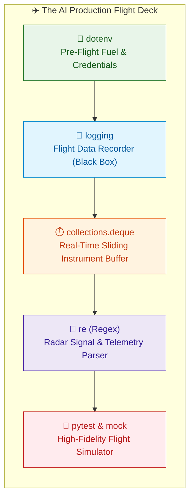

# $\Huge\color{#0D47A1}{\textsf{15 — Production Python Essentials}}$

[](https://www.python.org/)
[](README.md)
[](../../AI%20Engineer%20Architect%20Road%20Map.md)
[](#)

> $\color{#546E7A}\mathbf{Navigation:}$ **Phase 0** · **Module 0.1** · **Lesson 15 of 25** · [← Prev: 14 Advanced Python](14%20Advanced%20Python.md) · [Phase 0.1 — Python Index](README.md) · [Next: 22 Type Hints and Pydantic →](22%20Type%20Hints%20and%20Pydantic.md)

---


## 🗺️ $\Large\color{#0D47A1}\blacksquare\space\color{#1565C0}{\textsf{Stage 0 — Concept Map}}$

In prototype scripts and Jupyter notebooks, you can get away with `print()` statements, standard Python lists, hardcoded API keys, manual string slicing, and ad-hoc manual testing. But the moment an AI service is deployed to production—serving thousands of concurrent LLM inferences, streaming tokens across agent networks, and executing retrieval pipelines (RAG)—those amateur habits trigger catastrophic failures:

1. **Silent Production Blindness:** `print()` prints plain un-timestamped strings directly to the terminal stdout. When an exception occurs inside a container or worker thread, you get no timestamps, no severity levels, no module context, and no structured stack traces in your log aggregator (Datadog, CloudWatch, or OpenTelemetry).
2. **Algorithmic Memory & Latency Traps:** Using standard Python `list.insert(0, msg)` or `list.pop(0)` for sliding conversational memory turns every chat message append into an $O(N)$ memory reallocation that crawls under long conversations. Handling word frequencies and groupings with plain dicts forces repetitive `KeyError` defensive boilerplate.
3. **Budget Depletion During CI/CD:** Running automated test suites that invoke live commercial AI APIs (OpenAI, Anthropic, Gemini) burns credit cards, hits rate limits, and breaks determinism whenever remote servers experience network jitter.
4. **Brittle LLM Output Extraction:** Large Language Models frequently wrap JSON payloads inside conversational markdown chatter (```` ```json { ... } ``` ````). Using manual `.find()` and string indexing causes parsing crashes on the slightest formatting variance, while poorly written greedy regular expressions swallow multiple tool calls in a single match.
5. **Secret Leaks & Security Vulnerabilities:** Hardcoding API keys in source files leads to accidental git commits, exposed credentials, and revoked keys.

```
[13 Built-ins & 14 Advanced] ──> [15 Production Essentials] ──> [22 Pydantic & 23 Concurrency]
  (slots, iterators, cache)        (logging, collections,          (data schemas, async event
                                   mocking, regex, secrets)        loops & worker threads)
```

- **Prerequisites:** [05 Dictionaries and Sets](05%20Dictionaries%20and%20Sets.md), [07 Functions](07%20Functions.md), [10 Error Handling](10%20Error%20Handling.md), [11 Modules and Packages](11%20Modules%20Packages%20and%20Files.md).
- **Where this sits:** The five indispensable production pillars (`logging`, `collections`, `pytest`/`mock`, `re`, `python-dotenv`) that transform raw mathematical scripts into enterprise-ready, observable, and hermetically tested AI systems.
- **Why care as an AI Architect:** Real-world enterprise AI systems don't just compute tensors; they must be **observable** (logging), **memory-bounded** (`deque`), **hermetically tested without burning API tokens** (`pytest` + `mock`), **robust against messy model responses** (`re`), and **securely configured** (`dotenv`).

---


## 🔑 $\Large\color{#4A148C}\blacksquare\space\color{#6A1B9A}{\textsf{New Terms (Plain English)}}$

- **`logging`** — A standard Python library for recording structured diagnostic messages with timestamps, severities, and source module tags, replacing unstructured `print()`.
- **Log Severity Level** — A numeric threshold (`DEBUG < INFO < WARNING < ERROR < CRITICAL`) that determines which messages are saved or discarded at runtime.
- **`deque` (Double-Ended Queue)** — A ring-buffer data structure optimized for lightning-fast $O(1)$ insertions and evictions from both ends, ideal for sliding context windows.
- **`defaultdict`** — A specialized dictionary that automatically provisions a default value via a callable factory function when an unknown key is queried.
- **`Counter`** — A dictionary subclass specifically designed for counting hashable objects and tracking token frequencies.
- **`pytest`** — The industry-standard testing framework that discovers and runs automated assertions with zero boilerplate.
- **Test Double / Mock (`unittest.mock`)** — A simulated object that mimics the behavior of real external dependencies (like paid AI APIs or external databases) during test execution.
- **Monkey Patch (`patch`)** — Temporarily replacing a function, class, or network call with a mock during testing, with automatic restoration when finished.
- **Raw String (`r"..."`)** — A string literal where backslashes `\` are treated as literal text rather than Python escape characters, vital for regex patterns.
- **Greedy Matching (`.*`)** — A regex quantification behavior that consumes as much text as possible up to the last matching token.
- **Lazy / Non-Greedy Matching (`.*?`)** — A regex quantification behavior that stops matching at the very first occurrence of the closing delimiter.
- **Environment Variables (`os.environ`)** — Key-value pairs managed by the operating system to store sensitive configurations outside source code.
- **`.env` File** — A local plaintext file containing developer secrets loaded into runtime environment variables by the `python-dotenv` package.

*(For general terms, reference the shared [AI Terms — Plain-English Glossary](../../AI%20Terms%20-%20Plain%20English%20Glossary.md).)*

---


## 🎈 $\Large\color{#00695C}\blacksquare\space\color{#00897B}{\textsf{Stage 1 — The Simple Idea (Analogy: The Commercial Flight Deck)}}$

Imagine building and piloting a modern commercial airliner:



* **`python-dotenv` is the Pre-Flight Credential Vault:** Before takeoff, pilots don't paint the airport security codes on the side of the fuselage. They keep credentials in a sealed pre-flight manifest loaded directly into the cockpit instruments.
* **`logging` is the Flight Data Recorder (Black Box):** The pilot does not shout instrument readings out the window (`print`). Instead, every sensor continuously writes categorized telemetry (Altitude, Engine Temp, Warnings, Critical Errors) to an indelible flight recorder for real-time monitoring and crash analysis.
* **`collections` is the Real-Time Instrument Buffer:** A cockpit display only shows the last 10 seconds of wind shear readings. When an 11th second arrives, the oldest reading drops off the screen instantly ($O(1)$ eviction with `deque`), rather than pausing the flight computer to shift an entire history array in memory.
* **`re` is the Radar Telemetry Parser:** Incoming transponder signals from air traffic control contain static, callsigns, and coordinates mixed together. The flight computer uses precise pattern recognition (`re`) to instantly isolate the aircraft's latitude, longitude, and heading.
* **`pytest` & `mock` is the Flight Simulator:** You do not train emergency engine-out maneuvers by crashing real multimillion-dollar airplanes or burning thousands of gallons of jet fuel. You plug the cockpit instruments into a high-fidelity simulator (`unittest.mock`), test edge cases deterministically, and confirm every alarm triggers as designed.

> [!IMPORTANT]
> ### $\color{#512DA8}{\textsf{The "Aha!" Insight}}$
> Writing clean code is only half the battle. A production AI application is an industrial process: it must continuously **log** its operational heartbeat, store data in **efficient memory-bounded buffers**, run in **isolated hermetic tests without burning money**, **parse erratic text outputs reliably**, and **protect its security keys**.

---


## ⚙️ $\Large\color{#BF360C}\blacksquare\space\color{#D84315}{\textsf{Stage 2 — How It Actually Works (The 5 Pillars)}}$

---

### $\large\color{#0D47A1}\blacksquare\space\color{#1565C0}{\textsf{Pillar 1: Structured Logging (Production Replacement for print)}}$

#### 1. Why `print()` Fails in Production
`print()` writes raw text directly to `sys.stdout`. It has no timestamp, no file or line location, no severity classification, and cannot be filtered. In a web server with 50 concurrent requests, `print()` outputs from different users interleave into an unreadable soup.

#### 2. The Logging Severity Hierarchy
Python's `logging` module provides five standard levels of increasing severity:

$$\Large\color{#0288D1}\texttt{DEBUG}\space\color{#546E7A}<\space\color{#2E7D32}\texttt{INFO}\space\color{#546E7A}<\space\color{#F57C00}\texttt{WARNING}\space\color{#546E7A}<\space\color{#D32F2F}\texttt{ERROR}\space\color{#546E7A}<\space\color{#880E4F}\texttt{CRITICAL}$$

When you configure a logger at `INFO`, all `INFO`, `WARNING`, `ERROR`, and `CRITICAL` messages are output; all `DEBUG` messages are silently dropped with zero terminal clutter.

#### 3. Module-Level Loggers & `basicConfig`
* **Golden Architecture Rule:** Call `logging.basicConfig(...)` **only once** at the root entry point of your application (`main.py` or `cli.py`).
* Inside library modules and classes, **always** obtain a logger via `logger = logging.getLogger(__name__)`. This automatically assigns the module's dotted path (e.g., `services.rag.retriever`) to every log record.

#### 4. The Critical Performance Optimization: Lazy Formatting
When logging high-frequency events (like token streaming or embedding calculations), never use f-strings in disabled log levels:

```python
# 🚫 BAD: f-string evaluates EVERY turn, even when DEBUG is disabled!
logger.debug(f"Computed embeddings for {len(chunk_list)} chunks: {expensive_repr()}")

# ✅ GOOD: Lazy evaluation (%s placeholders). The string is formatted ONLY if DEBUG is active!
logger.debug("Computed embeddings for %s chunks: %s", len(chunk_list), expensive_repr)
```

#### 5. Automatic Traceback Capture with `logger.exception()`
Inside an `except` block, calling `logger.exception("message")` logs at `ERROR` level and automatically captures and appends the full exception traceback (`sys.exc_info()`) without manual string formatting.

```python
import logging

# 1. Configure formatting and threshold at application entry point:
logging.basicConfig(
    level=logging.INFO,
    format="%(asctime)s [%(levelname)s] %(name)s (line %(lineno)d): %(message)s",
    datefmt="%Y-%m-%d %H:%M:%S"
)

# 2. Instantiate a module-scoped logger:
logger = logging.getLogger(__name__)

def run_inference(prompt: str, model: str = "gpt-4o") -> str:
    # Lazy formatting: arguments evaluated only if DEBUG is enabled
    logger.debug("Prompt payload prepared: length=%s", len(prompt))
    logger.info("Dispatching inference request to model=%s", model)
    
    try:
        if not prompt:
            raise ValueError("Prompt text cannot be empty.")
        return f"Response to: {prompt}"
    except ValueError as err:
        # Automatically logs ERROR + the entire multi-line traceback
        logger.exception("Inference execution aborted due to invalid input.")
        raise
```

---

### $\large\color{#00695C}\blacksquare\space\color{#00897B}{\textsf{Pillar 2: Specialized Data Structures (collections)}}$

Standard lists and dicts are general-purpose. The `collections` module provides specialized alternatives that eliminate algorithmic bottlenecks.

#### 1. `deque(maxlen=N)`: $O(1)$ Sliding Chat History
* **The Problem:** In a multi-turn chat agent, you want to retain only the last $N$ turns of conversation. With a standard Python `list`:
  * Prepending messages (`list.insert(0, msg)`) or popping the oldest (`list.pop(0)`) requires shifting every remaining item in memory: **$O(N)$ time complexity**.
* **The Solution:** A `deque` (double-ended queue) is backed by a doubly linked list of fixed memory blocks. Adding or popping from either end is **$O(1)$ time complexity**.
* **Automatic Eviction:** Specifying `maxlen=N` bounds the buffer size. Adding an item to a full `deque` automatically evicts the oldest item on the opposite end with zero manual code.

```python
from collections import deque

# Bounded sliding memory buffer for LLM context (holds last 3 messages)
chat_history = deque(maxlen=3)

chat_history.append("User: Hello")
chat_history.append("Assistant: Hi there!")
chat_history.append("User: What is RAG?")
print(list(chat_history))
# Output: ['User: Hello', 'Assistant: Hi there!', 'User: What is RAG?']

# Adding a 4th item automatically evicts 'User: Hello' from the left
chat_history.append("Assistant: RAG stands for Retrieval-Augmented Generation.")
print(list(chat_history))
# Output: ['Assistant: Hi there!', 'User: What is RAG?', 'Assistant: RAG stands for...']
```

#### 2. `defaultdict(factory)`: Grouping Without `KeyError` Boilerplate
* **The Problem:** When grouping document chunks by topic, a regular dictionary raises `KeyError` if a category hasn't been seen before, forcing ugly checks:
  ```python
  if category not in doc_groups:
      doc_groups[category] = []
  doc_groups[category].append(chunk)
  ```
* **The Solution:** `defaultdict(list)` automatically invokes `list()` to create a fresh empty list whenever an unknown key is accessed:
  ```python
  from collections import defaultdict

  corpus = [("finance", "doc_1"), ("legal", "doc_2"), ("finance", "doc_3")]
  grouped = defaultdict(list)

  for cat, doc in corpus:
      grouped[cat].append(doc)  # No KeyError, no defensive if-checks

  print(dict(grouped))
  # Output: {'finance': ['doc_1', 'doc_3'], 'legal': ['doc_2']}
  ```
* **⚠️ The Read Trap:** Merely querying a missing key (e.g., `_ = grouped["health"]`) **inserts** that key with a default empty list into the dictionary! Use `.get("key")` if you want to inspect without insertion.

#### 3. `Counter(iterable)`: Instant Frequency & Token Analytics
* `Counter` is a dictionary subclass that tallies hashable elements in $O(N)$ time.
* Provides `.most_common(k)` to retrieve top-$k$ elements in $O(N \log k)$ time using an internal heap.
* Supports multiset arithmetic (`+`, `-`, `&`, `|`):

```python
from collections import Counter

tokens = ["rag", "llm", "rag", "agent", "prompt", "rag", "llm"]
counts = Counter(tokens)

print(counts["rag"])            # 3
print(counts.most_common(2))    # [('rag', 3), ('llm', 2)]

# Multiset arithmetic:
batch_2 = Counter(["agent", "eval", "eval"])
total_vocab = counts + batch_2
print(total_vocab["agent"])     # 2
```

---

### $\large\color{#BF360C}\blacksquare\space\color{#D84315}{\textsf{Pillar 3: Hermetic Testing (pytest and unittest.mock)}}$

In AI engineering, running automated tests against live LLM endpoints (like OpenAI or Anthropic) causes three fatal problems:
1. **Financial Drain:** Running 100 CI tests on every git push burns credit card tokens.
2. **Network Flakiness:** Remote API latency or 503 rate limits fail your builds unpredictably.
3. **Non-Determinism:** LLMs generate stochastic output, making exact equality checks flaky.

#### 1. Unit Testing with `pytest`
`pytest` uses plain Python `assert` statements, eliminating verbose `self.assertEqual(...)` classes. It automatically discovers all files named `test_*.py` and functions named `def test_*()`.

* **Testing Expected Exceptions:** Use `with pytest.raises(ExpectedError):`
* **Table-Driven Parameterized Tests:** Use `@pytest.mark.parametrize`

#### 2. Mocking Remote API Calls with `unittest.mock.patch`
`unittest.mock.patch` dynamically intercepts a function or class during a test and substitutes a `MagicMock` in its place. When the `with` block exits, the original implementation is **automatically restored**.

* **The Golden Patch Rule:** **Patch where the symbol is LOOKED UP / IMPORTED, not where it is defined.**
  * If your code file `my_agent.py` contains: `from httpx import post`
  * You MUST patch `"my_agent.post"`, NOT `"httpx.post"`.

```python
# File: test_agent_pipeline.py
import pytest
from unittest.mock import patch, MagicMock

# The function under test:
def fetch_agent_decision(prompt: str) -> str:
    import requests  # Simulated external network dependency
    resp = requests.post("https://api.openai.com/v1/chat", json={"prompt": prompt})
    return resp.json()["choices"][0]["text"]

# 1. Parameterized assertion test:
@pytest.mark.parametrize("query,expected_word_count", [
    ("Summarize text", 2),
    ("Explain RAG pipeline architecture", 4),
])
def test_prompt_token_length(query: str, expected_word_count: int):
    assert len(query.split()) == expected_word_count

# 2. Hermetic mock test (zero paid network calls):
def test_fetch_agent_decision_offline():
    mock_payload = {"choices": [{"text": "Synthetic AI Answer"}]}
    
    # Intercept 'requests.post' right where fetch_agent_decision looks it up:
    with patch("requests.post") as mock_post:
        # Configure mock return value:
        mock_response = MagicMock()
        mock_response.json.return_value = mock_payload
        mock_post.return_value = mock_response
        
        result = fetch_agent_decision("Hello AI")
        
        # Verify result without hitting internet:
        assert result == "Synthetic AI Answer"
        mock_post.assert_called_once_with(
            "https://api.openai.com/v1/chat",
            json={"prompt": "Hello AI"}
        )

# 3. Exception assertion test:
def test_divide_by_zero_safety():
    with pytest.raises(ZeroDivisionError):
        _ = 1 / 0
```

---

### $\large\color{#4A148C}\blacksquare\space\color{#6A1B9A}{\textsf{Pillar 4: Regular Expressions for AI Engineers (re)}}$

LLMs return unstructured natural language. Even when instructed to *"return only valid JSON"*, models regularly prepend conversational filler:
`"Here is the requested output:\n```json\n{\"score\": 0.95}\n```\nHope this helps!"`

#### 1. Always Use Raw Strings (`r"..."`)
In regular Python strings, `\b` means backspace and `\n` means newline. In regex, `\b` means a word boundary and `\d` means a digit. Always prefix regex strings with `r` so Python leaves backslashes untouched.

#### 2. The 4 Essential Regex Operations
* **`re.search(pattern, text)`:** Scans through string for the *first* location where pattern matches; returns a `Match` object or `None`.
* **`re.findall(pattern, text)`:** Returns all non-overlapping matches of pattern in a string as a `list` of strings.
* **`re.sub(pattern, replacement, text)`:** Substitutes matches with a replacement string (ideal for PII redaction like masking phone numbers or emails).
* **`re.compile(pattern)`:** Compiles a regex into a reusable `Pattern` object. Use this when running the same regex inside a loop over thousands of document chunks for massive speedups.

#### 3. The Greedy vs. Lazy Matching Trap (`.*` vs `.*?`)
This is the single most common bug in LLM output parsing:
* **Greedy (`.*`):** Matches as many characters as possible. If an LLM outputs two markdown code blocks, greedy matching swallows everything from the first ```` ``` ```` to the *last* ```` ``` ```` in the entire document!
* **Lazy / Non-Greedy (`.*?`):** Stops matching at the *very first* occurrence of the closing delimiter.
* Combine with the `re.DOTALL` flag so `.` also matches newline characters `\n`.

```python
import re

raw_llm_output = """
Here is the first tool call:
```json
{"action": "search_db", "query": "vector embeddings"}
```
And here is the second tool call:
```json
{"action": "calc_metrics", "tokens": 500}
```
Done!
"""

# 🚫 GREEDY MATCH TRAP: Swallows BOTH blocks into one massive broken string!
greedy_match = re.findall(r"```json\s*(.*)\s*```", raw_llm_output, re.DOTALL)
print(f"Greedy extracted {len(greedy_match)} item (combines both blocks):")

# ✅ LAZY EXTRACTION: Correctly extracts each individual JSON block cleanly
blocks = re.findall(r"```json\s*(.*?)\s*```", raw_llm_output, re.DOTALL)
print(f"Lazy extracted {len(blocks)} independent blocks:")
for i, b in enumerate(blocks, 1):
    print(f"  Block {i}: {b.strip()}")

# PII Redaction:
user_query = "Contact user at alice@example.com or phone 555-0199."
sanitized = re.sub(r"\b[A-Za-z0-9._%+-]+@[A-Za-z0-9.-]+\.[A-Z|a-z]{2,}\b", "[EMAIL_REDACTED]", user_query)
print("Sanitized Prompt:", sanitized)
```

---

### $\large\color{#1B5E20}\blacksquare\space\color{#2E7D32}{\textsf{Pillar 5: Configuration and Secret Hygiene (python-dotenv)}}$

Hardcoding API keys (`OPENAI_API_KEY = "sk-proj-..."`) in code is a critical security vulnerability. Even a single `git push` to a public repository can result in automated bots stealing your API tokens within seconds.

#### 1. The 12-Factor Secret Pattern
Store credentials in a local `.env` file that is **strictly excluded** from version control:

```ini
# File: .env (DO NOT COMMIT TO GIT)
OPENAI_API_KEY=sk-proj-live-production-secret-xyz
MODEL_NAME=gpt-4o
MAX_RETRIES=3
LOG_LEVEL=INFO
```

#### 2. The `.env.example` Template
Always commit a sanitized template file named `.env.example` to the repository so collaborators know which environment variables are required:

```ini
# File: .env.example (SAFE TO COMMIT)
OPENAI_API_KEY=your_openai_api_key_here
MODEL_NAME=gpt-4o
MAX_RETRIES=3
LOG_LEVEL=INFO
```

#### 3. Strict `.gitignore` Protection
Ensure your repository's `.gitignore` explicitly prevents environment files from ever being staged:

```gitignore
.env
.env.local
.env.*.local
*.log
```

#### 4. Loading Environment Variables in Python
Use `pip install python-dotenv`. Calling `load_dotenv()` reads `.env` and injects keys into `os.environ` without overriding pre-existing system environment variables:

```python
import os
from dotenv import load_dotenv

# Reads key-value pairs from .env into operating system environment
load_dotenv()

# Fail-Fast Access Pattern (Raises KeyError immediately if secret is missing):
try:
    api_key = os.environ["OPENAI_API_KEY"]
except KeyError:
    raise RuntimeError("Critical: OPENAI_API_KEY missing from environment or .env file.")

# Safe Default Access Pattern (for non-sensitive configuration):
model_name = os.getenv("MODEL_NAME", "gpt-4o-mini")
max_retries = int(os.getenv("MAX_RETRIES", "3"))

print(f"Initialized client with model={model_name}, retries={max_retries}")
```

---


## 🚀 $\Large\color{#0D47A1}\blacksquare\space\color{#1565C0}{\textsf{Stage 3 — In Practice / Why It Matters}}$

These five production essentials form the foundation of real-world AI software engineering:

1. **LangChain & LlamaIndex Pipelines:** Every production orchestrator relies on `logging.getLogger(__name__)` to stream callback events and tokens to dashboards.
2. **Autonomous Agent Memory:** Agents managing sliding multi-turn conversational context use `deque(maxlen=10)` to prevent the context window from overflowing the model's token limit.
3. **CI/CD Quality Gates:** AI companies run test suites comprising thousands of unit tests every day. By mocking remote LLM endpoints with `unittest.mock.patch`, test suites run in 5 seconds for zero cost instead of 20 minutes and significant API spend.
4. **Structured JSON Output Parsers:** When models produce malformed or markdown-wrapped JSON, production extractors apply non-greedy regular expressions (`re.findall(r"```json\s*(.*?)\s*```", re.DOTALL)`) before passing data to Pydantic.
5. **Secure Cloud Deployments:** Modern container platforms (Docker, Kubernetes, AWS ECS) inject secrets directly into `os.environ`. `python-dotenv` allows identical code to run locally on your laptop and in the cloud without changing a single line of code.

---


## ⚖️ $\Large\color{#00695C}\blacksquare\space\color{#00838F}{\textsf{Variations and Architectural Decision Guide}}$

| Requirement | 🚫 Prototype / Naive Way | 🟢 Production Architectural Standard | Engineering Trade-Off & Reason |
| :--- | :--- | :--- | :--- |
| **Diagnostics & Telemetry** | `print(f"Error: {e}")` | `logger.exception("Inference failed")` | `print` lacks timestamps and file names; `logger.exception` automatically attaches complete multi-line tracebacks. |
| **Debug String Formatting** | `logger.debug(f"Data: {exp()}")` | `logger.debug("Data: %s", exp)` | f-strings execute eagerly even when debug logging is disabled; `%s` formatting executes lazily only when logging is active. |
| **Sliding Memory Buffer** | `list.insert(0, msg)` + `pop()` | `collections.deque(maxlen=N)` | Standard list shift is $O(N)$ memory copy; `deque` push and auto-eviction is $O(1)$. |
| **Item Grouping** | Regular `dict` + `if key not in d` | `collections.defaultdict(list)` | Eliminates defensive boilerplate code and prevents `KeyError`. |
| **API Testing** | Direct HTTP calls to OpenAI | `unittest.mock.patch("agent.client")` | Live calls cost money, suffer network latency, and fail non-deterministically; mocks are instant and deterministic. |
| **Code Block Extraction** | Greedy regex `r"```json(.*)```"` | Lazy regex `r"```json\s*(.*?)\s*```"` | Greedy regex swallows multiple blocks across text; non-greedy regex stops at the first closing fence. |
| **Secret Storage** | `API_KEY = "sk-..."` in code | `os.environ["API_KEY"]` via `dotenv` | Hardcoded keys leak to GitHub; `.env` files keep secrets isolated locally and out of git history. |

---


## 🐛 $\Large\color{#880E4F}\blacksquare\space\color{#AD1457}{\textsf{Common Errors and Fixes}}$

| Error Signature / Bug | Root Cause | Immediate Fix |
| :--- | :--- | :--- |
| `TypeError: 'NoneType' object is not callable` in mock | In `patch("module.function")`, you forgot `return_value` or assigned a non-callable. | Configure mock behavior explicitly: `mock_fn.return_value = "desired_output"`. |
| Mock has no effect during test | You patched the definition location (`httpx.post`) instead of the lookup location (`app.services.httpx.post`). | Patch the exact module where the target function is imported and called. |
| `KeyError: 'OPENAI_API_KEY'` | Calling `os.environ["KEY"]` before calling `load_dotenv()`, or `.env` is named incorrectly. | Invoke `load_dotenv()` before accessing environment variables; ensure file is named exactly `.env`. |
| Regex matches entire file as one group | Used greedy `.*` instead of lazy `.*?` when extracting markdown blocks. | Append `?` after quantifier (`.*?`) and supply `re.DOTALL` to match across newlines. |
| Dictionary unexpectedly grows on lookup | Queried missing keys on a `defaultdict` using `d[missing_key]`. | Use `d.get(key)` for read-only inspection without triggering default insertion. |

---


## 📌 $\Large\color{#1B5E20}\blacksquare\space\color{#2E7D32}{\textsf{Quick Reference (60-Second Revision)}}$

```python
# 1. LOGGING:
import logging
logging.basicConfig(level=logging.INFO, format="%(asctime)s [%(levelname)s] %(name)s: %(message)s")
logger = logging.getLogger(__name__)
logger.info("Loaded model=%s", "gpt-4o")            # Lazy formatting
try: 1 / 0
except ZeroDivisionError:
    logger.exception("Inference failed")            # Auto-attaches traceback

# 2. COLLECTIONS:
from collections import deque, defaultdict, Counter
win = deque(maxlen=2); win.extend(["m1", "m2", "m3"])  # deque(['m2', 'm3']) - 'm1' evicted
groups = defaultdict(list); groups["user"].append("Hi")  # {'user': ['Hi']}
counts = Counter(["a", "b", "a"]).most_common(1)       # [('a', 2)]

# 3. PYTEST & MOCK:
from unittest.mock import patch
def test_pipeline():
    with patch("my_agent.call_api", return_value="mocked") as mock_fn:
        assert my_agent.call_api("hi") == "mocked"
        mock_fn.assert_called_once_with("hi")

# 4. REGEX:
import re
text = "```json\n{\"id\": 1}\n``` and ```json\n{\"id\": 2}\n```"
blocks = re.findall(r"```json\s*(.*?)\s*```", text, re.DOTALL)  # Non-greedy: 2 blocks

# 5. DOTENV:
import os
from dotenv import load_dotenv
load_dotenv()
api_key = os.environ["OPENAI_API_KEY"]  # Fails fast with KeyError if missing
```

---


## 🛑 $\Large\color{#B71C1C}\blacksquare\space\color{#D32F2F}{\textsf{STOP — Self-Check}}$

### 🎯 The Architect's Verification Challenge
You are building an automated testing pipeline for an AI agent. The agent resides in `agent.py` and starts with:
```python
from external_api import query_llm

def ask_agent(prompt: str) -> str:
    raw = query_llm(prompt)
    return raw.upper()
```
In your test file `test_agent.py`, which of the following two `patch` statements must you use, and why?
1. `@patch("external_api.query_llm")`
2. `@patch("agent.query_llm")`

<details>
<summary>🔍 <b>Reveal Architectural Answer</b></summary>
<br>

**Correct Answer:** **Option 2: `@patch("agent.query_llm")`**

**Why:** The fundamental patching rule in Python is: **Patch where the object is looked up, not where it is defined.**  
When `agent.py` ran `from external_api import query_llm`, it created a local reference to that function inside the `agent` module's namespace. If you patch `external_api.query_llm`, `agent.ask_agent` continues pointing to its already-imported local reference, and the test will continue attempting to make real network calls! You must patch the symbol where `ask_agent` actually looks for it: inside `"agent.query_llm"`.

</details>
