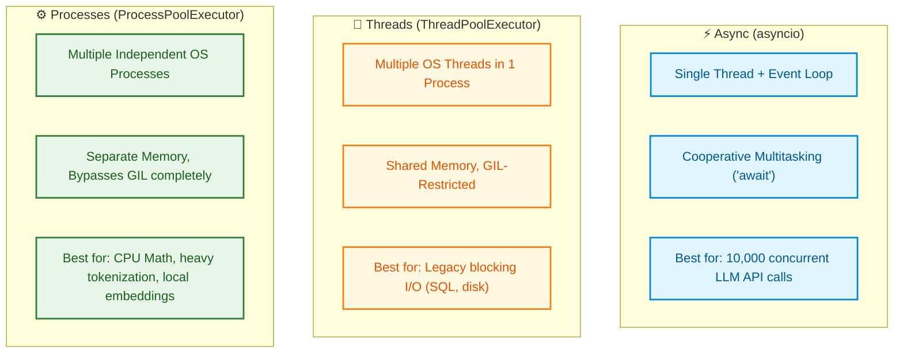

# $\Huge\color{#0D47A1}{\textsf{23 — Concurrency: Async, Threads and Processes}}$

[](https://www.python.org/)
[](README.md)
[](../../AI%20Engineer%20Architect%20Road%20Map.md)
[](#)

> $\color{#546E7A}\mathbf{Navigation:}$ **Phase 0** · **Module 0.1** · **Lesson 23 of 25** · [← Prev: 22 Type Hints and Pydantic](22%20Type%20Hints%20and%20Pydantic.md) · [Phase 0.1 — Python Index](README.md) · [Next: 24 AI Essentials - NumPy and HTTP →](24%20AI%20Essentials%20-%20NumPy%20and%20HTTP.md)

---

## 🗺️ $\color{#0D47A1}\blacksquare\space\color{#1565C0}{\textsf{Stage 0 — Concept Map}}$

AI programs spend most of their time **waiting** on networks (LLM APIs, databases). Doing one slow
call at a time wastes that waiting. **Concurrency** lets a program make progress on many things at
once. This lesson covers Python's three approaches — **async**, **threads**, **processes** — and,
crucially, *when to use each*. It's the capstone of the language module.

## 🔑 $\color{#4A148C}\blacksquare\space\color{#6A1B9A}{\textsf{New Terms (Plain English)}}$

- **Concurrency** — making progress on many tasks by overlapping their waiting.
- **Coroutine** — an `async def` function that can pause at `await`.
- **Event loop** — the scheduler that runs and resumes coroutines.
- **GIL** — the rule that only one thread runs Python code at a time.
- **I/O-bound vs CPU-bound** — waiting on network/disk vs heavy computation.

## 🎈 $\color{#00695C}\blacksquare\space\color{#00897B}{\textsf{Stage 1 — The Simple Idea (analogy: one smart waiter vs. many cooks)}}$

- **Async (one smart waiter):** a single worker who, while one table's food cooks, goes and serves
  other tables instead of standing idle. Perfect when the work is mostly **waiting**.
- **Threads (several waiters sharing one kitchen):** more workers, but in Python they must take
  turns using the kitchen (the GIL — explained below). Helpful for waiting-heavy work, not for
  heavy chopping.
- **Processes (several separate kitchens):** fully independent workers with their own kitchens —
  the way to actually do heavy **CPU work** in parallel.

**The "Aha!":** match the tool to the bottleneck. **Waiting on I/O → async (or threads). Heavy
computation → processes.**



## ⚙️ $\color{#BF360C}\blacksquare\space\color{#D84315}{\textsf{Stage 2 — How It Actually Works}}$

> [!IMPORTANT]
> ### $\color{#00C853}{\textsf{🔥 The 80/20 Core Rule: What Matters in Production}}$
> * $\color{#00C853}\blacktriangleright$ **Daily Core (90% of Real AI Work):** `asyncio` for I/O-bound tasks (concurrent LLM API calls, embedding fetches, web scraping), `async def`, `await`, `asyncio.gather(*tasks)` for parallel execution, and `ThreadPoolExecutor` for running legacy blocking calls without stalling the async event loop.
> * $\color{#FFB300}\blacktriangleright$ **Occasional (CPU Heavy and Rate Limiting):** `multiprocessing` for CPU-bound tasks (tokenization, local vector embeddings), `asyncio.Semaphore(max_concurrent)` for preventing 429 rate limit errors from API providers.
> * $\color{#757575}\blacktriangleright$ **Reference Only (Exhaustive and Low-Level):** `asyncio.Queue`, `asyncio.Lock`, manual `threading.Thread` lifecycle management, process IPC pipes.

### $\color{#D84315}\blacktriangleright\space\color{#BF360C}{\textsf{14.1 The GIL (one microphone)}}$

The **GIL (Global Interpreter Lock)** is a rule in standard Python: only **one thread runs Python
code at a time** — like a room with a single microphone. This means threads don't speed up pure
Python *computation*. But while a thread **waits** on I/O, it drops the microphone, so other work
proceeds — which is why waiting-heavy work *can* still benefit.

### $\color{#D84315}\blacktriangleright\space\color{#BF360C}{\textsf{14.2 Async — async / await (the main one for AI)}}$


```diff
# Running multiple LLM API calls concurrently
- ❌ Sequential blocking loop (Takes 10 * 2s = 20 seconds total):
- results = []
- for prompt in prompts:
-     results.append(sync_client.chat.completions.create(prompt=prompt))

+ ✅ Asynchronous concurrent gather (Takes ~2 seconds total!):
+ async def fetch_all(prompts):
+     tasks = [async_client.chat.completions.create(prompt=p) for p in prompts]
+     return await asyncio.gather(*tasks)
```

```python
import asyncio
import time

async def fetch(name, seconds):       # "async def" = a coroutine that can pause
    print(f"{name}: start")
    await asyncio.sleep(seconds)       # "await" = pause here; let others run while we wait
    print(f"{name}: done")
    return name

async def main():
    start = time.time()
    # gather() runs all three CONCURRENTLY and waits for all to finish.
    results = await asyncio.gather(
        fetch("A", 2), fetch("B", 2), fetch("C", 2)
    )
    print(results, f"in {time.time() - start:.1f}s")   # ~2s, not 6s

asyncio.run(main())                   # start the event loop and run main()
```

The waits **overlap**, so three 2-second calls finish in ~2 seconds. Key pieces:
- **coroutine** — a function defined with `async def`; it can pause at `await`.
- **event loop** — the scheduler (`asyncio.run`) that resumes whichever coroutine is ready.
- **`asyncio.gather(...)`** — run many coroutines at once; **`asyncio.create_task(...)`** schedules
  one to run in the background.

```python
# async also has its own "with" and "for" for async resources/streams:
# async with client as c: ...
# async for chunk in stream: ...   # e.g. consuming a streamed LLM response
```

### $\color{#D84315}\blacktriangleright\space\color{#BF360C}{\textsf{14.3 Threads — for blocking I/O you can't await}}$

```python
from concurrent.futures import ThreadPoolExecutor
import urllib.request

def download(url):                    # a normal (blocking) function
    return urllib.request.urlopen(url).read()[:50]

urls = ["https://example.com"] * 3
with ThreadPoolExecutor(max_workers=3) as pool:   # run several at once
    results = list(pool.map(download, urls))       # overlaps their waiting
```

Use threads when a library is **blocking** (no `async` version) but the work is I/O-bound.

### $\color{#D84315}\blacktriangleright\space\color{#BF360C}{\textsf{14.4 Processes — for CPU-bound work}}$

```python
from concurrent.futures import ProcessPoolExecutor

def heavy(n):                         # pure-CPU work: lots of computation
    return sum(i * i for i in range(n))

with ProcessPoolExecutor() as pool:   # separate processes -> real parallel CPU use
    results = list(pool.map(heavy, [10_000_00, 10_000_00]))
```

Each process has its **own** Python interpreter and GIL, so they truly run in parallel across CPU
cores — the right tool for number-crunching that isn't already handled by a library like NumPy.

### $\color{#D84315}\blacktriangleright\space\color{#BF360C}{\textsf{14.5 Choosing — the decision rule}}$

| Concurrency Model | Primary Mechanism | Production Priority | Memory Footprint | Bottleneck Target | Real-World AI Application |
| :--- | :--- | :--- | :--- | :--- | :--- |
| **`asyncio`** | Single-thread cooperative event loop | $\color{#00C853}\blacksquare\ \textbf{Core (Daily)}$ | Minimal ($O(1)$ stack overhead) | Network I/O wait | Concurrent LLM API calls, streaming token SSE feeds |
| **`ThreadPoolExecutor`** | OS threads with GIL time-slicing | $\color{#00C853}\blacksquare\ \textbf{Core (Daily)}$ | Moderate (shared process memory) | Blocking I/O | Legacy sync database drivers, reading prompt files from disk |
| **`ProcessPoolExecutor`** | Multi-process separate Python instances | $\color{#FFB300}\blacksquare\ \textbf{Occasional}$ | Heavy (duplicated RAM per process) | CPU Compute | Heavy dataset tokenization, batch local embeddings |

| Bottleneck | Best tool | Example |
|---|---|---|
| Waiting on network/disk (I/O-bound) | **async** (or threads) | calling 100 LLM endpoints |
| Heavy pure-Python computation (CPU-bound) | **processes** | parsing/processing millions of rows |
| Heavy math on arrays | a library (NumPy/PyTorch) | embeddings, tensors (Lesson 15 / Module 0.2) |

## 🚀 $\color{#0D47A1}\blacksquare\space\color{#1565C0}{\textsf{Stage 3 — In Practice / Why It Matters}}$

AI servers are overwhelmingly I/O-bound — they wait on model APIs — so **async is the default** in
the AI Python world (the OpenAI SDK, `httpx`, FastAPI all offer `async`). You'll use `asyncio.gather`
to fan out many model/tool calls in Phase 1 and Phase 3, collapsing total latency dramatically.

**Common beginner mistakes (the reasoning):**
1. **Blocking the event loop** — calling a slow *synchronous* function inside async code freezes
   everything. Use the async version, or offload it to a thread. *Reason:* one event loop runs
   everything; a blocking call stops all coroutines.
2. **Expecting threads to speed up CPU work** — the GIL prevents that; use **processes** for CPU.
3. **Sequential `await`s** — `await a(); await b()` runs them one after another. Use
   `asyncio.gather(a(), b())` to overlap.
4. **Forgetting `asyncio.run(main())`** — coroutines do nothing until driven by an event loop.

### $\color{#0D47A1}\blacktriangleright\space\color{#1565C0}{\textsf{Try It Yourself}}$
Rewrite three sequential `await asyncio.sleep(1)` calls so they run concurrently and finish in ~1
second instead of ~3.

## 🐛 $\color{#880E4F}\blacksquare\space\color{#AD1457}{\textsf{Common Errors and Fixes}}$

| What you see | Cause | Fix |
| --- | --- | --- |
| Async code runs slowly, one-by-one | Sequential `await`s | Use `asyncio.gather(...)` to overlap them |
| The whole program freezes | A blocking call inside async code | Use the async version, or offload to a thread |
| Threads don't speed up the maths | The GIL serialises CPU work | Use `multiprocessing` for CPU-bound work |
| `RuntimeWarning: coroutine '...' was never awaited` | Called a coroutine without `await` | `await` it, or run via `asyncio.run(...)` |

## 📌 $\color{#1B5E20}\blacksquare\space\color{#2E7D32}{\textsf{Quick Reference}}$

```python
import asyncio
async def main():
    results = await asyncio.gather(task1(), task2())   # overlap the waiting
asyncio.run(main())
# I/O-bound  -> async (or threads)
# CPU-bound  -> multiprocessing
# heavy math -> a library (NumPy / PyTorch)
```

## 🛑 $\color{#B71C1C}\blacksquare\space\color{#D32F2F}{\textsf{STOP — Self-Check}}$

You must call 50 LLM API endpoints (each ~1s of waiting). Which concurrency tool fits best, and why
*not* the others?

<details>
<summary><b>🔍 Click to Reveal the Answer</b></summary>

<br/>

**Async** (`asyncio.gather`) fits best: the work is **I/O-bound** (waiting on the network), so a
single event loop can overlap all 50 waits and finish in roughly the time of the slowest call. The
GIL is irrelevant here because little Python computation happens. **Processes** would be wasteful
overkill (heavy to spin up, meant for CPU-bound work), and plain sequential code would take ~50s.
Threads could also work, but async is the lighter, idiomatic choice in the AI ecosystem.
</details>
