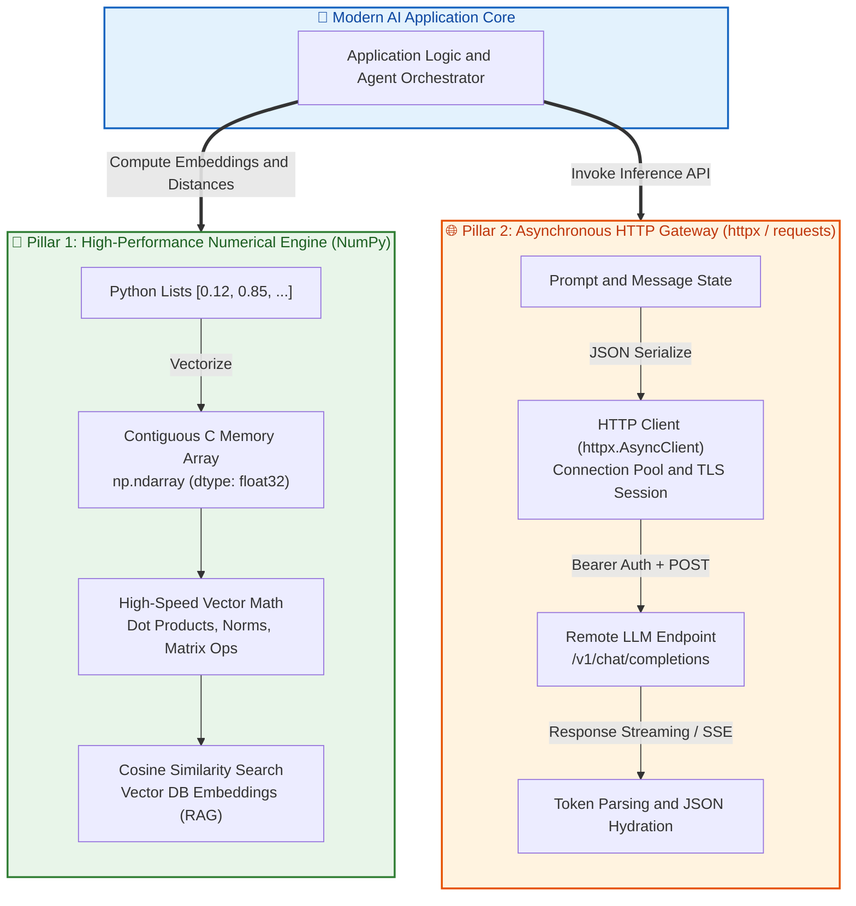
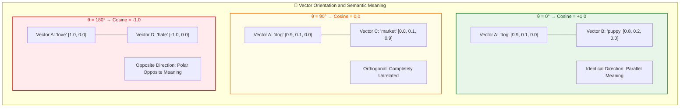

# $\Huge\color{#0D47A1}{\textsf{24 — AI Essentials: NumPy and HTTP}}$

[](https://www.python.org/)
[](README.md)
[](../../AI%20Engineer%20Architect%20Road%20Map.md)
[](#)

> $\color{#546E7A}\mathbf{Navigation:}$ **Phase 0** · **Module 0.1** · **Lesson 24 of 25** · [← Prev: 23 Concurrency](23%20Concurrency.md) · [Phase 0.1 — Python Index](README.md) · [Next: 25 Milestone - Typed API CLI →](25%20Milestone%20-%20Typed%20API%20CLI.md)

---


## 🗺️ $\Large\color{#0D47A1}\blacksquare\space\color{#1565C0}{\textsf{Stage 0 — Concept Map}}$

Two libraries appear in almost every AI program and bridge "plain Python" to "AI work":
**NumPy** (fast numerical arrays — the foundation under embeddings and tensors) and an **HTTP
client** (`httpx`/`requests` — how you call model APIs). This lesson gives you working comfort with
both, completing the language groundwork before the milestone.




## 🎈 $\Large\color{#00695C}\blacksquare\space\color{#00897B}{\textsf{Stage 1 — The Simple Idea }}$

- **NumPy** turns lists of numbers into a high-speed **array** that does math on the *whole array at
  once* (called **vectorization**) — like applying an operation to every cell of a spreadsheet in a
  single step, far faster than a Python loop.
- **HTTP client**: an AI model API is just a web service. You send a request (often JSON) and read a
  response (JSON). An HTTP client is your phone line to that service.

**The "Aha!":** embeddings and tensors are just arrays of numbers, and talking to an LLM is just a
web request. These two tools are how those ideas become code.

> 🔑 **New AI words (plain English):** an **LLM** is the AI behind ChatGPT — you send it text, it
> sends text back. An **embedding** is a list of numbers that captures the *meaning* of some text.
> A **tensor** is just a grid of numbers (Module 0.2). The full list is in the
> [AI Terms glossary](../../AI%20Terms%20-%20Plain%20English%20Glossary.md); each term below is also
> defined the first time it appears.


## ⚙️ $\Large\color{#BF360C}\blacksquare\space\color{#D84315}{\textsf{Stage 2 — How It Actually Works}}$

> [!IMPORTANT]
> ### 🔥 $\color{#00C853}{\textsf{The 80/20 Core Rule: What Matters in Production}}$
> * $\color{#00C853}\blacktriangleright$ **Daily Core (90% of Real AI Work):**
>   - **NumPy:** `np.array()`, checking `.shape`, matrix multiplication / dot product `@` or `np.dot()` for vector cosine similarity in RAG embeddings.
>   - **HTTP:** `httpx.post()` / `requests.post()` with headers (`Authorization: Bearer <key>`) and JSON payloads (`{"model": ..., "messages": [...]}`), checking status with `resp.raise_for_status()`, and parsing response JSON (`resp.json()`).
> * $\color{#FFB300}\blacktriangleright$ **Occasional (Data Shaping and Streams):** NumPy broadcasting rules, `.reshape()`, `np.zeros()`, `np.ones()`, HTTP streaming responses (`httpx.stream()`) for SSE token streaming.
> * $\color{#757575}\blacktriangleright$ **Reference Only (Exhaustive):** Advanced multidimensional slicing, NumPy memory strides, custom HTTP connection adapters and proxies.

### $\large\color{#D84315}\blacktriangleright\space\color{#BF360C}{\textsf{24.1 NumPy basics}}$

Install: `pip install numpy`.

```python
import numpy as np                 # "np" is the universal nickname

a = np.array([1, 2, 3])            # a 1-D array (a vector)
m = np.array([[1, 2], [3, 4]])     # a 2-D array (a matrix)

print(a.shape)                     # (3,)    — size along each dimension
print(m.shape)                     # (2, 2)
print(a.dtype)                     # int64   — the number type

# VECTORIZATION: operate on the whole array at once (no loop, much faster):
print(a * 10)                      # [10 20 30]
print(a + a)                       # [2 4 6]
print(a.mean(), a.sum(), a.max())  # 2.0 6 3
```

```diff
# Vector Math: Pure Python Loop vs NumPy Vectorized SIMD
- # ❌ Slow: Pure Python list iteration (Pointer chasing, dynamic boxing, 50-100x slower)
- def python_dot_product(vec_a, vec_b):
-     total = 0.0
-     for i in range(len(vec_a)):
-         total += vec_a[i] * vec_b[i]
-     return total

+ # Fast: NumPy Vectorized C BLAS Execution (Contiguous memory, zero loop overhead)
+ def numpy_dot_product(vec_a: np.ndarray, vec_b: np.ndarray) -> float:
+     return float(np.dot(vec_a, vec_b))  # or vec_a @ vec_b
```


### $\large\color{#D84315}\blacktriangleright\space\color{#BF360C}{\textsf{24.2 Why NumPy matters: cosine similarity by hand}}$

Three plain-English ideas this builds on (also in the
[glossary](../../AI%20Terms%20-%20Plain%20English%20Glossary.md)):
- A **vector** is just a list of numbers, e.g. `[0.9, 0.1, 0.0]` — picture it as an arrow pointing
  somewhere in space.
- An **embedding** is a special vector a *model* produces to capture the **meaning** of text;
  similar meanings get similar vectors.
- **Cosine similarity** scores how alike two vectors are by their **direction**, from `-1` to `1`.

Why *direction*? Picture each vector as an arrow from the origin. Two arrows pointing the **same
way** describe the same "topic" (score near `1`); at a **right angle** they're unrelated (near `0`);
pointing **opposite** they're contrary (near `-1`). Length is ignored, so a short sentence and a
long sentence about the same thing still match. Here it is from first principles:




```python
import numpy as np

def cosine_similarity(u, v):
    # dot product divided by the product of lengths -> a value in [-1, 1].
    return np.dot(u, v) / (np.linalg.norm(u) * np.linalg.norm(v))

dog    = np.array([0.9, 0.1, 0.0])
puppy  = np.array([0.8, 0.2, 0.0])
market = np.array([0.0, 0.1, 0.9])

print(round(cosine_similarity(dog, puppy), 3))    # ~0.985  (similar direction)
print(round(cosine_similarity(dog, market), 3))   # ~0.135  (different)
```

You just built the core of **semantic search** — finding text by *meaning* rather than exact
keywords. Two more terms this unlocks:
- A **vector database** is a specialised store that holds millions of embeddings and, given a query
  vector, returns the nearest ones *fast* — the comparison above, done at huge scale. (Names you'll
  meet later: pgvector, Pinecone, Qdrant.)
- **RAG (Retrieval-Augmented Generation)** = use semantic search to fetch the most relevant text,
  then hand it to an **LLM** so it answers from *your* documents instead of guessing.

That retrieve-then-answer loop is the backbone of Phase 2 — and you've just hand-built its engine.

### $\large\color{#D84315}\blacktriangleright\space\color{#BF360C}{\textsf{24.3 Calling an API — synchronous (requests)}}$

Install: `pip install requests`.

```python
import requests

# GET: fetch data
resp = requests.get("https://jsonplaceholder.typicode.com/todos/1", timeout=10)
print(resp.status_code)        # 200 = OK (check before trusting the body)
data = resp.json()             # parse the JSON body into a Python dict
print(data["title"])

# POST: send data (as JSON)
resp = requests.post(
    "https://httpbin.org/post",
    json={"name": "Ada"},                       # the "json=" arg serialises + sets headers
    headers={"Authorization": "Bearer SECRET"}, # auth headers go here
    timeout=10,
)
print(resp.json()["json"])     # {'name': 'Ada'}
```

### $\large\color{#D84315}\blacktriangleright\space\color{#BF360C}{\textsf{24.4 Calling an API — asynchronous (httpx)}}$

Install: `pip install httpx`. Same shape, but `await`-able so you can overlap many calls (Lesson 23).

```python
import asyncio
import httpx

async def get_todo(client, n):
    r = await client.get(f"https://jsonplaceholder.typicode.com/todos/{n}", timeout=10)
    r.raise_for_status()                 # raise on 4xx/5xx instead of silently continuing
    return r.json()["title"]

async def main():
    async with httpx.AsyncClient() as client:        # reuse one client (connection pooling)
        titles = await asyncio.gather(*(get_todo(client, n) for n in range(1, 6)))
    print(titles)                        # 5 calls overlapped

asyncio.run(main())
```

```diff
# HTTP API Invocation: Fragile Request vs Resilient Production Client
- # ❌ Fragile: No timeout (can hang forever), no status validation, hardcoded secret
- import requests
- response = requests.post("https://api.openai.com/v1/chat/completions",
-                          headers={"Authorization": "Bearer sk-proj-12345"},
-                          json={"model": "gpt-4o", "messages": []})
- data = response.json()  # May crash or parse HTTP 500 error HTML as JSON!

+ # Resilient: Async client with connection pool, explicit timeout, env secrets, and status check
+ import os, httpx
+ api_key = os.environ.get("OPENAI_API_KEY")
+ if not api_key:
+     raise RuntimeError("Missing OPENAI_API_KEY environment variable")
+ 
+ async with httpx.AsyncClient(timeout=10.0) as client:
+     response = await client.post(
+         "https://api.openai.com/v1/chat/completions",
+         headers={"Authorization": f"Bearer {api_key}"},
+         json={"model": "gpt-4o", "messages": []}
+     )
+     response.raise_for_status()  # Traps 4xx/5xx HTTP errors immediately
+     data = response.json()
```


### $\large\color{#D84315}\blacktriangleright\space\color{#BF360C}{\textsf{24.5 Secrets via environment variables (never hardcode)}}$

```python
import os
api_key = os.environ.get("OPENAI_API_KEY")   # read from the environment
if not api_key:
    raise RuntimeError("Set OPENAI_API_KEY first")
# headers = {"Authorization": f"Bearer {api_key}"}
```

### $\large\color{#D84315}\blacktriangleright\space\color{#BF360C}{\textsf{AI Essentials: NumPy and HTTP Production Matrix}}$

| Capability / API | Canonical Syntax | Mechanism / Execution | AI Production Role | Production Priority |
| :--- | :--- | :--- | :--- | :--- |
| **NumPy Array Creation** | `np.array([x, y, z], dtype=np.float32)` | Contiguous C buffer allocation | Storing embeddings & model weights | $\color{#00C853}\blacksquare\space\textsf{\textbf{Core (Daily)}}$ |
| **Array Shape Inspection** | `arr.shape`, `arr.dtype` | Metadata tuple inspection | Verifying tensor dimensions before forward pass | $\color{#00C853}\blacksquare\space\textsf{\textbf{Core (Daily)}}$ |
| **Vector Dot Product** | `np.dot(u, v)` or `u @ v` | Optimized BLAS SIMD matrix math | Core mathematical operator for cosine similarity | $\color{#00C853}\blacksquare\space\textsf{\textbf{Core (Daily)}}$ |
| **Vector Norm (Magnitude)** | `np.linalg.norm(u)` | Euclidean vector length calculation | Normalizing embedding vectors to unit length | $\color{#00C853}\blacksquare\space\textsf{\textbf{Core (Daily)}}$ |
| **Vector Broadcasting** | `matrix + bias_vector` | Dimension stretching without memory copies | Applying biases across batches of embeddings | $\color{#FFB300}\blacksquare\space\textsf{\textbf{Occasional}}$ |
| **Array Reshaping** | `arr.reshape(-1, embedding_dim)` | View re-indexing on same memory buffer | Aligning batch dimensions for tensor libraries | $\color{#FFB300}\blacksquare\space\textsf{\textbf{Occasional}}$ |
| **Synchronous HTTP GET** | `requests.get(url, timeout=10)` | Blocking socket I/O | Quick one-off scripts and test harnesses | $\color{#FFB300}\blacksquare\space\textsf{\textbf{Occasional}}$ |
| **Async HTTP Client Pool** | `async with httpx.AsyncClient() as c:` | Async I/O connection reuse | High-throughput concurrent LLM calls | $\color{#00C853}\blacksquare\space\textsf{\textbf{Core (Daily)}}$ |
| **HTTP Status Validation** | `resp.raise_for_status()` | Raises `HTTPStatusError` on 4xx/5xx | Preventing corrupted error HTML from reaching parsers | $\color{#00C853}\blacksquare\space\textsf{\textbf{Core (Daily)}}$ |
| **JSON Response Extraction**| `resp.json()` | Parses UTF-8 JSON payload to dict | Extracting completions, function calls, usage metrics | $\color{#00C853}\blacksquare\space\textsf{\textbf{Core (Daily)}}$ |
| **HTTP Token Streaming** | `async with client.stream(...) as resp:` | Server-Sent Events (SSE) chunk streaming | Streaming token-by-token LLM output to UI | $\color{#FFB300}\blacksquare\space\textsf{\textbf{Occasional}}$ |
| **Env Var Secret Access** | `os.environ.get("API_KEY")` | Reads process environment table | Secure zero-leak credential provisioning | $\color{#00C853}\blacksquare\space\textsf{\textbf{Core (Daily)}}$ |


## 🚀 $\Large\color{#0D47A1}\blacksquare\space\color{#1565C0}{\textsf{Stage 3 — In Practice / Why It Matters}}$

The OpenAI SDK is a polished wrapper around exactly these HTTP calls; embeddings you'll store and
compare are NumPy arrays; the cosine-similarity function above is the literal heart of RAG (Phase
2). You now have the raw skills the higher-level libraries are built on.

**Common beginner mistakes (the reasoning):**
1. **Not checking `status_code` / not calling `raise_for_status()`** — you then parse an error page
   as if it were data. Always verify the response succeeded.
2. **No `timeout`** — a hung server freezes your program forever. Always pass a timeout.
3. **Looping in pure Python over big arrays** instead of vectorizing with NumPy — orders of
   magnitude slower. Let NumPy operate on the whole array.
4. **Hardcoding API keys** — leak risk. Read from `os.environ` / a `.env` file.

### $\large\color{#D84315}\blacktriangleright\space\color{#BF360C}{\textsf{Try it yourself}}$
Use `requests.get` to fetch `https://jsonplaceholder.typicode.com/todos/2`, check the status is
`200`, and print the `title`. Then compute the cosine similarity between `[1,0,1]` and `[1,1,1]`.


## 🐛 $\Large\color{#880E4F}\blacksquare\space\color{#AD1457}{\textsf{Common Errors and Fixes}}$

| What you see | Cause | Fix |
| --- | --- | --- |
| The request hangs forever | No timeout set | Always pass `timeout=...` |
| You parse an error page as data | Didn't check the status | Check `status_code` / call `raise_for_status()` |
| `ModuleNotFoundError: numpy` | Not installed in this venv | `pip install numpy` |
| Array maths is very slow | Looping in pure Python | Vectorize — operate on the whole NumPy array |
| `JSONDecodeError` on `.json()` | Response wasn't the JSON you expected | Inspect the body; handle the error |


## 📌 $\Large\color{#1B5E20}\blacksquare\space\color{#2E7D32}{\textsf{Quick Reference}}$

```python
import numpy as np
a = np.array([1, 2, 3]); a.shape; a.dtype; a * 10; a.mean()
np.dot(u, v) / (np.linalg.norm(u) * np.linalg.norm(v))   # cosine similarity
import requests
r = requests.get(url, timeout=10); r.raise_for_status(); r.json()
import httpx                                   # async version
# async with httpx.AsyncClient() as c: await c.get(url)
```


## 🛑 $\Large\color{#B71C1C}\blacksquare\space\color{#D32F2F}{\textsf{STOP — Self-Check}}$

Why do AI libraries represent embeddings as **NumPy arrays** rather than plain Python lists, and
why should every API call include a `timeout`?

<details>
<summary><b>🔍 Click to Reveal the Answer</b></summary>

<br/>

**NumPy arrays** support **vectorized** math — operating on the entire array of numbers at once in
fast, optimised code — which is essential for the large numeric workloads (dot products, norms,
similarity) behind embeddings; plain Python list loops are far slower. A **`timeout`** ensures a
slow or unresponsive server can't hang your program indefinitely — it caps how long you'll wait
before the call fails and your error handling (Lesson 10) can react.
</details>
