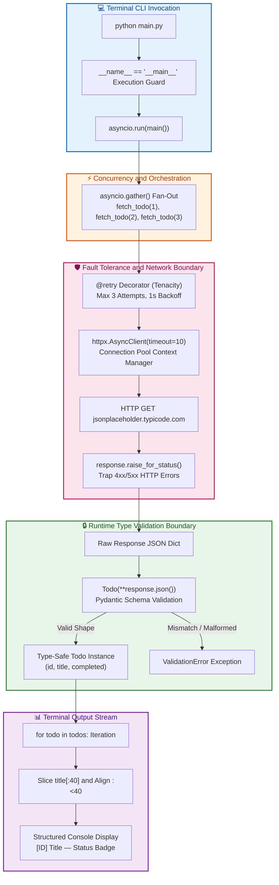

# $\Huge\color{#0D47A1}{\textsf{25 — Milestone: Typed API CLI Tool}}$

[](https://www.python.org/)
[](README.md)
[](../../AI%20Engineer%20Architect%20Road%20Map.md)
[](#)

> $\color{#546E7A}\mathbf{Navigation:}$ **Phase 0** · **Module 0.1** · **Lesson 25 of 25** · [← Prev: 24 AI Essentials - NumPy and HTTP](24%20AI%20Essentials%20-%20NumPy%20and%20HTTP.md) · [Phase 0.1 — Python Index](README.md) · [Next: Phase 0.2 — PyTorch Index →](../Phase%200.2%20-%20PyTorch/README.md)

---

## 🎯 $\Large\color{#0D47A1}\blacksquare\space\color{#1565C0}{\textsf{Goal and Capstone Architecture}}$

Combine the whole module into one small, professional program: a **command-line tool** that calls
an API, **validates** the response with Pydantic, handles **errors** with retries, and prints a
clean result. If you can build and explain this, you're ready for the AI-specific modules.




## 🧩 $\Large\color{#00695C}\blacksquare\space\color{#00897B}{\textsf{What It Exercises — Concept Synthesis}}$
- Setup & running scripts (01) · variables/types (02) · strings (03)
- collections (04, 05) · control flow (06) · functions (07)
- error handling (10) · modules/files (11) · built-in functions (13)
- type hints & Pydantic (22) · async + HTTP (23, 24)

> [!IMPORTANT]
> ### 🔥 $\color{#00C853}{\textsf{The 80/20 Core Rule: What Matters in Production}}$
> * $\color{#00C853}\blacktriangleright$ **Daily Core (90% of Real AI Work):** End-to-end integration of the core Python stack: CLI flags, type-safe request/response validation with Pydantic, robust error handling with specific exception traps, and structured terminal reporting.
> * $\color{#FFB300}\blacktriangleright$ **Occasional (Production Tuning):** Exponential backoff retries (`tenacity`), streaming HTTP responses, environment variable loading.
> * $\color{#757575}\blacktriangleright$ **Reference Only (CLI Polish):** Advanced subcommands, shell auto-completion.

---

```diff
# CLI API Script: Fragile Scripting vs Resilient Typed Architecture
- # ❌ Fragile Prototype: Untyped, blocking, no retries, crashes on unexpected JSON
- import requests
- for i in range(1, 4):
-     res = requests.get(f"https://jsonplaceholder.typicode.com/todos/{i}")
-     data = res.json()  # What if status is 500? What if 'title' key is missing?
-     print(data["title"])

+ # Resilient Typed Architecture: Async fan-out, retry policy, Pydantic runtime schema
+ import asyncio, httpx
+ from pydantic import BaseModel
+ from tenacity import retry, stop_after_attempt, wait_fixed
+ 
+ class Todo(BaseModel):
+     userId: int; id: int; title: str; completed: bool
+ 
+ @retry(stop=stop_after_attempt(3), wait=wait_fixed(1))
+ async def fetch_todo(todo_id: int) -> Todo:
+     async with httpx.AsyncClient(timeout=10) as client:
+         resp = await client.get(f"https://jsonplaceholder.typicode.com/todos/{todo_id}")
+         resp.raise_for_status()
+         return Todo(**resp.json())  # Strict type validation at system boundary
```


### $\large\color{#D84315}\blacktriangleright\space\color{#BF360C}{\textsf{Capstone Synthesis: Module 0.1 Concepts in Production Architecture}}$

| Module Lesson | Python Concept / Tool | Role in `main.py` | Production Failure Guarded Against | Production Priority |
| :--- | :--- | :--- | :--- | :--- |
| **01 & 11** | `if __name__ == "__main__":` | Script entry guard | Accidental execution during testing or package import | $\color{#00C853}\blacksquare\space\textsf{\textbf{Core (Daily)}}$ |
| **03 & 06** | F-strings & Ternary `if/else` | Terminal output formatting | Inconsistent formatting and unaligned CLI reports | $\color{#00C853}\blacksquare\space\textsf{\textbf{Core (Daily)}}$ |
| **09** | `@retry` Decorator (Tenacity) | Function wrapping & re-invocation | Transient network blips and rate-limit drops | $\color{#00C853}\blacksquare\space\textsf{\textbf{Core (Daily)}}$ |
| **10** | Custom Exception `TodoError` | Domain-specific error bubbling | Raw unhandled stack traces leaking into user terminal | $\color{#00C853}\blacksquare\space\textsf{\textbf{Core (Daily)}}$ |
| **11** | `async with` Context Manager | Connection lifecycle management | Socket exhaustion and dangling TLS connections | $\color{#00C853}\blacksquare\space\textsf{\textbf{Core (Daily)}}$ |
| **22** | Pydantic `BaseModel` | Runtime payload schema parsing | Silent schema drift and missing payload keys | $\color{#00C853}\blacksquare\space\textsf{\textbf{Core (Daily)}}$ |
| **23** | `asyncio.gather()` | Non-blocking concurrent requests | High latency serial request bottlenecks | $\color{#00C853}\blacksquare\space\textsf{\textbf{Core (Daily)}}$ |
| **24** | `httpx.AsyncClient` & `timeout=10` | Non-blocking HTTP with timeout | Indefinite process hanging on dead network connections | $\color{#00C853}\blacksquare\space\textsf{\textbf{Core (Daily)}}$ |


---

## 🛠️ $\Large\color{#BF360C}\blacksquare\space\color{#D84315}{\textsf{Environment Setup}}$

```powershell
python -m venv .venv
.\.venv\Scripts\Activate.ps1
pip install httpx pydantic tenacity
pip freeze > requirements.txt
```

- **`httpx`** — async HTTP client (Lesson 24).
- **`pydantic`** — validation (Lesson 22).
- **`tenacity`** — retry-on-failure via a decorator (Lesson 09 decorators + Lesson 10 errors).

## 📄 $\Large\color{#0D47A1}\blacksquare\space\color{#1565C0}{\textsf{main.py (Production Implementation)}}$

```python
import asyncio
import httpx
from pydantic import BaseModel
from tenacity import retry, stop_after_attempt, wait_fixed

URL = "https://jsonplaceholder.typicode.com/todos/{id}"   # a free test API

# 1. The EXACT shape we expect back. Pydantic validates incoming JSON against this.
class Todo(BaseModel):
    userId: int
    id: int
    title: str
    completed: bool

# 2. A domain-specific error (Lesson 10) so callers can catch THIS failure precisely.
class TodoError(Exception):
    """Raised when a todo can't be fetched or validated."""

# 3. @retry (Lesson 09): if this coroutine raises, retry up to 3 times, 1s apart.
@retry(stop=stop_after_attempt(3), wait=wait_fixed(1))
async def fetch_todo(todo_id: int) -> Todo:
    async with httpx.AsyncClient(timeout=10) as client:   # context manager auto-closes
        response = await client.get(URL.format(id=todo_id))
        response.raise_for_status()                       # 4xx/5xx -> raise -> triggers retry
        return Todo(**response.json())                    # validate at the boundary

async def main() -> None:
    try:
        # asyncio.gather (Lesson 23) fetches several todos concurrently.
        todos = await asyncio.gather(*(fetch_todo(i) for i in range(1, 4)))
    except Exception as error:                            # last-resort guard
        raise TodoError(f"Failed to fetch todos: {error}") from error

    for todo in todos:                                    # loop + f-strings (Lessons 06, 03)
        status = "done" if todo.completed else "pending"  # conditional expression (Lesson 06)
        print(f"[{todo.id}] {todo.title[:40]:<40} — {status}")

if __name__ == "__main__":                                # script guard (Lesson 11)
    asyncio.run(main())
```

## ▶️ $\Large\color{#1B5E20}\blacksquare\space\color{#2E7D32}{\textsf{Execution and Verification}}$

```powershell
python main.py
# [1] delectus aut autem                        — pending
# [2] quis ut nam facilis et officia qui        — pending
# [3] fugiat veniam minus                       — pending
```

## $\Large\color{#1B5E20}\blacksquare\space\color{#2E7D32}{\textsf{Verification Criteria}}$
- Run it and get three validated rows.
- **Explain each line** — what it does and which lesson it comes from.
- Break the URL (typo the host) and watch `tenacity` retry 3 times, then raise a `TodoError`.
- Change a `Todo` field type (e.g. `id: bool`) and see a Pydantic `ValidationError` at the boundary.


## 🐛 $\Large\color{#880E4F}\blacksquare\space\color{#AD1457}{\textsf{Common Errors and Fixes}}$ (running this milestone)

| What you see | Cause | Fix |
| --- | --- | --- |
| `ModuleNotFoundError` | venv not active / packages not installed | Activate the venv; `pip install httpx pydantic tenacity` |
| `ValidationError` | API JSON didn't match `Todo` | Compare the model fields to the actual response |
| Hangs, then fails | No network, or no timeout | Confirm the `timeout`; check your connection |
| `RetryError` after 3 tries | URL wrong / host down | Fix the URL; read the underlying error it wraps |

## 🛑 $\Large\color{#B71C1C}\blacksquare\space\color{#D32F2F}{\textsf{STOP — Architectural Reflection}}$
Name the three "boundaries" in this program where things could go wrong, and which tool guards
each.

<details>
<summary><b>🔍 Click to Reveal the Answer</b></summary>

<br/>

1. **The network call** — guarded by `timeout` + `response.raise_for_status()` and retried by
   `@retry` (tenacity). 2. **The data shape** — guarded by the Pydantic `Todo` model at
   `Todo(**response.json())`, which rejects malformed/missing fields. 3. **Overall orchestration**
   — guarded by the `try/except` in `main`, which converts any failure into a clear domain-specific
   `TodoError`. Each boundary has an explicit guard, which is exactly the mindset AI systems need.
</details>

---

## 🎓 $\Large\color{#0D47A1}\blacksquare\space\color{#1565C0}{\textsf{Module 0.1 Complete — Readiness for AI Systems}}$
You've covered Python from "how it runs" through OOP, typing, concurrency, and the AI-essential
libraries. Combined with **Module 0.2 (PyTorch)** and **Module 0.3 (Core AI Constructs)**, **Phase
0 is now complete** — you can read AI code, reason about data, and make real API calls.
