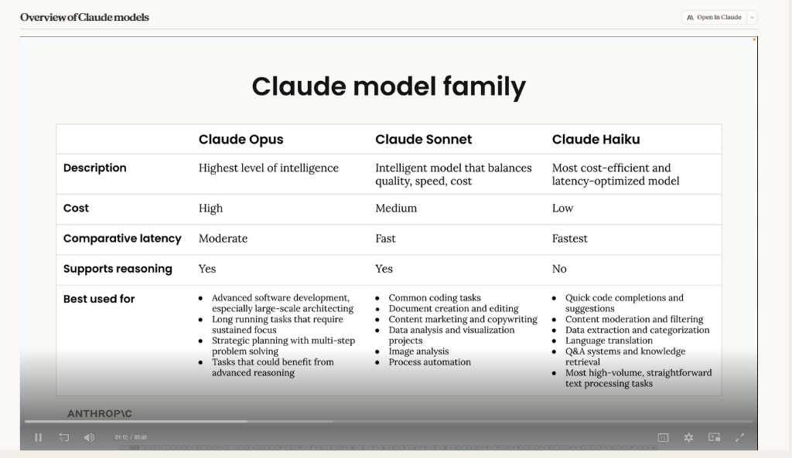
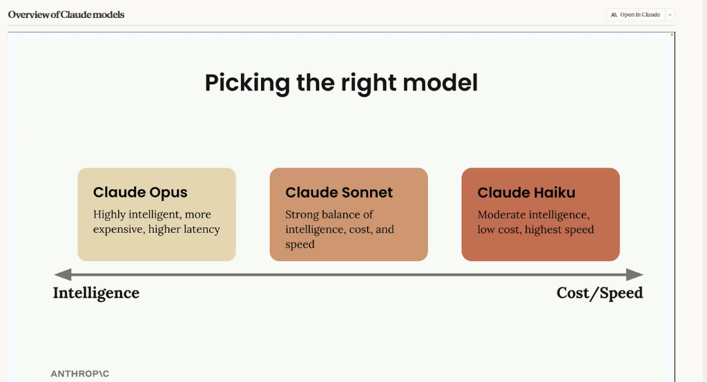

# 01 — Overview of Claude Models

> Course 02 · Section 02 - Anthropic Overview · Lesson 1 of 1 · [Course Index](../README.md) · [Next: Accessing the API →](../03%20-%20Accessing%20Claude%20with%20the%20API/01%20Accessing%20the%20API.md)

---

## 🗺️ Concept Overview

Claude offers three distinct model families, each engineered for a different balance of intelligence, speed, and cost. Rather than relying on a single model across an entire system, architects and developers combine multiple Claude models within the same application to match each specific task to its optimal profile.

---

## 📊 The Claude Model Family

The three model tiers optimize for distinct priorities across performance, cost, and capability:



| Feature | Claude Opus | Claude Sonnet | Claude Haiku |
| :--- | :--- | :--- | :--- |
| **Description** | Highest level of intelligence | Intelligent model that balances quality, speed, cost | Most cost-efficient and latency-optimized model |
| **Cost** | High | Medium | Low |
| **Comparative Latency** | Moderate | Fast | Fastest |
| **Supports Reasoning** | **Yes** | **Yes** | **No** |
| **Best Used For** | • Advanced software development, especially large-scale architecting<br>• Long running tasks that require sustained focus<br>• Strategic planning with multi-step problem solving<br>• Tasks that could benefit from advanced reasoning | • Common coding tasks<br>• Document creation and editing<br>• Content marketing and copywriting<br>• Data analysis and visualization projects<br>• Image analysis<br>• Process automation | • Quick code completions and suggestions<br>• Content moderation and filtering<br>• Data extraction and categorization<br>• Language translation<br>• Q&A systems and knowledge retrieval<br>• Most high-volume, straightforward text processing tasks |

---

## ⚖️ Picking the Right Model

Model selection is a continuous trade-off along a single spectrum balancing **Intelligence** against **Cost and Speed**:



```text
 ◄── INTELLIGENCE                                                      COST / SPEED ──►
┌─────────────────────────┐     ┌─────────────────────────┐     ┌─────────────────────────┐
│       Claude Opus       │     │      Claude Sonnet      │     │      Claude Haiku       │
├─────────────────────────┤     ├─────────────────────────┤     ├─────────────────────────┤
│ Highly intelligent,     │ ──► │ Strong balance of       │ ──► │ Moderate intelligence,  │
│ more expensive,         │     │ intelligence, cost,     │     │ low cost,               │
│ higher latency          │     │ and speed               │     │ highest speed           │
└─────────────────────────┘     └─────────────────────────┘     └─────────────────────────┘
```

### Selection Framework

- **Intelligence Priority $\rightarrow$ Claude Opus:** Choose Opus when the problem demands deep, multi-step logical planning, extensive system architecture, or wicked reasoning problems where answer quality outweighs cost and latency.
- **Balanced Requirements $\rightarrow$ Claude Sonnet:** Choose Sonnet for most practical use cases and production applications. It provides strong coding abilities, precise editing, and high intelligence at fast speeds and moderate cost.
- **Speed & Cost Priority $\rightarrow$ Claude Haiku:** Choose Haiku for real-time, interactive user interfaces and high-volume data processing where sub-second latency and minimal token cost are required.

---

## 🧩 Shared Capabilities & Multi-Model Architecture

### Shared Baseline
All Claude models share foundational core capabilities:
- **Text Generation:** High-quality, natural prose and structured content.
- **Coding:** Code explanation, generation, and syntax formatting.
- **Image Analysis:** Multimodal vision for analyzing charts, diagrams, and visual inputs.

The fundamental difference between tiers is their **optimization focus** (depth of reasoning vs. throughput and cost), not their core interface.

### The Multi-Model Approach
A common and effective design pattern is to use **multiple models collaboratively in the same application**:
1. **Claude Haiku** acts as the front-line triage engine (filtering content, categorizing requests, routing, or extracting parameters).
2. **Claude Sonnet** handles the primary business logic, document generation, and core coding tasks.
3. **Claude Opus** is invoked selectively for high-complexity, multi-step strategic analysis or deep reasoning.

---

## 📌 Quick Reference

```text
┌────────────────────────────────────────────────────────────────────────┐
│                        MODEL SELECTION CHEATSHEET                      │
├───────────────────────┬────────────────────────────────────────────────┤
│ Primary Requirement   │ Recommended Model                              │
├───────────────────────┼────────────────────────────────────────────────┤
│ Deep Reasoning & Plan │ **Claude Opus** (Highest intelligence, higher  │
│                       │  cost/latency)                                 │
│ Everyday Workhorse    │ **Claude Sonnet** (Best balance of quality,    │
│                       │  speed, cost; default choice)                  │
│ High-Volume & Realtime│ **Claude Haiku** (Fastest, lowest cost, no     │
│                       │  deep reasoning)                               │
└───────────────────────┴────────────────────────────────────────────────┘
```

---

## 🛑 Self-Check

### Question 1
According to the Claude model selection spectrum, which model should be your default choice for general document creation, data analysis, and common coding tasks?

<details>
<summary>👉 Reveal Answer & Explanation</summary>

**Answer:** **Claude Sonnet**

**Explanation:** Claude Sonnet is engineered specifically to balance quality, speed, and cost, making it the ideal workhorse model for the majority of practical enterprise use cases, including coding and document workflows.
</details>

---

### Question 2
What is the primary architectural trade-off when selecting Claude Opus instead of Claude Haiku?

<details>
<summary>👉 Reveal Answer & Explanation</summary>

**Answer:** Higher intelligence and reasoning support in exchange for higher token cost and higher latency.

**Explanation:** Opus provides the highest cognitive capabilities for complex planning and multi-step reasoning, whereas Haiku prioritizes near-instantaneous speed and minimal cost for high-volume tasks without reasoning capabilities.
</details>
