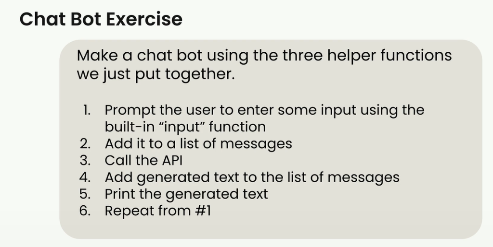
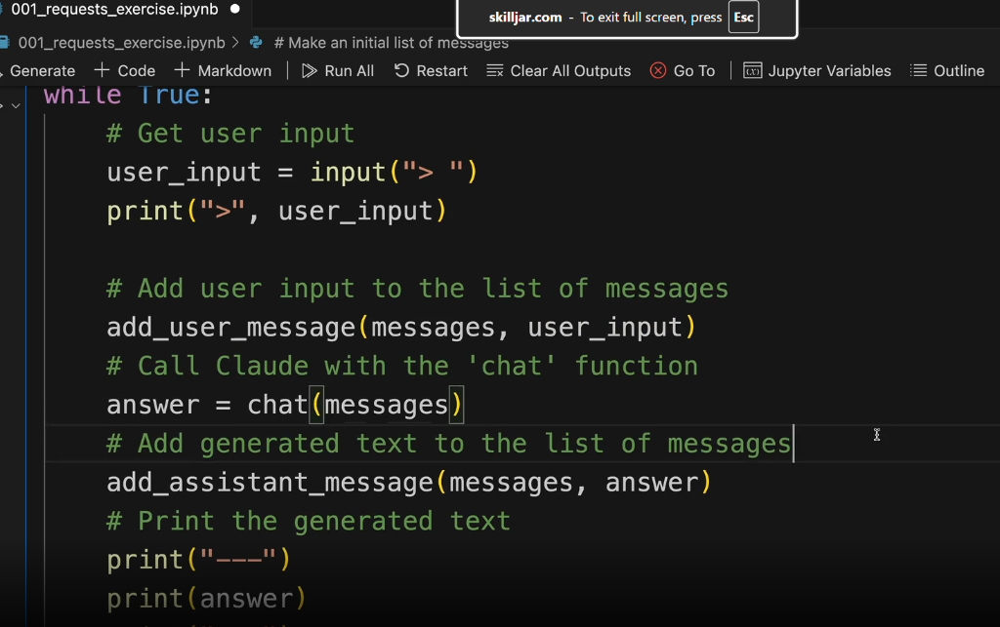

# 05 — Chat Exercise

> Course 02 · Section 03 - Accessing Claude with the API · Lesson 5 of 10 · [← Prev: Multi-Turn Conversations](04%20Multi-Turn%20conversations.md) · [Course Index](../README.md) · [Next: System Prompts →](06%20System%20prompts.md)

---

## 🗺️ Concept Overview

In this hands-on exercise, you apply the three helper functions developed in the previous lesson (`add_user_message`, `add_assistant_message`, and `chat`) to build a continuous, interactive chatbot in Python.

By looping through user input and response collection, you create a conversational interface that automatically maintains context across exchanges.

---

## 📋 Exercise Requirements

Make a chatbot using the three helper functions we just put together:



1. **Prompt the user** to enter some input using the built-in `input` function.
2. **Add it** to a list of messages.
3. **Call the API** using the `chat` function.
4. **Add generated text** to the list of messages.
5. **Print the generated text**.
6. **Repeat from #1**.

---

## 💻 Exercise Solution

Here is the complete implementation matching the exercise requirements from the course notebook (`001_requests_exercise.ipynb`):



```python
from dotenv import load_dotenv
from anthropic import Anthropic

# 1. Environment & Client Setup
load_dotenv()
client = Anthropic()
model = "claude-3-7-sonnet-20250219"

# 2. Helper Functions
def add_user_message(messages: list, text: str):
    user_message = {"role": "user", "content": text}
    messages.append(user_message)

def add_assistant_message(messages: list, text: str):
    assistant_message = {"role": "assistant", "content": text}
    messages.append(assistant_message)

def chat(messages: list) -> str:
    message = client.messages.create(
        model=model,
        max_tokens=1000,
        messages=messages,
    )
    return message.content[0].text

# 3. Initialize Conversation History
messages = []

# 4. Interactive Chat Loop
while True:
    # 1. Get user input
    user_input = input("> ")
    print(">", user_input)

    # 2. Add user input to the list of messages
    add_user_message(messages, user_input)

    # 3. Call Claude with the 'chat' function
    answer = chat(messages)

    # 4. Add generated text to the list of messages
    add_assistant_message(messages, answer)

    # 5. Print the generated text
    print("---")
    print(answer)

    # 6. Repeats automatically from #1 via while loop
```

---

## 🔍 How the Context Accumulates

As you chat in the terminal, the `messages` array continuously grows, preserving the entire conversational context:

```text
Turn 1:
User: > Who wrote the novel 'Neuromancer'?
Claude: ---
        William Gibson wrote 'Neuromancer', published in 1984.

Turn 2:
User: > What other famous books did he write?
Claude: ---
        William Gibson also wrote 'Count Zero' (1986) and 'Mona Lisa Overdrive' (1988), 
        which complete the Sprawl trilogy, as well as 'The Difference Engine' (with Bruce Sterling) 
        and 'The Peripheral'.
```

Because `messages` contains Turn 1 when Turn 2 is dispatched, Claude seamlessly resolves *"he"* to William Gibson.

---

## 📌 Quick Reference

```text
┌────────────────────────────────────────────────────────────────────────┐
│                        CHAT LOOP EXECUTION ORDER                       │
├────────────────────────────────────────────────────────────────────────┤
│ 1. `user_input = input("> ")`                                          │
│ 2. `add_user_message(messages, user_input)`                            │
│ 3. `answer = chat(messages)`                                           │
│ 4. `add_assistant_message(messages, answer)`                           │
│ 5. `print(answer)`                                                     │
│ 6. Next loop iteration                                                 │
└────────────────────────────────────────────────────────────────────────┘
```

---

## 🛑 Self-Check

### Question 1
Why does step 4 (`add_assistant_message(messages, answer)`) need to occur **before** the next iteration's `chat(messages)` call?

<details>
<summary>👉 Reveal Answer & Explanation</summary>

**Answer:** If Claude's answer is not appended to `messages`, then on the next turn when the user provides input, `messages` will contain two consecutive `"user"` messages without an intervening `"assistant"` message. This violates the API's alternating role constraint and causes the API to reject the request with a validation error.
</details>

---

### Question 2
What happens to the input token count on each subsequent turn through the `while True` loop?

<details>
<summary>👉 Reveal Answer & Explanation</summary>

**Answer:** Input tokens increase on each turn because the full conversation history from all prior turns is resent to Claude with every new prompt.
</details>
