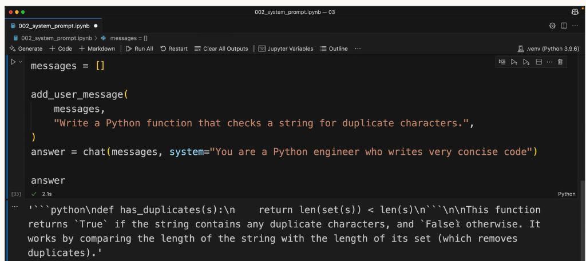

# 07 — System Prompts Exercise

> Course 02 · Section 03 - Accessing Claude with the API · Lesson 7 of 10 · [← Prev: System Prompts](06%20System%20prompts.md) · [Course Index](../README.md) · [Next: Temperature →](08%20Temperature.md)

---

## 🗺️ Concept Overview

In this exercise, you put system prompts into practice to control the conciseness and implementation style of generated code. 

By passing a targeted persona directive to your `chat` helper function, you steer Claude to generate ultra-concise, idiomatic Python code rather than multi-paragraph explanations and verbose iterative loops.

---

## 📋 Exercise Goal: Generating Concise Code

### The Challenge
Instruct Claude to write a Python function that checks whether a given string contains duplicate characters. 

Instead of accepting a generic, verbose answer, guide Claude using a system prompt to write like a seasoned Python developer who prioritizes concise, idiomatic expressions.

### Implementation in Jupyter Notebook (`002_system_prompt.ipynb`)



```python
from dotenv import load_dotenv
from anthropic import Anthropic

load_dotenv()
client = Anthropic()
model = "claude-3-7-sonnet-20250219"

# Helper functions from previous lessons
def add_user_message(messages: list, text: str):
    messages.append({"role": "user", "content": text})

def add_assistant_message(messages: list, text: str):
    messages.append({"role": "assistant", "content": text})

def chat(messages: list, system: str | None = None) -> str:
    params = {
        "model": model,
        "max_tokens": 1000,
        "messages": messages,
    }
    if system:
        params["system"] = system
    message = client.messages.create(**params)
    return message.content[0].text

# 1. Initialize conversation history
messages = []

# 2. Add user prompt
add_user_message(
    messages,
    "Write a Python function that checks a string for duplicate characters.",
)

# 3. Call chat with specialized system prompt
answer = chat(
    messages, 
    system="You are a Python engineer who writes very concise code"
)

# 4. Inspect generated output
print(answer)
```

---

## 🔍 Output & Behavioral Analysis

### The Generated Output:

```python
def has_duplicates(s):
    return len(set(s)) < len(s)
```

> *"This function returns `True` if the string contains any duplicate characters, and `False` otherwise. It works by comparing the length of the string with the length of its set (which removes duplicates)."*

### Why the System Prompt Makes a Difference:

| Without System Prompt (Default) | With System Prompt (`"very concise code"`) |
| :--- | :--- |
| Often creates an explicit `seen = set()` loop with `for char in s:` checks and early returns. | Employs an idiomatic one-liner comparing set length: `len(set(s)) < len(s)`. |
| Emits multiple paragraphs describing time complexity, space complexity, alternative approaches, and testing examples. | Limits commentary to two direct sentences explaining the exact logic. |

The system prompt successfully steered Claude's stylistic profile without requiring any alterations to the user's task prompt.

---

## 📌 Quick Reference

```text
┌────────────────────────────────────────────────────────────────────────┐
│                   PERSONA-STEERED CODE GENERATION                      │
├───────────────────────┬────────────────────────────────────────────────┤
│ Task Prompt           │ Defines WHAT to implement (functional logic)   │
│ System Prompt         │ Defines HOW to implement (concise, idiomatic)  │
│ Dispatch Pattern      │ `chat(messages, system="You are a ...")`       │
│ Resulting Code        │ Single-expression `return len(set(s)) < len(s)`│
└───────────────────────┴────────────────────────────────────────────────┘
```

---

## 🛑 Self-Check

### Question 1
In this exercise, what was the primary advantage of placing the instruction `"You are a Python engineer who writes very concise code"` into the `system` parameter rather than appending it to the user's message?

<details>
<summary>👉 Reveal Answer & Explanation</summary>

**Answer:** Placing the persona in the `system` parameter establishes an overarching behavioral role that governs how Claude structures its code across the entire conversation. It cleanly separates the global stylistic constraints from the specific task input in `messages`.
</details>

---

### Question 2
Why does comparing `len(set(s)) < len(s)` accurately determine if a string contains duplicates?

<details>
<summary>👉 Reveal Answer & Explanation</summary>

**Answer:** A Python `set` only stores unique elements. If a string contains any duplicate characters, converting it to a set removes the duplicates, making `len(set(s))` strictly less than `len(s)`. If all characters are unique, the lengths are identical.
</details>
